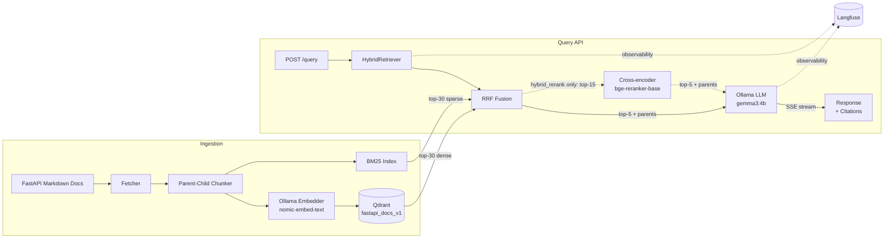
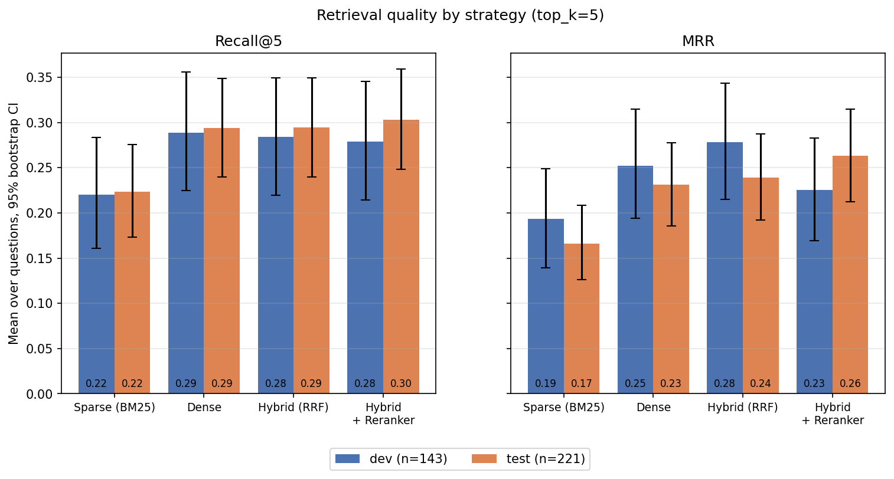
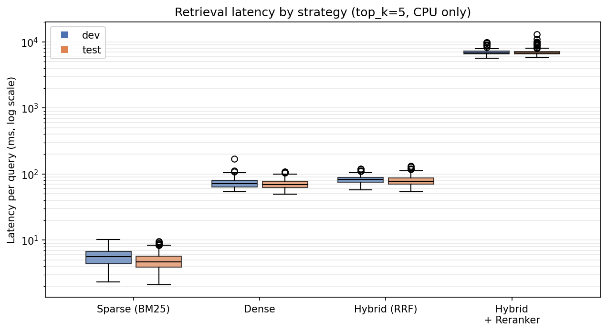

# fastapi-rag-lab

> **RAG over the FastAPI documentation, and the evaluations that show how well it retrieves.**
> Hybrid retrieval (dense + BM25, optional cross-encoder rerank), SSE streaming with
> citations, Langfuse tracing, hand-written orchestration without LangChain.

[](https://www.python.org/downloads/)
[](LICENSE)

I built this to test chunking strategies, hybrid retrieval, and hallucination
evaluation against a corpus I actually know well. Most RAG tutorials stop at
"it works on my demo query". This one measures whether it works on a 30-question golden dataset
and tells you honestly when it doesn't.

Everything runs locally: Ollama for embeddings and generation, Qdrant for
vector storage, Langfuse for traces. No API keys are needed. Every benchmark
number comes from a run committed under [`reports/`](reports/), which records
the code commit, corpus commit, model digests and hardware it ran on.

## Roadmap

- ✅ **Phase 1** — Project scaffold, CI, smoke tests, [ADR-001](docs/decisions/001-chunking-strategy.md)
- ✅ **Phase 2** — Ingestion pipeline (154 markdown docs → 2054 chunks indexed in Qdrant), [ADR-002](docs/decisions/002-ingestion-pipeline.md)
- ✅ **Phase 3** — Hybrid retrieval (dense + BM25 + RRF + bge-reranker-base), [ADR-003](docs/decisions/003-hybrid-retrieval.md)
- ✅ **Phase 4** — `/query` API with SSE streaming, citations, Langfuse tracing per query, [ADR-004](docs/decisions/004-query-api-streaming.md)
- ✅ **Phase 5.1** — RAGAS eval pipeline + 30-query golden dataset + custom citation accuracy metric (pipeline code only; no results committed yet), [ADR-005](docs/decisions/005-evaluation-strategy.md)
- ✅ **Phase 5.2** — A/B retrieval benchmarks (9 configs), comparative analysis with plots, [ADR-006](docs/decisions/006-retrieval-benchmarks.md)
- ✅ **Phase 5.3** — Reproducible retrieval evals: Stack Overflow set (143 dev / 221 test), bootstrap CIs, pinned and recorded runtime, plain hybrid as default, [ADR-007](docs/decisions/007-embedding-runtime.md), [ADR-008](docs/decisions/008-default-retrieval-strategy.md)
- ✅ **Phase 5.4** — Answer faithfulness judge (Claude Haiku 5.5 / Sonnet 5.5) calibrated against 50 human-labelled answers, [ADR-009](docs/decisions/009-faithfulness-judge.md)

**Repo status: retrieval benchmarks and the judge calibration done; judged answer faithfulness on the test questions not yet run.** Latest: Oct 31, 2026 ([commits](https://github.com/egtimer/fastapi-rag-lab/commits/main)).

## Results at a glance

| What | Result | Source |
|---|---|---|
| Retrieval, Stack Overflow test (n = 221), default `hybrid`, k=5 | Recall@5 0.295 [0.240, 0.349], MRR 0.239 [0.192, 0.287], p50 78 ms | `reports/2026-10-20-so-test-ollama-0.35.1` |
| Retrieval, golden set (n = 30), `hybrid`, k=5 | Recall@5 0.900 [0.767, 1.000], MRR 0.817 [0.700, 0.917] | `reports/2026-10-20-golden30-ollama-0.35.1` |
| Cross-encoder reranker vs plain hybrid, MRR at k=5 | dev −0.052 [−0.105, +0.001], test +0.024 [−0.016, +0.065]: no detectable effect, about 80× the latency | [ADR-008](docs/decisions/008-default-retrieval-strategy.md) |
| April's golden numbers | Reproduce query by query on Ollama 0.20.7, not on 0.5.7 or 0.35.1; the embedding runtime is now pinned and checked | [ADR-007](docs/decisions/007-embedding-runtime.md) |
| Faithfulness judge vs human (n = 50) | Sonnet 5.5 kappa 0.82 [0.63, 0.96]; Haiku 5.5 kappa 0.73 [0.51, 0.91] (47 parsed) | [ADR-009](docs/decisions/009-faithfulness-judge.md) |
| `gemma3:4b` answers fully supported by their sources (human labels, 50 dev questions) | 17 of 50 | `reports/2026-10-30-judge-items-so-dev-50` |
| Judged faithfulness on golden + Stack Overflow test (251 questions) | Not run in this phase | [ADR-009](docs/decisions/009-faithfulness-judge.md) |

Intervals are 95% bootstrap CIs over questions. All runs are on CPU (4 cores)
and record their runtime in the report's provenance.

## Why this project exists

I've been building production RAG systems for clients over the last year, and
most of what I've learned does not fit in a tutorial. The interesting problems
are in the parts nobody writes blog posts about:

- Chunking that preserves semantic boundaries without losing context.
- Measuring retrieval quality before measuring generation quality.
- Knowing when a bad answer is the retriever's fault, the chunker's fault,
  or the model's fault.
- Catching hallucinations before they reach the user.

This repository is where I work those problems out on public data, so I can
talk about them openly.

## Engineering principles

Decisions deliberately taken in this repo, with rationale linked when they
warrant an ADR:

- **No LangChain, no LlamaIndex.** Orchestration is hand-written for control
  over failure modes. LangChain abstractions become liabilities in production
  when something fails — debugging a 5-level chain of polymorphic abstractions
  is brutal. See [ADR-003](docs/decisions/003-hybrid-retrieval.md).
- **Real services over mocks.** Integration tests run against real Ollama + real
  Qdrant and are skipped when those services are absent. Unit tests cover
  metrics and schemas, and one test (`tests/ingest/test_embedder.py`)
  monkeypatches the HTTP client. Mocks give false confidence: tests pass but
  the system fails in production because the mock did not reflect real
  behaviour, so I prefer real services wherever practical.
- **Observability from day one.** Langfuse traces every query (retrieval span +
  generation span + total latency). You cannot optimise what you cannot measure.
- **ADRs for every significant decision.** Future-me (and reviewers) need to
  understand the why, not just the what. See [`docs/decisions/`](docs/decisions/).
- **Honest about limitations.** See [Known limitations](#known-limitations) below.

## Architecture



## Stack

- Python 3.12+
- FastAPI + Pydantic v2
- Qdrant 1.12.4 (self-hosted via Docker)
- Ollama 0.35.1, pinned ([ADR-007](docs/decisions/007-embedding-runtime.md)): `nomic-embed-text` (embeddings), `gemma3:4b` (generation)
- `rank_bm25` for sparse retrieval
- `sentence-transformers` for the optional cross-encoder reranker (`BAAI/bge-reranker-base`, pinned revision)
- Langfuse (self-hosted via Docker) for observability
- RAGAS for evaluation metrics (Phase 5.1)
- `uv` for dependency management
- `pytest` integration tests against real services
- GitHub Actions: CI (lint and the tests that need no services) and a weekly retrieval eval

## Running it locally

### Prerequisites

1. Docker and Docker Compose (for Qdrant, Langfuse and Ollama)
2. Ollama runs from docker compose, pinned to 0.35.1. After `docker compose up -d`, pull the models:

   ```bash
   docker compose exec ollama ollama pull nomic-embed-text
   docker compose exec ollama ollama pull gemma3:4b
   ```

   A host Ollama works only at exactly the pinned version, because the embeddings
   depend on the Ollama server version, not only on the model
   ([ADR-007](docs/decisions/007-embedding-runtime.md)).
3. Python 3.12+ with [uv](https://docs.astral.sh/uv/)

### Start services

```bash
docker compose up -d
uv sync
```

### Running ingestion

The ingestion pipeline clones the FastAPI docs at a pinned commit, chunks them
using a heading-aware parent-child strategy, embeds children via Ollama, and
upserts everything into Qdrant.

```bash
export OLLAMA_HOST=http://localhost:11434

# Langfuse credentials (matches docker-compose.yml defaults):
export LANGFUSE_PUBLIC_KEY=pk-lf-local-dev
export LANGFUSE_SECRET_KEY=sk-lf-local-dev
export LANGFUSE_HOST=http://localhost:3000

python -m fastapi_rag_lab.ingest
```

After a successful run:
- `data/raw/manifest.json` contains ingestion metadata (file counts, timestamps)
- Qdrant dashboard at http://localhost:6333/dashboard shows the `fastapi_docs_v1` collection
- Langfuse at http://localhost:3000 shows the `ingest_run` trace with per-stage spans

### Hybrid retrieval (programmatic)

```python
from fastapi_rag_lab.retrieval.hybrid import HybridRetriever

retriever = HybridRetriever()
results = retriever.retrieve("How do I handle background tasks in FastAPI?")
for r in results:
    print(f"{r.rerank_score:.3f} | {r.chunk_text[:80]}...")
```

See [ADR-003](docs/decisions/003-hybrid-retrieval.md) for the design rationale
(why RRF over score normalisation, why bge-reranker-base, why hybrid over pure
dense).

### Query API

Start the server:

```bash
export OLLAMA_HOST=http://localhost:11434
uv run uvicorn fastapi_rag_lab.api.app:app --reload --port 8000
```

`POST /query` runs hybrid retrieval (dense + BM25 with RRF; set
`RAG_RETRIEVAL_STRATEGY=hybrid_rerank` to add the cross-encoder, see
[ADR-008](docs/decisions/008-default-retrieval-strategy.md)), builds a prompt with the top-K parent
chunks as context, and streams the LLM response token-by-token via SSE.
Citations (source chunks used) arrive as the final event before the stream
closes.

```bash
curl -N -X POST http://localhost:8000/query \
  -H "Content-Type: application/json" \
  -d '{"query": "How do I handle exceptions in FastAPI?", "top_k": 5}'
```

For a non-streaming JSON response:

```bash
curl -X POST http://localhost:8000/query \
  -H "Content-Type: application/json" \
  -d '{"query": "How do I handle exceptions in FastAPI?", "top_k": 5, "stream": false}'
```

See [ADR-004](docs/decisions/004-query-api-streaming.md) for why SSE over
WebSockets, why streaming-first, and how Langfuse tracing is structured.

## Testing

161 tests covering ingestion, retrieval, the query API, and the eval
pipeline. 143 need no services, network or models; the other 18 need Qdrant and
Ollama and are skipped when those are not reachable.

```bash
export OLLAMA_HOST=http://localhost:11434
uv run pytest tests/ -v
```

CI (`.github/workflows/ci.yml`) runs `ruff check`, `ruff format --check` and the
tests that need no services, network or models:

```bash
uv run pytest -m "not network and not ollama and not qdrant and not integration"
```

### Retrieval eval workflow

`.github/workflows/retrieval-eval.yml` runs the sparse, dense and hybrid
benchmarks on the golden and StackOverflow datasets against Qdrant and Ollama
containers started on the runner. It makes no API calls, and it runs weekly and
on manual dispatch rather than on push, since it ingests the full corpus. When a
committed reference run is configured for a dataset, `python -m
fastapi_rag_lab.eval.check_regression` compares the new `hybrid_k5` results with
it by paired bootstrap over queries, and fails if a metric drops by more than
the limit or its whole confidence interval lies below zero. It refuses to
compare runs with different dataset hashes or query sets.

## Design decisions

Significant architectural choices are documented in
[`docs/decisions/`](docs/decisions/):

- [001 — Chunking strategy](docs/decisions/001-chunking-strategy.md): why parent-child, why heading-aware
- [002 — Ingestion pipeline](docs/decisions/002-ingestion-pipeline.md): pipeline shape, manifest tracking
- [003 — Hybrid retrieval](docs/decisions/003-hybrid-retrieval.md): RRF, reranker choice, no-LangChain rationale
- [004 — Query API streaming](docs/decisions/004-query-api-streaming.md): SSE vs WebSockets, citation format, Langfuse spans
- [005 — Evaluation strategy](docs/decisions/005-evaluation-strategy.md): RAGAS + custom citation accuracy, threshold rationale, golden-dataset construction
- [006 — Retrieval benchmarks](docs/decisions/006-retrieval-benchmarks.md): retrieval-only A/B methodology, 9-config cross-product, re-run instructions
- [007 — Embedding runtime](docs/decisions/007-embedding-runtime.md): why April's numbers did not reproduce, and pinning and recording Ollama, the reranker and Qdrant
- [008 — Default retrieval strategy](docs/decisions/008-default-retrieval-strategy.md): plain hybrid over hybrid + rerank, chosen on the dev split (a negative result)
- [009 — Faithfulness judge](docs/decisions/009-faithfulness-judge.md): an LLM judge of whether answers stay within their sources, calibrated against human labels

## Evaluation

The RAG pipeline is evaluated against a hand-built golden dataset of 30 real
FastAPI questions across five categories (factual, conceptual, code,
error_handling, advanced). Each entry carries a reference answer and the
relative paths of the source documents that should be cited.

Per-query metrics:

- **Faithfulness** (RAGAS): is the answer grounded in the retrieved context?
- **Answer Relevancy** (RAGAS): does the answer actually address the question?
- **Context Precision** (RAGAS): were the retrieved chunks relevant?
- **Context Recall** (RAGAS): was all necessary context retrieved?
- **Citation Accuracy** (custom): F1 over returned source IDs vs. ground truth.

Run the full suite:

```bash
OLLAMA_HOST=http://localhost:11434 uv run python tests/eval/run_eval.py
```

The runner writes a timestamped JSON report to `tests/eval/results/`,
prints a summary table to stdout, and exits non-zero if any threshold
fails. See [ADR-005](docs/decisions/005-evaluation-strategy.md) for the
methodology, threshold rationale, and the trade-offs of using a small
local model as both producer and judge.

### Answer faithfulness: judge calibration

The RAGAS judge above is the same small model that writes the answers. To
check answers with something stronger, a Claude judge reads the question, the
five sources the generator saw and the answer, and says whether the answer is
`supported` by those sources or `unsupported`. It does not judge whether the
answer is useful. Before using it for any reported number, it was calibrated
against human labels on 50 Stack Overflow dev questions, answered through the
API's own path (`hybrid`, top_k 5, `gemma3:4b` on Ollama 0.35.1).

The labelling rule:

- `supported` means faithful to the five sources, not a useful answer.
- Any material claim that is not in the sources is `unsupported`, even if it
  is true of FastAPI.
- An invented quotation, or attributing to a source something it does not
  say, is `unsupported`.

| Judge | n | Accuracy | Cohen's kappa | On human `supported` (n = 17) | On human `unsupported` | Cost per answer |
|---|---|---|---|---|---|---|
| Claude Haiku 5.5 | 47 | 0.87 [0.77, 0.96] | 0.73 [0.51, 0.91] | 0.88 [0.70, 1.00] | 0.87 [0.73, 0.97] (n = 30) | $0.00054 |
| Claude Sonnet 5.5 | 50 | 0.92 [0.84, 0.98] | 0.82 [0.63, 0.96] | 0.88 [0.70, 1.00] | 0.94 [0.85, 1.00] (n = 33) | $0.0089 |

Haiku returned three replies that were not valid JSON; all three answers were
labelled `unsupported` by the human, so excluding them flatters Haiku (41 of
50 matches when they count as misses). The two judges' intervals overlap: 50
answers and one labeller do not separate them. The human found 17 of the 50
answers fully supported by their sources. Calibration cost: $0.47 in total.
Judging the 251 golden and Stack Overflow test questions is not run in this
phase. The judge prompt stays as it was frozen before the labels were read;
making the citation rule explicit in it, and forcing structured output for
Haiku, are future work that needs a new set of human labels to validate.
Details, confusion matrices and the commands are in
[ADR-009](docs/decisions/009-faithfulness-judge.md); the runs are in
`reports/2026-10-30-judge-items-so-dev-50` and `reports/2026-10-31-judge-*`.

## Retrieval benchmarks

Retrieval-only benchmarks (no LLM judge) across four strategies (BM25 only,
dense only, hybrid with RRF, hybrid plus the cross-encoder reranker) and
k = 3, 5, 10, on two datasets:

- **Golden set**: 30 hand-written questions with the docs pages that answer them.
- **Stack Overflow set**: 364 top-voted `fastapi` questions labelled with the
  docs pages that answerers linked (CC BY-SA 4.0, see
  [`tests/eval/stackoverflow/`](tests/eval/stackoverflow/)), split into 143 dev
  and 221 test questions. The labels are noisy (some links are background
  reading), so the set measures "found a page a human linked"; absolute numbers
  are low and only comparisons between strategies on the same questions are
  meaningful.

Every run below was made on the reference runtime (Ollama 0.35.1,
`nomic-embed-text` `0a109f42…`, reranker revision `2cfc18c9…`, Qdrant 1.12.4)
on an AMD EPYC 7763 with 4 logical cores and 16 GB RAM, CPU only; the full
provenance is in each report. Intervals are 95% bootstrap CIs over questions
(10,000 resamples, seed 0). See [ADR-006](docs/decisions/006-retrieval-benchmarks.md)
for the method.





Both plots come from the committed reports:
`python -m fastapi_rag_lab.eval.report_plots --run dev=reports/2026-10-20-so-dev-ollama-0.35.1 --run test=reports/2026-10-20-so-test-ollama-0.35.1 --out docs/benchmarks`.

### Stack Overflow test split (n = 221), run once after the choice was made on dev

`reports/2026-10-20-so-test-ollama-0.35.1`

| Strategy (k=5) | Recall@5 | MRR | nDCG@5 | p50 / p95 latency |
|---|---|---|---|---|
| Sparse (BM25) | 0.223 [0.173, 0.275] | 0.166 [0.126, 0.208] | 0.168 [0.128, 0.209] | 5 / 7 ms |
| Dense | 0.294 [0.240, 0.349] | 0.231 [0.186, 0.277] | 0.219 [0.178, 0.260] | 70 / 92 ms |
| Hybrid (RRF), default | 0.295 [0.240, 0.349] | 0.239 [0.192, 0.287] | 0.229 [0.186, 0.274] | 78 / 103 ms |
| Hybrid + reranker | 0.303 [0.248, 0.359] | 0.263 [0.212, 0.315] | 0.244 [0.199, 0.290] | 6,786 / 9,614 ms |

### Stack Overflow dev split (n = 143), used to choose the default

`reports/2026-10-20-so-dev-ollama-0.35.1`

| Strategy (k=5) | Recall@5 | MRR | nDCG@5 | p50 / p95 latency |
|---|---|---|---|---|
| Sparse (BM25) | 0.220 [0.161, 0.283] | 0.193 [0.140, 0.249] | 0.167 [0.123, 0.214] | 6 / 9 ms |
| Dense | 0.289 [0.225, 0.356] | 0.252 [0.194, 0.315] | 0.231 [0.177, 0.287] | 71 / 96 ms |
| Hybrid (RRF), default | 0.284 [0.220, 0.350] | 0.278 [0.215, 0.343] | 0.239 [0.184, 0.294] | 84 / 103 ms |
| Hybrid + reranker | 0.279 [0.214, 0.346] | 0.226 [0.169, 0.283] | 0.213 [0.163, 0.266] | 6,805 / 9,698 ms |

### Golden set (n = 30)

`reports/2026-10-20-golden30-ollama-0.35.1`

| Strategy (k=5) | Recall@5 | MRR | nDCG@5 | p50 / p95 latency |
|---|---|---|---|---|
| Sparse (BM25) | 0.883 [0.767, 0.983] | 0.612 [0.486, 0.733] | 0.677 [0.561, 0.785] | 6 / 9 ms |
| Dense | 0.933 [0.833, 1.000] | 0.719 [0.600, 0.833] | 0.775 [0.669, 0.868] | 75 / 92 ms |
| Hybrid (RRF), default | 0.900 [0.767, 1.000] | 0.817 [0.700, 0.917] | 0.838 [0.721, 0.938] | 76 / 103 ms |
| Hybrid + reranker | 0.900 [0.800, 1.000] | 0.679 [0.547, 0.806] | 0.734 [0.616, 0.845] | 6,738 / 9,227 ms |

### The reranker does not pay for itself

The API used to rerank every query. Paired differences, hybrid + reranker minus
hybrid, at k=5:

| Dataset | Recall@5 | MRR |
|---|---|---|
| Stack Overflow dev (n = 143) | -0.005 [-0.057, +0.046] | -0.052 [-0.105, +0.001] |
| Stack Overflow test (n = 221) | +0.009 [-0.026, +0.043] | +0.024 [-0.016, +0.065] |
| Golden (n = 30) | +0.000 [-0.100, +0.100] | -0.138 [-0.256, -0.025] |

On Stack Overflow every interval contains zero, and the MRR difference changes
sign between dev and test: the reranker's effect there is within the noise,
in either direction. On the golden set it lowers MRR. It always costs about 80
times the latency on this CPU (p50 around 6.8 s against 80 ms). Plain `hybrid`
is the default and `RAG_RETRIEVAL_STRATEGY=hybrid_rerank` turns the reranker
back on. The choice was made on dev before the test split was run, and nothing
changed after it; see [ADR-008](docs/decisions/008-default-retrieval-strategy.md).
This is a result about this model on CPU with these labels, not about
cross-encoders in general. Hybrid and dense are also within the noise of each
other on Stack Overflow; hybrid's higher MRR over dense shows only on the
golden set (+0.097 [+0.000, +0.197] at k=5).

### April's numbers

The first benchmark (`reports/2026-04-17-golden30-benchmark`) reported a
higher hybrid Recall@5 on the golden set than the pinned runtime gives
(0.900 [0.767, 1.000]). It reproduces exactly, query by query, on Ollama
0.20.7, the version it most likely ran on, and not on 0.5.7 or 0.35.1: Ollama
0.30.0 changed how `nomic-embed-text` handles case, which changes the vectors
of the same model. Why, and what now
prevents a silent change of runtime, is in
[ADR-007](docs/decisions/007-embedding-runtime.md).

### Re-running benchmarks

```bash
QDRANT_URL=http://localhost:6333 OLLAMA_HOST=http://localhost:11434 \
  uv run python tests/eval/run_benchmarks.py --dataset tests/eval/stackoverflow/dev.json \
  --strategies sparse,dense,hybrid,hybrid_rerank --top-k 3,5,10 --run-id my-run --resume
```

Writes `reports/<run-id>/benchmark.json` (with a provenance block) and
`analysis.json`; plots only if `--plots-dir` is given. The benchmark refuses an
Ollama runtime that differs from the one that built the index. `--resume`
continues an interrupted run from its checkpoint.
`python -m fastapi_rag_lab.eval.compare_runs reports/<a> reports/<b>` compares
two runs query by query.

## Known limitations

This section will grow as the project does. Things I already know will be
limitations:

- The gold dataset is hand-built and small (30 queries, document-level labels).
  Statistical claims are limited accordingly.
- Running everything locally on a single machine means latency numbers
  depend heavily on hardware; each report records the machine it ran on.
- The Stack Overflow labels are the pages answerers linked, not judged
  relevance; their precision has not been measured yet (a 60-pair sample is
  in `tests/eval/stackoverflow/label_audit/`, waiting for review).
- The faithfulness judge is calibrated on 50 answers labelled by one person;
  its agreement numbers have wide intervals, and judged faithfulness on the
  test questions has not been run.
- The Qdrant client (1.17.1) is newer than the server (1.12.4) by more than the
  client supports. Both are recorded in every report; aligning them is pending
  ([ADR-007](docs/decisions/007-embedding-runtime.md)).
- `gemma3:4b` is a small model. A larger model would likely improve
  generation quality but the point here is reproducibility, not peak
  accuracy.
- No multilingual support. FastAPI docs are English, the retriever is
  English-only.
- Ingestion re-processes everything on each run. For a corpus this size
  that's fine (a few minutes). Incremental re-ingestion is not worth the
  complexity yet.
- `tiktoken` cl100k_base is a proxy for nomic-embed-text's actual tokenizer.
  Close enough for chunk sizing, but token counts in the manifest are
  approximate.
- Heading-based parent segmentation can produce unbalanced parents. Some
  FastAPI doc sections are much longer than 1024 tokens and get accepted
  as oversized rather than split mid-paragraph.

## License

The code is MIT. See [LICENSE](LICENSE).

Data this repo uses but did not write:

- **Corpus:** the English FastAPI documentation (`docs/en/docs/`) of
  [fastapi/fastapi](https://github.com/fastapi/fastapi), MIT, Copyright (c) 2018 Sebastián Ramírez.
  It is downloaded at a pinned commit by the ingestion step and not redistributed here.
- **Stack Overflow set:** question titles and metadata in
  [`tests/eval/stackoverflow/`](tests/eval/stackoverflow/), CC BY-SA 4.0, with per-item
  attribution; see its [LICENSE.md](tests/eval/stackoverflow/LICENSE.md).
