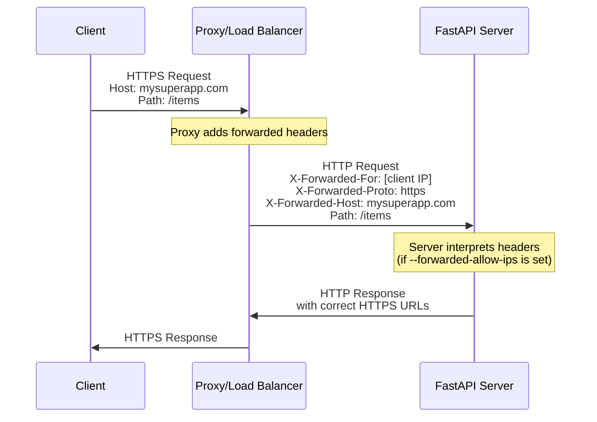
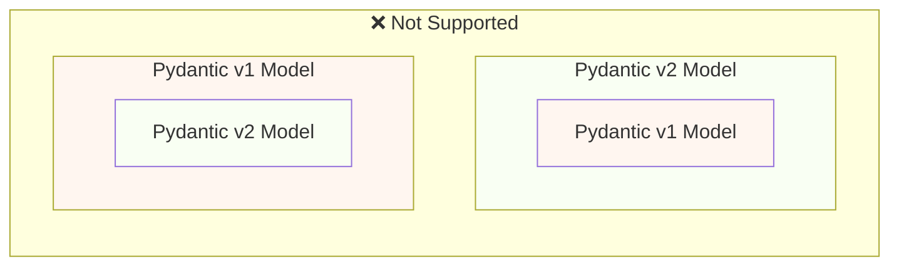
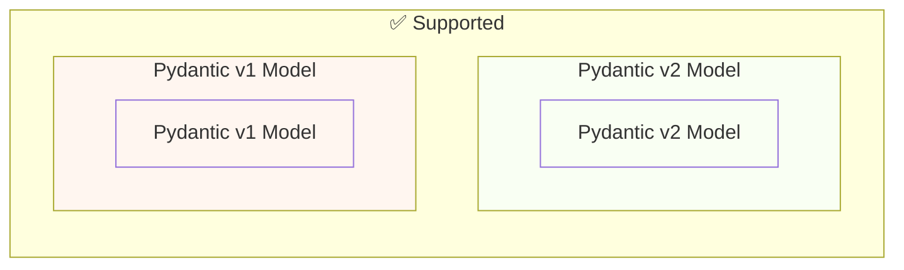
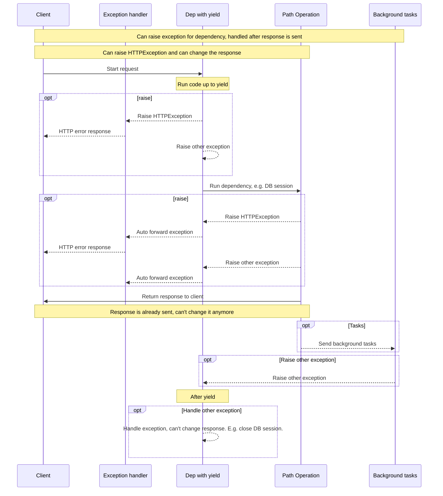
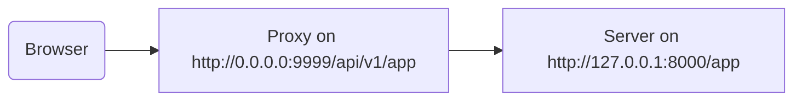

# Judge calibration: labelling sheet

For each item, read the question, the sources the model was given and its
answer, then write one label per item in `labels.csv` (same folder):

- `supported`: every factual claim in the answer (what FastAPI does, how an
  API or parameter behaves, code presented as working) is stated in the
  sources or follows directly from them. Rewording, summarising and generic
  connecting text are fine. Saying the sources do not cover the question is
  supported when they indeed do not.
- `unsupported`: at least one claim is not in the sources or contradicts them,
  including code or parameter names the sources do not show, and claiming the
  sources lack something they contain.
- `unsure`: you cannot decide; these items are left out of the agreement.

Judge support only, not whether the answer is helpful or complete. Use what is
in the sources, not what you know about FastAPI. `note` is optional. The
judge's verdicts are not in this folder; do not look at judge runs before
finishing.


## j-01: How to redirect from one domain to another and set cookies or headers for the other domain?

Question: [so_73547776](https://stackoverflow.com/questions/73547776/how-to-redirect-from-one-domain-to-another-and-set-cookies-or-headers-for-the-ot) (CC BY-SA 4.0)

<details>
<summary>Source 1: advanced/middleware.md (Advanced Middleware { #advanced-middleware } > `TrustedHostMiddleware` { #trustedhostmiddleware })</summary>

Enforces that all incoming requests have a correctly set `Host` header, in order to guard against HTTP Host Header attacks.

{* ../../docs_src/advanced_middleware/tutorial002_py310.py hl[2,6:8] *}

The following arguments are supported:

`allowed_hosts` - A list of domain names that should be allowed as hostnames. Wildcard domains such as `*.example.com` are supported for matching subdomains. To allow any hostname either use `allowed_hosts=["*"]` or omit the middleware.

`www_redirect` - If set to True, requests to non-www versions of the allowed hosts will be redirected to their www counterparts. Defaults to `True`.

If an incoming request does not validate correctly then a `400` response will be sent.

</details>

<details>
<summary>Source 2: deployment/https.md (About HTTPS { #about-https } > Proxy Forwarded Headers { #proxy-forwarded-headers })</summary>

When using a proxy to handle HTTPS, your **application server** (for example Uvicorn via FastAPI CLI) doesn't known anything about the HTTPS process, it communicates with plain HTTP with the **TLS Termination Proxy**.

This **proxy** would normally set some HTTP headers on the fly before transmitting the request to the **application server**, to let the application server know that the request is being **forwarded** by the proxy.

/// note | Technical Details

The proxy headers are:

[X-Forwarded-For](https://developer.mozilla.org/en-US/docs/Web/HTTP/Reference/Headers/X-Forwarded-For)

[X-Forwarded-Proto](https://developer.mozilla.org/en-US/docs/Web/HTTP/Reference/Headers/X-Forwarded-Proto)

[X-Forwarded-Host](https://developer.mozilla.org/en-US/docs/Web/HTTP/Reference/Headers/X-Forwarded-Host)

///

Nevertheless, as the **application server** doesn't know it is behind a trusted **proxy**, by default, it wouldn't trust those headers.

But you can configure the **application server** to trust the *forwarded* headers sent by the **proxy**. If you are using FastAPI CLI, you can use the *CLI Option* `--forwarded-allow-ips` to tell it from which IPs it should trust those *forwarded* headers.

For example, if the **application server** is only receiving communication from the trusted **proxy**, you can set it to `--forwarded-allow-ips="*"` to make it trust all incoming IPs, as it will only receive requests from whatever is the IP used by the **proxy**.

This way the application would be able to know what is its own public URL, if it is using HTTPS, the domain, etc.

This would be useful for example to properly handle redirects.

/// tip

You can learn more about this in the documentation for [Behind a Proxy - Enable Proxy Forwarded Headers](../advanced/behind-a-proxy.md#enable-proxy-forwarded-headers)

///

</details>

<details>
<summary>Source 3: advanced/behind-a-proxy.md (Behind a Proxy { #behind-a-proxy } > Proxy Forwarded Headers { #proxy-forwarded-headers })</summary>

A **proxy** in front of your application would normally set some headers on the fly before sending the requests to your **server** to let the server know that the request was **forwarded** by the proxy, letting it know the original (public) URL, including the domain, that it is using HTTPS, etc.

The **server** program (for example **Uvicorn** via **FastAPI CLI**) is capable of interpreting these headers, and then passing that information to your application.

But for security, as the server doesn't know it is behind a trusted proxy, it won't interpret those headers.

/// note | Technical Details

The proxy headers are:

[X-Forwarded-For](https://developer.mozilla.org/en-US/docs/Web/HTTP/Reference/Headers/X-Forwarded-For)

[X-Forwarded-Proto](https://developer.mozilla.org/en-US/docs/Web/HTTP/Reference/Headers/X-Forwarded-Proto)

[X-Forwarded-Host](https://developer.mozilla.org/en-US/docs/Web/HTTP/Reference/Headers/X-Forwarded-Host)

///

You can start FastAPI CLI with the *CLI Option* `--forwarded-allow-ips` and pass the IP addresses that should be trusted to read those forwarded headers.

If you set it to `--forwarded-allow-ips="*"` it would trust all the incoming IPs.

If your **server** is behind a trusted **proxy** and only the proxy talks to it, this would make it accept whatever is the IP of that **proxy**.

<div class="termy">

```console
$ fastapi run --forwarded-allow-ips="*"

<span style="color: green;">INFO</span>:     Uvicorn running on http://127.0.0.1:8000 (Press CTRL+C to quit)
```
</div>

For example, let's say you define a *path operation* `/items/`:

{* ../../docs_src/behind_a_proxy/tutorial001_01_py310.py hl[6] *}

If the client tries to go to `/items`, by default, it would be redirected to `/items/`.

But before setting the *CLI Option* `--forwarded-allow-ips` it could redirect to `http://localhost:8000/items/`.

But maybe your application is hosted at `https://mysuperapp.com`, and the redirection should be to `https://mysuperapp.com/items/`.

By setting `--proxy-headers` now FastAPI would be able to redirect to the right location. 😎


```
https://mysuperapp.com/items/
```
/// tip

If you want to learn more about HTTPS, check the guide [About HTTPS](../deployment/https.md).

///

Here's a visual representation of how the **proxy** adds forwarded headers between the client and the **application server**:



The **proxy** intercepts the original client request and adds the special *forwarded* headers (`X-Forwarded-*`) before passing the request to the **application server**.

These headers preserve information about the original request that would otherwise be lost:

**X-Forwarded-For**: The original client's IP address

**X-Forwarded-Proto**: The original protocol (`https`)

**X-Forwarded-Host**: The original host (`mysuperapp.com`)

When **FastAPI CLI** is configured with `--forwarded-allow-ips`, it trusts these headers and uses them, for example to generate the correct URLs in redirects.

</details>

<details>
<summary>Source 4: tutorial/cors.md (CORS (Cross-Origin Resource Sharing) { #cors-cross-origin-resource-sharing } > Use `CORSMiddleware` { #use-corsmiddleware })</summary>

You can configure it in your **FastAPI** application using the `CORSMiddleware`.

Import `CORSMiddleware`.

Create a list of allowed origins (as strings).

Add it as a "middleware" to your **FastAPI** application.

You can also specify whether your backend allows:

Credentials (Authorization headers, Cookies, etc).

Specific HTTP methods (`POST`, `PUT`) or all of them with the wildcard `"*"`.

Specific HTTP headers or all of them with the wildcard `"*"`.

{* ../../docs_src/cors/tutorial001_py310.py hl[2,6:11,13:19] *}

The default parameters used by the `CORSMiddleware` implementation are restrictive by default, so you'll need to explicitly enable particular origins, methods, or headers, in order for browsers to be permitted to use them in a Cross-Domain context.

The following arguments are supported:

`allow_origins` - A list of origins that should be permitted to make cross-origin requests. E.g. `['https://example.org', 'https://www.example.org']`. You can use `['*']` to allow any origin.

`allow_origin_regex` - A regex string to match against origins that should be permitted to make cross-origin requests. e.g. `'https://.*\.example\.org'`.

`allow_methods` - A list of HTTP methods that should be allowed for cross-origin requests. Defaults to `['GET']`. You can use `['*']` to allow all standard methods.

`allow_headers` - A list of HTTP request headers that should be supported for cross-origin requests. Defaults to `[]`. You can use `['*']` to allow all headers. The `Accept`, `Accept-Language`, `Content-Language` and `Content-Type` headers are always allowed for [simple CORS requests](https://developer.mozilla.org/en-US/docs/Web/HTTP/CORS#simple_requests).

`allow_credentials` - Indicate that cookies should be supported for cross-origin requests. Defaults to `False`.

None of `allow_origins`, `allow_methods` and `allow_headers` can be set to `['*']` if `allow_credentials` is set to `True`. All of them must be [explicitly specified](https://developer.mozilla.org/en-US/docs/Web/HTTP/CORS#credentialed_requests_and_wildcards).

`expose_headers` - Indicate any response headers that should be made accessible to the browser. Defaults to `[]`.

`max_age` - Sets a maximum time in seconds for browsers to cache CORS responses. Defaults to `600`.

The middleware responds to two particular types of HTTP request...

These are any `OPTIONS` request with `Origin` and `Access-Control-Request-Method` headers.

In this case the middleware will intercept the incoming request and respond with appropriate CORS headers, and either a `200` or `400` response for informational purposes.

Any request with an `Origin` header. In this case the middleware will pass the request through as normal, but will include appropriate CORS headers on the response.

</details>

<details>
<summary>Source 5: advanced/response-headers.md (Response Headers { #response-headers } > Use a `Response` parameter { #use-a-response-parameter })</summary>

You can declare a parameter of type `Response` in your *path operation function* (as you can do for cookies).

And then you can set headers in that *temporal* response object.

{* ../../docs_src/response_headers/tutorial002_py310.py hl[1, 7:8] *}

And then you can return any object you need, as you normally would (a `dict`, a database model, etc).

And if you declared a `response_model`, it will still be used to filter and convert the object you returned.

**FastAPI** will use that *temporal* response to extract the headers (also cookies and status code), and will put them in the final response that contains the value you returned, filtered by any `response_model`.

You can also declare the `Response` parameter in dependencies, and set headers (and cookies) in them.

</details>

**Answer:**

Based on the provided context, here’s how you can redirect from one domain to another and set cookies or headers for the other domain using FastAPI:

**1. Using `CORSMiddleware` for Cross-Origin Requests and Redirects:**

   *   The `CORSMiddleware` allows you to configure Cross-Origin Resource Sharing (CORS) settings.  You can define allowed origins, methods, headers, and whether credentials (cookies) are allowed.
   *   You can use it to handle redirects to the correct domain with the correct protocol (HTTPS) and headers.
   *   You can set headers like `X-Forwarded-Host` and `X-Forwarded-Proto` which are essential when the application is behind a proxy.

**2.  `--forwarded-allow-ips` for Proxy Headers:**

   *   If your FastAPI application is behind a trusted proxy, you *must* configure it to trust the forwarded headers from the proxy.  This is done using the `fastapi.cli` command with the `--forwarded-allow-ips` option.
   *   For example: `fastapi run --forwarded-allow-ips="*"`. This tells the server to trust any incoming IPs. This is particularly important when setting headers such as `X-Forwarded-Host` and `X-Forwarded-Proto`.

**3.  Setting Response Headers (Temporal Response Object):**

   *   You can directly set response headers (including cookies) within a `Response` object that you return from a path operation. This is useful for scenarios where you need to dynamically set headers based on the request or application logic.  
   *   This approach will use the declared `response_model` to filter and convert the object you returned.

**Example Scenario & Combining Techniques:**

Let's say you're hosting your FastAPI app behind a proxy, and your base domain is `https://mysuperapp.com`.  You want to redirect requests to `https://mysuperapp.com/items/` and set the `X-Forwarded-Host` header to `https://mysuperapp.com`.

Here's how you might do it:

1.  **Configure CORS:**  Add the `CORSMiddleware` to your FastAPI application, allowing all origins:

```python
from fastapi import FastAPI, Depends
from fastapi.middleware.cors import CORSMiddleware

app = FastAPI()

app.add_middleware(
    CORSMiddleware,
    allow_origins=["*"],  # Allow all origins
    allow_origin=["*"],
    allow_methods=["*"],
    allow_headers=["*"],
    allow_credentials=True
)
```

2.  **Configure Forwarded Headers:**  Run the FastAPI CLI with the `--forwarded-allow-ips` option:

```bash
fastapi run --forwarded-allow-ips="*"
```

3.  **Path Operation with Response Header Setting:**

```python
from fastapi import FastAPI, Response, Depends
from fastapi.responses import RedirectResponse
from typing import List

app = FastAPI()

@app.get("/items/")
async def items_redirect():
    return RedirectResponse(url="https://mysuperapp.com/items/", status_code=302)
```

**Key Considerations:**

*   **Proxy Configuration:** The `--forwarded-allow-ips` setting is absolutely crucial when your application is behind a proxy to allow the server to trust the proxy's headers (like `X-Forwarded-Host` and `X-Forwarded-Proto`).
*   **CORS:** Use `CORSMiddleware` to manage CORS and allow requests from different origins.
*   **HTTPS:** Always use HTTPS for secure communication.

The provided documentation emphasizes the importance of understanding how your application is deployed (behind a proxy or not) and configuring FastAPI accordingly to correctly handle headers and redirects.  The use of `CORSMiddleware` and the `--forwarded-allow-ips` option are fundamental to this.

---

## j-02: How to render CSS/JS/Images along with HTML file in FastAPI?

Question: [so_73911250](https://stackoverflow.com/questions/73911250/how-to-render-css-js-images-along-with-html-file-in-fastapi) (CC BY-SA 4.0)

<details>
<summary>Source 1: how-to/custom-docs-ui-assets.md (Custom Docs UI Static Assets (Self-Hosting) { #custom-docs-ui-static-assets-self-hosting } > Self-hosting JavaScript and CSS for docs { #self-hosting-javascript-and-css-for-docs })</summary>

Self-hosting the JavaScript and CSS could be useful if, for example, you need your app to keep working even while offline, without open Internet access, or in a local network.

Here you'll see how to serve those files yourself, in the same FastAPI app, and configure the docs to use them.

Let's say your project file structure looks like this:


```
.
├── app
│   ├── __init__.py
│   ├── main.py
```
Now create a directory to store those static files.

Your new file structure could look like this:


```
.
├── app
│   ├── __init__.py
│   ├── main.py
└── static/
```

Download the static files needed for the docs and put them on that `static/` directory.

You can probably right-click each link and select an option similar to "Save link as...".

**Swagger UI** uses the files:

[`swagger-ui-bundle.js`](https://cdn.jsdelivr.net/npm/swagger-ui-dist@5/swagger-ui-bundle.js)

[`swagger-ui.css`](https://cdn.jsdelivr.net/npm/swagger-ui-dist@5/swagger-ui.css)

And **ReDoc** uses the file:

[`redoc.standalone.js`](https://cdn.jsdelivr.net/npm/redoc@2/bundles/redoc.standalone.js)

After that, your file structure could look like:


```
.
├── app
│   ├── __init__.py
│   ├── main.py
└── static
    ├── redoc.standalone.js
    ├── swagger-ui-bundle.js
    └── swagger-ui.css
```

Import `StaticFiles`.

"Mount" a `StaticFiles()` instance in a specific path.

{* ../../docs_src/custom_docs_ui/tutorial002_py310.py hl[7,11] *}

Start your application and go to [http://127.0.0.1:8000/static/redoc.standalone.js](http://127.0.0.1:8000/static/redoc.standalone.js).

You should see a very long JavaScript file for **ReDoc**.

It could start with something like:


```JavaScript
/*! For license information please see redoc.standalone.js.LICENSE.txt */
!function(e,t){"object"==typeof exports&&"object"==typeof module?module.exports=t(require("null")):
...
```
That confirms that you are being able to serve static files from your app, and that you placed the static files for the docs in the correct place.

Now we can configure the app to use those static files for the docs.

The same as when using a custom CDN, the first step is to disable the automatic docs, as those use the CDN by default.

To disable them, set their URLs to `None` when creating your `FastAPI` app:

{* ../../docs_src/custom_docs_ui/tutorial002_py310.py hl[9] *}

And the same way as with a custom CDN, now you can create the *path operations* for the custom docs.

Again, you can reuse FastAPI's internal functions to create the HTML pages for the docs, and pass them the needed arguments:

`openapi_url`: the URL where the HTML page for the docs can get the OpenAPI schema for your API. You can use here the attribute `app.openapi_url`.

`title`: the title of your API.

`oauth2_redirect_url`: you can use `app.swagger_ui_oauth2_redirect_url` here to use the default.

`swagger_js_url`: the URL where the HTML for your Swagger UI docs can get the **JavaScript** file. **This is the one that your own app is now serving**.

`swagger_css_url`: the URL where the HTML for your Swagger UI docs can get the **CSS** file. **This is the one that your own app is now serving**.

And similarly for ReDoc...

{* ../../docs_src/custom_docs_ui/tutorial002_py310.py hl[2:6,14:22,25:27,30:36] *}

/// tip

The *path operation* for `swagger_ui_redirect` is a helper for when you use OAuth2.

If you integrate your API with an OAuth2 provider, you will be able to authenticate and come back to the API docs with the acquired credentials. And interact with it using the real OAuth2 authentication.

Swagger UI will handle it behind the scenes for you, but it needs this "redirect" helper.

///

Now, to be able to test that everything works, create a *path operation*:

{* ../../docs_src/custom_docs_ui/tutorial002_py310.py hl[39:41] *}

Now, you should be able to disconnect your WiFi, go to your docs at [http://127.0.0.1:8000/docs](http://127.0.0.1:8000/docs), and reload the page.

And even without Internet, you would be able to see the docs for your API and interact with it.

</details>

<details>
<summary>Source 2: reference/responses.md (Custom Response Classes - File, HTML, Redirect, Streaming, etc. > Starlette Responses)</summary>

You can read more about all of them in the [FastAPI docs for Custom Response](https://fastapi.tiangolo.com/advanced/custom-response/) and in the [Starlette docs about Responses](https://starlette.dev/responses/).

::: fastapi.responses.FileResponse
    options:
        members:
            - chunk_size
            - charset
            - status_code
            - media_type
            - body
            - background
            - raw_headers
            - render
            - init_headers
            - headers
            - set_cookie
            - delete_cookie

::: fastapi.responses.HTMLResponse
    options:
        members:
            - charset
            - status_code
            - media_type
            - body
            - background
            - raw_headers
            - render
            - init_headers
            - headers
            - set_cookie
            - delete_cookie

::: fastapi.responses.JSONResponse
    options:
        members:
            - charset
            - status_code
            - media_type
            - body
            - background
            - raw_headers
            - render
            - init_headers
            - headers
            - set_cookie
            - delete_cookie

::: fastapi.responses.PlainTextResponse
    options:
        members:
            - charset
            - status_code
            - media_type
            - body
            - background
            - raw_headers
            - render
            - init_headers
            - headers
            - set_cookie
            - delete_cookie

::: fastapi.responses.RedirectResponse
    options:
        members:
            - charset
            - status_code
            - media_type
            - body
            - background
            - raw_headers
            - render
            - init_headers
            - headers
            - set_cookie
            - delete_cookie

::: fastapi.responses.Response
    options:
        members:
            - charset
            - status_code
            - media_type
            - body
            - background
            - raw_headers
            - render
            - init_headers
            - headers
            - set_cookie
            - delete_cookie

::: fastapi.responses.StreamingResponse
    options:
        members:
            - body_iterator
            - charset
            - status_code
            - media_type
            - body
            - background
            - raw_headers
            - render
            - init_headers
            - headers
            - set_cookie
            - delete_cookie

</details>

<details>
<summary>Source 3: advanced/templates.md (Templates { #templates })</summary>

You can use any template engine you want with **FastAPI**.

A common choice is Jinja2, the same one used by Flask and other tools.

There are utilities to configure it easily that you can use directly in your **FastAPI** application (provided by Starlette).

</details>

<details>
<summary>Source 4: advanced/websockets.md (WebSockets { #websockets } > Try it { #try-it })</summary>

Put your code in a file `main.py` and then run your application:

<div class="termy">

```console
$ fastapi dev

<span style="color: green;">INFO</span>:     Uvicorn running on http://127.0.0.1:8000 (Press CTRL+C to quit)
```
</div>
Open your browser at [http://127.0.0.1:8000](http://127.0.0.1:8000).

You will see a simple page like:


You can type messages in the input box, and send them:


And your **FastAPI** application with WebSockets will respond back:


You can send (and receive) many messages:


And all of them will use the same WebSocket connection.

</details>

<details>
<summary>Source 5: advanced/templates.md (Templates { #templates } > Templates and static files { #templates-and-static-files })</summary>

You can also use `url_for()` inside of the template, and use it, for example, with the `StaticFiles` you mounted with the `name="static"`.


```jinja hl_lines="4"
{!../../docs_src/templates/templates/item.html!}
```
In this example, it would link to a CSS file at `static/styles.css` with:


```CSS hl_lines="4"
{!../../docs_src/templates/static/styles.css!}
```
And because you are using `StaticFiles`, that CSS file would be served automatically by your **FastAPI** application at the URL `/static/styles.css`.

</details>

**Answer:**

To render CSS, JS, and images along with your HTML file in FastAPI, you need to serve static files and then reference them in your templates. Here’s how you can do it, based on the provided context:

1.  **Serve Static Files:**
    *   Create a directory named `static` at the root of your project.
    *   Download the necessary static files (swagger-ui-bundle.js, swagger-ui.css, redoc.standalone.js) and place them in the `static/` directory.
    *   Import `StaticFiles()` and mount it in a specific path.

2.  **Configure the App:**
    *   Disable the automatic docs by setting the URLs of Swagger UI and ReDoc to `None` when creating your FastAPI app.

3.  **Use Templates (Jinja2):**
    *   FastAPI supports using template engines like Jinja2.
    *   You can use `url_for()` inside your templates to generate URLs for your static files. For example, if you have a CSS file named `styles.css` in the `static/` directory, you would reference it in your HTML template using `url_for('static', filename='styles.css')`.

Here’s a more detailed explanation based on the sources:

*   **Swagger UI and ReDoc:** These tools rely on JavaScript and CSS files which you need to serve from your FastAPI app. The provided context gives you the specific URLs for these files: `swagger-ui-bundle.js`, `swagger-ui.css`, and `redoc.standalone.js`.

*   **Template Engines:** The context notes that you can use template engines like Jinja2 with FastAPI.

*   **`url_for()` and `StaticFiles`:** The most convenient way to use static files is by using the `url_for()` function within your templates and specifying the `name="static"` to tell FastAPI that it should serve those files from the `static/` directory.  For example, you can link to `static/styles.css` using `url_for('static', filename='styles.css')`.

To recap, you first need to ensure your static files are in the correct location and then use the `url_for()` function in your templates to properly reference them.

---

## j-03: Send a csv file to fastAPI and get a new file back

Question: [so_62749365](https://stackoverflow.com/questions/62749365/send-a-csv-file-to-fastapi-and-get-a-new-file-back) (CC BY-SA 4.0)

<details>
<summary>Source 1: advanced/websockets.md (WebSockets { #websockets } > Try it { #try-it })</summary>

Put your code in a file `main.py` and then run your application:

<div class="termy">

```console
$ fastapi dev

<span style="color: green;">INFO</span>:     Uvicorn running on http://127.0.0.1:8000 (Press CTRL+C to quit)
```
</div>
Open your browser at [http://127.0.0.1:8000](http://127.0.0.1:8000).

You will see a simple page like:


You can type messages in the input box, and send them:


And your **FastAPI** application with WebSockets will respond back:


You can send (and receive) many messages:


And all of them will use the same WebSocket connection.

</details>

<details>
<summary>Source 2: deployment/docker.md (FastAPI in Containers - Docker { #fastapi-in-containers-docker } > Build a Docker Image with a Single-File FastAPI { #build-a-docker-image-with-a-single-file-fastapi })</summary>

If your FastAPI is a single file, for example, `main.py` without an `./app` directory, your file structure could look like this:


```
.
├── Dockerfile
├── main.py
└── requirements.txt
```
Then you would just have to change the corresponding paths to copy the file inside the `Dockerfile`:


```{ .dockerfile .annotate hl_lines="10  13" }
FROM python:3.14

WORKDIR /code

COPY ./requirements.txt /code/requirements.txt

RUN pip install --no-cache-dir --upgrade -r /code/requirements.txt

# (1)!
COPY ./main.py /code/

# (2)!
CMD ["fastapi", "run", "main.py", "--port", "80"]
```
Copy the `main.py` file to the `/code` directory directly (without any `./app` directory).

Use `fastapi run` to serve your application in the single file `main.py`.

When you pass the file to `fastapi run` it will detect automatically that it is a single file and not part of a package and will know how to import it and serve your FastAPI app. 😎

</details>

<details>
<summary>Source 3: advanced/additional-status-codes.md (Additional Status Codes { #additional-status-codes })</summary>

By default, **FastAPI** will return the responses using a `JSONResponse`, putting the content you return from your *path operation* inside of that `JSONResponse`.

It will use the default status code or the one you set in your *path operation*.

</details>

<details>
<summary>Source 4: features.md (Features { #features } > FastAPI features { #fastapi-features })</summary>

**FastAPI** gives you the following:

</details>

<details>
<summary>Source 5: tutorial/request-files.md (Request Files { #request-files } > File Parameters with `UploadFile` { #file-parameters-with-uploadfile })</summary>

Define a file parameter with a type of `UploadFile`:

{* ../../docs_src/request_files/tutorial001_an_py310.py hl[14] *}

Using `UploadFile` has several advantages over `bytes`:

You don't have to use `File()` in the default value of the parameter.

It uses a "spooled" file:

A file stored in memory up to a maximum size limit, and after passing this limit it will be stored in disk.

This means that it will work well for large files like images, videos, large binaries, etc. without consuming all the memory.

You can get metadata from the uploaded file.

It has a [file-like](https://docs.python.org/3/glossary.html#term-file-like-object) `async` interface.

It exposes an actual Python [`SpooledTemporaryFile`](https://docs.python.org/3/library/tempfile.html#tempfile.SpooledTemporaryFile) object that you can pass directly to other libraries that expect a file-like object.

`UploadFile` has the following attributes:

`filename`: A `str` with the original file name that was uploaded (e.g. `myimage.jpg`).

`content_type`: A `str` with the content type (MIME type / media type) (e.g. `image/jpeg`).

`file`: A [`SpooledTemporaryFile`](https://docs.python.org/3/library/tempfile.html#tempfile.SpooledTemporaryFile) (a [file-like](https://docs.python.org/3/glossary.html#term-file-like-object) object). This is the actual Python file object that you can pass directly to other functions or libraries that expect a "file-like" object.

`UploadFile` has the following `async` methods. They all call the corresponding file methods underneath (using the internal `SpooledTemporaryFile`).

`write(data)`: Writes `data` (`str` or `bytes`) to the file.

`read(size)`: Reads `size` (`int`) bytes/characters of the file.

`seek(offset)`: Goes to the byte position `offset` (`int`) in the file.

E.g., `await myfile.seek(0)` would go to the start of the file.

This is especially useful if you run `await myfile.read()` once and then need to read the contents again.

`close()`: Closes the file.

As all these methods are `async` methods, you need to "await" them.

For example, inside of an `async` *path operation function* you can get the contents with:


```Python
contents = await myfile.read()
```
If you are inside of a normal `def` *path operation function*, you can access the `UploadFile.file` directly, for example:


```Python
contents = myfile.file.read()
```
/// note | `async` Technical Details

When you use the `async` methods, **FastAPI** runs the file methods in a threadpool and awaits for them.

///

/// note | Starlette Technical Details

**FastAPI**'s `UploadFile` inherits directly from **Starlette**'s `UploadFile`, but adds some necessary parts to make it compatible with **Pydantic** and the other parts of FastAPI.

///

</details>

**Answer:**

To send a CSV file to FastAPI and get a new file back, you would use the `UploadFile` type for a file parameter in your path operation. Here's how you can do it, referencing the provided context:

1.  **Define the Path Operation:** In your `main.py` file, define a path operation that accepts an `UploadFile` parameter.

```python
from fastapi import FastAPI, UploadFile, File
from typing import Annotated

app = FastAPI()

@app.post("/process_file/")
async def process_file(file: Annotated[UploadFile, File()]):
    # Read the contents of the uploaded file
    contents = await file.read()

    # Process the file contents (example: save to a new file)
    new_filename = "processed_file.csv"
    with open(new_filename, "wb") as f:
        f.write(contents)

    return {"filename": new_filename}
```

2.  **Using `UploadFile`:** The `UploadFile` object provides several methods to work with the uploaded file, including `read()` to get the file's contents as bytes and `write()` to write data to the file.

3.  **File-like Interface:** You can use the `UploadFile.file` attribute to access the underlying `SpooledTemporaryFile` object, which is a file-like object that can be passed directly to other libraries that expect a file-like object.

4.  **Asynchronous Operations:** The `read()` and `write()` methods are `async` functions, so you need to `await` them to ensure that the file operations are completed before returning the response.

To run this application, you would use the command: `fastapi dev`. This will start a development server and you can then send a CSV file to the `/process_file/` endpoint using a tool like `curl` or Postman. FastAPI will process the file and return a new file named `processed_file.csv`.

---

## j-04: Using FastAPI in a sync way, how can I get the raw body of a POST request?

Question: [so_70658748](https://stackoverflow.com/questions/70658748/using-fastapi-in-a-sync-way-how-can-i-get-the-raw-body-of-a-post-request) (CC BY-SA 4.0)

<details>
<summary>Source 1: tutorial/body.md (Request Body { #request-body })</summary>

When you need to send data from a client (let's say, a browser) to your API, you send it as a **request body**.

A **request** body is data sent by the client to your API. A **response** body is the data your API sends to the client.

Your API almost always has to send a **response** body. But clients don't necessarily need to send **request bodies** all the time, sometimes they only request a path, maybe with some query parameters, but don't send a body.

To declare a **request** body, you use [Pydantic](https://docs.pydantic.dev/) models with all their power and benefits.

/// info

To send data, you should use one of: `POST` (the more common), `PUT`, `DELETE` or `PATCH`.

Sending a body with a `GET` request has an undefined behavior in the specifications, nevertheless, it is supported by FastAPI, only for very complex/extreme use cases.

As it is discouraged, the interactive docs with Swagger UI won't show the documentation for the body when using `GET`, and proxies in the middle might not support it.

///

</details>

<details>
<summary>Source 2: tutorial/request-files.md (Request Files { #request-files } > What is "Form Data" { #what-is-form-data })</summary>

The way HTML forms (`<form></form>`) sends the data to the server normally uses a "special" encoding for that data, it's different from JSON.

**FastAPI** will make sure to read that data from the right place instead of JSON.

/// note | Technical Details

Data from forms is normally encoded using the "media type" `application/x-www-form-urlencoded` when it doesn't include files.

But when the form includes files, it is encoded as `multipart/form-data`. If you use `File`, **FastAPI** will know it has to get the files from the correct part of the body.

If you want to read more about these encodings and form fields, head to the [<abbr title="Mozilla Developer Network">MDN</abbr> web docs for `POST`](https://developer.mozilla.org/en-US/docs/Web/HTTP/Methods/POST).

///

/// warning

You can declare multiple `File` and `Form` parameters in a *path operation*, but you can't also declare `Body` fields that you expect to receive as JSON, as the request will have the body encoded using `multipart/form-data` instead of `application/json`.

This is not a limitation of **FastAPI**, it's part of the HTTP protocol.

///

</details>

<details>
<summary>Source 3: reference/request.md (`Request` class)</summary>

You can declare a parameter in a *path operation function* or dependency to be of type `Request` and then you can access the raw request object directly, without any validation, etc.

Read more about it in the [FastAPI docs about using Request directly](https://fastapi.tiangolo.com/advanced/using-request-directly/)

You can import it directly from `fastapi`:


```python
from fastapi import Request
```
/// tip

When you want to define dependencies that should be compatible with both HTTP and WebSockets, you can define a parameter that takes an `HTTPConnection` instead of a `Request` or a `WebSocket`.

///

::: fastapi.Request

</details>

<details>
<summary>Source 4: tutorial/request-forms.md (Form Data { #form-data } > About "Form Fields" { #about-form-fields })</summary>

The way HTML forms (`<form></form>`) sends the data to the server normally uses a "special" encoding for that data, it's different from JSON.

**FastAPI** will make sure to read that data from the right place instead of JSON.

/// note | Technical Details

Data from forms is normally encoded using the "media type" `application/x-www-form-urlencoded`.

But when the form includes files, it is encoded as `multipart/form-data`. You'll read about handling files in the next chapter.

If you want to read more about these encodings and form fields, head to the [<abbr title="Mozilla Developer Network">MDN</abbr> web docs for `POST`](https://developer.mozilla.org/en-US/docs/Web/HTTP/Methods/POST).

///

/// warning

You can declare multiple `Form` parameters in a *path operation*, but you can't also declare `Body` fields that you expect to receive as JSON, as the request will have the body encoded using `application/x-www-form-urlencoded` instead of `application/json`.

This is not a limitation of **FastAPI**, it's part of the HTTP protocol.

///

</details>

<details>
<summary>Source 5: tutorial/request-forms-and-files.md (Request Forms and Files { #request-forms-and-files } > Define `File` and `Form` parameters { #define-file-and-form-parameters })</summary>

Create file and form parameters the same way you would for `Body` or `Query`:

{* ../../docs_src/request_forms_and_files/tutorial001_an_py310.py hl[10:12] *}

The files and form fields will be uploaded as form data and you will receive the files and form fields.

And you can declare some of the files as `bytes` and some as `UploadFile`.

/// warning

You can declare multiple `File` and `Form` parameters in a *path operation*, but you can't also declare `Body` fields that you expect to receive as JSON, as the request will have the body encoded using `multipart/form-data` instead of `application/json`.

This is not a limitation of **FastAPI**, it's part of the HTTP protocol.

///

</details>

**Answer:**

To get the raw body of a POST request in FastAPI, you can use the `Request` object. You can declare a parameter in a *path operation function* or dependency to be of type `Request` and then you can access the raw request object directly, without any validation, etc.

You can import it directly from `fastapi`:

```python
from fastapi import Request
```

Then, within your path operation function, you can access the `Request` object and its `body` attribute to get the raw request body.

For more information, you can refer to the [FastAPI docs about using Request directly](https://fastapi.tiangolo.com/advanced/using-request-directly/).

---

## j-05: How to define query parameters using Pydantic model in FastAPI?

Question: [so_75998227](https://stackoverflow.com/questions/75998227/how-to-define-query-parameters-using-pydantic-model-in-fastapi) (CC BY-SA 4.0)

<details>
<summary>Source 1: tutorial/query-param-models.md (Query Parameter Models { #query-parameter-models } > Query Parameters with a Pydantic Model { #query-parameters-with-a-pydantic-model })</summary>

Declare the **query parameters** that you need in a **Pydantic model**, and then declare the parameter as `Query`:

{* ../../docs_src/query_param_models/tutorial001_an_py310.py hl[9:13,17] *}

**FastAPI** will **extract** the data for **each field** from the **query parameters** in the request and give you the Pydantic model you defined.

</details>

<details>
<summary>Source 2: tutorial/query-param-models.md (Query Parameter Models { #query-parameter-models })</summary>

If you have a group of **query parameters** that are related, you can create a **Pydantic model** to declare them.

This would allow you to **re-use the model** in **multiple places** and also to declare validations and metadata for all the parameters at once. 😎

/// note

This is supported since FastAPI version `0.115.0`. 🤓

///

</details>

<details>
<summary>Source 3: tutorial/query-param-models.md (Query Parameter Models { #query-parameter-models } > Summary { #summary })</summary>

You can use **Pydantic models** to declare **query parameters** in **FastAPI**. 😎

/// tip

Spoiler alert: you can also use Pydantic models to declare cookies and headers, but you will read about that later in the tutorial. 🤫

///

</details>

<details>
<summary>Source 4: how-to/migrate-from-pydantic-v1-to-pydantic-v2.md (Migrate from Pydantic v1 to Pydantic v2 { #migrate-from-pydantic-v1-to-pydantic-v2 } > Pydantic v1 in v2 { #pydantic-v1-in-v2 })</summary>

Pydantic v2 includes everything from Pydantic v1 as a submodule `pydantic.v1`. But this is no longer supported in versions above Python 3.13.

This means that you can install the latest version of Pydantic v2 and import and use the old Pydantic v1 components from this submodule, as if you had the old Pydantic v1 installed.

{* ../../docs_src/pydantic_v1_in_v2/tutorial001_an_py310.py hl[1,4] *}

Since FastAPI 0.119.0, there's also partial support for Pydantic v1 from inside of Pydantic v2, to facilitate the migration to v2.

So, you could upgrade Pydantic to the latest version 2, and change the imports to use the `pydantic.v1` submodule, and in many cases it would just work.

{* ../../docs_src/pydantic_v1_in_v2/tutorial002_an_py310.py hl[2,5,15] *}

/// warning

Have in mind that as the Pydantic team no longer supports Pydantic v1 in recent versions of Python, starting from Python 3.14, using `pydantic.v1` is also not supported in Python 3.14 and above.

///

It's **not supported** by Pydantic to have a model of Pydantic v2 with its own fields defined as Pydantic v1 models or vice versa.



...but, you can have separated models using Pydantic v1 and v2 in the same app.



In some cases, it's even possible to have both Pydantic v1 and v2 models in the same **path operation** in your FastAPI app:

{* ../../docs_src/pydantic_v1_in_v2/tutorial003_an_py310.py hl[2:3,6,12,21:22] *}

In this example above, the input model is a Pydantic v1 model, and the output model (defined in `response_model=ItemV2`) is a Pydantic v2 model.

If you need to use some of the FastAPI-specific tools for parameters like `Body`, `Query`, `Form`, etc. with Pydantic v1 models, you can import them from `fastapi.temp_pydantic_v1_params` while you finish the migration to Pydantic v2:

{* ../../docs_src/pydantic_v1_in_v2/tutorial004_an_py310.py hl[4,18] *}

/// tip

First try with `bump-pydantic`, if your tests pass and that works, then you're done in one command. ✨

///

If `bump-pydantic` doesn't work for your use case, you can use the support for both Pydantic v1 and v2 models in the same app to do the migration to Pydantic v2 gradually.

You could fist upgrade Pydantic to use the latest version 2, and change the imports to use `pydantic.v1` for all your models.

Then, you can start migrating your models from Pydantic v1 to v2 in groups, in gradual steps. 🚶

</details>

<details>
<summary>Source 5: tutorial/header-param-models.md (Header Parameter Models { #header-parameter-models })</summary>

If you have a group of related **header parameters**, you can create a **Pydantic model** to declare them.

This would allow you to **re-use the model** in **multiple places** and also to declare validations and metadata for all the parameters at once. 😎

/// note

This is supported since FastAPI version `0.115.0`. 🤓

///

</details>

**Answer:**

You can define query parameters using Pydantic models in FastAPI by declaring the parameter as `Query` after defining a Pydantic model with the necessary fields.  This allows FastAPI to extract the data for each field from the query parameters in the request and give you the Pydantic model you defined. You can also create a Pydantic model to declare a group of related query parameters, which allows you to reuse the model in multiple places and declare validations and metadata for all the parameters at once.  This feature has been supported since FastAPI version 0.115.0.

---

## j-06: Is it possible to have a required query parameter with a default value on FastAPI?

Question: [so_75448722](https://stackoverflow.com/questions/75448722/is-it-possible-to-have-a-required-query-parameter-with-a-default-value-on-fastap) (CC BY-SA 4.0)

<details>
<summary>Source 1: tutorial/query-params-str-validations.md (Query Parameters and String Validations { #query-parameters-and-string-validations } > Alternative (old): `Query` as the default value { #alternative-old-query-as-the-default-value })</summary>

Previous versions of FastAPI (before <dfn title="before 2023-03">0.95.0</dfn>) required you to use `Query` as the default value of your parameter, instead of putting it in `Annotated`, there's a high chance that you will see code using it around, so I'll explain it to you.

/// tip

For new code and whenever possible, use `Annotated` as explained above. There are multiple advantages (explained below) and no disadvantages. 🍰

///

This is how you would use `Query()` as the default value of your function parameter, setting the parameter `max_length` to 50:

{* ../../docs_src/query_params_str_validations/tutorial002_py310.py hl[7] *}

As in this case (without using `Annotated`) we have to replace the default value `None` in the function with `Query()`, we now need to set the default value with the parameter `Query(default=None)`, it serves the same purpose of defining that default value (at least for FastAPI).

So:


```Python
q: str | None = Query(default=None)
```
...makes the parameter optional, with a default value of `None`, the same as:


```Python
q: str | None = None
```
But the `Query` version declares it explicitly as being a query parameter.

Then, we can pass more parameters to `Query`. In this case, the `max_length` parameter that applies to strings:


```Python
q: str | None = Query(default=None, max_length=50)
```
This will validate the data, show a clear error when the data is not valid, and document the parameter in the OpenAPI schema *path operation*.

Keep in mind that when using `Query` inside of `Annotated` you cannot use the `default` parameter for `Query`.

Instead, use the actual default value of the function parameter. Otherwise, it would be inconsistent.

For example, this is not allowed:


```Python
q: Annotated[str, Query(default="rick")] = "morty"
```
...because it's not clear if the default value should be `"rick"` or `"morty"`.

So, you would use (preferably):


```Python
q: Annotated[str, Query()] = "rick"
```
...or in older code bases you will find:


```Python
q: str = Query(default="rick")
```

**Using `Annotated` is recommended** instead of the default value in function parameters, it is **better** for multiple reasons. 🤓

The **default** value of the **function parameter** is the **actual default** value, that's more intuitive with Python in general. 😌

You could **call** that same function in **other places** without FastAPI, and it would **work as expected**. If there's a **required** parameter (without a default value), your **editor** will let you know with an error, **Python** will also complain if you run it without passing the required parameter.

When you don't use `Annotated` and instead use the **(old) default value style**, if you call that function without FastAPI in **other places**, you have to **remember** to pass the arguments to the function for it to work correctly, otherwise the values will be different from what you expect (e.g. `QueryInfo` or something similar instead of `str`). And your editor won't complain, and Python won't complain running that function, only when the operations inside error out.

Because `Annotated` can have more than one metadata annotation, you could now even use the same function with other tools, like [Typer](https://typer.tiangolo.com/). 🚀

</details>

<details>
<summary>Source 2: tutorial/query-params-str-validations.md (Query Parameters and String Validations { #query-parameters-and-string-validations })</summary>

**FastAPI** allows you to declare additional information and validation for your parameters.

Let's take this application as example:

{* ../../docs_src/query_params_str_validations/tutorial001_py310.py hl[7] *}

The query parameter `q` is of type `str | None`, that means that it's of type `str` but could also be `None`, and indeed, the default value is `None`, so FastAPI will know it's not required.

/// note

FastAPI will know that the value of `q` is not required because of the default value `= None`.

Having `str | None` will allow your editor to give you better support and detect errors.

///

</details>

<details>
<summary>Source 3: tutorial/body.md (Request Body { #request-body } > Request body + path + query parameters { #request-body-path-query-parameters })</summary>

You can also declare **body**, **path** and **query** parameters, all at the same time.

**FastAPI** will recognize each of them and take the data from the correct place.

{* ../../docs_src/body/tutorial004_py310.py hl[16] *}

The function parameters will be recognized as follows:

If the parameter is also declared in the **path**, it will be used as a path parameter.

If the parameter is of a **singular type** (like `int`, `float`, `str`, `bool`, etc) it will be interpreted as a **query** parameter.

If the parameter is declared to be of the type of a **Pydantic model**, it will be interpreted as a request **body**.

/// note

FastAPI will know that the value of `q` is not required because of the default value `= None`.

The `str | None` is not used by FastAPI to determine that the value is not required, it will know it's not required because it has a default value of `= None`.

But adding the type annotations will allow your editor to give you better support and detect errors.

///

</details>

<details>
<summary>Source 4: tutorial/query-params.md (Query Parameters { #query-parameters } > Required query parameters { #required-query-parameters })</summary>

When you declare a default value for non-path parameters (for now, we have only seen query parameters), then it is not required.

If you don't want to add a specific value but just make it optional, set the default as `None`.

But when you want to make a query parameter required, you can just not declare any default value:

{* ../../docs_src/query_params/tutorial005_py310.py hl[6:7] *}

Here the query parameter `needy` is a required query parameter of type `str`.

If you open in your browser a URL like:


```
http://127.0.0.1:8000/items/foo-item
```
...without adding the required parameter `needy`, you will see an error like:


```JSON
{
  "detail": [
    {
      "type": "missing",
      "loc": [
        "query",
        "needy"
      ],
      "msg": "Field required",
      "input": null
    }
  ]
}
```
As `needy` is a required parameter, you would need to set it in the URL:


```
http://127.0.0.1:8000/items/foo-item?needy=sooooneedy
```
...this would work:


```JSON
{
    "item_id": "foo-item",
    "needy": "sooooneedy"
}
```
And of course, you can define some parameters as required, some as having a default value, and some entirely optional:

{* ../../docs_src/query_params/tutorial006_py310.py hl[8] *}

In this case, there are 3 query parameters:

`needy`, a required `str`.

`skip`, an `int` with a default value of `0`.

`limit`, an optional `int`.

/// tip

You could also use `Enum`s the same way as with [Path Parameters](path-params.md#predefined-values).

///

</details>

<details>
<summary>Source 5: tutorial/query-params-str-validations.md (Query Parameters and String Validations { #query-parameters-and-string-validations } > Default values { #default-values })</summary>

You can, of course, use default values other than `None`.

Let's say that you want to declare the `q` query parameter to have a `min_length` of `3`, and to have a default value of `"fixedquery"`:

{* ../../docs_src/query_params_str_validations/tutorial005_an_py310.py hl[9] *}

/// note

Having a default value of any type, including `None`, makes the parameter optional (not required).

///

</details>

**Answer:**

Yes, it is possible to have a required query parameter with a default value in FastAPI, but it needs to be handled carefully.

According to Source 4, if you don't want to add a specific value but just make it optional, set the default as `None`. However, if you want to make a query parameter *required*, you can just not declare any default value. 

Source 5 explains that you can use default values other than `None`. If you declare a default value for a query parameter, it becomes optional. 

Therefore, to have a required query parameter, you must *not* specify a default value when declaring it.  For example:

```python
q: str = Query() # No default value here - makes 'q' a required query parameter
```

If you then try to use a default value like `Query(default="rick")`, FastAPI will raise an error because it will be interpreted as trying to make a required parameter optional, which is not allowed.

---

## j-07: How to stop execution of FastAPI endpoint after a specified time to reduce CPU resource usage/cost?

Question: [so_73716578](https://stackoverflow.com/questions/73716578/how-to-stop-execution-of-fastapi-endpoint-after-a-specified-time-to-reduce-cpu-r) (CC BY-SA 4.0)

<details>
<summary>Source 1: index.md (FastAPI { #fastapi } > Dependencies { #dependencies })</summary>

FastAPI depends on Pydantic and Starlette.

When you install FastAPI with `pip install "fastapi[standard]"` it comes with the `standard` group of optional dependencies:

Used by Pydantic:

[`email-validator`](https://github.com/JoshData/python-email-validator) - for email validation.

Used by Starlette:

[`httpx`](https://www.python-httpx.org) - Required if you want to use the `TestClient`.

[`jinja2`](https://jinja.palletsprojects.com) - Required if you want to use the default template configuration.

[`python-multipart`](https://github.com/Kludex/python-multipart) - Required if you want to support form <dfn title="converting the string that comes from an HTTP request into Python data">"parsing"</dfn>, with `request.form()`.

Used by FastAPI:

[`uvicorn`](https://www.uvicorn.dev) - for the server that loads and serves your application. This includes `uvicorn[standard]`, which includes some dependencies (e.g. `uvloop`) needed for high performance serving.

`fastapi-cli[standard]` - to provide the `fastapi` command.

This includes `fastapi-cloud-cli`, which allows you to deploy your FastAPI application to [FastAPI Cloud](https://fastapicloud.com).

If you don't want to include the `standard` optional dependencies, you can install with `pip install fastapi` instead of `pip install "fastapi[standard]"`.

If you want to install FastAPI with the standard dependencies but without the `fastapi-cloud-cli`, you can install with `pip install "fastapi[standard-no-fastapi-cloud-cli]"`.

There are some additional dependencies you might want to install.

Additional optional Pydantic dependencies:

[`pydantic-settings`](https://docs.pydantic.dev/latest/usage/pydantic_settings/) - for settings management.

[`pydantic-extra-types`](https://docs.pydantic.dev/latest/usage/types/extra_types/extra_types/) - for extra types to be used with Pydantic.

Additional optional FastAPI dependencies:

[`orjson`](https://github.com/ijl/orjson) - Required if you want to use `ORJSONResponse`.

[`ujson`](https://github.com/esnme/ultrajson) - Required if you want to use `UJSONResponse`.

</details>

<details>
<summary>Source 2: advanced/events.md (Lifespan Events { #lifespan-events } > Alternative Events (deprecated) { #alternative-events-deprecated })</summary>

/// warning

The recommended way to handle the *startup* and *shutdown* is using the `lifespan` parameter of the `FastAPI` app as described above. If you provide a `lifespan` parameter, `startup` and `shutdown` event handlers will no longer be called. It's all `lifespan` or all events, not both.

You can probably skip this part.

///

There's an alternative way to define this logic to be executed during *startup* and during *shutdown*.

You can define event handlers (functions) that need to be executed before the application starts up, or when the application is shutting down.

These functions can be declared with `async def` or normal `def`.

To add a function that should be run before the application starts, declare it with the event `"startup"`:

{* ../../docs_src/events/tutorial001_py310.py hl[8] *}

In this case, the `startup` event handler function will initialize the items "database" (just a `dict`) with some values.

You can add more than one event handler function.

And your application won't start receiving requests until all the `startup` event handlers have completed.

To add a function that should be run when the application is shutting down, declare it with the event `"shutdown"`:

{* ../../docs_src/events/tutorial002_py310.py hl[6] *}

Here, the `shutdown` event handler function will write a text line `"Application shutdown"` to a file `log.txt`.

/// info

In the `open()` function, the `mode="a"` means "append", so, the line will be added after whatever is on that file, without overwriting the previous contents.

///

/// tip

Notice that in this case we are using a standard Python `open()` function that interacts with a file.

So, it involves I/O (input/output), that requires "waiting" for things to be written to disk.

But `open()` doesn't use `async` and `await`.

So, we declare the event handler function with standard `def` instead of `async def`.

///

There's a high chance that the logic for your *startup* and *shutdown* is connected, you might want to start something and then finish it, acquire a resource and then release it, etc.

Doing that in separated functions that don't share logic or variables together is more difficult as you would need to store values in global variables or similar tricks.

Because of that, it's now recommended to instead use the `lifespan` as explained above.

</details>

<details>
<summary>Source 3: deployment/concepts.md (Deployments Concepts { #deployments-concepts } > Resource Utilization { #resource-utilization })</summary>

Your server(s) is (are) a **resource**, you can consume or **utilize**, with your programs, the computation time on the CPUs, and the RAM memory available.

How much of the system resources do you want to be consuming/utilizing? It might be easy to think "not much", but in reality, you will probably want to consume **as much as possible without crashing**.

If you are paying for 3 servers but you are using only a little bit of their RAM and CPU, you are probably **wasting money** 💸, and probably **wasting server electric power** 🌎, etc.

In that case, it could be better to have only 2 servers and use a higher percentage of their resources (CPU, memory, disk, network bandwidth, etc).

On the other hand, if you have 2 servers and you are using **100% of their CPU and RAM**, at some point one process will ask for more memory, and the server will have to use the disk as "memory" (which can be thousands of times slower), or even **crash**. Or one process might need to do some computation and would have to wait until the CPU is free again.

In this case, it would be better to get **one extra server** and run some processes on it so that they all have **enough RAM and CPU time**.

There's also the chance that for some reason you have a **spike** of usage of your API. Maybe it went viral, or maybe some other services or bots start using it. And you might want to have extra resources to be safe in those cases.

You could put an **arbitrary number** to target, for example, something **between 50% to 90%** of resource utilization. The point is that those are probably the main things you will want to measure and use to tweak your deployments.

You can use simple tools like `htop` to see the CPU and RAM used in your server or the amount used by each process. Or you can use more complex monitoring tools, which may be distributed across servers, etc.

</details>

<details>
<summary>Source 4: fastapi-cli.md (FastAPI CLI { #fastapi-cli } > `fastapi dev` { #fastapi-dev })</summary>

Running `fastapi dev` initiates development mode.

By default, **auto-reload** is enabled, automatically reloading the server when you make changes to your code. This is resource-intensive and could be less stable than when it's disabled. You should only use it for development. It also listens on the IP address `127.0.0.1`, which is the IP for your machine to communicate with itself alone (`localhost`).

</details>

<details>
<summary>Source 5: deployment/concepts.md (Deployments Concepts { #deployments-concepts } > Resource Utilization { #resource-utilization })</summary>

Your server(s) is (are) a **resource**, you can consume or **utilize**, with your programs, the computation time on the CPUs, and the RAM memory available.

How much of the system resources do you want to be consuming/utilizing? It might be easy to think "not much", but in reality, you will probably want to consume **as much as possible without crashing**.

If you are paying for 3 servers but you are using only a little bit of their RAM and CPU, you are probably **wasting money** 💸, and probably **wasting server electric power** 🌎, etc.

In that case, it could be better to have only 2 servers and use a higher percentage of their resources (CPU, memory, disk, network bandwidth, etc).

On the other hand, if you have 2 servers and you are using **100% of their CPU and RAM**, at some point one process will ask for more memory, and the server will have to use the disk as "memory" (which can be thousands of times slower), or even **crash**. Or one process might need to do some computation and would have to wait until the CPU is free again.

In this case, it would be better to get **one extra server** and run some processes on it so that they all have **enough RAM and CPU time**.

There's also the chance that for some reason you have a **spike** of usage of your API. Maybe it went viral, or maybe some other services or bots start using it. And you might want to have extra resources to be safe in those cases.

You could put an **arbitrary number** to target, for example, something **between 50% to 90%** of resource utilization. The point is that those are probably the main things you will want to measure and use to tweak your deployments.

You can use simple tools like `htop` to see the CPU and RAM used in your server or the amount used by each process. Or you can use more complex monitoring tools, which may be distributed across servers, etc.

</details>

**Answer:**

Based on the provided context, there isn't a direct, built-in mechanism within FastAPI to automatically stop endpoint execution after a specified time to reduce CPU resource usage or cost. However, you can achieve this using the `lifespan` parameter of the `FastAPI` app.

Here's how you can implement this using the `lifespan` event handlers:

1.  **Define `startup` and `shutdown` Event Handlers:** You can define functions that will be executed before the application starts up (startup) and when the application is shutting down (shutdown).
2.  **Use `lifespan` Parameter:** You can pass these event handler functions to the `lifespan` parameter of the `FastAPI` app.

The context suggests that using the `lifespan` is the recommended way to handle startup and shutdown events. It avoids the need to use event handlers separately for startup and shutdown, simplifying the process.

The documentation also mentions that you can use `htop` to monitor CPU and RAM usage, and setting a target utilization of 50% to 90% could help in optimizing deployments.  This doesn't directly stop endpoint execution, but allows you to monitor resource usage.

---

## j-08: Background Task in FastAPI is not working properly

Question: [so_71434927](https://stackoverflow.com/questions/71434927/background-task-in-fastapi-is-not-working-properly) (CC BY-SA 4.0)

<details>
<summary>Source 1: tutorial/background-tasks.md (Background Tasks { #background-tasks } > Dependency Injection { #dependency-injection })</summary>

Using `BackgroundTasks` also works with the dependency injection system, you can declare a parameter of type `BackgroundTasks` at multiple levels: in a *path operation function*, in a dependency (dependable), in a sub-dependency, etc.

**FastAPI** knows what to do in each case and how to reuse the same object, so that all the background tasks are merged together and are run in the background afterwards:

{* ../../docs_src/background_tasks/tutorial002_an_py310.py hl[13,15,22,25] *}

In this example, the messages will be written to the `log.txt` file *after* the response is sent.

If there was a query in the request, it will be written to the log in a background task.

And then another background task generated at the *path operation function* will write a message using the `email` path parameter.

</details>

<details>
<summary>Source 2: tutorial/background-tasks.md (Background Tasks { #background-tasks } > Technical Details { #technical-details })</summary>

The class `BackgroundTasks` comes directly from [`starlette.background`](https://www.starlette.dev/background/).

It is imported/included directly into FastAPI so that you can import it from `fastapi` and avoid accidentally importing the alternative `BackgroundTask` (without the `s` at the end) from `starlette.background`.

By only using `BackgroundTasks` (and not `BackgroundTask`), it's then possible to use it as a *path operation function* parameter and have **FastAPI** handle the rest for you, just like when using the `Request` object directly.

It's still possible to use `BackgroundTask` alone in FastAPI, but you have to create the object in your code and return a Starlette `Response` including it.

You can see more details in [Starlette's official docs for Background Tasks](https://www.starlette.dev/background/).

</details>

<details>
<summary>Source 3: tutorial/background-tasks.md (Background Tasks { #background-tasks } > Create a task function { #create-a-task-function })</summary>

Create a function to be run as the background task.

It is just a standard function that can receive parameters.

It can be an `async def` or normal `def` function, **FastAPI** will know how to handle it correctly.

In this case, the task function will write to a file (simulating sending an email).

And as the write operation doesn't use `async` and `await`, we define the function with normal `def`:

{* ../../docs_src/background_tasks/tutorial001_py310.py hl[6:9] *}

</details>

<details>
<summary>Source 4: release-notes.md (Release Notes > 0.106.0 (2023-12-25))</summary>

Using resources from dependencies with `yield` in background tasks is no longer supported.

This change is what supports the new features, read below. 🤓

Dependencies with `yield` now can raise `HTTPException` and other exceptions after `yield`. 🎉

Read the new docs here: [Dependencies with `yield` and `HTTPException`](https://fastapi.tiangolo.com/tutorial/dependencies/dependencies-with-yield/#dependencies-with-yield-and-httpexception).


```Python
from fastapi import Depends, FastAPI, HTTPException
from typing_extensions import Annotated

app = FastAPI()


data = {
    "plumbus": {"description": "Freshly pickled plumbus", "owner": "Morty"},
    "portal-gun": {"description": "Gun to create portals", "owner": "Rick"},
}


class OwnerError(Exception):
    pass


def get_username():
    try:
        yield "Rick"
    except OwnerError as e:
        raise HTTPException(status_code=400, detail=f"Owner error: {e}")


@app.get("/items/{item_id}")
def get_item(item_id: str, username: Annotated[str, Depends(get_username)]):
    if item_id not in data:
        raise HTTPException(status_code=404, detail="Item not found")
    item = data[item_id]
    if item["owner"] != username:
        raise OwnerError(username)
    return item
```
Before FastAPI 0.106.0, raising exceptions after `yield` was not possible, the exit code in dependencies with `yield` was executed *after* the response was sent, so [Exception Handlers](https://fastapi.tiangolo.com/tutorial/handling-errors/#install-custom-exception-handlers) would have already run.

This was designed this way mainly to allow using the same objects "yielded" by dependencies inside of background tasks, because the exit code would be executed after the background tasks were finished.

Nevertheless, as this would mean waiting for the response to travel through the network while unnecessarily holding a resource in a dependency with yield (for example a database connection), this was changed in FastAPI 0.106.0.

Additionally, a background task is normally an independent set of logic that should be handled separately, with its own resources (e.g. its own database connection).

If you used to rely on this behavior, now you should create the resources for background tasks inside the background task itself, and use internally only data that doesn't depend on the resources of dependencies with `yield`.

For example, instead of using the same database session, you would create a new database session inside of the background task, and you would obtain the objects from the database using this new session. And then instead of passing the object from the database as a parameter to the background task function, you would pass the ID of that object and then obtain the object again inside the background task function.

The sequence of execution before FastAPI 0.106.0 was like this diagram:

Time flows from top to bottom. And each column is one of the parts interacting or executing code.



The new execution flow can be found in the docs: [Execution of dependencies with `yield`](https://fastapi.tiangolo.com/tutorial/dependencies/dependencies-with-yield/#execution-of-dependencies-with-yield).

✨ Add support for raising exceptions (including `HTTPException`) in dependencies with `yield` in the exit code, do not support them in background tasks. PR [#10831](https://github.com/tiangolo/fastapi/pull/10831) by [@tiangolo](https://github.com/tiangolo).

👥 Update FastAPI People. PR [#10567](https://github.com/tiangolo/fastapi/pull/10567) by [@tiangolo](https://github.com/tiangolo).

</details>

<details>
<summary>Source 5: release-notes.md (Release Notes > 0.10.0 (2019-03-24))</summary>

Add support for Background Tasks in *path operation functions* and dependencies. New documentation about [Background Tasks is here](https://fastapi.tiangolo.com/tutorial/background-tasks/). PR [#103](https://github.com/tiangolo/fastapi/pull/103).

Add support for `.websocket_route()` in `APIRouter`. PR [#100](https://github.com/tiangolo/fastapi/pull/100) by [@euri10](https://github.com/euri10).

New docs section about [Events: startup - shutdown](https://fastapi.tiangolo.com/advanced/events/). PR [#99](https://github.com/tiangolo/fastapi/pull/99).

</details>

**Answer:**

Okay, let's break down how BackgroundTasks work in FastAPI and troubleshoot why yours might not be working as expected. Based on the provided documentation, here's a comprehensive guide:

**Key Concepts & How BackgroundTasks Work**

1.  **What are BackgroundTasks?** `BackgroundTasks` are a way to execute asynchronous tasks concurrently with your main API request handlers. They are designed to run in the background without blocking the main request processing. This is critical for tasks like sending emails, processing large files, or interacting with external services that might take a long time.

2.  **How to Use Them:**
    *   **Import:** You need to import `BackgroundTasks` from `fastapi`.
    *   **Declaration:** You can declare `BackgroundTasks` at multiple levels – within path operation functions, as dependencies (using `depend()` or `Depends()`), or within sub-dependencies. FastAPI handles the reuse of the `BackgroundTasks` object to ensure all background tasks are executed together.
    *   **Task Functions:** Create functions to be executed as background tasks. These functions can be `async def` or regular `def` functions.  FastAPI handles the execution correctly.
    *   **Running the Task:** Use `task.sleep(seconds)` to represent a function that executes asynchronously.

3.  **Example (from Source 5):**

    ```python
    from fastapi import Depends, FastAPI, HTTPException
    from typing_extensions import Annotated

    app = FastAPI()

    # ... (Your data and other setup) ...

    def get_username():
        try:
            yield "Rick"
        except OwnerError as e:
            raise HTTPException(status_code=400, detail=f"Owner error: {e}")

    @app.get("/items/{item_id}")
    async def get_item(item_id: str, username: Annotated[str, Depends(get_username)]):
        # ... (Item retrieval logic) ...
        # Create a background task to write to a file (simulating email)
        async def send_email():
            # Simulate a long-running email sending operation
            await asyncio.sleep(5)  # Simulate a delay
            print(f"Sending email to {username} for item {item_id}")

        task = task.sleep(5)
        return item
    ```

**Troubleshooting "Not Working Properly"**

The documentation highlights a key change that might be the root of the problem:

*   **Prior Changes (Pre-FastAPI 0.106.0):** Before FastAPI 0.106.0, raising exceptions *after* `yield` in dependencies with `yield` was possible, allowing background tasks to handle them.  This meant the exit code of the dependency would be executed *after* the response was sent. This allowed the same object to be used inside background tasks.
*   **Current Behavior (FastAPI 0.106.0 and later):** This behavior has been changed. Now, raising exceptions after `yield` in dependencies with `yield` is *not* supported within the background task.  Exceptions are handled *after* the response has been sent and cannot be modified.  The background tasks are now meant to be independent.

**What to Do If Your BackgroundTask Isn't Working:**

1.  **Ensure `async def`:** Your background task function *must* be defined as an `async def` function.

2.  **Avoid Modifying the Response:** You can't change the response that was already sent by the main request handler. The background task cannot directly modify the HTTP response.

3.  **Independent Resources:**  If you were previously using the same database connection or other resources within both the main request handler and the background task, you *must* create separate resources inside the background task.  Don't rely on sharing objects that have been yielded by dependencies with `yield`.  Instead, obtain the data you need within the background task itself.

4. **Check your code**
    - Verify that you've actually created a `BackgroundTasks` object and assigned it to a variable.
    - Make sure the background task function is called correctly (e.g., `task.sleep(seconds)` to simulate the task)
    - Debug to see where the execution is getting stuck.

**Resources for Further Learning:**

*   **Official Documentation:** [Background Tasks](https://fastapi.tiangolo.com/tutorial/background-tasks/)
*   **Execution of dependencies with `yield`:** [Execution of dependencies with `yield`](https://fastapi.tiangolo.com/tutorial/dependencies/dependencies-with-yield/#execution-of-dependencies-with-yield)
*   **Starlette Background Tasks:** [Starlette's official docs for Background Tasks](https://www.starlette.dev/background/)

To help me provide even more specific advice, could you please share the relevant part of your code where you're attempting to use `BackgroundTasks`?  This will allow me to pinpoint potential issues.

---

## j-09: Make Pydantic BaseModel fields optional including sub-models for PATCH

Question: [so_75167317](https://stackoverflow.com/questions/75167317/make-pydantic-basemodel-fields-optional-including-sub-models-for-patch) (CC BY-SA 4.0)

<details>
<summary>Source 1: release-notes.md (Release Notes > 0.114.0 (2024-09-06))</summary>

You can restrict form fields to only include those declared in a Pydantic model and forbid any extra field sent in the request using Pydantic's `model_config = {"extra": "forbid"}`:


```python
from typing import Annotated

from fastapi import FastAPI, Form
from pydantic import BaseModel

app = FastAPI()


class FormData(BaseModel):
    username: str
    password: str
    model_config = {"extra": "forbid"}


@app.post("/login/")
async def login(data: Annotated[FormData, Form()]):
    return data
```
Read the new docs: [Form Models - Forbid Extra Form Fields](https://fastapi.tiangolo.com/tutorial/request-form-models/#forbid-extra-form-fields).

✨ Add support for forbidding extra form fields with Pydantic models. PR [#12134](https://github.com/fastapi/fastapi/pull/12134) by [@tiangolo](https://github.com/tiangolo).

📝 Update docs, Form Models section title, to match config name. PR [#12152](https://github.com/fastapi/fastapi/pull/12152) by [@tiangolo](https://github.com/tiangolo).

✅ Update internal tests for latest Pydantic, including CI tweaks to install the latest Pydantic. PR [#12147](https://github.com/fastapi/fastapi/pull/12147) by [@tiangolo](https://github.com/tiangolo).

</details>

<details>
<summary>Source 2: release-notes.md (Release Notes > 0.113.0 (2024-09-05))</summary>

Now you can declare form fields with Pydantic models:


```python
from typing import Annotated

from fastapi import FastAPI, Form
from pydantic import BaseModel

app = FastAPI()


class FormData(BaseModel):
    username: str
    password: str


@app.post("/login/")
async def login(data: Annotated[FormData, Form()]):
    return data
```
Read the new docs: [Form Models](https://fastapi.tiangolo.com/tutorial/request-form-models/).

✨ Add support for Pydantic models in `Form` parameters. PR [#12129](https://github.com/fastapi/fastapi/pull/12129) by [@tiangolo](https://github.com/tiangolo).

🔧 Update sponsors: Coherence link. PR [#12130](https://github.com/fastapi/fastapi/pull/12130) by [@tiangolo](https://github.com/tiangolo).

</details>

<details>
<summary>Source 3: release-notes.md (Release Notes > 0.119.0 (2025-10-11))</summary>

FastAPI now (temporarily) supports both Pydantic v2 models and `pydantic.v1` models at the same time in the same app, to make it easier for any FastAPI apps still using Pydantic v1 to gradually but quickly **migrate to Pydantic v2**.


```Python
from fastapi import FastAPI
from pydantic import BaseModel as BaseModelV2
from pydantic.v1 import BaseModel


class Item(BaseModel):
    name: str
    description: str | None = None


class ItemV2(BaseModelV2):
    title: str
    summary: str | None = None


app = FastAPI()


@app.post("/items/", response_model=ItemV2)
def create_item(item: Item):
    return {"title": item.name, "summary": item.description}
```
Adding this feature was a big effort with the main objective of making it easier for the few applications still stuck in Pydantic v1 to migrate to Pydantic v2.

And with this, support for **Pydantic v1 is now deprecated** and will be **removed** from FastAPI in a future version soon.

**Note**: have in mind that the Pydantic team already stopped supporting Pydantic v1 for recent versions of Python, starting with Python 3.14.

You can read in the docs more about how to [Migrate from Pydantic v1 to Pydantic v2](https://fastapi.tiangolo.com/how-to/migrate-from-pydantic-v1-to-pydantic-v2/).

✨ Add support for `from pydantic.v1 import BaseModel`, mixed Pydantic v1 and v2 models in the same app. PR [#14168](https://github.com/fastapi/fastapi/pull/14168) by [@tiangolo](https://github.com/tiangolo).

</details>

<details>
<summary>Source 4: advanced/settings.md (Settings and Environment Variables { #settings-and-environment-variables } > Pydantic `Settings` { #pydantic-settings })</summary>

Fortunately, Pydantic provides a great utility to handle these settings coming from environment variables with [Pydantic: Settings management](https://docs.pydantic.dev/latest/concepts/pydantic_settings/).

First, make sure you create your [virtual environment](../virtual-environments.md), activate it, and then install the `pydantic-settings` package:

<div class="termy">

```console
$ pip install pydantic-settings
---> 100%
```
</div>
It also comes included when you install the `all` extras with:

<div class="termy">

```console
$ pip install "fastapi[all]"
---> 100%
```
</div>

Import `BaseSettings` from Pydantic and create a sub-class, very much like with a Pydantic model.

The same way as with Pydantic models, you declare class attributes with type annotations, and possibly default values.

You can use all the same validation features and tools you use for Pydantic models, like different data types and additional validations with `Field()`.

{* ../../docs_src/settings/tutorial001_py310.py hl[2,5:8,11] *}

/// tip

If you want something quick to copy and paste, don't use this example, use the last one below.

///

Then, when you create an instance of that `Settings` class (in this case, in the `settings` object), Pydantic will read the environment variables in a case-insensitive way, so, an upper-case variable `APP_NAME` will still be read for the attribute `app_name`.

Next it will convert and validate the data. So, when you use that `settings` object, you will have data of the types you declared (e.g. `items_per_user` will be an `int`).

Then you can use the new `settings` object in your application:

{* ../../docs_src/settings/tutorial001_py310.py hl[18:20] *}

Next, you would run the server passing the configurations as environment variables, for example you could set an `ADMIN_EMAIL` and `APP_NAME` with:

<div class="termy">

```console
$ ADMIN_EMAIL="deadpool@example.com" APP_NAME="ChimichangApp" fastapi run main.py

<span style="color: green;">INFO</span>:     Uvicorn running on http://127.0.0.1:8000 (Press CTRL+C to quit)
```
</div>
/// tip

To set multiple env vars for a single command just separate them with a space, and put them all before the command.

///

And then the `admin_email` setting would be set to `"deadpool@example.com"`.

The `app_name` would be `"ChimichangApp"`.

And the `items_per_user` would keep its default value of `50`.

</details>

<details>
<summary>Source 5: release-notes.md (Release Notes > 0.112.4 (2024-09-05))</summary>

This release is mainly a big internal refactor to enable adding support for Pydantic models for `Form` fields, but that feature comes in the next release.

This release shouldn't affect apps using FastAPI in any way. You don't even have to upgrade to this version yet. It's just a checkpoint. 🤓

♻️ Refactor deciding if `embed` body fields, do not overwrite fields, compute once per router, refactor internals in preparation for Pydantic models in `Form`, `Query` and others. PR [#12117](https://github.com/fastapi/fastapi/pull/12117) by [@tiangolo](https://github.com/tiangolo).

⏪️ Temporarily revert "✨ Add support for Pydantic models in `Form` parameters" to make a checkpoint release. PR [#12128](https://github.com/fastapi/fastapi/pull/12128) by [@tiangolo](https://github.com/tiangolo). Restored by PR [#12129](https://github.com/fastapi/fastapi/pull/12129).

✨ Add support for Pydantic models in `Form` parameters. PR [#12127](https://github.com/fastapi/fastapi/pull/12127) by [@tiangolo](https://github.com/tiangolo). Reverted by PR [#12128](https://github.com/fastapi/fastapi/pull/12128) to make a checkpoint release with only refactors. Restored by PR [#12129](https://github.com/fastapi/fastapi/pull/12129).

</details>

**Answer:**

Based on the provided context, here's how you can make Pydantic `BaseModel` fields, including sub-models, optional when using them with FastAPI's `Form` parameters:

1.  **`model_config = {"extra": "forbid"}`**: This is the key.  As described in Source 1 and Source 2, you can use this configuration on your Pydantic `BaseModel` to prevent extra fields from being included in the form data.

2.  **Optional Fields in the Model**:  To make a field optional, simply include it in your Pydantic `BaseModel` without a type annotation or with `| None` for nullable types (e.g., `str | None`).

Here's an example illustrating this:

```python
from typing import Annotated

from fastapi import FastAPI, Form
from pydantic import BaseModel

app = FastAPI()

class FormData(BaseModel):
    username: str = None  # Optional string field
    password: str = None  # Optional string field
    # You can also have optional sub-models:
    details: Annotated[BaseModel, Form()] = None # optional sub-model
    model_config = {"extra": "forbid"}

@app.post("/login/")
async def login(data: Annotated[FormData, Form()]):
    return data
```

In this example:

*   `username: str = None` and `password: str = None` declare `username` and `password` fields in the `FormData` model, but they are optional.  If these fields are not present in the form data, they will not be included in the `data` object when the `login` function is called.
*   `details: Annotated[BaseModel, Form()] = None` declares an optional sub-model that can be included in the form data.

**Important Considerations:**

*   **Pydantic v2 and Migration:**  The context also mentions support for both Pydantic v1 and v2 models at the same time.  If you are using Pydantic v2, the best practice is to use `BaseModelV2` instead of `BaseModel`. The context also warns that Pydantic v1 support will be removed in a future version.
*   **Settings Management (Pydantic Settings):**  For more complex configuration, you can use Pydantic's settings management capabilities (Source 4). This involves creating a `Settings` class that inherits from `BaseSettings` and uses environment variables to populate its attributes.

I've focused on directly answering your question based on the information presented in the provided sources.

---

## j-10: How to load a different file than index.html in FastAPI root path while using StaticFiles?

Question: [so_73110208](https://stackoverflow.com/questions/73110208/how-to-load-a-different-file-than-index-html-in-fastapi-root-path-while-using-st) (CC BY-SA 4.0)

<details>
<summary>Source 1: tutorial/static-files.md (Static Files { #static-files } > Use `StaticFiles` { #use-staticfiles })</summary>

Import `StaticFiles`.

"Mount" a `StaticFiles()` instance in a specific path.

{* ../../docs_src/static_files/tutorial001_py310.py hl[2,6] *}

/// note | Technical Details

You could also use `from starlette.staticfiles import StaticFiles`.

**FastAPI** provides the same `starlette.staticfiles` as `fastapi.staticfiles` just as a convenience for you, the developer. But it actually comes directly from Starlette.

///

"Mounting" means adding a complete "independent" application in a specific path, that then takes care of handling all the sub-paths.

This is different from using an `APIRouter` as a mounted application is completely independent. The OpenAPI and docs from your main application won't include anything from the mounted application, etc.

You can read more about this in the [Advanced User Guide](../advanced/index.md).

</details>

<details>
<summary>Source 2: reference/staticfiles.md (Static Files - `StaticFiles`)</summary>

You can use the `StaticFiles` class to serve static files, like JavaScript, CSS, images, etc.

Read more about it in the [FastAPI docs for Static Files](https://fastapi.tiangolo.com/tutorial/static-files/).

You can import it directly from `fastapi.staticfiles`:


```python
from fastapi.staticfiles import StaticFiles
```
::: fastapi.staticfiles.StaticFiles

</details>

<details>
<summary>Source 3: advanced/templates.md (Templates { #templates } > Templates and static files { #templates-and-static-files })</summary>

You can also use `url_for()` inside of the template, and use it, for example, with the `StaticFiles` you mounted with the `name="static"`.


```jinja hl_lines="4"
{!../../docs_src/templates/templates/item.html!}
```
In this example, it would link to a CSS file at `static/styles.css` with:


```CSS hl_lines="4"
{!../../docs_src/templates/static/styles.css!}
```
And because you are using `StaticFiles`, that CSS file would be served automatically by your **FastAPI** application at the URL `/static/styles.css`.

</details>

<details>
<summary>Source 4: advanced/behind-a-proxy.md (Behind a Proxy { #behind-a-proxy } > Proxy with a stripped path prefix { #proxy-with-a-stripped-path-prefix })</summary>

You could have a proxy that adds a path prefix to your application.

In these cases you can use `root_path` to configure your application.

The `root_path` is a mechanism provided by the ASGI specification (that FastAPI is built on, through Starlette).

The `root_path` is used to handle these specific cases.

And it's also used internally when mounting sub-applications.

Having a proxy with a stripped path prefix, in this case, means that you could declare a path at `/app` in your code, but then, you add a layer on top (the proxy) that would put your **FastAPI** application under a path like `/api/v1`.

In this case, the original path `/app` would actually be served at `/api/v1/app`.

Even though all your code is written assuming there's just `/app`.

{* ../../docs_src/behind_a_proxy/tutorial001_py310.py hl[6] *}

And the proxy would be **"stripping"** the **path prefix** on the fly before transmitting the request to the app server (probably Uvicorn via FastAPI CLI), keeping your application convinced that it is being served at `/app`, so that you don't have to update all your code to include the prefix `/api/v1`.

Up to here, everything would work as normally.

But then, when you open the integrated docs UI (the frontend), it would expect to get the OpenAPI schema at `/openapi.json`, instead of `/api/v1/openapi.json`.

So, the frontend (that runs in the browser) would try to reach `/openapi.json` and wouldn't be able to get the OpenAPI schema.

Because we have a proxy with a path prefix of `/api/v1` for our app, the frontend needs to fetch the OpenAPI schema at `/api/v1/openapi.json`.



/// tip

The IP `0.0.0.0` is commonly used to mean that the program listens on all the IPs available in that machine/server.

///

The docs UI would also need the OpenAPI schema to declare that this API `server` is located at `/api/v1` (behind the proxy). For example:


```JSON hl_lines="4-8"
{
    "openapi": "3.1.0",
    // More stuff here
    "servers": [
        {
            "url": "/api/v1"
        }
    ],
    "paths": {
            // More stuff here
    }
}
```
In this example, the "Proxy" could be something like **Traefik**. And the server would be something like FastAPI CLI with **Uvicorn**, running your FastAPI application.

To achieve this, you can use the command line option `--root-path` like:

<div class="termy">

```console
$ fastapi run main.py --forwarded-allow-ips="*" --root-path /api/v1

<span style="color: green;">INFO</span>:     Uvicorn running on http://127.0.0.1:8000 (Press CTRL+C to quit)
```
</div>
If you use Hypercorn, it also has the option `--root-path`.

/// note | Technical Details

The ASGI specification defines a `root_path` for this use case.

And the `--root-path` command line option provides that `root_path`.

///

You can get the current `root_path` used by your application for each request, it is part of the `scope` dictionary (that's part of the ASGI spec).

Here we are including it in the message just for demonstration purposes.

{* ../../docs_src/behind_a_proxy/tutorial001_py310.py hl[8] *}

Then, if you start Uvicorn with:

<div class="termy">

```console
$ fastapi run main.py --forwarded-allow-ips="*" --root-path /api/v1

<span style="color: green;">INFO</span>:     Uvicorn running on http://127.0.0.1:8000 (Press CTRL+C to quit)
```
</div>
The response would be something like:


```JSON
{
    "message": "Hello World",
    "root_path": "/api/v1"
}
```

Alternatively, if you don't have a way to provide a command line option like `--root-path` or equivalent, you can set the `root_path` parameter when creating your FastAPI app:

{* ../../docs_src/behind_a_proxy/tutorial002_py310.py hl[3] *}

Passing the `root_path` to `FastAPI` would be the equivalent of passing the `--root-path` command line option to Uvicorn or Hypercorn.

Keep in mind that the server (Uvicorn) won't use that `root_path` for anything else than passing it to the app.

But if you go with your browser to [http://127.0.0.1:8000/app](http://127.0.0.1:8000/app) you will see the normal response:


```JSON
{
    "message": "Hello World",
    "root_path": "/api/v1"
}
```
So, it won't expect to be accessed at `http://127.0.0.1:8000/api/v1/app`.

Uvicorn will expect the proxy to access Uvicorn at `http://127.0.0.1:8000/app`, and then it would be the proxy's responsibility to add the extra `/api/v1` prefix on top.

</details>

<details>
<summary>Source 5: release-notes.md (Release Notes > 0.56.0 (2020-06-11))</summary>

Add support for ASGI `root_path`:

Use `root_path` internally for mounted applications, so that OpenAPI and the docs UI works automatically without extra configurations and parameters.

Add new `root_path` parameter for `FastAPI` applications to provide it in cases where it can be set with the command line (e.g. for Uvicorn and Hypercorn, with the parameter `--root-path`).

Deprecate `openapi_prefix` parameter in favor of the new `root_path` parameter.

Add new/updated docs for [Sub Applications - Mounts](https://fastapi.tiangolo.com/advanced/sub-applications/), without `openapi_prefix` (as it is now handled automatically).

Add new/updated docs for [Behind a Proxy](https://fastapi.tiangolo.com/advanced/behind-a-proxy/), including how to setup a local testing proxy with Traefik and using `root_path`.

Update docs for [Extending OpenAPI](https://fastapi.tiangolo.com/advanced/extending-openapi/) with the new `openapi_prefix` parameter passed (internally generated from `root_path`).

Original PR [#1199](https://github.com/tiangolo/fastapi/pull/1199) by [@iksteen](https://github.com/iksteen).

Update new issue templates and docs: [Help FastAPI - Get Help](https://fastapi.tiangolo.com/help-fastapi/). PR [#1531](https://github.com/tiangolo/fastapi/pull/1531).

Update GitHub action issue-manager. PR [#1520](https://github.com/tiangolo/fastapi/pull/1520).

Add new links:

**English articles**:

[Real-time Notifications with Python and Postgres](https://wuilly.com/2019/10/real-time-notifications-with-python-and-postgres/) by [Guillermo Cruz](https://wuilly.com/).

[Microservice in Python using FastAPI](https://dev.to/paurakhsharma/microservice-in-python-using-fastapi-24cc)  by [Paurakh Sharma Humagain](https://x.com/PaurakhSharma).

[Build simple API service with Python FastAPI — Part 1](https://dev.to/cuongld2/build-simple-api-service-with-python-fastapi-part-1-581o) by [cuongld2](https://dev.to/cuongld2).

[FastAPI + Zeit.co = 🚀](https://paulsec.github.io/posts/fastapi_plus_zeit_serverless_fu/) by [Paul Sec](https://x.com/PaulWebSec).

[Build a web API from scratch with FastAPI - the workshop](https://dev.to/tiangolo/build-a-web-api-from-scratch-with-fastapi-the-workshop-2ehe) by [Sebastián Ramírez (tiangolo)](https://x.com/tiangolo).

[Build a Secure Twilio Webhook with Python and FastAPI](https://www.twilio.com/blog/build-secure-twilio-webhook-python-fastapi)  by [Twilio](https://www.twilio.com).

[Using FastAPI with Django](https://www.stavros.io/posts/fastapi-with-django/)  by [Stavros Korokithakis](https://x.com/Stavros).

[Introducing Dispatch](https://netflixtechblog.com/introducing-dispatch-da4b8a2a8072) by [Netflix](https://netflixtechblog.com/).

**Podcasts**:

[Build The Next Generation Of Python Web Applications With FastAPI - Episode 259 - interview to Sebastían Ramírez (tiangolo)](https://www.pythonpodcast.com/fastapi-web-application-framework-episode-259/) by [Podcast.`__init__`](https://www.pythonpodcast.com/).

**Talks**:

[PyConBY 2020: Serve ML models easily with FastAPI](https://www.youtube.com/watch?v=z9K5pwb0rt8) by [Sebastián Ramírez (tiangolo)](https://x.com/tiangolo).

[[VIRTUAL] Py.Amsterdam's flying Software Circus: Intro to FastAPI](https://www.youtube.com/watch?v=PnpTY1f4k2U) by [Sebastián Ramírez (tiangolo)](https://x.com/tiangolo).

PR [#1467](https://github.com/tiangolo/fastapi/pull/1467).

Add translation to Chinese for [Python Types Intro - Python 类型提示简介](https://fastapi.tiangolo.com/zh/python-types/). PR [#1197](https://github.com/tiangolo/fastapi/pull/1197) by [@waynerv](https://github.com/waynerv).

</details>

**Answer:**

Okay, let's break down how to serve different files than `index.html` when using `StaticFiles` in FastAPI, especially when you're dealing with a `root_path`.

Here's the key concept and how to achieve it, drawing on the provided documentation:

1. **Mounting StaticFiles:** You correctly mount a `StaticFiles()` instance in a specific path. This path is where you'll refer to your static files.  The documentation emphasizes that this "Mounting" adds a completely independent application.

2. **Using `url_for()`:** This is the crucial part.  The documentation states: "You can use the `url_for()` inside of the template, and use it, for example, with the `StaticFiles` you mounted with the `name="static"`. "

   *   `url_for()` is your primary tool for generating URLs to your static files. It takes the name of the StaticFiles mount (which you defined when you mounted it) and the file name as arguments.
   *   The `name` argument corresponds to the name you gave to the `StaticFiles` mount.  This is typically "static", but you can change it.

3. **Example:** Let's say you want to serve `styles.css`. You would use `url_for()` in your template like this:

   ```jinja
   <link rel="stylesheet" href="{{ url_for('static', filename='styles.css') }}">
   ```

   *   `'static'` is the name you gave to your `StaticFiles` mount.
   *   `'styles.css'` is the name of the file you want to serve.

4. **`root_path` and the Proxy:** This is where things get a bit more nuanced. The `root_path` is especially relevant when you have a proxy (like Traefik) sitting in front of your FastAPI application.  The proxy adds a prefix to all the URLs.

   *   If you *don't* have a proxy, the `url_for()` function handles the prefix automatically.
   *   **With a proxy**, you need to account for the prefix in your `url_for()` calls.  The documentation in Source 4 shows how this works.  The proxy strips the path prefix on the fly, so you don't have to worry about including the prefix in your URLs.

   *   Example: If your `root_path` is `/api/v1` and your StaticFiles is mounted as `name="static"`, the correct URL would be:

      ```jinja
      <link rel="stylesheet" href="{{ url_for('static', filename='styles.css') }}">
      ```

      The `url_for()` function will automatically generate the correct URL to be served, taking the `root_path` into account.

5. **`openapi_prefix` is deprecated:** The documentation notes that the `openapi_prefix` parameter has been deprecated in favor of the `root_path` parameter.

**In Summary:**

*   Use `url_for('static', filename='your_file.ext')` in your templates to generate URLs to static files.
*   If you're using a proxy, make sure that your `root_path` is correctly configured in your FastAPI app (either via command-line option or app initialization).
*   The `url_for()` function will automatically handle the prefix based on the `root_path`.

I hope this detailed explanation, combined with the relevant excerpts from the provided context, clarifies how to serve different static files in your FastAPI application.  Do you want me to elaborate on any specific aspect, such as setting up a proxy or configuring the `root_path`?

---
