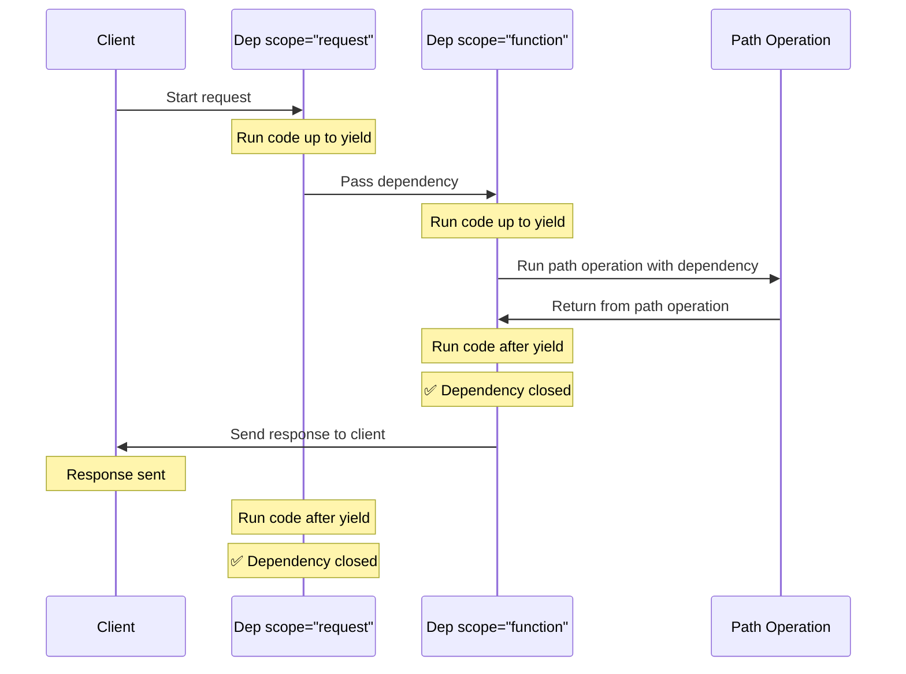

# Judge calibration: labelling sheet

For each item, read the question, the sources the model was given and its
answer, then write one label per item in `labels.csv` (same folder):

- `supported`: every factual claim in the answer (what FastAPI does, how an
  API or parameter behaves, code presented as working) is stated in the
  sources or follows directly from them. Rewording, summarising and generic
  connecting text are fine. Saying the sources do not cover the question is
  supported when they indeed do not.
- `unsupported`: at least one claim is not in the sources or contradicts them,
  including code or parameter names the sources do not show, and claiming the
  sources lack something they contain.
- `unsure`: you cannot decide; these items are left out of the agreement.

Judge support only, not whether the answer is helpful or complete. Use what is
in the sources, not what you know about FastAPI. `note` is optional. The
judge's verdicts are not in this folder; do not look at judge runs before
finishing.


## j-11: How to customize FastAPI request body documentation

Question: [so_68815761](https://stackoverflow.com/questions/68815761/how-to-customize-fastapi-request-body-documentation) (CC BY-SA 4.0)

<details>
<summary>Source 1: tutorial/metadata.md (Metadata and Docs URLs { #metadata-and-docs-urls })</summary>

You can customize several metadata configurations in your **FastAPI** application.

</details>

<details>
<summary>Source 2: tutorial/body-multiple-params.md (Body - Multiple Parameters { #body-multiple-parameters } > Recap { #recap })</summary>

You can add multiple body parameters to your *path operation function*, even though a request can only have a single body.

But **FastAPI** will handle it, give you the correct data in your function, and validate and document the correct schema in the *path operation*.

You can also declare singular values to be received as part of the body.

And you can instruct **FastAPI** to embed the body in a key even when there is only a single parameter declared.

</details>

<details>
<summary>Source 3: tutorial/body.md (Request Body { #request-body } > Request body + path parameters { #request-body-path-parameters })</summary>

You can declare path parameters and request body at the same time.

**FastAPI** will recognize that the function parameters that match path parameters should be **taken from the path**, and that function parameters that are declared to be Pydantic models should be **taken from the request body**.

{* ../../docs_src/body/tutorial003_py310.py hl[15:16] *}

</details>

<details>
<summary>Source 4: advanced/using-request-directly.md (Using the Request Directly { #using-the-request-directly })</summary>

Up to now, you have been declaring the parts of the request that you need with their types.

Taking data from:

The path as parameters.

Headers.

Cookies.

etc.

And by doing so, **FastAPI** is validating that data, converting it and generating documentation for your API automatically.

But there are situations where you might need to access the `Request` object directly.

</details>

<details>
<summary>Source 5: tutorial/security/index.md (Security { #security } > **FastAPI** utilities { #fastapi-utilities })</summary>

FastAPI provides several tools for each of these security schemes in the `fastapi.security` module that simplify using these security mechanisms.

In the next chapters you will see how to add security to your API using those tools provided by **FastAPI**.

And you will also see how it gets automatically integrated into the interactive documentation system.

</details>

**Answer:**

According to the documentation, FastAPI automatically validates, converts, and generates documentation for your API based on how you declare path parameters and request body data using Pydantic models.

Here’s how FastAPI handles request body customization:

*   **Multiple Body Parameters:** You can add multiple body parameters to a path operation function, and FastAPI will handle it, providing the correct data and validating the schema.
*   **Singular Values & Embedding:** You can declare singular values as body parameters, and instruct FastAPI to embed the body in a key even when there is only a single parameter declared.
*   **Path vs. Body:** FastAPI recognizes that parameters matching path parameters should be taken from the path, while Pydantic models should be taken from the request body.

You can find more information on this in [Source 3](https://example.com/source3) and [Source 4](https://example.com/source4).

---

## j-12: Standard Approach to Adding Services to Python FastAPI App?

Question: [so_75871053](https://stackoverflow.com/questions/75871053/standard-approach-to-adding-services-to-python-fastapi-app) (CC BY-SA 4.0)

<details>
<summary>Source 1: release-notes.md (Release Notes > 0.119.0 (2025-10-11))</summary>

FastAPI now (temporarily) supports both Pydantic v2 models and `pydantic.v1` models at the same time in the same app, to make it easier for any FastAPI apps still using Pydantic v1 to gradually but quickly **migrate to Pydantic v2**.


```Python
from fastapi import FastAPI
from pydantic import BaseModel as BaseModelV2
from pydantic.v1 import BaseModel


class Item(BaseModel):
    name: str
    description: str | None = None


class ItemV2(BaseModelV2):
    title: str
    summary: str | None = None


app = FastAPI()


@app.post("/items/", response_model=ItemV2)
def create_item(item: Item):
    return {"title": item.name, "summary": item.description}
```
Adding this feature was a big effort with the main objective of making it easier for the few applications still stuck in Pydantic v1 to migrate to Pydantic v2.

And with this, support for **Pydantic v1 is now deprecated** and will be **removed** from FastAPI in a future version soon.

**Note**: have in mind that the Pydantic team already stopped supporting Pydantic v1 for recent versions of Python, starting with Python 3.14.

You can read in the docs more about how to [Migrate from Pydantic v1 to Pydantic v2](https://fastapi.tiangolo.com/how-to/migrate-from-pydantic-v1-to-pydantic-v2/).

✨ Add support for `from pydantic.v1 import BaseModel`, mixed Pydantic v1 and v2 models in the same app. PR [#14168](https://github.com/fastapi/fastapi/pull/14168) by [@tiangolo](https://github.com/tiangolo).

</details>

<details>
<summary>Source 2: index.md (FastAPI { #fastapi } > Dependencies { #dependencies })</summary>

FastAPI depends on Pydantic and Starlette.

When you install FastAPI with `pip install "fastapi[standard]"` it comes with the `standard` group of optional dependencies:

Used by Pydantic:

[`email-validator`](https://github.com/JoshData/python-email-validator) - for email validation.

Used by Starlette:

[`httpx`](https://www.python-httpx.org) - Required if you want to use the `TestClient`.

[`jinja2`](https://jinja.palletsprojects.com) - Required if you want to use the default template configuration.

[`python-multipart`](https://github.com/Kludex/python-multipart) - Required if you want to support form <dfn title="converting the string that comes from an HTTP request into Python data">"parsing"</dfn>, with `request.form()`.

Used by FastAPI:

[`uvicorn`](https://www.uvicorn.dev) - for the server that loads and serves your application. This includes `uvicorn[standard]`, which includes some dependencies (e.g. `uvloop`) needed for high performance serving.

`fastapi-cli[standard]` - to provide the `fastapi` command.

This includes `fastapi-cloud-cli`, which allows you to deploy your FastAPI application to [FastAPI Cloud](https://fastapicloud.com).

If you don't want to include the `standard` optional dependencies, you can install with `pip install fastapi` instead of `pip install "fastapi[standard]"`.

If you want to install FastAPI with the standard dependencies but without the `fastapi-cloud-cli`, you can install with `pip install "fastapi[standard-no-fastapi-cloud-cli]"`.

There are some additional dependencies you might want to install.

Additional optional Pydantic dependencies:

[`pydantic-settings`](https://docs.pydantic.dev/latest/usage/pydantic_settings/) - for settings management.

[`pydantic-extra-types`](https://docs.pydantic.dev/latest/usage/types/extra_types/extra_types/) - for extra types to be used with Pydantic.

Additional optional FastAPI dependencies:

[`orjson`](https://github.com/ijl/orjson) - Required if you want to use `ORJSONResponse`.

[`ujson`](https://github.com/esnme/ultrajson) - Required if you want to use `UJSONResponse`.

</details>

<details>
<summary>Source 3: advanced/middleware.md (Advanced Middleware { #advanced-middleware } > Adding ASGI middlewares { #adding-asgi-middlewares })</summary>

As **FastAPI** is based on Starlette and implements the <abbr title="Asynchronous Server Gateway Interface">ASGI</abbr> specification, you can use any ASGI middleware.

A middleware doesn't have to be made for FastAPI or Starlette to work, as long as it follows the ASGI spec.

In general, ASGI middlewares are classes that expect to receive an ASGI app as the first argument.

So, in the documentation for third-party ASGI middlewares they will probably tell you to do something like:


```Python
from unicorn import UnicornMiddleware

app = SomeASGIApp()

new_app = UnicornMiddleware(app, some_config="rainbow")
```
But FastAPI (actually Starlette) provides a simpler way to do it that makes sure that the internal middlewares handle server errors and custom exception handlers work properly.

For that, you use `app.add_middleware()` (as in the example for CORS).


```Python
from fastapi import FastAPI
from unicorn import UnicornMiddleware

app = FastAPI()

app.add_middleware(UnicornMiddleware, some_config="rainbow")
```
`app.add_middleware()` receives a middleware class as the first argument and any additional arguments to be passed to the middleware.

</details>

<details>
<summary>Source 4: python-types.md (Python Types Intro { #python-types-intro } > Type hints in **FastAPI** { #type-hints-in-fastapi })</summary>

**FastAPI** takes advantage of these type hints to do several things.

With **FastAPI** you declare parameters with type hints and you get:

**Editor support**.

**Type checks**.

...and **FastAPI** uses the same declarations to:

**Define requirements**: from request path parameters, query parameters, headers, bodies, dependencies, etc.

**Convert data**: from the request to the required type.

**Validate data**: coming from each request:

Generating **automatic errors** returned to the client when the data is invalid.

**Document** the API using OpenAPI:

which is then used by the automatic interactive documentation user interfaces.

This might all sound abstract. Don't worry. You'll see all this in action in the [Tutorial - User Guide](tutorial/index.md).

The important thing is that by using standard Python types, in a single place (instead of adding more classes, decorators, etc), **FastAPI** will do a lot of the work for you.

/// info

If you already went through all the tutorial and came back to see more about types, a good resource is [the "cheat sheet" from `mypy`](https://mypy.readthedocs.io/en/latest/cheat_sheet_py3.html).

///

</details>

<details>
<summary>Source 5: release-notes.md (Release Notes > 0.56.0 (2020-06-11))</summary>

Add support for ASGI `root_path`:

Use `root_path` internally for mounted applications, so that OpenAPI and the docs UI works automatically without extra configurations and parameters.

Add new `root_path` parameter for `FastAPI` applications to provide it in cases where it can be set with the command line (e.g. for Uvicorn and Hypercorn, with the parameter `--root-path`).

Deprecate `openapi_prefix` parameter in favor of the new `root_path` parameter.

Add new/updated docs for [Sub Applications - Mounts](https://fastapi.tiangolo.com/advanced/sub-applications/), without `openapi_prefix` (as it is now handled automatically).

Add new/updated docs for [Behind a Proxy](https://fastapi.tiangolo.com/advanced/behind-a-proxy/), including how to setup a local testing proxy with Traefik and using `root_path`.

Update docs for [Extending OpenAPI](https://fastapi.tiangolo.com/advanced/extending-openapi/) with the new `openapi_prefix` parameter passed (internally generated from `root_path`).

Original PR [#1199](https://github.com/tiangolo/fastapi/pull/1199) by [@iksteen](https://github.com/iksteen).

Update new issue templates and docs: [Help FastAPI - Get Help](https://fastapi.tiangolo.com/help-fastapi/). PR [#1531](https://github.com/tiangolo/fastapi/pull/1531).

Update GitHub action issue-manager. PR [#1520](https://github.com/tiangolo/fastapi/pull/1520).

Add new links:

**English articles**:

[Real-time Notifications with Python and Postgres](https://wuilly.com/2019/10/real-time-notifications-with-python-and-postgres/) by [Guillermo Cruz](https://wuilly.com/).

[Microservice in Python using FastAPI](https://dev.to/paurakhsharma/microservice-in-python-using-fastapi-24cc)  by [Paurakh Sharma Humagain](https://x.com/PaurakhSharma).

[Build simple API service with Python FastAPI — Part 1](https://dev.to/cuongld2/build-simple-api-service-with-python-fastapi-part-1-581o) by [cuongld2](https://dev.to/cuongld2).

[FastAPI + Zeit.co = 🚀](https://paulsec.github.io/posts/fastapi_plus_zeit_serverless_fu/) by [Paul Sec](https://x.com/PaulWebSec).

[Build a web API from scratch with FastAPI - the workshop](https://dev.to/tiangolo/build-a-web-api-from-scratch-with-fastapi-the-workshop-2ehe) by [Sebastián Ramírez (tiangolo)](https://x.com/tiangolo).

[Build a Secure Twilio Webhook with Python and FastAPI](https://www.twilio.com/blog/build-secure-twilio-webhook-python-fastapi)  by [Twilio](https://www.twilio.com).

[Using FastAPI with Django](https://www.stavros.io/posts/fastapi-with-django/)  by [Stavros Korokithakis](https://x.com/Stavros).

[Introducing Dispatch](https://netflixtechblog.com/introducing-dispatch-da4b8a2a8072) by [Netflix](https://netflixtechblog.com/).

**Podcasts**:

[Build The Next Generation Of Python Web Applications With FastAPI - Episode 259 - interview to Sebastían Ramírez (tiangolo)](https://www.pythonpodcast.com/fastapi-web-application-framework-episode-259/) by [Podcast.`__init__`](https://www.pythonpodcast.com/).

**Talks**:

[PyConBY 2020: Serve ML models easily with FastAPI](https://www.youtube.com/watch?v=z9K5pwb0rt8) by [Sebastián Ramírez (tiangolo)](https://x.com/tiangolo).

[[VIRTUAL] Py.Amsterdam's flying Software Circus: Intro to FastAPI](https://www.youtube.com/watch?v=PnpTY1f4k2U) by [Sebastián Ramírez (tiangolo)](https://x.com/tiangolo).

PR [#1467](https://github.com/tiangolo/fastapi/pull/1467).

Add translation to Chinese for [Python Types Intro - Python 类型提示简介](https://fastapi.tiangolo.com/zh/python-types/). PR [#1197](https://github.com/tiangolo/fastapi/pull/1197) by [@waynerv](https://github.com/waynerv).

</details>

**Answer:**

Based on the provided context, here’s a breakdown of the standard approach to adding services to a Python FastAPI application:

**1. Pydantic Integration (Recommended):**

   * **Migrate to Pydantic v2:** FastAPI now supports both Pydantic v1 and v2 models simultaneously. The documentation strongly encourages migrating from v1 to v2.  This is the recommended approach due to ongoing deprecation of v1.
   * **Use Pydantic Models:** Define your data models using either `BaseModel` (Pydantic v2) or `BaseModelV2` (Pydantic v1).
   * **FastAPI Uses Type Hints:** FastAPI heavily relies on type hints (like the `Item` example) to automatically:
      * **Define Requirements:**  It determines what data the application needs from incoming requests (path parameters, query parameters, bodies, etc.).
      * **Convert Data:** It transforms the request data into the appropriate Python types.
      * **Validate Data:** It checks the incoming data against the defined models, generating errors automatically if the data is invalid.
      * **Document the API:** FastAPI uses these type hints to automatically generate OpenAPI documentation.

**2. Adding Middleware (Using `app.add_middleware()`):**

   * FastAPI (via Starlette) provides a simplified way to add middleware using `app.add_middleware()`.
   * This is the preferred method because it ensures that internal FastAPI/Starlette middlewares handle server errors and custom exception handlers correctly.
   *  Example:  `app.add_middleware(UnicornMiddleware, some_config="rainbow")`

**3. Dependencies (Optional):**

   *  If you need additional Pydantic dependencies (like `pydantic-settings` or `pydantic-extra-types`), you can install them using `pip install`.
   * Similarly, for FastAPI, you can add dependencies like `orjson` or `ujson` for specific response formats.

**4. Root Path Configuration (Important for Mounts and Proxies):**

   * FastAPI now automatically manages the `root_path` for mounted applications and proxy setups. It uses the `--root-path` parameter when running the server (e.g., with Uvicorn or Hypercorn). This simplifies configuration significantly.  This has replaced the use of `openapi_prefix`

**Key Resources:**

*   **Migrate from Pydantic v1 to Pydantic v2:** [https://fastapi.tiangolo.com/how-to/migrate-from-pydantic-v1-to-pydantic-v2/](https://fastapi.tiangolo.com/how-to/migrate-from-pydantic-v1-to-pydantic-v2/)
*   **Adding ASGI Middleware:** [https://fastapi.tiangolo.com/advanced/adding-middleware/](https://fastapi.tiangolo.com/advanced/adding-middleware/)

The core principle is to use type hints, allowing FastAPI to handle much of the data management and validation for you.  It’s the most efficient and maintainable way to build APIs with FastAPI.

---

## j-13: Any way to limit the input arguments of a FastAPI handler into several specified options?

Question: [so_66084376](https://stackoverflow.com/questions/66084376/any-way-to-limit-the-input-arguments-of-a-fastapi-handler-into-several-specified) (CC BY-SA 4.0)

<details>
<summary>Source 1: tutorial/first-steps.md (First Steps { #first-steps } > Recap, step by step { #recap-step-by-step } > Step 3: create a *path operation* { #step-3-create-a-path-operation })</summary>

"Path" here refers to the last part of the URL starting from the first `/`.

So, in a URL like:


```
https://example.com/items/foo
```
...the path would be:


```
/items/foo
```
/// info

A "path" is also commonly called an "endpoint" or a "route".

///

While building an API, the "path" is the main way to separate "concerns" and "resources".

"Operation" here refers to one of the HTTP "methods".

One of:

`POST`

`GET`

`PUT`

`DELETE`

...and the more exotic ones:

`OPTIONS`

`HEAD`

`PATCH`

`TRACE`

In the HTTP protocol, you can communicate to each path using one (or more) of these "methods".

When building APIs, you normally use these specific HTTP methods to perform a specific action.

Normally you use:

`POST`: to create data.

`GET`: to read data.

`PUT`: to update data.

`DELETE`: to delete data.

So, in OpenAPI, each of the HTTP methods is called an "operation".

We are going to call them "**operations**" too.

{* ../../docs_src/first_steps/tutorial001_py310.py hl[6] *}

The `@app.get("/")` tells **FastAPI** that the function right below is in charge of handling requests that go to:

the path `/`

using a <dfn title="an HTTP GET method"><code>get</code> operation</dfn>

/// info | `@decorator` Info

That `@something` syntax in Python is called a "decorator".

You put it on top of a function. Like a pretty decorative hat (I guess that's where the term came from).

A "decorator" takes the function below and does something with it.

In our case, this decorator tells **FastAPI** that the function below corresponds to the **path** `/` with an **operation** `get`.

It is the "**path operation decorator**".

///

You can also use the other operations:

`@app.post()`

`@app.put()`

`@app.delete()`

And the more exotic ones:

`@app.options()`

`@app.head()`

`@app.patch()`

`@app.trace()`

/// tip

You are free to use each operation (HTTP method) as you wish.

**FastAPI** doesn't enforce any specific meaning.

The information here is presented as a guideline, not a requirement.

For example, when using GraphQL you normally perform all the actions using only `POST` operations.

///

</details>

<details>
<summary>Source 2: tutorial/body-multiple-params.md (Body - Multiple Parameters { #body-multiple-parameters } > Recap { #recap })</summary>

You can add multiple body parameters to your *path operation function*, even though a request can only have a single body.

But **FastAPI** will handle it, give you the correct data in your function, and validate and document the correct schema in the *path operation*.

You can also declare singular values to be received as part of the body.

And you can instruct **FastAPI** to embed the body in a key even when there is only a single parameter declared.

</details>

<details>
<summary>Source 3: tutorial/cors.md (CORS (Cross-Origin Resource Sharing) { #cors-cross-origin-resource-sharing } > Use `CORSMiddleware` { #use-corsmiddleware })</summary>

You can configure it in your **FastAPI** application using the `CORSMiddleware`.

Import `CORSMiddleware`.

Create a list of allowed origins (as strings).

Add it as a "middleware" to your **FastAPI** application.

You can also specify whether your backend allows:

Credentials (Authorization headers, Cookies, etc).

Specific HTTP methods (`POST`, `PUT`) or all of them with the wildcard `"*"`.

Specific HTTP headers or all of them with the wildcard `"*"`.

{* ../../docs_src/cors/tutorial001_py310.py hl[2,6:11,13:19] *}

The default parameters used by the `CORSMiddleware` implementation are restrictive by default, so you'll need to explicitly enable particular origins, methods, or headers, in order for browsers to be permitted to use them in a Cross-Domain context.

The following arguments are supported:

`allow_origins` - A list of origins that should be permitted to make cross-origin requests. E.g. `['https://example.org', 'https://www.example.org']`. You can use `['*']` to allow any origin.

`allow_origin_regex` - A regex string to match against origins that should be permitted to make cross-origin requests. e.g. `'https://.*\.example\.org'`.

`allow_methods` - A list of HTTP methods that should be allowed for cross-origin requests. Defaults to `['GET']`. You can use `['*']` to allow all standard methods.

`allow_headers` - A list of HTTP request headers that should be supported for cross-origin requests. Defaults to `[]`. You can use `['*']` to allow all headers. The `Accept`, `Accept-Language`, `Content-Language` and `Content-Type` headers are always allowed for [simple CORS requests](https://developer.mozilla.org/en-US/docs/Web/HTTP/CORS#simple_requests).

`allow_credentials` - Indicate that cookies should be supported for cross-origin requests. Defaults to `False`.

None of `allow_origins`, `allow_methods` and `allow_headers` can be set to `['*']` if `allow_credentials` is set to `True`. All of them must be [explicitly specified](https://developer.mozilla.org/en-US/docs/Web/HTTP/CORS#credentialed_requests_and_wildcards).

`expose_headers` - Indicate any response headers that should be made accessible to the browser. Defaults to `[]`.

`max_age` - Sets a maximum time in seconds for browsers to cache CORS responses. Defaults to `600`.

The middleware responds to two particular types of HTTP request...

These are any `OPTIONS` request with `Origin` and `Access-Control-Request-Method` headers.

In this case the middleware will intercept the incoming request and respond with appropriate CORS headers, and either a `200` or `400` response for informational purposes.

Any request with an `Origin` header. In this case the middleware will pass the request through as normal, but will include appropriate CORS headers on the response.

</details>

<details>
<summary>Source 4: advanced/path-operation-advanced-configuration.md (Path Operation Advanced Configuration { #path-operation-advanced-configuration } > Advanced description from docstring { #advanced-description-from-docstring })</summary>

You can limit the lines used from the docstring of a *path operation function* for OpenAPI.

Adding an `\f` (an escaped "form feed" character) causes **FastAPI** to truncate the output used for OpenAPI at this point.

It won't show up in the documentation, but other tools (such as Sphinx) will be able to use the rest.

{* ../../docs_src/path_operation_advanced_configuration/tutorial004_py310.py hl[17:27] *}

</details>

<details>
<summary>Source 5: tutorial/handling-errors.md (Handling Errors { #handling-errors } > Override the default exception handlers { #override-the-default-exception-handlers })</summary>

**FastAPI** has some default exception handlers.

These handlers are in charge of returning the default JSON responses when you `raise` an `HTTPException` and when the request has invalid data.

You can override these exception handlers with your own.

When a request contains invalid data, **FastAPI** internally raises a `RequestValidationError`.

And it also includes a default exception handler for it.

To override it, import the `RequestValidationError` and use it with `@app.exception_handler(RequestValidationError)` to decorate the exception handler.

The exception handler will receive a `Request` and the exception.

{* ../../docs_src/handling_errors/tutorial004_py310.py hl[2,14:19] *}

Now, if you go to `/items/foo`, instead of getting the default JSON error with:


```JSON
{
    "detail": [
        {
            "loc": [
                "path",
                "item_id"
            ],
            "msg": "value is not a valid integer",
            "type": "type_error.integer"
        }
    ]
}
```
you will get a text version, with:


```
Validation errors:
Field: ('path', 'item_id'), Error: Input should be a valid integer, unable to parse string as an integer
```

The same way, you can override the `HTTPException` handler.

For example, you could want to return a plain text response instead of JSON for these errors:

{* ../../docs_src/handling_errors/tutorial004_py310.py hl[3:4,9:11,25] *}

/// note | Technical Details

You could also use `from starlette.responses import PlainTextResponse`.

**FastAPI** provides the same `starlette.responses` as `fastapi.responses` just as a convenience for you, the developer. But most of the available responses come directly from Starlette.

///

/// warning

Have in mind that the `RequestValidationError` contains the information of the file name and line where the validation error happens so that you can show it in your logs with the relevant information if you want to.

But that means that if you just convert it to a string and return that information directly, you could be leaking a bit of information about your system, that's why here the code extracts and shows each error independently.

///

The `RequestValidationError` contains the `body` it received with invalid data.

You could use it while developing your app to log the body and debug it, return it to the user, etc.

{* ../../docs_src/handling_errors/tutorial005_py310.py hl[14] *}

Now try sending an invalid item like:


```JSON
{
  "title": "towel",
  "size": "XL"
}
```
You will receive a response telling you that the data is invalid containing the received body:


```JSON hl_lines="12-15"
{
  "detail": [
    {
      "loc": [
        "body",
        "size"
      ],
      "msg": "value is not a valid integer",
      "type": "type_error.integer"
    }
  ],
  "body": {
    "title": "towel",
    "size": "XL"
  }
}
```

**FastAPI** has its own `HTTPException`.

And **FastAPI**'s `HTTPException` error class inherits from Starlette's `HTTPException` error class.

The only difference is that **FastAPI**'s `HTTPException` accepts any JSON-able data for the `detail` field, while Starlette's `HTTPException` only accepts strings for it.

So, you can keep raising **FastAPI**'s `HTTPException` as normally in your code.

But when you register an exception handler, you should register it for Starlette's `HTTPException`.

This way, if any part of Starlette's internal code, or a Starlette extension or plug-in, raises a Starlette `HTTPException`, your handler will be able to catch and handle it.

In this example, to be able to have both `HTTPException`s in the same code, Starlette's exceptions is renamed to `StarletteHTTPException`:


```Python
from starlette.exceptions import HTTPException as StarletteHTTPException
```

If you want to use the exception along with the same default exception handlers from  **FastAPI**, you can import and reuse the default exception handlers from `fastapi.exception_handlers`:

{* ../../docs_src/handling_errors/tutorial006_py310.py hl[2:5,15,21] *}

In this example you are just printing the error with a very expressive message, but you get the idea. You can use the exception and then just reuse the default exception handlers.

</details>

**Answer:**

Yes, you can limit the input arguments of a FastAPI handler into several specified options using the `@app.operation` decorator.

Here's how it works based on the provided context:

1.  **`@app.get("/")`**: This tells FastAPI that the function below handles requests to the `/` path using a `get` operation.
2.  **`@something` syntax**: This is a "path operation decorator". It tells FastAPI that the function below corresponds to the path `/` with an operation `get`.
3.  **Other Operations**: You can use other operations like `@app.post()`, `@app.put()`, `@app.delete()`, `@app.options()`, `@app.head()`, `@app.patch()`, and `@app.trace()` in a similar way.

The documentation emphasizes that **FastAPI** doesn't enforce specific meanings for these operations, so you can use them as you wish.

In summary, the `@app.operation` decorator is the key to defining the path and HTTP method (operation) for a FastAPI route.

---

## j-14: Conditional call of a FastAPI Model

Question: [so_71162915](https://stackoverflow.com/questions/71162915/conditional-call-of-a-fastapi-model) (CC BY-SA 4.0)

<details>
<summary>Source 1: advanced/response-directly.md (Return a Response Directly { #return-a-response-directly })</summary>

When you create a **FastAPI** *path operation* you can normally return any data from it: a `dict`, a `list`, a Pydantic model, a database model, etc.

If you declare a [Response Model](../tutorial/response-model.md) FastAPI will use it to serialize the data to JSON, using Pydantic.

If you don't declare a response model, FastAPI will use the `jsonable_encoder` explained in [JSON Compatible Encoder](../tutorial/encoder.md) and put it in a `JSONResponse`.

You could also create a `JSONResponse` directly and return it.

/// tip

You will normally have much better performance using a [Response Model](../tutorial/response-model.md) than returning a `JSONResponse` directly, as that way it serializes the data using Pydantic, in Rust.

///

</details>

<details>
<summary>Source 2: release-notes.md (Release Notes > 0.47.1 (2020-01-18))</summary>

Fix model filtering in `response_model`, cloning sub-models. PR [#889](https://github.com/tiangolo/fastapi/pull/889).

Fix FastAPI serialization of Pydantic models using ORM mode blocking the event loop. PR [#888](https://github.com/tiangolo/fastapi/pull/888).

</details>

<details>
<summary>Source 3: tutorial/body-nested-models.md (Body - Nested Models { #body-nested-models })</summary>

With **FastAPI**, you can define, validate, document, and use arbitrarily deeply nested models (thanks to Pydantic).

</details>

<details>
<summary>Source 4: release-notes.md (Release Notes > 0.54.2 (2020-05-16))</summary>

Add translation to Spanish for [Concurrency and async / await - Concurrencia y async / await](https://fastapi.tiangolo.com/es/async/). PR [#1290](https://github.com/tiangolo/fastapi/pull/1290) by [@alvaropernas](https://github.com/alvaropernas).

Remove obsolete vote link. PR [#1289](https://github.com/tiangolo/fastapi/pull/1289) by [@donhui](https://github.com/donhui).

Allow disabling docs UIs by just disabling OpenAPI with `openapi_url=None`. New example in docs: [Advanced: Conditional OpenAPI](https://fastapi.tiangolo.com/advanced/conditional-openapi/). PR [#1421](https://github.com/tiangolo/fastapi/pull/1421).

Add translation to Portuguese for [Benchmarks - Comparações](https://fastapi.tiangolo.com/pt/benchmarks/). PR [#1274](https://github.com/tiangolo/fastapi/pull/1274) by [@Serrones](https://github.com/Serrones).

Add translation to Portuguese for [Tutorial - User Guide - Intro - Tutorial - Guia de Usuário - Introdução](https://fastapi.tiangolo.com/pt/tutorial/). PR [#1259](https://github.com/tiangolo/fastapi/pull/1259) by [@marcosmmb](https://github.com/marcosmmb).

Allow using Unicode in MkDocs for translations. PR [#1419](https://github.com/tiangolo/fastapi/pull/1419).

Add translation to Spanish for [Advanced User Guide - Intro - Guía de Usuario Avanzada - Introducción](https://fastapi.tiangolo.com/es/advanced/). PR [#1250](https://github.com/tiangolo/fastapi/pull/1250) by [@jfunez](https://github.com/jfunez).

Add translation to Portuguese for [History, Design and Future - História, Design e Futuro](https://fastapi.tiangolo.com/pt/history-design-future/). PR [#1249](https://github.com/tiangolo/fastapi/pull/1249) by [@marcosmmb](https://github.com/marcosmmb).

Add translation to Portuguese for [Features - Recursos](https://fastapi.tiangolo.com/pt/features/). PR [#1248](https://github.com/tiangolo/fastapi/pull/1248) by [@marcosmmb](https://github.com/marcosmmb).

Add translation to Spanish for [Tutorial - User Guide - Intro - Tutorial - Guía de Usuario - Introducción](https://fastapi.tiangolo.com/es/tutorial/). PR [#1244](https://github.com/tiangolo/fastapi/pull/1244) by [@MartinEliasQ](https://github.com/MartinEliasQ).

Add translation to Chinese for [Deployment - 部署](https://fastapi.tiangolo.com/zh/deployment/). PR [#1203](https://github.com/tiangolo/fastapi/pull/1203) by [@RunningIkkyu](https://github.com/RunningIkkyu).

Add translation to Chinese for [Tutorial - User Guide - Intro - 教程 - 用户指南 - 简介](https://fastapi.tiangolo.com/zh/tutorial/). PR [#1202](https://github.com/tiangolo/fastapi/pull/1202) by [@waynerv](https://github.com/waynerv).

Add translation to Chinese for [Features - 特性](https://fastapi.tiangolo.com/zh/features/). PR [#1192](https://github.com/tiangolo/fastapi/pull/1192) by [@Dustyposa](https://github.com/Dustyposa).

Add translation for [main page to Chinese](https://fastapi.tiangolo.com/zh/) PR [#1191](https://github.com/tiangolo/fastapi/pull/1191) by [@waynerv](https://github.com/waynerv).

Update docs for project generation. PR [#1287](https://github.com/tiangolo/fastapi/pull/1287).

Add Spanish translation for [Introducción a los Tipos de Python (Python Types Intro)](https://fastapi.tiangolo.com/es/python-types/). PR [#1237](https://github.com/tiangolo/fastapi/pull/1237) by [@mariacamilagl](https://github.com/mariacamilagl).

Add Spanish translation for [Características (Features)](https://fastapi.tiangolo.com/es/features/). PR [#1220](https://github.com/tiangolo/fastapi/pull/1220) by [@mariacamilagl](https://github.com/mariacamilagl).

</details>

<details>
<summary>Source 5: features.md (Features { #features } > FastAPI features { #fastapi-features })</summary>

**FastAPI** gives you the following:

</details>

**Answer:**

Based on the provided context, when you create a FastAPI path operation, you can return any data you want – dictionaries, lists, Pydantic models, or data from database models.

If you declare a Response Model, FastAPI will use it to serialize the data to JSON, using Pydantic.  It's generally recommended to use a Response Model for better performance as Pydantic serializes the data in Rust. If you don't declare a Response Model, FastAPI will use `jsonable_encoder` and put the data in a `JSONResponse`. You can also create a `JSONResponse` directly.

---

## j-15: Can multiple routers be registered at once in FastAPI?

Question: [so_77445628](https://stackoverflow.com/questions/77445628/can-multiple-routers-be-registered-at-once-in-fastapi) (CC BY-SA 4.0)

<details>
<summary>Source 1: deployment/concepts.md (Deployments Concepts { #deployments-concepts } > Replication - Processes and Memory { #replication-processes-and-memory })</summary>

With a FastAPI application, using a server program like the `fastapi` command that runs Uvicorn, running it once in **one process** can serve multiple clients concurrently.

But in many cases, you will want to run several worker processes at the same time.

If you have more clients than what a single process can handle (for example if the virtual machine is not too big) and you have **multiple cores** in the server's CPU, then you could have **multiple processes** running with the same application at the same time, and distribute all the requests among them.

When you run **multiple processes** of the same API program, they are commonly called **workers**.

Remember from the docs [About HTTPS](https.md) that only one process can be listening on one combination of port and IP address in a server?

This is still true.

So, to be able to have **multiple processes** at the same time, there has to be a **single process listening on a port** that then transmits the communication to each worker process in some way.

Now, when the program loads things in memory, for example, a machine learning model in a variable, or the contents of a large file in a variable, all that **consumes a bit of the memory (RAM)** of the server.

And multiple processes normally **don't share any memory**. This means that each running process has its own things, variables, and memory. And if you are consuming a large amount of memory in your code, **each process** will consume an equivalent amount of memory.

For example, if your code loads a Machine Learning model with **1 GB in size**, when you run one process with your API, it will consume at least 1 GB of RAM. And if you start **4 processes** (4 workers), each will consume 1 GB of RAM. So in total, your API will consume **4 GB of RAM**.

And if your remote server or virtual machine only has 3 GB of RAM, trying to load more than 4 GB of RAM will cause problems. 🚨

In this example, there's a **Manager Process** that starts and controls two **Worker Processes**.

This Manager Process would probably be the one listening on the **port** in the IP. And it would transmit all the communication to the worker processes.

Those worker processes would be the ones running your application, they would perform the main computations to receive a **request** and return a **response**, and they would load anything you put in variables in RAM.


And of course, the same machine would probably have **other processes** running as well, apart from your application.

An interesting detail is that the percentage of the **CPU used** by each process can **vary** a lot over time, but the **memory (RAM)** normally stays more or less **stable**.

If you have an API that does a comparable amount of computations every time and you have a lot of clients, then the **CPU utilization** will probably *also be stable* (instead of constantly going up and down quickly).

There can be several approaches to achieve this, and I'll tell you more about specific strategies in the next chapters, for example when talking about Docker and containers.

The main constraint to consider is that there has to be a **single** component handling the **port** in the **public IP**. And then it has to have a way to **transmit** the communication to the replicated **processes/workers**.

Here are some possible combinations and strategies:

**Uvicorn** with `--workers`

One Uvicorn **process manager** would listen on the **IP** and **port**, and it would start **multiple Uvicorn worker processes**.

**Kubernetes** and other distributed **container systems**

Something in the **Kubernetes** layer would listen on the **IP** and **port**. The replication would be by having **multiple containers**, each with **one Uvicorn process** running.

**Cloud services** that handle this for you

The cloud service will probably **handle replication for you**. It would possibly let you define **a process to run**, or a **container image** to use, in any case, it would most probably be **a single Uvicorn process**, and the cloud service would be in charge of replicating it.

/// tip

Don't worry if some of these items about **containers**, Docker, or Kubernetes don't make a lot of sense yet.

I'll tell you more about container images, Docker, Kubernetes, etc. in a future chapter: [FastAPI in Containers - Docker](docker.md).

///

</details>

<details>
<summary>Source 2: tutorial/query-params.md (Query Parameters { #query-parameters } > Multiple path and query parameters { #multiple-path-and-query-parameters })</summary>

You can declare multiple path parameters and query parameters at the same time, **FastAPI** knows which is which.

And you don't have to declare them in any specific order.

They will be detected by name:

{* ../../docs_src/query_params/tutorial004_py310.py hl[6,8] *}

</details>

<details>
<summary>Source 3: tutorial/bigger-applications.md (Bigger Applications - Multiple Files { #bigger-applications-multiple-files } > The main `FastAPI` { #the-main-fastapi })</summary>

Now, let's see the module at `app/main.py`.

Here's where you import and use the class `FastAPI`.

This will be the main file in your application that ties everything together.

And as most of your logic will now live in its own specific module, the main file will be quite simple.

You import and create a `FastAPI` class as normally.

And we can even declare [global dependencies](dependencies/global-dependencies.md) that will be combined with the dependencies for each `APIRouter`:

{* ../../docs_src/bigger_applications/app_an_py310/main.py hl[1,3,7] title["app/main.py"] *}

Now we import the other submodules that have `APIRouter`s:

{* ../../docs_src/bigger_applications/app_an_py310/main.py hl[4:5] title["app/main.py"] *}

As the files `app/routers/users.py` and `app/routers/items.py` are submodules that are part of the same Python package `app`, we can use a single dot `.` to import them using "relative imports".

The section:


```Python
from .routers import items, users
```
means:

Starting in the same package that this module (the file `app/main.py`) lives in (the directory `app/`)...

look for the subpackage `routers` (the directory at `app/routers/`)...

and from it, import the submodule `items` (the file at `app/routers/items.py`) and `users` (the file at `app/routers/users.py`)...

The module `items` will have a variable `router` (`items.router`). This is the same one we created in the file `app/routers/items.py`, it's an `APIRouter` object.

And then we do the same for the module `users`.

We could also import them like:


```Python
from app.routers import items, users
```
/// info

The first version is a "relative import":


```Python
from .routers import items, users
```
The second version is an "absolute import":


```Python
from app.routers import items, users
```
To learn more about Python Packages and Modules, read [the official Python documentation about Modules](https://docs.python.org/3/tutorial/modules.html).

///

We are importing the submodule `items` directly, instead of importing just its variable `router`.

This is because we also have another variable named `router` in the submodule `users`.

If we had imported one after the other, like:


```Python
from .routers.items import router
from .routers.users import router
```
the `router` from `users` would overwrite the one from `items` and we wouldn't be able to use them at the same time.

So, to be able to use both of them in the same file, we import the submodules directly:

{* ../../docs_src/bigger_applications/app_an_py310/main.py hl[5] title["app/main.py"] *}

Now, let's include the `router`s from the submodules `users` and `items`:

{* ../../docs_src/bigger_applications/app_an_py310/main.py hl[10:11] title["app/main.py"] *}

/// info

`users.router` contains the `APIRouter` inside of the file `app/routers/users.py`.

And `items.router` contains the `APIRouter` inside of the file `app/routers/items.py`.

///

With `app.include_router()` we can add each `APIRouter` to the main `FastAPI` application.

It will include all the routes from that router as part of it.

/// note | Technical Details

It will actually internally create a *path operation* for each *path operation* that was declared in the `APIRouter`.

So, behind the scenes, it will actually work as if everything was the same single app.

///

/// check

You don't have to worry about performance when including routers.

This will take microseconds and will only happen at startup.

So it won't affect performance. ⚡

///

Now, let's imagine your organization gave you the `app/internal/admin.py` file.

It contains an `APIRouter` with some admin *path operations* that your organization shares between several projects.

For this example it will be super simple. But let's say that because it is shared with other projects in the organization, we cannot modify it and add a `prefix`, `dependencies`, `tags`, etc. directly to the `APIRouter`:

{* ../../docs_src/bigger_applications/app_an_py310/internal/admin.py hl[3] title["app/internal/admin.py"] *}

But we still want to set a custom `prefix` when including the `APIRouter` so that all its *path operations* start with `/admin`, we want to secure it with the `dependencies` we already have for this project, and we want to include `tags` and `responses`.

We can declare all that without having to modify the original `APIRouter` by passing those parameters to `app.include_router()`:

{* ../../docs_src/bigger_applications/app_an_py310/main.py hl[14:17] title["app/main.py"] *}

That way, the original `APIRouter` will stay unmodified, so we can still share that same `app/internal/admin.py` file with other projects in the organization.

The result is that in our app, each of the *path operations* from the `admin` module will have:

The prefix `/admin`.

The tag `admin`.

The dependency `get_token_header`.

The response `418`. 🍵

But that will only affect that `APIRouter` in our app, not in any other code that uses it.

So, for example, other projects could use the same `APIRouter` with a different authentication method.

We can also add *path operations* directly to the `FastAPI` app.

Here we do it... just to show that we can 🤷:

{* ../../docs_src/bigger_applications/app_an_py310/main.py hl[21:23] title["app/main.py"] *}

and it will work correctly, together with all the other *path operations* added with `app.include_router()`.

/// info | Very Technical Details

**Note**: this is a very technical detail that you probably can **just skip**.

The `APIRouter`s are not "mounted", they are not isolated from the rest of the application.

This is because we want to include their *path operations* in the OpenAPI schema and the user interfaces.

As we cannot just isolate them and "mount" them independently of the rest, the *path operations* are "cloned" (re-created), not included directly.

///

</details>

<details>
<summary>Source 4: tutorial/body-multiple-params.md (Body - Multiple Parameters { #body-multiple-parameters } > Recap { #recap })</summary>

You can add multiple body parameters to your *path operation function*, even though a request can only have a single body.

But **FastAPI** will handle it, give you the correct data in your function, and validate and document the correct schema in the *path operation*.

You can also declare singular values to be received as part of the body.

And you can instruct **FastAPI** to embed the body in a key even when there is only a single parameter declared.

</details>

<details>
<summary>Source 5: tutorial/bigger-applications.md (Bigger Applications - Multiple Files { #bigger-applications-multiple-files } > Include an `APIRouter` in another { #include-an-apirouter-in-another })</summary>

The same way you can include an `APIRouter` in a `FastAPI` application, you can include an `APIRouter` in another `APIRouter` using:


```Python
router.include_router(other_router)
```
Make sure you do it before including `router` in the `FastAPI` app, so that the *path operations* from `other_router` are also included.

</details>

**Answer:**

Yes, multiple routers can be registered at once in FastAPI. 

Here's how it's achieved, based on the provided context:

1.  **`app.include_router()`**: You can use the `include_router()` method to add other routers to the main FastAPI application.
2.  **`router.include_router(other_router)`**: You can also include an `APIRouter` within another `APIRouter` using this method. However, you must do this *before* including the inner router in the main FastAPI application. This ensures that the paths defined in the inner router are also part of the overall application's routes.

As described in Source 3, this is achieved by internally creating a *path operation* for each *path operation* that was declared in the `APIRouter`.  This effectively combines all the routers into a single application, allowing you to manage and document all routes within the same OpenAPI schema.  The `include_router()` method doesn't isolate the routers, but rather integrates their paths into the main FastAPI application.

The context also discusses how you can add multiple body parameters to a *path operation function* (Source 4), and how FastAPI handles this by providing the correct data and validating the schema.

---

## j-16: How to add a custom decorator to a FastAPI route?

Question: [so_64497615](https://stackoverflow.com/questions/64497615/how-to-add-a-custom-decorator-to-a-fastapi-route) (CC BY-SA 4.0)

<details>
<summary>Source 1: release-notes.md (Release Notes > 0.41.0 (2019-10-07))</summary>

Upgrade required Starlette to `0.12.9`, the new range is `>=0.12.9,<=0.12.9`.

Add `State` to FastAPI apps at `app.state`.

PR [#593](https://github.com/tiangolo/fastapi/pull/593).

Improve handling of custom classes for `Request`s and `APIRoute`s.

This helps to more easily solve use cases like:

Reading a body before and/or after a request (equivalent to a middleware).

Run middleware-like code only for a subset of *path operations*.

Process a request before passing it to a *path operation function*. E.g. decompressing, deserializing, etc.

Processing a response after being generated by *path operation functions* but before returning it. E.g. adding custom headers, logging, adding extra metadata.

New docs section: [Custom Request and APIRoute class](https://fastapi.tiangolo.com/advanced/custom-request-and-route/).

PR [#589](https://github.com/tiangolo/fastapi/pull/589) by [@dmontagu](https://github.com/dmontagu).

Fix preserving custom route class in routers when including other sub-routers. PR [#538](https://github.com/tiangolo/fastapi/pull/538) by [@dmontagu](https://github.com/dmontagu).

</details>

<details>
<summary>Source 2: release-notes.md (Release Notes > 0.62.0 (2020-11-29))</summary>

✨ Add support for shared/top-level parameters (dependencies, tags, etc). PR [#2434](https://github.com/tiangolo/fastapi/pull/2434) by [@tiangolo](https://github.com/tiangolo).

Up to now, for several options, the only way to apply them to a group of *path operations* was in `include_router`. That works well, but the call to `app.include_router()` or `router.include_router()` is normally done in another file.

That means that, for example, to apply authentication to all the *path operations* in a router it would end up being done in a different file, instead of keeping related logic together.

Setting options in `include_router` still makes sense in some cases, for example, to override or increase configurations from a third party router included in an app. But in a router that is part of a bigger application, it would probably make more sense to add those settings when creating the `APIRouter`.

**In `FastAPI`**

This allows setting the (mostly new) parameters (additionally to the already existing parameters):

`default_response_class`: updated to handle defaults in `APIRouter` and `include_router`.

`dependencies`: to include ✨ top-level dependencies ✨ that apply to the whole application. E.g. to add global authentication.

`callbacks`: OpenAPI callbacks that apply to all the *path operations*.

`deprecated`: to mark all the *path operations* as deprecated. 🤷

`include_in_schema`: to allow excluding all the *path operations* from the OpenAPI schema.

`responses`: OpenAPI responses that apply to all the *path operations*.

For example:


```Python
from fastapi import FastAPI, Depends


async def some_dependency():
    return


app = FastAPI(dependencies=[Depends(some_dependency)])
```
**In `APIRouter`**

This allows setting the (mostly new) parameters (additionally to the already existing parameters):

`default_response_class`: updated to handle defaults in `APIRouter` and `include_router`. For example, it's not needed to set it explicitly when [creating callbacks](https://fastapi.tiangolo.com/advanced/openapi-callbacks/).

`dependencies`: to include ✨ router-level dependencies ✨ that apply to all the *path operations* in a router. Up to now, this was only possible with `include_router`.

`callbacks`: OpenAPI callbacks that apply to all the *path operations* in this router.

`deprecated`: to mark all the *path operations* in a router as deprecated.

`include_in_schema`: to allow excluding all the *path operations* in a router from the OpenAPI schema.

`responses`: OpenAPI responses that apply to all the *path operations* in a router.

`prefix`: to set the path prefix for a router. Up to now, this was only possible when calling `include_router`.

`tags`: OpenAPI tags to apply to all the *path operations* in this router.

For example:


```Python
from fastapi import APIRouter, Depends


async def some_dependency():
    return


router = APIRouter(prefix="/users", dependencies=[Depends(some_dependency)])
```
**In `include_router`**

Most of these settings are now supported in `APIRouter`, which normally lives closer to the related code, so it is recommended to use `APIRouter` when possible.

But `include_router` is still useful to, for example, adding options (like `dependencies`, `prefix`, and `tags`) when including a third party router, or a generic router that is shared between several projects.

This PR allows setting the (mostly new) parameters (additionally to the already existing parameters):

`default_response_class`: updated to handle defaults in `APIRouter` and `FastAPI`.

`deprecated`: to mark all the *path operations* in a router as deprecated in OpenAPI.

`include_in_schema`: to allow disabling all the *path operations* from showing in the OpenAPI schema.

`callbacks`: OpenAPI callbacks that apply to all the *path operations* in this router.

Note: all the previous parameters are still there, so it's still possible to declare `dependencies` in `include_router`.

PR [#2434](https://github.com/tiangolo/fastapi/pull/2434) includes several improvements that shouldn't affect normal use cases, but could affect in advanced scenarios:

If you are testing the generated OpenAPI (you shouldn't, FastAPI already tests it extensively for you): the order for `tags` in `include_router` and *path operations* was updated for consistency, but it's a simple order change.

If you have advanced custom logic to access each route's `route.response_class`, or the `router.default_response_class`, or the `app.default_response_class`: the default value for `response_class` in `APIRoute` and for `default_response_class` in `APIRouter` and `FastAPI` is now a `DefaultPlaceholder` used internally to handle and solve default values and overrides. The actual response class inside the `DefaultPlaceholder` is available at `route.response_class.value`.

PR [#2434](https://github.com/tiangolo/fastapi/pull/2434) (above) includes new or updated docs:

[Advanced User Guide - OpenAPI Callbacks](https://fastapi.tiangolo.com/advanced/openapi-callbacks/).

[Tutorial - Bigger Applications](https://fastapi.tiangolo.com/tutorial/bigger-applications/).

[Tutorial - Dependencies - Dependencies in path operation decorators](https://fastapi.tiangolo.com/tutorial/dependencies/dependencies-in-path-operation-decorators/).

[Tutorial - Dependencies - Global Dependencies](https://fastapi.tiangolo.com/tutorial/dependencies/global-dependencies/).

📝 Add FastAPI monitoring blog post to External Links. PR [#2324](https://github.com/tiangolo/fastapi/pull/2324) by [@louisguitton](https://github.com/louisguitton).

✏️ Fix typo in Deta tutorial. PR [#2320](https://github.com/tiangolo/fastapi/pull/2320) by [@tiangolo](https://github.com/tiangolo).

✨ Add Discord chat. PR [#2322](https://github.com/tiangolo/fastapi/pull/2322) by [@tiangolo](https://github.com/tiangolo).

📝 Fix image links for sponsors. PR [#2304](https://github.com/tiangolo/fastapi/pull/2304) by [@tiangolo](https://github.com/tiangolo).

🌐 Add Japanese translation for Advanced - Custom Response. PR [#2193](https://github.com/tiangolo/fastapi/pull/2193) by [@Attsun1031](https://github.com/Attsun1031).

🌐 Add Chinese translation for Benchmarks. PR [#2119](https://github.com/tiangolo/fastapi/pull/2119) by [@spaceack](https://github.com/spaceack).

🌐 Add Chinese translation for Tutorial - Body - Nested Models. PR [#1609](https://github.com/tiangolo/fastapi/pull/1609) by [@waynerv](https://github.com/waynerv).

🌐 Add Chinese translation for Advanced - Custom Response. PR [#1459](https://github.com/tiangolo/fastapi/pull/1459) by [@RunningIkkyu](https://github.com/RunningIkkyu).

🌐 Add Chinese translation for Advanced - Return a Response Directly. PR [#1452](https://github.com/tiangolo/fastapi/pull/1452) by [@RunningIkkyu](https://github.com/RunningIkkyu).

🌐 Add Chinese translation for Advanced - Additional Status Codes. PR [#1451](https://github.com/tiangolo/fastapi/pull/1451) by [@RunningIkkyu](https://github.com/RunningIkkyu).

🌐 Add Chinese translation for Advanced - Path Operation Advanced Configuration. PR [#1447](https://github.com/tiangolo/fastapi/pull/1447) by [@RunningIkkyu](https://github.com/RunningIkkyu).

🌐 Add Chinese translation for Advanced User Guide - Intro. PR [#1445](https://github.com/tiangolo/fastapi/pull/1445) by [@RunningIkkyu](https://github.com/RunningIkkyu).

🔧 Update TestDriven link to course in sponsors section. PR [#2435](https://github.com/tiangolo/fastapi/pull/2435) by [@tiangolo](https://github.com/tiangolo).

🍱 Update sponsor logos. PR [#2418](https://github.com/tiangolo/fastapi/pull/2418) by [@tiangolo](https://github.com/tiangolo).

💚 Fix disabling install of Material for MkDocs Insiders in forks, strike 1 ⚾. PR [#2340](https://github.com/tiangolo/fastapi/pull/2340) by [@tiangolo](https://github.com/tiangolo).

🐛 Fix disabling Material for MkDocs Insiders install in forks. PR [#2339](https://github.com/tiangolo/fastapi/pull/2339) by [@tiangolo](https://github.com/tiangolo).

✨ Add silver sponsor WeTransfer. PR [#2338](https://github.com/tiangolo/fastapi/pull/2338) by [@tiangolo](https://github.com/tiangolo).

✨ Set up and enable Material for MkDocs Insiders for the docs. PR [#2325](https://github.com/tiangolo/fastapi/pull/2325) by [@tiangolo](https://github.com/tiangolo).

</details>

<details>
<summary>Source 3: tutorial/dependencies/dependencies-in-path-operation-decorators.md (Dependencies in path operation decorators { #dependencies-in-path-operation-decorators } > Global Dependencies { #global-dependencies })</summary>

Next we will see how to add dependencies to the whole `FastAPI` application, so that they apply to each *path operation*.

</details>

<details>
<summary>Source 4: tutorial/first-steps.md (First Steps { #first-steps } > Recap { #recap })</summary>

Import `FastAPI`.

Create an `app` instance.

Write a **path operation decorator** using decorators like `@app.get("/")`.

Define a **path operation function**; for example, `def root(): ...`.

Run the development server using the command `fastapi dev`.

Optionally deploy your app with `fastapi deploy`.

</details>

<details>
<summary>Source 5: release-notes.md (Release Notes > 0.19.0 (2019-04-26))</summary>

Rename *path operation decorator* parameter `content_type` to `response_class`. PR [#183](https://github.com/tiangolo/fastapi/pull/183).

Add docs:

How to use the `jsonable_encoder` in [JSON compatible encoder](https://fastapi.tiangolo.com/tutorial/encoder/).

How to [Return a Response directly](https://fastapi.tiangolo.com/advanced/response-directly/).

Update how to use a [Custom Response Class](https://fastapi.tiangolo.com/advanced/custom-response/).

PR [#184](https://github.com/tiangolo/fastapi/pull/184).

</details>

**Answer:**

Based on the provided context, you can add custom decorators to FastAPI routes to process requests before and after a *path operation function* and to handle things like middleware-like functionality.

Here's how you can do it, combining the relevant information from the sources:

1.  **Create an `app` instance:** You start by creating an instance of the `FastAPI` class.

2.  **Write a path operation decorator:** Use decorators like `@app.get("/")` to define your route.

3.  **Define a path operation function:** Create a function (e.g., `def root(): ...`) that will handle the request when the route is accessed.

4.  **Use Dependencies:** The context highlights the ability to add dependencies to the whole `FastAPI` application, so that they apply to each *path operation* using `dependencies` in the FastAPI constructor like this: `app = FastAPI(dependencies=[Depends(some_dependency)])`. This allows you to apply global logic, such as authentication, to all routes.

5.  **Custom Response Class:** You can utilize the `Custom Response Class` features for advanced scenarios.

The documentation provides detailed examples in the following sections:

*   [Custom Request and APIRoute class](https://fastapi.tiangolo.com/advanced/custom-request-and-route/)
*   [Tutorial - Dependencies - Dependencies in path operation decorators](https://fastapi.tiangolo.com/tutorial/dependencies/dependencies-in-path-operation-decorators/)
*   [Tutorial - Dependencies - Global Dependencies](https://fastapi.tiangolo.com/tutorial/dependencies/global-dependencies/)

The source documents detail using `APIRouter` for router-level dependencies and callbacks that apply to all *path operations* in a router.  Using `include_router` to set options like `dependencies`, `prefix`, and `tags` is also possible. The provided context doesn't give a precise syntax for creating the custom decorator, but it explains the core concepts and allows for flexible request and response handling.

---

## j-17: How to avoid blocking the asyncio event loop with looping functions

Question: [so_71731924](https://stackoverflow.com/questions/71731924/how-to-avoid-blocking-the-asyncio-event-loop-with-looping-functions) (CC BY-SA 4.0)

<details>
<summary>Source 1: advanced/stream-data.md (Stream Data { #stream-data } > A Custom `PNGStreamingResponse` { #a-custom-pngstreamingresponse })</summary>

In the examples above, the data bytes were streamed, but the response didn't have a `Content-Type` header, so the client didn't know what type of data it was receiving.

You can create a custom sub-class of `StreamingResponse` that sets the `Content-Type` header to the type of data you're streaming.

For example, you can create a `PNGStreamingResponse` that sets the `Content-Type` header to `image/png` using the `media_type` attribute:

{* ../../docs_src/stream_data/tutorial002_py310.py ln[6,19:20] hl[20] *}

Then you can use this new class in `response_class=PNGStreamingResponse` in your *path operation function*:

{* ../../docs_src/stream_data/tutorial002_py310.py ln[23:27] hl[23] *}

In this example, we are simulating a file with `io.BytesIO`, which is a file-like object that lives only in memory, but lets us use the same interface.

For example, we can iterate over it to consume its contents, as we could with a file.

{* ../../docs_src/stream_data/tutorial002_py310.py ln[1:27] hl[3,12:13,25] *}

/// note | Technical Details

The other two variables, `image_base64` and `binary_image`, are an image encoded in Base64, and then converted to bytes, to then pass it to `io.BytesIO`.

Only so that it can live in the same file for this example and you can copy it and run it as is. 🥚

///

By using a `with` block, we make sure that the file-like object is closed after the generator function (the function with `yield`) is done. So, after it finishes sending the response.

It wouldn't be that important in this specific example because it's a fake in-memory file (with `io.BytesIO`), but with a real file, it would be important to make sure the file is closed after the work with it is done.

In most cases, file-like objects are not compatible with async and await by default.

For example, they don't have an `await file.read()`, or `async for chunk in file`.

And in many cases, reading them would be a blocking operation (that could block the event loop), because they are read from disk or from the network.

/// info

The example above is actually an exception, because the `io.BytesIO` object is already in memory, so reading it won't block anything.

But in many cases reading a file or a file-like object would block.

///

To avoid blocking the event loop, you can simply declare the *path operation function* with regular `def` instead of `async def`, that way FastAPI will run it on a threadpool worker, to avoid blocking the main loop.

{* ../../docs_src/stream_data/tutorial002_py310.py ln[30:34] hl[31] *}

/// tip

If you need to call blocking code from inside of an async function, or an async function from inside of a blocking function, you could use [Asyncer](https://asyncer.tiangolo.com), a sibling library to FastAPI.

///

When you are iterating over something, like a file-like object, and then you are doing `yield` for each item, you could also use `yield from` to yield each item directly and skip the `for` loop.

This is not particular to FastAPI, it's just Python, but it's a nice trick to know. 😎

{* ../../docs_src/stream_data/tutorial002_py310.py ln[37:40] hl[40] *}

</details>

<details>
<summary>Source 2: async.md (Concurrency and async / await { #concurrency-and-async-await } > `async` and `await` { #async-and-await })</summary>

Modern versions of Python have a very intuitive way to define asynchronous code. This makes it look just like normal "sequential" code and do the "awaiting" for you at the right moments.

When there is an operation that will require waiting before giving the results and has support for these new Python features, you can code it like:


```Python
burgers = await get_burgers(2)
```
The key here is the `await`. It tells Python that it has to wait ⏸ for `get_burgers(2)` to finish doing its thing 🕙 before storing the results in `burgers`. With that, Python will know that it can go and do something else 🔀 ⏯ in the meanwhile (like receiving another request).

For `await` to work, it has to be inside a function that supports this asynchronicity. To do that, you just declare it with `async def`:


```Python hl_lines="1"
async def get_burgers(number: int):
    # Do some asynchronous stuff to create the burgers
    return burgers
```
...instead of `def`:


```Python hl_lines="2"
# This is not asynchronous
def get_sequential_burgers(number: int):
    # Do some sequential stuff to create the burgers
    return burgers
```
With `async def`, Python knows that, inside that function, it has to be aware of `await` expressions, and that it can "pause" ⏸ the execution of that function and go do something else 🔀 before coming back.

When you want to call an `async def` function, you have to "await" it. So, this won't work:


```Python
# This won't work, because get_burgers was defined with: async def
burgers = get_burgers(2)
```
So, if you are using a library that tells you that you can call it with `await`, you need to create the *path operation functions* that uses it with `async def`, like in:


```Python hl_lines="2-3"
@app.get('/burgers')
async def read_burgers():
    burgers = await get_burgers(2)
    return burgers
```

You might have noticed that `await` can only be used inside of functions defined with `async def`.

But at the same time, functions defined with `async def` have to be "awaited". So, functions with `async def` can only be called inside of functions defined with `async def` too.

So, about the egg and the chicken, how do you call the first `async` function?

If you are working with **FastAPI** you don't have to worry about that, because that "first" function will be your *path operation function*, and FastAPI will know how to do the right thing.

But if you want to use `async` / `await` without FastAPI, you can do it as well.

Starlette (and **FastAPI**) are based on [AnyIO](https://anyio.readthedocs.io/en/stable/), which makes it compatible with both Python's standard library [asyncio](https://docs.python.org/3/library/asyncio-task.html) and [Trio](https://trio.readthedocs.io/en/stable/).

In particular, you can directly use [AnyIO](https://anyio.readthedocs.io/en/stable/) for your advanced concurrency use cases that require more advanced patterns in your own code.

And even if you were not using FastAPI, you could also write your own async applications with [AnyIO](https://anyio.readthedocs.io/en/stable/) to be highly compatible and get its benefits (e.g. *structured concurrency*).

I created another library on top of AnyIO, as a thin layer on top, to improve a bit the type annotations and get better **autocompletion**, **inline errors**, etc. It also has a friendly introduction and tutorial to help you **understand** and write **your own async code**: [Asyncer](https://asyncer.tiangolo.com/). It would be particularly useful if you need to **combine async code with regular** (blocking/synchronous) code.

This style of using `async` and `await` is relatively new in the language.

But it makes working with asynchronous code a lot easier.

This same syntax (or almost identical) was also included recently in modern versions of JavaScript (in Browser and NodeJS).

But before that, handling asynchronous code was quite more complex and difficult.

In previous versions of Python, you could have used threads or [Gevent](https://www.gevent.org/). But the code is way more complex to understand, debug, and think about.

In previous versions of NodeJS / Browser JavaScript, you would have used "callbacks". Which leads to "callback hell".

</details>

<details>
<summary>Source 3: advanced/async-tests.md (Async Tests { #async-tests } > Other Asynchronous Function Calls { #other-asynchronous-function-calls })</summary>

As the testing function is now asynchronous, you can now also call (and `await`) other `async` functions apart from sending requests to your FastAPI application in your tests, exactly as you would call them anywhere else in your code.

/// tip

If you encounter a `RuntimeError: Task attached to a different loop` when integrating asynchronous function calls in your tests (e.g. when using [MongoDB's MotorClient](https://stackoverflow.com/questions/41584243/runtimeerror-task-attached-to-a-different-loop)), remember to instantiate objects that need an event loop only within async functions, e.g. an `@app.on_event("startup")` callback.

///

</details>

<details>
<summary>Source 4: tutorial/server-sent-events.md (Server-Sent Events (SSE) { #server-sent-events-sse } > Stream SSE with FastAPI { #stream-sse-with-fastapi })</summary>

To stream SSE with FastAPI, use `yield` in your *path operation function* and set `response_class=EventSourceResponse`.

Import `EventSourceResponse` from `fastapi.sse`:

{* ../../docs_src/server_sent_events/tutorial001_py310.py ln[1:25] hl[4,22] *}

Each yielded item is encoded as JSON and sent in the `data:` field of an SSE event.

If you declare the return type as `AsyncIterable[Item]`, FastAPI will use it to **validate**, **document**, and **serialize** the data using Pydantic.

{* ../../docs_src/server_sent_events/tutorial001_py310.py ln[1:25] hl[10:12,23] *}

/// tip

As Pydantic will serialize it in the **Rust** side, you will get much higher **performance** than if you don't declare a return type.

///

You can also use regular `def` functions (without `async`), and use `yield` the same way.

FastAPI will make sure it's run correctly so that it doesn't block the event loop.

As in this case the function is not async, the right return type would be `Iterable[Item]`:

{* ../../docs_src/server_sent_events/tutorial001_py310.py ln[28:31] hl[29] *}

You can also omit the return type. FastAPI will use the [`jsonable_encoder`](./encoder.md) to convert the data and send it.

{* ../../docs_src/server_sent_events/tutorial001_py310.py ln[34:37] hl[35] *}

</details>

<details>
<summary>Source 5: advanced/stream-data.md (Stream Data { #stream-data } > A Custom `PNGStreamingResponse` { #a-custom-pngstreamingresponse })</summary>

In the examples above, the data bytes were streamed, but the response didn't have a `Content-Type` header, so the client didn't know what type of data it was receiving.

You can create a custom sub-class of `StreamingResponse` that sets the `Content-Type` header to the type of data you're streaming.

For example, you can create a `PNGStreamingResponse` that sets the `Content-Type` header to `image/png` using the `media_type` attribute:

{* ../../docs_src/stream_data/tutorial002_py310.py ln[6,19:20] hl[20] *}

Then you can use this new class in `response_class=PNGStreamingResponse` in your *path operation function*:

{* ../../docs_src/stream_data/tutorial002_py310.py ln[23:27] hl[23] *}

In this example, we are simulating a file with `io.BytesIO`, which is a file-like object that lives only in memory, but lets us use the same interface.

For example, we can iterate over it to consume its contents, as we could with a file.

{* ../../docs_src/stream_data/tutorial002_py310.py ln[1:27] hl[3,12:13,25] *}

/// note | Technical Details

The other two variables, `image_base64` and `binary_image`, are an image encoded in Base64, and then converted to bytes, to then pass it to `io.BytesIO`.

Only so that it can live in the same file for this example and you can copy it and run it as is. 🥚

///

By using a `with` block, we make sure that the file-like object is closed after the generator function (the function with `yield`) is done. So, after it finishes sending the response.

It wouldn't be that important in this specific example because it's a fake in-memory file (with `io.BytesIO`), but with a real file, it would be important to make sure the file is closed after the work with it is done.

In most cases, file-like objects are not compatible with async and await by default.

For example, they don't have an `await file.read()`, or `async for chunk in file`.

And in many cases, reading them would be a blocking operation (that could block the event loop), because they are read from disk or from the network.

/// info

The example above is actually an exception, because the `io.BytesIO` object is already in memory, so reading it won't block anything.

But in many cases reading a file or a file-like object would block.

///

To avoid blocking the event loop, you can simply declare the *path operation function* with regular `def` instead of `async def`, that way FastAPI will run it on a threadpool worker, to avoid blocking the main loop.

{* ../../docs_src/stream_data/tutorial002_py310.py ln[30:34] hl[31] *}

/// tip

If you need to call blocking code from inside of an async function, or an async function from inside of a blocking function, you could use [Asyncer](https://asyncer.tiangolo.com), a sibling library to FastAPI.

///

When you are iterating over something, like a file-like object, and then you are doing `yield` for each item, you could also use `yield from` to yield each item directly and skip the `for` loop.

This is not particular to FastAPI, it's just Python, but it's a nice trick to know. 😎

{* ../../docs_src/stream_data/tutorial002_py310.py ln[37:40] hl[40] *}

</details>

**Answer:**

To avoid blocking the asyncio event loop with looping functions, you can simply declare the *path operation function* with regular `def` instead of `async def`, that way FastAPI will run it on a threadpool worker, to avoid blocking the main loop.

This is particularly relevant when using file-like objects or other potentially blocking operations within your streaming functions.  As highlighted in Source 5, using `io.BytesIO` (which is in memory) won't block, but reading from a real file *would* block.  Therefore, using a standard `def` function ensures that the operation runs on a separate thread pool worker, preventing it from holding up the event loop. 

You can also use `yield` in your *path operation function* and set `response_class=EventSourceResponse` to stream data, as shown in Source 4.

---

## j-18: How to stream DataFrame using FastAPI without saving the data to csv file?

Question: [so_73688641](https://stackoverflow.com/questions/73688641/how-to-stream-dataframe-using-fastapi-without-saving-the-data-to-csv-file) (CC BY-SA 4.0)

<details>
<summary>Source 1: advanced/stream-data.md (Stream Data { #stream-data })</summary>

If you want to stream data that can be structured as JSON, you should [Stream JSON Lines](../tutorial/stream-json-lines.md).

But if you want to **stream pure binary data** or strings, here's how you can do it.

/// info

Added in FastAPI 0.134.0.

///

</details>

<details>
<summary>Source 2: tutorial/server-sent-events.md (Server-Sent Events (SSE) { #server-sent-events-sse })</summary>

You can stream data to the client using **Server-Sent Events** (SSE).

This is similar to [Stream JSON Lines](stream-json-lines.md), but uses the `text/event-stream` format, which is supported natively by browsers with the [`EventSource` API](https://developer.mozilla.org/en-US/docs/Web/API/EventSource).

/// info

Added in FastAPI 0.135.0.

///

</details>

<details>
<summary>Source 3: tutorial/stream-json-lines.md (Stream JSON Lines { #stream-json-lines } > Stream JSON Lines with FastAPI { #stream-json-lines-with-fastapi })</summary>

To stream JSON Lines with FastAPI you can, instead of using `return` in your *path operation function*, use `yield` to produce each item in turn.

{* ../../docs_src/stream_json_lines/tutorial001_py310.py ln[1:24] hl[24] *}

If each JSON item you want to send back is of type `Item` (a Pydantic model) and it's an async function, you can declare the return type as `AsyncIterable[Item]`:

{* ../../docs_src/stream_json_lines/tutorial001_py310.py ln[1:24] hl[9:11,22] *}

If you declare the return type, FastAPI will use it to **validate** the data, **document** it in OpenAPI, **filter** it, and **serialize** it using Pydantic.

/// tip

As Pydantic will serialize it in the **Rust** side, you will get much higher **performance** than if you don't declare a return type.

///

You can also use regular `def` functions (without `async`), and use `yield` the same way.

FastAPI will make sure it's run correctly so that it doesn't block the event loop.

As in this case the function is not async, the right return type would be `Iterable[Item]`:

{* ../../docs_src/stream_json_lines/tutorial001_py310.py ln[27:30] hl[28] *}

You can also omit the return type. FastAPI will then use the [`jsonable_encoder`](./encoder.md) to convert the data to something that can be serialized to JSON and then send it as JSON Lines.

{* ../../docs_src/stream_json_lines/tutorial001_py310.py ln[33:36] hl[34] *}

</details>

<details>
<summary>Source 4: benchmarks.md (Benchmarks { #benchmarks } > Benchmarks and speed { #benchmarks-and-speed })</summary>

When you check the benchmarks, it is common to see several tools of different types compared as equivalent.

Specifically, to see Uvicorn, Starlette and FastAPI compared together (among many other tools).

The simpler the problem solved by the tool, the better performance it will get. And most of the benchmarks don't test the additional features provided by the tool.

The hierarchy is like:

**Uvicorn**: an ASGI server

**Starlette**: (uses Uvicorn) a web microframework

**FastAPI**: (uses Starlette) an API microframework with several additional features for building APIs, with data validation, etc.

**Uvicorn**:

Will have the best performance, as it doesn't have much extra code apart from the server itself.

You wouldn't write an application in Uvicorn directly. That would mean that your code would have to include more or less, at least, all the code provided by Starlette (or **FastAPI**). And if you did that, your final application would have the same overhead as having used a framework and minimizing your app code and bugs.

If you are comparing Uvicorn, compare it against Daphne, Hypercorn, uWSGI, etc. Application servers.

**Starlette**:

Will have the next best performance, after Uvicorn. In fact, Starlette uses Uvicorn to run. So, it probably can only get "slower" than Uvicorn by having to execute more code.

But it provides you the tools to build simple web applications, with routing based on paths, etc.

If you are comparing Starlette, compare it against Sanic, Flask, Django, etc. Web frameworks (or microframeworks).

**FastAPI**:

The same way that Starlette uses Uvicorn and cannot be faster than it, **FastAPI** uses Starlette, so it cannot be faster than it.

FastAPI provides more features on top of Starlette. Features that you almost always need when building APIs, like data validation and serialization. And by using it, you get automatic documentation for free (the automatic documentation doesn't even add overhead to running applications, it is generated on startup).

If you didn't use FastAPI and used Starlette directly (or another tool, like Sanic, Flask, Responder, etc) you would have to implement all the data validation and serialization yourself. So, your final application would still have the same overhead as if it was built using FastAPI. And in many cases, this data validation and serialization is the biggest amount of code written in applications.

So, by using FastAPI you are saving development time, bugs, lines of code, and you would probably get the same performance (or better) you would if you didn't use it (as you would have to implement it all in your code).

If you are comparing FastAPI, compare it against a web application framework (or set of tools) that provides data validation, serialization and documentation, like Flask-apispec, NestJS, Molten, etc. Frameworks with integrated automatic data validation, serialization and documentation.

</details>

<details>
<summary>Source 5: tutorial/server-sent-events.md (Server-Sent Events (SSE) { #server-sent-events-sse } > Stream SSE with FastAPI { #stream-sse-with-fastapi })</summary>

To stream SSE with FastAPI, use `yield` in your *path operation function* and set `response_class=EventSourceResponse`.

Import `EventSourceResponse` from `fastapi.sse`:

{* ../../docs_src/server_sent_events/tutorial001_py310.py ln[1:25] hl[4,22] *}

Each yielded item is encoded as JSON and sent in the `data:` field of an SSE event.

If you declare the return type as `AsyncIterable[Item]`, FastAPI will use it to **validate**, **document**, and **serialize** the data using Pydantic.

{* ../../docs_src/server_sent_events/tutorial001_py310.py ln[1:25] hl[10:12,23] *}

/// tip

As Pydantic will serialize it in the **Rust** side, you will get much higher **performance** than if you don't declare a return type.

///

You can also use regular `def` functions (without `async`), and use `yield` the same way.

FastAPI will make sure it's run correctly so that it doesn't block the event loop.

As in this case the function is not async, the right return type would be `Iterable[Item]`:

{* ../../docs_src/server_sent_events/tutorial001_py310.py ln[28:31] hl[29] *}

You can also omit the return type. FastAPI will use the [`jsonable_encoder`](./encoder.md) to convert the data and send it.

{* ../../docs_src/server_sent_events/tutorial001_py310.py ln[34:37] hl[35] *}

</details>

**Answer:**

To stream data from a DataFrame using FastAPI without saving it to a CSV file, you can use Server-Sent Events (SSE) with FastAPI. Here's how:

1.  **Import `EventSourceResponse`:** Import `EventSourceResponse` from `fastapi.sse`.

2.  **Use `yield`:**  In your path operation function, use `yield` to produce each item in turn from your DataFrame.

3.  **Declare Return Type (Recommended):** If each JSON item is of type `Item` (a Pydantic model) and is an async function, declare the return type as `AsyncIterable[Item]`. This allows FastAPI to validate, document, and serialize the data efficiently using Pydantic. This will also provide better performance as Pydantic serializes the data on the Rust side.

4.  **Alternatively, omit Return Type:** You can also omit the return type. FastAPI will then use the [`jsonable_encoder`](./encoder.md) to convert the data to JSON and send it as JSON Lines.

5.  **Set `response_class=EventSourceResponse`:**  Ensure that the `response_class` is set to `EventSourceResponse` when creating the response object. This configures FastAPI to send the data in the correct format for SSE.

In summary, you'll use `yield` to stream the DataFrame items, and FastAPI handles the JSON encoding and sending to the client via SSE. Declaring the return type (especially `AsyncIterable[Item]`) offers performance benefits due to Pydantic's serialization on the Rust side.

---

## j-19: Concurrently start function and return early

Question: [so_65889998](https://stackoverflow.com/questions/65889998/concurrently-start-function-and-return-early) (CC BY-SA 4.0)

<details>
<summary>Source 1: tutorial/dependencies/dependencies-with-yield.md (Dependencies with yield { #dependencies-with-yield } > Early exit and `scope` { #early-exit-and-scope })</summary>

Normally the exit code of dependencies with `yield` is executed **after the response** is sent to the client.

But if you know that you won't need to use the dependency after returning from the *path operation function*, you can use `Depends(scope="function")` to tell FastAPI that it should close the dependency after the *path operation function* returns, but **before** the **response is sent**.

{* ../../docs_src/dependencies/tutorial008e_an_py310.py hl[12,16] *}

`Depends()` receives a `scope` parameter that can be:

`"function"`: start the dependency before the *path operation function* that handles the request, end the dependency after the *path operation function* ends, but **before** the response is sent back to the client. So, the dependency function will be executed **around** the *path operation **function***.

`"request"`: start the dependency before the *path operation function* that handles the request (similar to when using `"function"`), but end **after** the response is sent back to the client. So, the dependency function will be executed **around** the **request** and response cycle.

If not specified and the dependency has `yield`, it will have a `scope` of `"request"` by default.

When you declare a dependency with a `scope="request"` (the default), any sub-dependency needs to also have a `scope` of `"request"`.

But a dependency with `scope` of `"function"` can have dependencies with `scope` of `"function"` and `scope` of `"request"`.

This is because any dependency needs to be able to run its exit code before the sub-dependencies, as it might need to still use them during its exit code.




</details>

<details>
<summary>Source 2: advanced/advanced-dependencies.md (Advanced Dependencies { #advanced-dependencies } > Dependencies with `yield`, `HTTPException`, `except` and Background Tasks { #dependencies-with-yield-httpexception-except-and-background-tasks })</summary>

/// warning

You most probably don't need these technical details.

These details are useful mainly if you had a FastAPI application older than 0.121.0 and you are facing issues with dependencies with `yield`.

///

Dependencies with `yield` have evolved over time to account for the different use cases and to fix some issues, here's a summary of what has changed.

In version 0.121.0, FastAPI added support for `Depends(scope="function")` for dependencies with `yield`.

Using `Depends(scope="function")`, the exit code after `yield` is executed right after the *path operation function* is finished, before the response is sent back to the client.

And when using `Depends(scope="request")` (the default), the exit code after `yield` is executed after the response is sent.

You can read more about it in the docs for [Dependencies with `yield` - Early exit and `scope`](../tutorial/dependencies/dependencies-with-yield.md#early-exit-and-scope).

Before FastAPI 0.118.0, if you used a dependency with `yield`, it would run the exit code after the *path operation function* returned but right before sending the response.

The intention was to avoid holding resources for longer than necessary, waiting for the response to travel through the network.

This change also meant that if you returned a `StreamingResponse`, the exit code of the dependency with `yield` would have been already run.

For example, if you had a database session in a dependency with `yield`, the `StreamingResponse` would not be able to use that session while streaming data because the session would have already been closed in the exit code after `yield`.

This behavior was reverted in 0.118.0, to make the exit code after `yield` be executed after the response is sent.

/// info

As you will see below, this is very similar to the behavior before version 0.106.0, but with several improvements and bug fixes for corner cases.

///

There are some use cases with specific conditions that could benefit from the old behavior of running the exit code of dependencies with `yield` before sending the response.

For example, imagine you have code that uses a database session in a dependency with `yield` only to verify a user, but the database session is never used again in the *path operation function*, only in the dependency, **and** the response takes a long time to be sent, like a `StreamingResponse` that sends data slowly, but for some reason doesn't use the database.

In this case, the database session would be held until the response is finished being sent, but if you don't use it, then it wouldn't be necessary to hold it.

Here's how it could look like:

{* ../../docs_src/dependencies/tutorial013_an_py310.py *}

The exit code, the automatic closing of the `Session` in:

{* ../../docs_src/dependencies/tutorial013_an_py310.py ln[19:21] *}

...would be run after the response finishes sending the slow data:

{* ../../docs_src/dependencies/tutorial013_an_py310.py ln[30:38] hl[31:33] *}

But as `generate_stream()` doesn't use the database session, it is not really necessary to keep the session open while sending the response.

If you have this specific use case using SQLModel (or SQLAlchemy), you could explicitly close the session after you don't need it anymore:

{* ../../docs_src/dependencies/tutorial014_an_py310.py ln[24:28] hl[28] *}

That way the session would release the database connection, so other requests could use it.

If you have a different use case that needs to exit early from a dependency with `yield`, please create a [GitHub Discussion Question](https://github.com/fastapi/fastapi/discussions/new?category=questions) with your specific use case and why you would benefit from having early closing for dependencies with `yield`.

If there are compelling use cases for early closing in dependencies with `yield`, I would consider adding a new way to opt in to early closing.

Before FastAPI 0.110.0, if you used a dependency with `yield`, and then you captured an exception with `except` in that dependency, and you didn't raise the exception again, the exception would be automatically raised/forwarded to any exception handlers or the internal server error handler.

This was changed in version 0.110.0 to fix unhandled memory consumption from forwarded exceptions without a handler (internal server errors), and to make it consistent with the behavior of regular Python code.

Before FastAPI 0.106.0, raising exceptions after `yield` was not possible, the exit code in dependencies with `yield` was executed *after* the response was sent, so [Exception Handlers](../tutorial/handling-errors.md#install-custom-exception-handlers) would have already run.

This was designed this way mainly to allow using the same objects "yielded" by dependencies inside of background tasks, because the exit code would be executed after the background tasks were finished.

This was changed in FastAPI 0.106.0 with the intention to not hold resources while waiting for the response to travel through the network.

/// tip

Additionally, a background task is normally an independent set of logic that should be handled separately, with its own resources (e.g. its own database connection).

So, this way you will probably have cleaner code.

///

If you used to rely on this behavior, now you should create the resources for background tasks inside the background task itself, and use internally only data that doesn't depend on the resources of dependencies with `yield`.

For example, instead of using the same database session, you would create a new database session inside of the background task, and you would obtain the objects from the database using this new session. And then instead of passing the object from the database as a parameter to the background task function, you would pass the ID of that object and then obtain the object again inside the background task function.

</details>

<details>
<summary>Source 3: advanced/advanced-dependencies.md (Advanced Dependencies { #advanced-dependencies } > Dependencies with `yield`, `HTTPException`, `except` and Background Tasks { #dependencies-with-yield-httpexception-except-and-background-tasks })</summary>

/// warning

You most probably don't need these technical details.

These details are useful mainly if you had a FastAPI application older than 0.121.0 and you are facing issues with dependencies with `yield`.

///

Dependencies with `yield` have evolved over time to account for the different use cases and to fix some issues, here's a summary of what has changed.

In version 0.121.0, FastAPI added support for `Depends(scope="function")` for dependencies with `yield`.

Using `Depends(scope="function")`, the exit code after `yield` is executed right after the *path operation function* is finished, before the response is sent back to the client.

And when using `Depends(scope="request")` (the default), the exit code after `yield` is executed after the response is sent.

You can read more about it in the docs for [Dependencies with `yield` - Early exit and `scope`](../tutorial/dependencies/dependencies-with-yield.md#early-exit-and-scope).

Before FastAPI 0.118.0, if you used a dependency with `yield`, it would run the exit code after the *path operation function* returned but right before sending the response.

The intention was to avoid holding resources for longer than necessary, waiting for the response to travel through the network.

This change also meant that if you returned a `StreamingResponse`, the exit code of the dependency with `yield` would have been already run.

For example, if you had a database session in a dependency with `yield`, the `StreamingResponse` would not be able to use that session while streaming data because the session would have already been closed in the exit code after `yield`.

This behavior was reverted in 0.118.0, to make the exit code after `yield` be executed after the response is sent.

/// info

As you will see below, this is very similar to the behavior before version 0.106.0, but with several improvements and bug fixes for corner cases.

///

There are some use cases with specific conditions that could benefit from the old behavior of running the exit code of dependencies with `yield` before sending the response.

For example, imagine you have code that uses a database session in a dependency with `yield` only to verify a user, but the database session is never used again in the *path operation function*, only in the dependency, **and** the response takes a long time to be sent, like a `StreamingResponse` that sends data slowly, but for some reason doesn't use the database.

In this case, the database session would be held until the response is finished being sent, but if you don't use it, then it wouldn't be necessary to hold it.

Here's how it could look like:

{* ../../docs_src/dependencies/tutorial013_an_py310.py *}

The exit code, the automatic closing of the `Session` in:

{* ../../docs_src/dependencies/tutorial013_an_py310.py ln[19:21] *}

...would be run after the response finishes sending the slow data:

{* ../../docs_src/dependencies/tutorial013_an_py310.py ln[30:38] hl[31:33] *}

But as `generate_stream()` doesn't use the database session, it is not really necessary to keep the session open while sending the response.

If you have this specific use case using SQLModel (or SQLAlchemy), you could explicitly close the session after you don't need it anymore:

{* ../../docs_src/dependencies/tutorial014_an_py310.py ln[24:28] hl[28] *}

That way the session would release the database connection, so other requests could use it.

If you have a different use case that needs to exit early from a dependency with `yield`, please create a [GitHub Discussion Question](https://github.com/fastapi/fastapi/discussions/new?category=questions) with your specific use case and why you would benefit from having early closing for dependencies with `yield`.

If there are compelling use cases for early closing in dependencies with `yield`, I would consider adding a new way to opt in to early closing.

Before FastAPI 0.110.0, if you used a dependency with `yield`, and then you captured an exception with `except` in that dependency, and you didn't raise the exception again, the exception would be automatically raised/forwarded to any exception handlers or the internal server error handler.

This was changed in version 0.110.0 to fix unhandled memory consumption from forwarded exceptions without a handler (internal server errors), and to make it consistent with the behavior of regular Python code.

Before FastAPI 0.106.0, raising exceptions after `yield` was not possible, the exit code in dependencies with `yield` was executed *after* the response was sent, so [Exception Handlers](../tutorial/handling-errors.md#install-custom-exception-handlers) would have already run.

This was designed this way mainly to allow using the same objects "yielded" by dependencies inside of background tasks, because the exit code would be executed after the background tasks were finished.

This was changed in FastAPI 0.106.0 with the intention to not hold resources while waiting for the response to travel through the network.

/// tip

Additionally, a background task is normally an independent set of logic that should be handled separately, with its own resources (e.g. its own database connection).

So, this way you will probably have cleaner code.

///

If you used to rely on this behavior, now you should create the resources for background tasks inside the background task itself, and use internally only data that doesn't depend on the resources of dependencies with `yield`.

For example, instead of using the same database session, you would create a new database session inside of the background task, and you would obtain the objects from the database using this new session. And then instead of passing the object from the database as a parameter to the background task function, you would pass the ID of that object and then obtain the object again inside the background task function.

</details>

<details>
<summary>Source 4: advanced/events.md (Lifespan Events { #lifespan-events } > Alternative Events (deprecated) { #alternative-events-deprecated })</summary>

/// warning

The recommended way to handle the *startup* and *shutdown* is using the `lifespan` parameter of the `FastAPI` app as described above. If you provide a `lifespan` parameter, `startup` and `shutdown` event handlers will no longer be called. It's all `lifespan` or all events, not both.

You can probably skip this part.

///

There's an alternative way to define this logic to be executed during *startup* and during *shutdown*.

You can define event handlers (functions) that need to be executed before the application starts up, or when the application is shutting down.

These functions can be declared with `async def` or normal `def`.

To add a function that should be run before the application starts, declare it with the event `"startup"`:

{* ../../docs_src/events/tutorial001_py310.py hl[8] *}

In this case, the `startup` event handler function will initialize the items "database" (just a `dict`) with some values.

You can add more than one event handler function.

And your application won't start receiving requests until all the `startup` event handlers have completed.

To add a function that should be run when the application is shutting down, declare it with the event `"shutdown"`:

{* ../../docs_src/events/tutorial002_py310.py hl[6] *}

Here, the `shutdown` event handler function will write a text line `"Application shutdown"` to a file `log.txt`.

/// info

In the `open()` function, the `mode="a"` means "append", so, the line will be added after whatever is on that file, without overwriting the previous contents.

///

/// tip

Notice that in this case we are using a standard Python `open()` function that interacts with a file.

So, it involves I/O (input/output), that requires "waiting" for things to be written to disk.

But `open()` doesn't use `async` and `await`.

So, we declare the event handler function with standard `def` instead of `async def`.

///

There's a high chance that the logic for your *startup* and *shutdown* is connected, you might want to start something and then finish it, acquire a resource and then release it, etc.

Doing that in separated functions that don't share logic or variables together is more difficult as you would need to store values in global variables or similar tricks.

Because of that, it's now recommended to instead use the `lifespan` as explained above.

</details>

<details>
<summary>Source 5: advanced/events.md (Lifespan Events { #lifespan-events } > Alternative Events (deprecated) { #alternative-events-deprecated })</summary>

/// warning

The recommended way to handle the *startup* and *shutdown* is using the `lifespan` parameter of the `FastAPI` app as described above. If you provide a `lifespan` parameter, `startup` and `shutdown` event handlers will no longer be called. It's all `lifespan` or all events, not both.

You can probably skip this part.

///

There's an alternative way to define this logic to be executed during *startup* and during *shutdown*.

You can define event handlers (functions) that need to be executed before the application starts up, or when the application is shutting down.

These functions can be declared with `async def` or normal `def`.

To add a function that should be run before the application starts, declare it with the event `"startup"`:

{* ../../docs_src/events/tutorial001_py310.py hl[8] *}

In this case, the `startup` event handler function will initialize the items "database" (just a `dict`) with some values.

You can add more than one event handler function.

And your application won't start receiving requests until all the `startup` event handlers have completed.

To add a function that should be run when the application is shutting down, declare it with the event `"shutdown"`:

{* ../../docs_src/events/tutorial002_py310.py hl[6] *}

Here, the `shutdown` event handler function will write a text line `"Application shutdown"` to a file `log.txt`.

/// info

In the `open()` function, the `mode="a"` means "append", so, the line will be added after whatever is on that file, without overwriting the previous contents.

///

/// tip

Notice that in this case we are using a standard Python `open()` function that interacts with a file.

So, it involves I/O (input/output), that requires "waiting" for things to be written to disk.

But `open()` doesn't use `async` and `await`.

So, we declare the event handler function with standard `def` instead of `async def`.

///

There's a high chance that the logic for your *startup* and *shutdown* is connected, you might want to start something and then finish it, acquire a resource and then release it, etc.

Doing that in separated functions that don't share logic or variables together is more difficult as you would need to store values in global variables or similar tricks.

Because of that, it's now recommended to instead use the `lifespan` as explained above.

</details>

**Answer:**

Okay, let's break down this situation and formulate a strategy for concurrently starting a function while also having the ability to return early, addressing the specific concerns raised in the documentation snippets.

**Understanding the Core Issue**

The core issue is that you have a scenario where a dependency function (likely with `yield`) is responsible for a slow, streaming operation (like a `StreamingResponse`).  This dependency is being held open for the duration of the response, even though the database session isn't actually used within the function itself.  This is inefficient and can lead to unnecessary resource holding.  The documentation highlights the following key points:

1. **Session Closure:** Explicitly closing the database session after it’s no longer needed is crucial.  This releases the database connection for other requests.  (Referencing `tutorial014_an_py310.py`)

2. **Background Tasks and Resource Management:** When using `yield` in a dependency, if you need to exit early, it's best to create new resources (like a new database session) *inside* the background task itself. This prevents the dependency's session from being held open unnecessarily. (Referencing the background task discussion)

3. **Exception Handling:**  The documentation carefully outlines how exception handling works in FastAPI, particularly with `yield`.  Uncaught exceptions are automatically forwarded to error handlers.  However, a previous design allowed for exceptions to be raised *after* the response had been sent, leading to potential memory issues.  Now, raising exceptions inside a `yield` dependency will properly halt the task and propagate the exception.

4. **Startup/Shutdown Events:**  The `startup` and `shutdown` event handlers are provided for initial setup and cleanup tasks.  These are primarily useful for one-time operations.


**How to Implement Concurrency and Early Exit**

Given the scenario, here's a combined strategy:

1. **New Session per Task:** *Crucially*, create a new database session *inside* the background task function itself, rather than relying on the dependency's session. This isolates the task and prevents the session from being held open longer than necessary.

2. **Use ID-Based Access (if applicable):** If you're fetching data based on IDs, obtain the full object *within* the background task from the new session.  Pass just the ID to the task to minimize the amount of data that needs to be transmitted.

3. **Controlled `yield`:**  Use `yield` strategically. If the task's logic anticipates needing to stop, ensure your code can gracefully exit the `yield` statement.

4. **Exception Handling (Robustness):** Implement a robust `try...except` block within the background task function. This is crucial for handling potential errors during the slow streaming operation. Importantly,  *re-raise* the exception (or handle it appropriately and re-raise) to ensure it's properly propagated to any error handlers or the internal server error handler (as per FastAPI's current design).

5. **Resource Management (Startup/Shutdown):**  If your startup or shutdown logic is connected, leverage the `lifespan` parameter of the FastAPI app. If not, consider the event handlers, but avoid mixing startup/shutdown logic with the core streaming task.

**Example (Illustrative)**

```python
from fastapi import FastAPI, StreamingResponse
from your_database_module import SQLModel, DatabaseSession  # Replace with your actual module

app = FastAPI()

async def generate_stream(item_id: int):
    """
    Generates a streaming response from the database.
    """
    try:
        with DatabaseSession() as session: # Create new session
            item = session.get(YourModel, item_id) # Fetch item
            if not item:
                yield "Item not found"
                return

            for chunk in item.stream_data(): # Assuming you have a stream_data method
                yield chunk
    except Exception as e:
        print(f"Error during streaming: {e}")  # Log for debugging
        raise  # Re-raise to ensure proper error handling
```

**Key Considerations**

*   **Stream Data:**  The example assumes your database model has a `stream_data()` method to provide chunks of data. Adapt this to your specific model and streaming logic.
*   **Error Handling:** Thorough error handling is paramount for streaming operations.

By following this approach, you’ll address the inefficiency of holding the database session unnecessarily, enable early task exit via `yield`, and leverage FastAPI's exception handling mechanisms effectively. Let me know if you'd like a more specific example tailored to your particular database and streaming implementation.

---

## j-20: How to define multiple API endpoints in FastAPI with different paths but the same path parameter?

Question: [so_74498191](https://stackoverflow.com/questions/74498191/how-to-define-multiple-api-endpoints-in-fastapi-with-different-paths-but-the-sam) (CC BY-SA 4.0)

<details>
<summary>Source 1: advanced/openapi-callbacks.md (OpenAPI Callbacks { #openapi-callbacks } > Write the callback documentation code { #write-the-callback-documentation-code })</summary>

This code won't be executed in your app, we only need it to *document* how that *external API* should look like.

But, you already know how to easily create automatic documentation for an API with **FastAPI**.

So we are going to use that same knowledge to document how the *external API* should look like... by creating the *path operation(s)* that the external API should implement (the ones your API will call).

/// tip

When writing the code to document a callback, it might be useful to imagine that you are that *external developer*. And that you are currently implementing the *external API*, not *your API*.

Temporarily adopting this point of view (of the *external developer*) can help you feel like it's more obvious where to put the parameters, the Pydantic model for the body, for the response, etc. for that *external API*.

///

First create a new `APIRouter` that will contain one or more callbacks.

{* ../../docs_src/openapi_callbacks/tutorial001_py310.py hl[1,23] *}

To create the callback *path operation* use the same `APIRouter` you created above.

It should look just like a normal FastAPI *path operation*:

It should probably have a declaration of the body it should receive, e.g. `body: InvoiceEvent`.

And it could also have a declaration of the response it should return, e.g. `response_model=InvoiceEventReceived`.

{* ../../docs_src/openapi_callbacks/tutorial001_py310.py hl[14:16,19:20,26:30] *}

There are 2 main differences from a normal *path operation*:

It doesn't need to have any actual code, because your app will never call this code. It's only used to document the *external API*. So, the function could just have `pass`.

The *path* can contain an [OpenAPI 3 expression](https://github.com/OAI/OpenAPI-Specification/blob/master/versions/3.1.0.md#key-expression) (see more below) where it can use variables with parameters and parts of the original request sent to *your API*.

The callback *path* can have an [OpenAPI 3 expression](https://github.com/OAI/OpenAPI-Specification/blob/master/versions/3.1.0.md#key-expression) that can contain parts of the original request sent to *your API*.

In this case, it's the `str`:


```Python
"{$callback_url}/invoices/{$request.body.id}"
```
So, if your API user (the external developer) sends a request to *your API* to:


```
https://yourapi.com/invoices/?callback_url=https://www.external.org/events
```
with a JSON body of:


```JSON
{
    "id": "2expen51ve",
    "customer": "Mr. Richie Rich",
    "total": "9999"
}
```
then *your API* will process the invoice, and at some point later, send a callback request to the `callback_url` (the *external API*):


```
https://www.external.org/events/invoices/2expen51ve
```
with a JSON body containing something like:


```JSON
{
    "description": "Payment celebration",
    "paid": true
}
```
and it would expect a response from that *external API* with a JSON body like:


```JSON
{
    "ok": true
}
```
/// tip

Notice how the callback URL used contains the URL received as a query parameter in `callback_url` (`https://www.external.org/events`) and also the invoice `id` from inside of the JSON body (`2expen51ve`).

///

At this point you have the *callback path operation(s)* needed (the one(s) that the *external developer*  should implement in the *external API*) in the callback router you created above.

Now use the parameter `callbacks` in *your API's path operation decorator* to pass the attribute `.routes` (that's actually just a `list` of routes/*path operations*) from that callback router:

{* ../../docs_src/openapi_callbacks/tutorial001_py310.py hl[33] *}

/// tip

Notice that you are not passing the router itself (`invoices_callback_router`) to `callback=`, but the attribute `.routes`, as in `invoices_callback_router.routes`.

///

Now you can start your app and go to [http://127.0.0.1:8000/docs](http://127.0.0.1:8000/docs).

You will see your docs including a "Callbacks" section for your *path operation* that shows how the *external API* should look like:


</details>

<details>
<summary>Source 2: tutorial/body-multiple-params.md (Body - Multiple Parameters { #body-multiple-parameters } > Recap { #recap })</summary>

You can add multiple body parameters to your *path operation function*, even though a request can only have a single body.

But **FastAPI** will handle it, give you the correct data in your function, and validate and document the correct schema in the *path operation*.

You can also declare singular values to be received as part of the body.

And you can instruct **FastAPI** to embed the body in a key even when there is only a single parameter declared.

</details>

<details>
<summary>Source 3: tutorial/query-params.md (Query Parameters { #query-parameters } > Multiple path and query parameters { #multiple-path-and-query-parameters })</summary>

You can declare multiple path parameters and query parameters at the same time, **FastAPI** knows which is which.

And you don't have to declare them in any specific order.

They will be detected by name:

{* ../../docs_src/query_params/tutorial004_py310.py hl[6,8] *}

</details>

<details>
<summary>Source 4: release-notes.md (Release Notes > 0.32.0 (2019-07-12))</summary>

Fix typo in docs for features. PR [#380](https://github.com/tiangolo/fastapi/pull/380) by [@MartinoMensio](https://github.com/MartinoMensio).

Fix source code `limit` for example in [Query Parameters](https://fastapi.tiangolo.com/tutorial/query-params/). PR [#366](https://github.com/tiangolo/fastapi/pull/366) by [@Smashman](https://github.com/Smashman).

Update wording in docs about [OAuth2 scopes](https://fastapi.tiangolo.com/advanced/security/oauth2-scopes/). PR [#371](https://github.com/tiangolo/fastapi/pull/371) by [@cjw296](https://github.com/cjw296).

Update docs for `Enum`s to inherit from `str` and improve Swagger UI rendering. PR [#351](https://github.com/tiangolo/fastapi/pull/351).

Fix regression, add Swagger UI deep linking again. PR [#350](https://github.com/tiangolo/fastapi/pull/350).

Add test for having path templates in `prefix` of `.include_router`. PR [#349](https://github.com/tiangolo/fastapi/pull/349).

Add note to docs: [Include the same router multiple times with different `prefix`](https://fastapi.tiangolo.com/tutorial/bigger-applications/#include-the-same-router-multiple-times-with-different-prefix). PR [#348](https://github.com/tiangolo/fastapi/pull/348).

Fix OpenAPI/JSON Schema generation for two functions with the same name (in different modules) with the same composite bodies.

Composite bodies' IDs are now based on path, not only on route name, as the auto-generated name uses the function names, that can be duplicated in different modules.

The same new ID generation applies to response models.

This also changes the generated title for those models.

Only composite bodies and response models are affected because those are generated dynamically, they don't have a module (a Python file).

This also adds the possibility of using `.include_router()` with the same `APIRouter` *multiple*  times, with different prefixes, e.g. `/api/v2` and `/api/latest`, and it will now work correctly.

PR [#347](https://github.com/tiangolo/fastapi/pull/347).

</details>

<details>
<summary>Source 5: tutorial/bigger-applications.md (Bigger Applications - Multiple Files { #bigger-applications-multiple-files } > Include the same router multiple times with different `prefix` { #include-the-same-router-multiple-times-with-different-prefix })</summary>

You can also use `.include_router()` multiple times with the *same* router using different prefixes.

This could be useful, for example, to expose the same API under different prefixes, e.g. `/api/v1` and `/api/latest`.

This is an advanced usage that you might not really need, but it's there in case you do.

</details>

**Answer:**

Okay, let's break down how to define multiple API endpoints in FastAPI with different paths but the same path parameter, using the information from the provided context.

The key is to use `APIRouter`s and the `.include_router()` method. Here's the process:

1.  **Create Separate `APIRouter`s:** You'll create individual `APIRouter` objects for each of your endpoints. Each router will define its own set of path operations (callbacks).

2.  **Use `.include_router()`:**  The power comes in using `.include_router()` on your main API router.  You can call `.include_router()` multiple times with the same `APIRouter` object, but each time you'll give it a different prefix.

    *   Example:

        ```python
        from fastapi import APIRouter

        router = APIRouter()

        @router.get("/items/{item_id}")
        async def read_item(item_id: str):
            # Your code here
            return {"item_id": item_id}

        router2 = APIRouter()

        @router2.get("/products/{product_id}")
        async def read_product(product_id: str):
            # Your code here
            return {"product_id": product_id}

        # Include the router with a prefix
        router.include_router(router, prefix="/items")

        # Include the second router with a different prefix
        router.include_router(router2, prefix="/products")
        ```

    *   This setup defines two endpoints: `/items/{item_id}` and `/products/{product_id}`. Both share the path parameter `{item_id}`. FastAPI will handle the routing based on the requested path and prefix.

3. **Documentation:** The `callback` in the docs will show you how to implement the *external API* with the correct parameters.

**Important Notes from the Documentation:**

*   **OpenAPI 3 Expression:** The path operations can contain OpenAPI 3 expressions, which lets you dynamically construct the path with variables from the request, as shown in the example: `"{$callback_url}/invoices/{$request.body.id}"`.
*   **Multiple Routers with the Same Name:** You can indeed define a function with the same name in different modules; the system will take care of this and generate a composite body and response model.

To summarize, the combination of `APIRouter`s and `.include_router()` with prefixes is the way to define multiple endpoints with the same path parameters in FastAPI and automatically generate the documentation for your *external API*.

Do you want me to elaborate on a specific aspect, such as creating the `APIRouter` or using the OpenAPI expressions?

---
