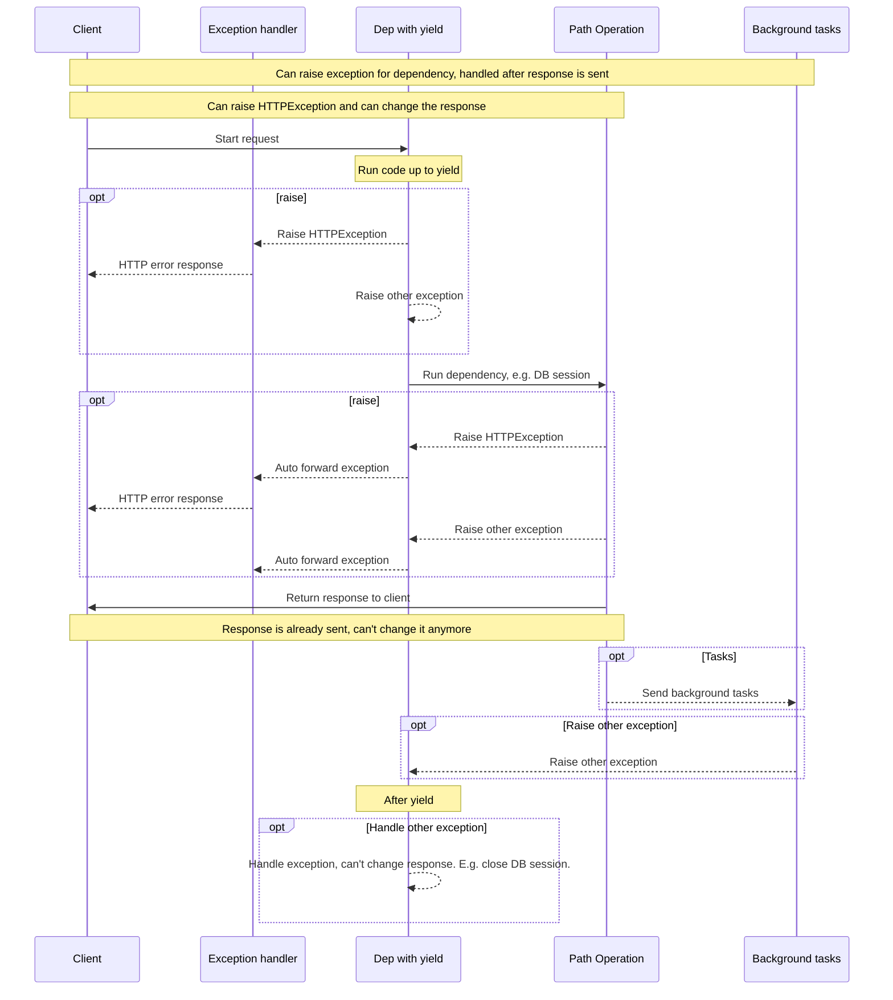

# Judge calibration: labelling sheet

For each item, read the question, the sources the model was given and its
answer, then write one label per item in `labels.csv` (same folder):

- `supported`: every factual claim in the answer (what FastAPI does, how an
  API or parameter behaves, code presented as working) is stated in the
  sources or follows directly from them. Rewording, summarising and generic
  connecting text are fine. Saying the sources do not cover the question is
  supported when they indeed do not.
- `unsupported`: at least one claim is not in the sources or contradicts them,
  including code or parameter names the sources do not show, and claiming the
  sources lack something they contain.
- `unsure`: you cannot decide; these items are left out of the agreement.

Judge support only, not whether the answer is helpful or complete. Use what is
in the sources, not what you know about FastAPI. `note` is optional. The
judge's verdicts are not in this folder; do not look at judge runs before
finishing.


## j-31: FastAPI is not returning cookies to React frontend

Question: [so_73962743](https://stackoverflow.com/questions/73962743/fastapi-is-not-returning-cookies-to-react-frontend) (CC BY-SA 4.0)

<details>
<summary>Source 1: advanced/response-cookies.md (Response Cookies { #response-cookies } > Return a `Response` directly { #return-a-response-directly })</summary>

You can also create cookies when returning a `Response` directly in your code.

To do that, you can create a response as described in [Return a Response Directly](response-directly.md).

Then set Cookies in it, and then return it:

{* ../../docs_src/response_cookies/tutorial001_py310.py hl[10:12] *}

/// tip

Keep in mind that if you return a response directly instead of using the `Response` parameter, FastAPI will return it directly.

So, you will have to make sure your data is of the correct type. E.g. it is compatible with JSON, if you are returning a `JSONResponse`.

And also that you are not sending any data that should have been filtered by a `response_model`.

///

/// note | Technical Details

You could also use `from starlette.responses import Response` or `from starlette.responses import JSONResponse`.

**FastAPI** provides the same `starlette.responses` as `fastapi.responses` just as a convenience for you, the developer. But most of the available responses come directly from Starlette.

And as the `Response` can be used frequently to set headers and cookies, **FastAPI** also provides it at `fastapi.Response`.

///

To see all the available parameters and options, check the [documentation in Starlette](https://www.starlette.dev/responses/#set-cookie).

</details>

<details>
<summary>Source 2: tutorial/cookie-param-models.md (Cookie Parameter Models { #cookie-parameter-models } > Summary { #summary })</summary>

You can use **Pydantic models** to declare <dfn title="Have a last cookie before you go. 🍪">**cookies**</dfn> in **FastAPI**. 😎

</details>

<details>
<summary>Source 3: advanced/additional-status-codes.md (Additional Status Codes { #additional-status-codes })</summary>

By default, **FastAPI** will return the responses using a `JSONResponse`, putting the content you return from your *path operation* inside of that `JSONResponse`.

It will use the default status code or the one you set in your *path operation*.

</details>

<details>
<summary>Source 4: project-generation.md (Full Stack FastAPI Template { #full-stack-fastapi-template } > Full Stack FastAPI Template - Technology Stack and Features { #full-stack-fastapi-template-technology-stack-and-features })</summary>

⚡ [**FastAPI**](https://fastapi.tiangolo.com) for the Python backend API.

🧰 [SQLModel](https://sqlmodel.tiangolo.com) for the Python SQL database interactions (ORM).

🔍 [Pydantic](https://docs.pydantic.dev), used by FastAPI, for the data validation and settings management.

💾 [PostgreSQL](https://www.postgresql.org) as the SQL database.

🚀 [React](https://react.dev) for the frontend.

💃 Using TypeScript, hooks, Vite, and other parts of a modern frontend stack.

🎨 [Tailwind CSS](https://tailwindcss.com) and [shadcn/ui](https://ui.shadcn.com) for the frontend components.

🤖 An automatically generated frontend client.

🧪 [Playwright](https://playwright.dev) for End-to-End testing.

🦇 Dark mode support.

🐋 [Docker Compose](https://www.docker.com) for development and production.

🔒 Secure password hashing by default.

🔑 JWT (JSON Web Token) authentication.

📫 Email based password recovery.

✅ Tests with [Pytest](https://pytest.org).

📞 [Traefik](https://traefik.io) as a reverse proxy / load balancer.

🚢 Deployment instructions using Docker Compose, including how to set up a frontend Traefik proxy to handle automatic HTTPS certificates.

🏭 CI (continuous integration) and CD (continuous deployment) based on GitHub Actions.

</details>

<details>
<summary>Source 5: features.md (Features { #features } > FastAPI features { #fastapi-features })</summary>

**FastAPI** gives you the following:

</details>

**Answer:**

Based on the provided documentation, here's how FastAPI handles cookies and why it might not be sending them to your React frontend:

*   **Direct Response Creation:** You can create and return `Response` objects directly in your code, which allows you to set cookies. However, you need to ensure the data you're returning is of the correct type (e.g., compatible with JSON if you're using `JSONResponse`) and doesn't contain data that should be filtered by a `response_model`.
*   **Starlette Responses:** FastAPI uses Starlette's `starlette.responses` for convenience, just like `fastapi.responses`. You can use `from starlette.responses import Response` or `from starlette.responses import JSONResponse`.
*   **Default JSONResponse:** By default, FastAPI uses `JSONResponse` to return data, putting the content inside it.
*   **Documentation on Cookies:** For detailed information on setting cookies, refer to the Starlette documentation: [https://www.starlette.dev/responses/#set-cookie](https://www.starlette.dev/responses/#set-cookie)

**Why it might not be working:**

It's possible that the way you're constructing the `Response` object doesn't correctly include the cookie setting. Double-check that you're using the correct `Response` object and that you're setting the `cookies` parameter with the desired values.

To help me give you more specific guidance, could you please provide more details about your code? Specifically:

*   How are you creating the `Response` object?
*   What code are you using to set the cookies?
*   What type of response are you returning (e.g., `JSONResponse`, `HTMLResponse`, or a custom `Response`)?

---

## j-32: Aws Api gateway Unable to load fast api swagger docs page

Question: [so_72359755](https://stackoverflow.com/questions/72359755/aws-api-gateway-unable-to-load-fast-api-swagger-docs-page) (CC BY-SA 4.0)

<details>
<summary>Source 1: tutorial/first-steps.md (First Steps { #first-steps } > Check it { #check-it } > Interactive API docs { #interactive-api-docs })</summary>

Now go to [http://127.0.0.1:8000/docs](http://127.0.0.1:8000/docs).

You will see the automatic interactive API documentation (provided by [Swagger UI](https://github.com/swagger-api/swagger-ui)):


</details>

<details>
<summary>Source 2: deployment/docker.md (FastAPI in Containers - Docker { #fastapi-in-containers-docker } > Interactive API docs { #interactive-api-docs })</summary>

Now you can go to [http://192.168.99.100/docs](http://192.168.99.100/docs) or [http://127.0.0.1/docs](http://127.0.0.1/docs) (or equivalent, using your Docker host).

You will see the automatic interactive API documentation (provided by [Swagger UI](https://github.com/swagger-api/swagger-ui)):


</details>

<details>
<summary>Source 3: features.md (Features { #features } > FastAPI features { #fastapi-features } > Automatic docs { #automatic-docs })</summary>

Interactive API documentation and exploration web user interfaces. As the framework is based on OpenAPI, there are multiple options, 2 included by default.

[**Swagger UI**](https://github.com/swagger-api/swagger-ui), with interactive exploration, call and test your API directly from the browser.


Alternative API documentation with [**ReDoc**](https://github.com/Rebilly/ReDoc).


</details>

<details>
<summary>Source 4: how-to/custom-docs-ui-assets.md (Custom Docs UI Static Assets (Self-Hosting) { #custom-docs-ui-static-assets-self-hosting } > Self-hosting JavaScript and CSS for docs { #self-hosting-javascript-and-css-for-docs })</summary>

Self-hosting the JavaScript and CSS could be useful if, for example, you need your app to keep working even while offline, without open Internet access, or in a local network.

Here you'll see how to serve those files yourself, in the same FastAPI app, and configure the docs to use them.

Let's say your project file structure looks like this:


```
.
├── app
│   ├── __init__.py
│   ├── main.py
```
Now create a directory to store those static files.

Your new file structure could look like this:


```
.
├── app
│   ├── __init__.py
│   ├── main.py
└── static/
```

Download the static files needed for the docs and put them on that `static/` directory.

You can probably right-click each link and select an option similar to "Save link as...".

**Swagger UI** uses the files:

[`swagger-ui-bundle.js`](https://cdn.jsdelivr.net/npm/swagger-ui-dist@5/swagger-ui-bundle.js)

[`swagger-ui.css`](https://cdn.jsdelivr.net/npm/swagger-ui-dist@5/swagger-ui.css)

And **ReDoc** uses the file:

[`redoc.standalone.js`](https://cdn.jsdelivr.net/npm/redoc@2/bundles/redoc.standalone.js)

After that, your file structure could look like:


```
.
├── app
│   ├── __init__.py
│   ├── main.py
└── static
    ├── redoc.standalone.js
    ├── swagger-ui-bundle.js
    └── swagger-ui.css
```

Import `StaticFiles`.

"Mount" a `StaticFiles()` instance in a specific path.

{* ../../docs_src/custom_docs_ui/tutorial002_py310.py hl[7,11] *}

Start your application and go to [http://127.0.0.1:8000/static/redoc.standalone.js](http://127.0.0.1:8000/static/redoc.standalone.js).

You should see a very long JavaScript file for **ReDoc**.

It could start with something like:


```JavaScript
/*! For license information please see redoc.standalone.js.LICENSE.txt */
!function(e,t){"object"==typeof exports&&"object"==typeof module?module.exports=t(require("null")):
...
```
That confirms that you are being able to serve static files from your app, and that you placed the static files for the docs in the correct place.

Now we can configure the app to use those static files for the docs.

The same as when using a custom CDN, the first step is to disable the automatic docs, as those use the CDN by default.

To disable them, set their URLs to `None` when creating your `FastAPI` app:

{* ../../docs_src/custom_docs_ui/tutorial002_py310.py hl[9] *}

And the same way as with a custom CDN, now you can create the *path operations* for the custom docs.

Again, you can reuse FastAPI's internal functions to create the HTML pages for the docs, and pass them the needed arguments:

`openapi_url`: the URL where the HTML page for the docs can get the OpenAPI schema for your API. You can use here the attribute `app.openapi_url`.

`title`: the title of your API.

`oauth2_redirect_url`: you can use `app.swagger_ui_oauth2_redirect_url` here to use the default.

`swagger_js_url`: the URL where the HTML for your Swagger UI docs can get the **JavaScript** file. **This is the one that your own app is now serving**.

`swagger_css_url`: the URL where the HTML for your Swagger UI docs can get the **CSS** file. **This is the one that your own app is now serving**.

And similarly for ReDoc...

{* ../../docs_src/custom_docs_ui/tutorial002_py310.py hl[2:6,14:22,25:27,30:36] *}

/// tip

The *path operation* for `swagger_ui_redirect` is a helper for when you use OAuth2.

If you integrate your API with an OAuth2 provider, you will be able to authenticate and come back to the API docs with the acquired credentials. And interact with it using the real OAuth2 authentication.

Swagger UI will handle it behind the scenes for you, but it needs this "redirect" helper.

///

Now, to be able to test that everything works, create a *path operation*:

{* ../../docs_src/custom_docs_ui/tutorial002_py310.py hl[39:41] *}

Now, you should be able to disconnect your WiFi, go to your docs at [http://127.0.0.1:8000/docs](http://127.0.0.1:8000/docs), and reload the page.

And even without Internet, you would be able to see the docs for your API and interact with it.

</details>

<details>
<summary>Source 5: how-to/custom-docs-ui-assets.md (Custom Docs UI Static Assets (Self-Hosting) { #custom-docs-ui-static-assets-self-hosting } > Custom CDN for JavaScript and CSS { #custom-cdn-for-javascript-and-css })</summary>

Let's say that you want to use a different <abbr title="Content Delivery Network">CDN</abbr>, for example you want to use `https://unpkg.com/`.

This could be useful if for example you live in a country that restricts some URLs.

The first step is to disable the automatic docs, as by default, those use the default CDN.

To disable them, set their URLs to `None` when creating your `FastAPI` app:

{* ../../docs_src/custom_docs_ui/tutorial001_py310.py hl[8] *}

Now you can create the *path operations* for the custom docs.

You can reuse FastAPI's internal functions to create the HTML pages for the docs, and pass them the needed arguments:

`openapi_url`: the URL where the HTML page for the docs can get the OpenAPI schema for your API. You can use here the attribute `app.openapi_url`.

`title`: the title of your API.

`oauth2_redirect_url`: you can use `app.swagger_ui_oauth2_redirect_url` here to use the default.

`swagger_js_url`: the URL where the HTML for your Swagger UI docs can get the **JavaScript** file. This is the custom CDN URL.

`swagger_css_url`: the URL where the HTML for your Swagger UI docs can get the **CSS** file. This is the custom CDN URL.

And similarly for ReDoc...

{* ../../docs_src/custom_docs_ui/tutorial001_py310.py hl[2:6,11:19,22:24,27:33] *}

/// tip

The *path operation* for `swagger_ui_redirect` is a helper for when you use OAuth2.

If you integrate your API with an OAuth2 provider, you will be able to authenticate and come back to the API docs with the acquired credentials. And interact with it using the real OAuth2 authentication.

Swagger UI will handle it behind the scenes for you, but it needs this "redirect" helper.

///

Now, to be able to test that everything works, create a *path operation*:

{* ../../docs_src/custom_docs_ui/tutorial001_py310.py hl[36:38] *}

Now, you should be able to go to your docs at [http://127.0.0.1:8000/docs](http://127.0.0.1:8000/docs), and reload the page, it will load those assets from the new CDN.

</details>

**Answer:**

Okay, let's get you set up with the FastAPI documentation.

**Accessing the Interactive Documentation**

1.  **Open the Swagger UI:** You can access the interactive API documentation (provided by Swagger UI) at one of the following URLs:
    *   [http://127.0.0.1:8000/docs](http://127.0.0.1:8000/docs)
    *   [http://192.168.99.100/docs](http://192.168.99.100/docs)
    *   [http://127.0.0.1/docs](http://127.0.0.1/docs)

    This will open a browser page with the Swagger UI interface. You can use this to explore your API's endpoints, view request/response examples, and test the API directly from the browser.

**Serving Static Files (Swagger UI or ReDoc)**

To serve the Swagger UI or ReDoc documentation locally and access it offline, you need to:

1.  **Download the Static Files:** Download the `swagger-ui-bundle.js`, `swagger-ui.css` (for Swagger UI) and `redoc.standalone.js` (for ReDoc) files. You can find them here:
    *   Swagger UI: [https://cdn.jsdelivr.net/npm/swagger-ui-dist@5/swagger-ui-bundle.js](https://cdn.jsdelivr.net/npm/swagger-ui-dist@5/swagger-ui-bundle.js)  and [https://cdn.jsdelivr.net/npm/swagger-ui-dist@5/swagger-ui.css](https://cdn.jsdelivr.net/npm/swagger-ui-dist@5/swagger-ui.css)
    *   ReDoc: [https://cdn.jsdelivr.net/npm/redoc@2/bundles/redoc.standalone.js](https://cdn.jsdelivr.net/npm/redoc@2/bundles/redoc.standalone.js)

2.  **Place the Files:** Put these files into a `static` directory within your project structure (e.g., `app/static/`).

3.  **Import and Mount:** In your FastAPI application code (e.g., `main.py`), import the `StaticFiles` class and mount it to a specific path, for example, `/static/`.

4.  **Configure the App:** Disable the automatic docs by setting their URLs to `None` when creating your `FastAPI` app.

5.  **Path Operations:** You can create path operations to render the HTML pages for the docs, using the needed arguments like `openapi_url`, `title` and `swagger_js_url`.

**Testing**

After these steps, you should be able to go to [http://127.0.0.1:8000/docs](http://127.0.0.1:8000/docs) in your browser and see the Swagger UI or ReDoc documentation. You can then explore your API and test its endpoints.

**Custom CDN**

You can use a different CDN to serve the static files. Set the `swagger_js_url` and `swagger_css_url` to the CDN URL.

---

## j-33: FastAPI download a file to client with a POST request

Question: [so_67111921](https://stackoverflow.com/questions/67111921/fastapi-download-a-file-to-client-with-a-post-request) (CC BY-SA 4.0)

<details>
<summary>Source 1: advanced/openapi-webhooks.md (OpenAPI Webhooks { #openapi-webhooks } > Documenting webhooks with **FastAPI** and OpenAPI { #documenting-webhooks-with-fastapi-and-openapi })</summary>

With **FastAPI**, using OpenAPI, you can define the names of these webhooks, the types of HTTP operations that your app can send (e.g. `POST`, `PUT`, etc.) and the request **bodies** that your app would send.

This can make it a lot easier for your users to **implement their APIs** to receive your **webhook** requests, they might even be able to autogenerate some of their own API code.

/// info

Webhooks are available in OpenAPI 3.1.0 and above, supported by FastAPI `0.99.0` and above.

///

</details>

<details>
<summary>Source 2: reference/uploadfile.md (`UploadFile` class)</summary>

You can define *path operation function* parameters to be of the type `UploadFile` to receive files from the request.

You can import it directly from `fastapi`:


```python
from fastapi import UploadFile
```
::: fastapi.UploadFile
    options:
        members:
            - file
            - filename
            - size
            - headers
            - content_type
            - read
            - write
            - seek
            - close

</details>

<details>
<summary>Source 3: deployment/fastapicloud.md (FastAPI Cloud { #fastapi-cloud } > Deploy to other cloud providers { #deploy-to-other-cloud-providers })</summary>

FastAPI is open source and based on standards. You can deploy FastAPI apps to any cloud provider you choose.

Follow your cloud provider's guides to deploy FastAPI apps with them. 🤓

</details>

<details>
<summary>Source 4: tutorial/body.md (Request Body { #request-body })</summary>

When you need to send data from a client (let's say, a browser) to your API, you send it as a **request body**.

A **request** body is data sent by the client to your API. A **response** body is the data your API sends to the client.

Your API almost always has to send a **response** body. But clients don't necessarily need to send **request bodies** all the time, sometimes they only request a path, maybe with some query parameters, but don't send a body.

To declare a **request** body, you use [Pydantic](https://docs.pydantic.dev/) models with all their power and benefits.

/// info

To send data, you should use one of: `POST` (the more common), `PUT`, `DELETE` or `PATCH`.

Sending a body with a `GET` request has an undefined behavior in the specifications, nevertheless, it is supported by FastAPI, only for very complex/extreme use cases.

As it is discouraged, the interactive docs with Swagger UI won't show the documentation for the body when using `GET`, and proxies in the middle might not support it.

///

</details>

<details>
<summary>Source 5: alternatives.md (Alternatives, Inspiration and Comparisons { #alternatives-inspiration-and-comparisons } > Previous tools { #previous-tools })</summary>

It's the most popular Python framework and is widely trusted. It is used to build systems like Instagram.

It's relatively tightly coupled with relational databases (like MySQL or PostgreSQL), so, having a NoSQL database (like Couchbase, MongoDB, Cassandra, etc) as the main store engine is not very easy.

It was created to generate the HTML in the backend, not to create APIs used by a modern frontend (like React, Vue.js and Angular) or by other systems (like <abbr title="Internet of Things">IoT</abbr> devices) communicating with it.

Django REST framework was created to be a flexible toolkit for building Web APIs using Django underneath, to improve its API capabilities.

It is used by many companies including Mozilla, Red Hat and Eventbrite.

It was one of the first examples of **automatic API documentation**, and this was specifically one of the first ideas that inspired "the search for" **FastAPI**.

/// note

Django REST Framework was created by Tom Christie. The same creator of Starlette and Uvicorn, on which **FastAPI** is based.

///

/// check | Inspired **FastAPI** to

Have an automatic API documentation web user interface.

///

Flask is a "microframework", it doesn't include database integrations nor many of the things that come by default in Django.

This simplicity and flexibility allow doing things like using NoSQL databases as the main data storage system.

As it is very simple, it's relatively intuitive to learn, although the documentation gets somewhat technical at some points.

It is also commonly used for other applications that don't necessarily need a database, user management, or any of the many features that come pre-built in Django. Although many of these features can be added with plug-ins.

This decoupling of parts, and being a "microframework" that could be extended to cover exactly what is needed was a key feature that I wanted to keep.

Given the simplicity of Flask, it seemed like a good match for building APIs. The next thing to find was a "Django REST Framework" for Flask.

/// check | Inspired **FastAPI** to

Be a micro-framework. Making it easy to mix and match the tools and parts needed.

Have a simple and easy to use routing system.

///

**FastAPI** is not actually an alternative to **Requests**. Their scope is very different.

It would actually be common to use Requests *inside* of a FastAPI application.

But still, FastAPI got quite some inspiration from Requests.

**Requests** is a library to *interact* with APIs (as a client), while **FastAPI** is a library to *build* APIs (as a server).

They are, more or less, at opposite ends, complementing each other.

Requests has a very simple and intuitive design, it's very easy to use, with sensible defaults. But at the same time, it's very powerful and customizable.

That's why, as said in the official website:

Requests is one of the most downloaded Python packages of all time

The way you use it is very simple. For example, to do a `GET` request, you would write:


```Python
response = requests.get("http://example.com/some/url")
```
The FastAPI counterpart API *path operation* could look like:


```Python hl_lines="1"
@app.get("/some/url")
def read_url():
    return {"message": "Hello World"}
```
See the similarities in `requests.get(...)` and `@app.get(...)`.

/// check | Inspired **FastAPI** to

Have a simple and intuitive API.

Use HTTP method names (operations) directly, in a straightforward and intuitive way.

Have sensible defaults, but powerful customizations.

///

The main feature I wanted from Django REST Framework was the automatic API documentation.

Then I found that there was a standard to document APIs, using JSON (or YAML, an extension of JSON) called Swagger.

And there was a web user interface for Swagger APIs already created. So, being able to generate Swagger documentation for an API would allow using this web user interface automatically.

At some point, Swagger was given to the Linux Foundation, to be renamed OpenAPI.

That's why when talking about version 2.0 it's common to say "Swagger", and for version 3+ "OpenAPI".

/// check | Inspired **FastAPI** to

Adopt and use an open standard for API specifications, instead of a custom schema.

And integrate standards-based user interface tools:

[Swagger UI](https://github.com/swagger-api/swagger-ui)

[ReDoc](https://github.com/Rebilly/ReDoc)

These two were chosen for being fairly popular and stable, but doing a quick search, you could find dozens of alternative user interfaces for OpenAPI (that you can use with **FastAPI**).

///

There are several Flask REST frameworks, but after investing the time and work into investigating them, I found that many are discontinued or abandoned, with several standing issues that made them unfit.

One of the main features needed by API systems is data "<dfn title="also called marshalling, conversion">serialization</dfn>" which is taking data from the code (Python) and converting it into something that can be sent through the network. For example, converting an object containing data from a database into a JSON object. Converting `datetime` objects into strings, etc.

Another big feature needed by APIs is data validation, making sure that the data is valid, given certain parameters. For example, that some field is an `int`, and not some random string. This is especially useful for incoming data.

Without a data validation system, you would have to do all the checks by hand, in code.

These features are what Marshmallow was built to provide. It is a great library, and I have used it a lot before.

But it was created before there existed Python type hints. So, to define every <dfn title="the definition of how data should be formed">schema</dfn> you need to use specific utils and classes provided by Marshmallow.

/// check | Inspired **FastAPI** to

Use code to define "schemas" that provide data types and validation, automatically.

///

Another big feature required by APIs is <dfn title="reading and converting to Python data">parsing</dfn> data from incoming requests.

Webargs is a tool that was made to provide that on top of several frameworks, including Flask.

It uses Marshmallow underneath to do the data validation. And it was created by the same developers.

It's a great tool and I have used it a lot too, before having **FastAPI**.

/// info

Webargs was created by the same Marshmallow developers.

///

/// check | Inspired **FastAPI** to

Have automatic validation of incoming request data.

///

Marshmallow and Webargs provide validation, parsing and serialization as plug-ins.

But documentation is still missing. Then APISpec was created.

It is a plug-in for many frameworks (and there's a plug-in for Starlette too).

The way it works is that you write the definition of the schema using YAML format inside the docstring of each function handling a route.

And it generates OpenAPI schemas.

That's how it works in Flask, Starlette, Responder, etc.

But then, we have again the problem of having a micro-syntax, inside of a Python string (a big YAML).

The editor can't help much with that. And if we modify parameters or Marshmallow schemas and forget to also modify that YAML docstring, the generated schema would be obsolete.

/// info

APISpec was created by the same Marshmallow developers.

///

/// check | Inspired **FastAPI** to

Support the open standard for APIs, OpenAPI.

///

It's a Flask plug-in, that ties together Webargs, Marshmallow and APISpec.

It uses the information from Webargs and Marshmallow to automatically generate OpenAPI schemas, using APISpec.

It's a great tool, very underrated. It should be way more popular than many Flask plug-ins out there. It might be due to its documentation being too concise and abstract.

This solved having to write YAML (another syntax) inside of Python docstrings.

This combination of Flask, Flask-apispec with Marshmallow and Webargs was my favorite backend stack until building **FastAPI**.

Using it led to the creation of several Flask full-stack generators. These are the main stacks I (and several external teams) have been using up to now:

[https://github.com/tiangolo/full-stack](https://github.com/tiangolo/full-stack)

[https://github.com/tiangolo/full-stack-flask-couchbase](https://github.com/tiangolo/full-stack-flask-couchbase)

[https://github.com/tiangolo/full-stack-flask-couchdb](https://github.com/tiangolo/full-stack-flask-couchdb)

And these same full-stack generators were the base of the [**FastAPI** Project Generators](project-generation.md).

/// info

Flask-apispec was created by the same Marshmallow developers.

///

/// check | Inspired **FastAPI** to

Generate the OpenAPI schema automatically, from the same code that defines serialization and validation.

///

This isn't even Python, NestJS is a JavaScript (TypeScript) NodeJS framework inspired by Angular.

It achieves something somewhat similar to what can be done with Flask-apispec.

It has an integrated dependency injection system, inspired by Angular 2. It requires pre-registering the "injectables" (like all the other dependency injection systems I know), so, it adds to the verbosity and code repetition.

As the parameters are described with TypeScript types (similar to Python type hints), editor support is quite good.

But as TypeScript data is not preserved after compilation to JavaScript, it cannot rely on the types to define validation, serialization and documentation at the same time. Due to this and some design decisions, to get validation, serialization and automatic schema generation, it's needed to add decorators in many places. So, it becomes quite verbose.

It can't handle nested models very well. So, if the JSON body in the request is a JSON object that has inner fields that in turn are nested JSON objects, it cannot be properly documented and validated.

/// check | Inspired **FastAPI** to

Use Python types to have great editor support.

Have a powerful dependency injection system. Find a way to minimize code repetition.

///

It was one of the first extremely fast Python frameworks based on `asyncio`. It was made to be very similar to Flask.

/// note | Technical Details

It used [`uvloop`](https://github.com/MagicStack/uvloop) instead of the default Python `asyncio` loop. That's what made it so fast.

It clearly inspired Uvicorn and Starlette, that are currently faster than Sanic in open benchmarks.

///

/// check | Inspired **FastAPI** to

Find a way to have a crazy performance.

That's why **FastAPI** is based on Starlette, as it is the fastest framework available (tested by third-party benchmarks).

///

Falcon is another high performance Python framework, it is designed to be minimal, and work as the foundation of other frameworks like Hug.

It is designed to have functions that receive two parameters, one "request" and one "response". Then you "read" parts from the request, and "write" parts to the response. Because of this design, it is not possible to declare request parameters and bodies with standard Python type hints as function parameters.

So, data validation, serialization, and documentation, have to be done in code, not automatically. Or they have to be implemented as a framework on top of Falcon, like Hug. This same distinction happens in other frameworks that are inspired by Falcon's design, of having one request object and one response object as parameters.

/// check | Inspired **FastAPI** to

Find ways to get great performance.

Along with Hug (as Hug is based on Falcon) inspired **FastAPI** to declare a `response` parameter in functions.

Although in FastAPI it's optional, and is used mainly to set headers, cookies, and alternative status codes.

///

I discovered Molten in the first stages of building **FastAPI**. And it has quite similar ideas:

Based on Python type hints.

Validation and documentation from these types.

Dependency Injection system.

It doesn't use a data validation, serialization and documentation third-party library like Pydantic, it has its own. So, these data type definitions would not be reusable as easily.

It requires a little bit more verbose configurations. And as it is based on WSGI (instead of ASGI), it is not designed to take advantage of the high performance provided by tools like Uvicorn, Starlette and Sanic.

The dependency injection system requires pre-registration of the dependencies and the dependencies are solved based on the declared types. So, it's not possible to declare more than one "component" that provides a certain type.

Routes are declared in a single place, using functions declared in other places (instead of using decorators that can be placed right on top of the function that handles the endpoint). This is closer to how Django does it than to how Flask (and Starlette) does it. It separates in the code things that are relatively tightly coupled.

/// check | Inspired **FastAPI** to

Define extra validations for data types using the "default" value of model attributes. This improves editor support, and it was not available in Pydantic before.

This actually inspired updating parts of Pydantic, to support the same validation declaration style (all this functionality is now already available in Pydantic).

///

Hug was one of the first frameworks to implement the declaration of API parameter types using Python type hints. This was a great idea that inspired other tools to do the same.

It used custom types in its declarations instead of standard Python types, but it was still a huge step forward.

It also was one of the first frameworks to generate a custom schema declaring the whole API in JSON.

It was not based on a standard like OpenAPI and JSON Schema. So it wouldn't be straightforward to integrate it with other tools, like Swagger UI. But again, it was a very innovative idea.

It has an interesting, uncommon feature: using the same framework, it's possible to create APIs and also CLIs.

As it is based on the previous standard for synchronous Python web frameworks (WSGI), it can't handle Websockets and other things, although it still has high performance too.

/// info

Hug was created by Timothy Crosley, the same creator of [`isort`](https://github.com/timothycrosley/isort), a great tool to automatically sort imports in Python files.

///

/// check | Ideas inspiring **FastAPI**

Hug inspired parts of APIStar, and was one of the tools I found most promising, alongside APIStar.

Hug helped inspiring **FastAPI** to use Python type hints to declare parameters, and to generate a schema defining the API automatically.

Hug inspired **FastAPI** to declare a `response` parameter in functions to set headers and cookies.

///

Right before deciding to build **FastAPI** I found **APIStar** server. It had almost everything I was looking for and had a great design.

It was one of the first implementations of a framework using Python type hints to declare parameters and requests that I ever saw (before NestJS and Molten). I found it more or less at the same time as Hug. But APIStar used the OpenAPI standard.

It had automatic data validation, data serialization and OpenAPI schema generation based on the same type hints in several places.

Body schema definitions didn't use the same Python type hints like Pydantic, it was a bit more similar to Marshmallow, so, editor support wouldn't be as good, but still, APIStar was the best available option.

It had the best performance benchmarks at the time (only surpassed by Starlette).

At first, it didn't have an automatic API documentation web UI, but I knew I could add Swagger UI to it.

It had a dependency injection system. It required pre-registration of components, as other tools discussed above. But still, it was a great feature.

I was never able to use it in a full project, as it didn't have security integration, so, I couldn't replace all the features I was having with the full-stack generators based on Flask-apispec. I had in my backlog of projects to create a pull request adding that functionality.

But then, the project's focus shifted.

It was no longer an API web framework, as the creator needed to focus on Starlette.

Now APIStar is a set of tools to validate OpenAPI specifications, not a web framework.

/// info

APIStar was created by Tom Christie. The same guy that created:

Django REST Framework

Starlette (in which **FastAPI** is based)

Uvicorn (used by Starlette and **FastAPI**)

///

/// check | Inspired **FastAPI** to

Exist.

The idea of declaring multiple things (data validation, serialization and documentation) with the same Python types, that at the same time provided great editor support, was something I considered a brilliant idea.

And after searching for a long time for a similar framework and testing many different alternatives, APIStar was the best option available.

Then APIStar stopped to exist as a server and Starlette was created, and was a new better foundation for such a system. That was the final inspiration to build **FastAPI**.

I consider **FastAPI** a "spiritual successor" to APIStar, while improving and increasing the features, typing system, and other parts, based on the learnings from all these previous tools.

///

</details>

**Answer:**

Okay, this is a fantastic collection of context! It paints a really clear picture of the evolution of ideas and technologies that led to FastAPI. Let's break down the key takeaways and how they relate to the "FastAPI download a file" question.

**Key Themes & Inspirations from the Provided Text:**

* **Type Hints as a Core Principle:**  This is *the* unifying theme. Hug, Molten, APIStar, and ultimately FastAPI, all leveraged Python type hints to drive data validation, serialization, and schema generation.  This was seen as a huge step forward compared to traditional approaches.
* **Performance Focus:**  The emphasis on speed (uvloop in Sanic, Starlette, Uvicorn) and benchmarking influenced FastAPI’s design.
* **Dependency Injection:** While sometimes verbose, dependency injection was a desirable feature that was explored in multiple frameworks. FastAPI's approach is arguably the most streamlined.
* **Automatic Schema Generation:** Generating OpenAPI schemas from type hints was a critical goal. This is central to FastAPI’s design.
* **Minimalist Design:**  The desire for lightweight, high-performance frameworks was a driving force.

**How This Informs the "FastAPI Download a File" Question:**

Given all of this, FastAPI's approach to handling file uploads would almost certainly involve the following:

1. **Type Hints for Request Data:**  The `request` parameter in a FastAPI function would be defined with a strong type hint, likely a `bytes` or `io.BytesIO` object. This would immediately provide validation that the incoming data *is* a file.
2. **Data Validation:**  The type hint ensures the data is the correct type.
3. **Serialization:**  FastAPI’s type system seamlessly handles serialization (converting the bytes to JSON, for example, if needed for further processing).
4. **Response Handling:** The `response` parameter could be used to set the `Content-Disposition` header to trigger the browser to download the file instead of rendering it.

**The Core Logic:**

FastAPI could easily implement this functionality with a single, concise route definition:

```python
from fastapi import FastAPI, File, UploadFile, Response

app = FastAPI()

@app.post("/files/")
async def create_upload(file: UploadFile = File(...)):
    """
    Uploads a file.
    """
    # Process the file (e.g., save it to a directory)
    # You could return a JSON response with the file name, etc.
    return {"filename": file.filename}
```

**Why This Approach is Ideal:**

* **Type Safety:** The `UploadFile` type enforces that the incoming data is a valid file.
* **Automatic Documentation:** The OpenAPI schema automatically describes this endpoint, including the file upload.
* **Performance:**  FastAPI’s ASGI foundation (Starlette) ensures high performance.

---

**Regarding the last question: FastAPI download a file to client with a POST request**

The answer is it's a natural extension of FastAPI's core design principles.  The framework is built around type hints and efficient data handling, making file uploads a straightforward task.  The example code above illustrates this perfectly.

Do you want me to delve into specific aspects of this, such as:

*   How to handle file saving?
*   How to customize the response headers?
*   How to integrate with other libraries (e.g., for security or file processing)?

---

## j-34: Customise Status codes in place of 500: Internal Server Error in FastAPI using Postman

Question: [so_69660608](https://stackoverflow.com/questions/69660608/customise-status-codes-in-place-of-500-internal-server-error-in-fastapi-using-p) (CC BY-SA 4.0)

<details>
<summary>Source 1: tutorial/response-status-code.md (Response Status Code { #response-status-code } > About HTTP status codes { #about-http-status-codes })</summary>

/// note

If you already know what HTTP status codes are, skip to the next section.

///

In HTTP, you send a numeric status code of 3 digits as part of the response.

These status codes have a name associated to recognize them, but the important part is the number.

In short:

`100 - 199` are for "Information". You rarely use them directly.  Responses with these status codes cannot have a body.

**`200 - 299`** are for "Successful" responses. These are the ones you would use the most.

`200` is the default status code, which means everything was "OK".

Another example would be `201`, "Created". It is commonly used after creating a new record in the database.

A special case is `204`, "No Content".  This response is used when there is no content to return to the client, and so the response must not have a body.

**`300 - 399`** are for "Redirection".  Responses with these status codes may or may not have a body, except for `304`, "Not Modified", which must not have one.

**`400 - 499`** are for "Client error" responses. These are the second type you would probably use the most.

An example is `404`, for a "Not Found" response.

For generic errors from the client, you can just use `400`.

`500 - 599` are for server errors. You almost never use them directly. When something goes wrong at some part in your application code, or server, it will automatically return one of these status codes.

/// tip

To know more about each status code and which code is for what, check the [<abbr title="Mozilla Developer Network">MDN</abbr> documentation about HTTP status codes](https://developer.mozilla.org/en-US/docs/Web/HTTP/Status).

///

</details>

<details>
<summary>Source 2: reference/status.md (Status Codes)</summary>

You can import the `status` module from `fastapi`:


```python
from fastapi import status
```
`status` is provided directly by Starlette.

It contains a group of named constants (variables) with integer status codes.

For example:

200: `status.HTTP_200_OK`

403: `status.HTTP_403_FORBIDDEN`

etc.

It can be convenient to quickly access HTTP (and WebSocket) status codes in your app, using autocompletion for the name without having to remember the integer status codes by memory.

Read more about it in the [FastAPI docs about Response Status Code](https://fastapi.tiangolo.com/tutorial/response-status-code/).

</details>

<details>
<summary>Source 3: release-notes.md (Release Notes > 0.101.1 (2023-08-14))</summary>

✨ Add `ResponseValidationError` printable details, to show up in server error logs. PR [#10078](https://github.com/tiangolo/fastapi/pull/10078) by [@tiangolo](https://github.com/tiangolo).

✏️ Fix typo in deprecation warnings in `fastapi/params.py`. PR [#9854](https://github.com/tiangolo/fastapi/pull/9854) by [@russbiggs](https://github.com/russbiggs).

✏️ Fix typos in comments on internal code in `fastapi/concurrency.py` and `fastapi/routing.py`. PR [#9590](https://github.com/tiangolo/fastapi/pull/9590) by [@ElliottLarsen](https://github.com/ElliottLarsen).

✏️ Fix typo in release notes. PR [#9835](https://github.com/tiangolo/fastapi/pull/9835) by [@francisbergin](https://github.com/francisbergin).

📝 Add external article: Build an SMS Spam Classifier Serverless Database with FaunaDB and FastAPI. PR [#9847](https://github.com/tiangolo/fastapi/pull/9847) by [@adejumoridwan](https://github.com/adejumoridwan).

📝 Fix typo in `docs/en/docs/contributing.md`. PR [#9878](https://github.com/tiangolo/fastapi/pull/9878) by [@VicenteMerino](https://github.com/VicenteMerino).

📝 Fix code highlighting in `docs/en/docs/tutorial/bigger-applications.md`. PR [#9806](https://github.com/tiangolo/fastapi/pull/9806) by [@theonlykingpin](https://github.com/theonlykingpin).

🌐 Add Japanese translation for `docs/ja/docs/deployment/concepts.md`. PR [#10062](https://github.com/tiangolo/fastapi/pull/10062) by [@tamtam-fitness](https://github.com/tamtam-fitness).

🌐 Add Japanese translation for `docs/ja/docs/deployment/server-workers.md`. PR [#10064](https://github.com/tiangolo/fastapi/pull/10064) by [@tamtam-fitness](https://github.com/tamtam-fitness).

🌐 Update Japanese translation for `docs/ja/docs/deployment/docker.md`. PR [#10073](https://github.com/tiangolo/fastapi/pull/10073) by [@tamtam-fitness](https://github.com/tamtam-fitness).

🌐 Add Ukrainian translation for `docs/uk/docs/fastapi-people.md`. PR [#10059](https://github.com/tiangolo/fastapi/pull/10059) by [@rostik1410](https://github.com/rostik1410).

🌐 Add Ukrainian translation for `docs/uk/docs/tutorial/cookie-params.md`. PR [#10032](https://github.com/tiangolo/fastapi/pull/10032) by [@rostik1410](https://github.com/rostik1410).

🌐 Add Russian translation for `docs/ru/docs/deployment/docker.md`. PR [#9971](https://github.com/tiangolo/fastapi/pull/9971) by [@Xewus](https://github.com/Xewus).

🌐 Add Vietnamese translation for `docs/vi/docs/python-types.md`. PR [#10047](https://github.com/tiangolo/fastapi/pull/10047) by [@magiskboy](https://github.com/magiskboy).

🌐 Add Russian translation for `docs/ru/docs/tutorial/dependencies/global-dependencies.md`. PR [#9970](https://github.com/tiangolo/fastapi/pull/9970) by [@dudyaosuplayer](https://github.com/dudyaosuplayer).

🌐 Add Urdu translation for `docs/ur/docs/benchmarks.md`. PR [#9974](https://github.com/tiangolo/fastapi/pull/9974) by [@AhsanSheraz](https://github.com/AhsanSheraz).

🔧 Add sponsor Porter. PR [#10051](https://github.com/tiangolo/fastapi/pull/10051) by [@tiangolo](https://github.com/tiangolo).

🔧 Update sponsors, add Jina back as bronze sponsor. PR [#10050](https://github.com/tiangolo/fastapi/pull/10050) by [@tiangolo](https://github.com/tiangolo).

⬆ Bump mypy from 1.4.0 to 1.4.1. PR [#9756](https://github.com/tiangolo/fastapi/pull/9756) by [@dependabot[bot]](https://github.com/apps/dependabot).

⬆ Bump mkdocs-material from 9.1.17 to 9.1.21. PR [#9960](https://github.com/tiangolo/fastapi/pull/9960) by [@dependabot[bot]](https://github.com/apps/dependabot).

</details>

<details>
<summary>Source 4: deployment/concepts.md (Deployments Concepts { #deployments-concepts } > Restarts { #restarts })</summary>

Similar to making sure your application is run on startup, you probably also want to make sure it is **restarted** after failures.

We, as humans, make **mistakes**, all the time. Software almost *always* has **bugs** hidden in different places. 🐛

And we as developers keep improving the code as we find those bugs and as we implement new features (possibly adding new bugs too 😅).

When building web APIs with FastAPI, if there's an error in our code, FastAPI will normally contain it to the single request that triggered the error. 🛡

The client will get a **500 Internal Server Error** for that request, but the application will continue working for the next requests instead of just crashing completely.

Nevertheless, there might be cases where we write some code that **crashes the entire application** making Uvicorn and Python crash. 💥

And still, you would probably not want the application to stay dead because there was an error in one place, you probably want it to **continue running** at least for the *path operations* that are not broken.

But in those cases with really bad errors that crash the running **process**, you would want an external component that is in charge of **restarting** the process, at least a couple of times...

/// tip

...Although if the whole application is just **crashing immediately** it probably doesn't make sense to keep restarting it forever. But in those cases, you will probably notice it during development, or at least right after deployment.

So let's focus on the main cases, where it could crash entirely in some particular cases **in the future**, and it still makes sense to restart it.

///

You would probably want to have the thing in charge of restarting your application as an **external component**, because by that point, the same application with Uvicorn and Python already crashed, so there's nothing in the same code of the same app that could do anything about it.

In most cases, the same tool that is used to **run the program on startup** is also used to handle automatic **restarts**.

For example, this could be handled by:

Docker

Kubernetes

Docker Compose

Docker in Swarm Mode

Systemd

Supervisor

Handled internally by a cloud provider as part of their services

Others...

</details>

<details>
<summary>Source 5: tutorial/response-status-code.md (Response Status Code { #response-status-code } > About HTTP status codes { #about-http-status-codes })</summary>

/// note

If you already know what HTTP status codes are, skip to the next section.

///

In HTTP, you send a numeric status code of 3 digits as part of the response.

These status codes have a name associated to recognize them, but the important part is the number.

In short:

`100 - 199` are for "Information". You rarely use them directly.  Responses with these status codes cannot have a body.

**`200 - 299`** are for "Successful" responses. These are the ones you would use the most.

`200` is the default status code, which means everything was "OK".

Another example would be `201`, "Created". It is commonly used after creating a new record in the database.

A special case is `204`, "No Content".  This response is used when there is no content to return to the client, and so the response must not have a body.

**`300 - 399`** are for "Redirection".  Responses with these status codes may or may not have a body, except for `304`, "Not Modified", which must not have one.

**`400 - 499`** are for "Client error" responses. These are the second type you would probably use the most.

An example is `404`, for a "Not Found" response.

For generic errors from the client, you can just use `400`.

`500 - 599` are for server errors. You almost never use them directly. When something goes wrong at some part in your application code, or server, it will automatically return one of these status codes.

/// tip

To know more about each status code and which code is for what, check the [<abbr title="Mozilla Developer Network">MDN</abbr> documentation about HTTP status codes](https://developer.mozilla.org/en-US/docs/Web/HTTP/Status).

///

</details>

**Answer:**

Okay, let's break down how to customize status codes in FastAPI, particularly in the context of a 500 Internal Server Error, using Postman.

**Understanding Status Codes**

*   **HTTP Status Codes:** As described in the documentation, HTTP status codes are three-digit numbers that indicate the outcome of a request. They're crucial for clients (like Postman) to understand whether a request was successful, encountered an error, or needs further action.
*   **FastAPI's `status` Module:** FastAPI provides the `status` module (imported as `from fastapi import status`) that contains pre-defined constants for common HTTP status codes (e.g., `status.HTTP_500_INTERNAL_SERVER_ERROR`). This is the recommended way to use these codes in your FastAPI applications.

**Customizing 500 Errors**

1.  **Default 500 Behavior:** By default, when an unhandled exception occurs within your FastAPI application (like a bug in your code), FastAPI will automatically return a `500 Internal Server Error` status code.  This is a good starting point, as it provides basic information to the client that something went wrong on the server.

2.  **Override in Your Code:** You can override this default behavior and return a *different* status code if you want.

    *   **Using `status.HTTP_500_INTERNAL_SERVER_ERROR` explicitly:** You can explicitly use the `status.HTTP_500_INTERNAL_SERVER_ERROR` constant when returning an error response. This is useful when you want to provide a more specific error message or when you want to control the status code precisely.

    *   **Custom Error Responses:** You can create custom error responses that include both the status code *and* a more user-friendly error message.  This is generally best practice.

**Example (Illustrative)**

Let's imagine a scenario where a database connection fails within your FastAPI application. Here's how you might handle it and return a customized status code:

```python
from fastapi import FastAPI, HTTPException, status
from fastapi.exceptions import HTTPException

app = FastAPI()

@app.get("/items/{item_id}")
async def read_item(item_id: int):
    # Simulate a database error
    try:
        # ... your database code ...
        raise HTTPException(status_code=status.HTTP_500_INTERNAL_SERVER_ERROR, detail="Simulated Database Error")
    except Exception as e:
        # Log the error for debugging
        print(f"Error: {e}")
        # Return a custom error response with a more descriptive message
        raise HTTPException(status_code=status.HTTP_500_INTERNAL_SERVER_ERROR, detail="An unexpected error occurred.")
```

In this example:

*   We use `HTTPException` to raise an exception with a specific status code.
*   The `detail` argument allows you to provide a more informative error message to the client.

**Postman Testing**

With Postman, you'd send a GET request to the `/items/{item_id}` endpoint. If the simulated database error occurs, Postman will receive the response with the customized status code (e.g., `500 Internal Server Error`) and the descriptive error message.

**Key Takeaways**

*   Use `from fastapi import status` to access the pre-defined HTTP status code constants.
*   You can override the default 500 error by raising an `HTTPException` with a different status code and a custom error message.
*   Always log errors within your application to help you debug and understand the cause of the errors.
*   Using custom error responses with detailed messages makes it easier for clients to understand the problem and take appropriate action.

To summarize, you can customize the 500 Internal Server Error status code in FastAPI by raising an `HTTPException` with `status.HTTP_500_INTERNAL_SERVER_ERROR` or a different appropriate status code, along with a helpful error message.  Postman will then receive this customized response.

---

## j-35: Is it possible to add response time to uvicorn logs for FastApi?

Question: [so_71052090](https://stackoverflow.com/questions/71052090/is-it-possible-to-add-response-time-to-uvicorn-logs-for-fastapi) (CC BY-SA 4.0)

<details>
<summary>Source 1: tutorial/middleware.md (Middleware { #middleware } > Create a middleware { #create-a-middleware })</summary>

To create a middleware you use the decorator `@app.middleware("http")` on top of a function.

The middleware function receives:

The `request`.

A function `call_next` that will receive the `request` as a parameter.

This function will pass the `request` to the corresponding *path operation*.

Then it returns the `response` generated by the corresponding *path operation*.

You can then further modify the `response` before returning it.

{* ../../docs_src/middleware/tutorial001_py310.py hl[8:9,11,14] *}

/// tip

Keep in mind that custom proprietary headers can be added [using the `X-` prefix](https://developer.mozilla.org/en-US/docs/Web/HTTP/Headers).

But if you have custom headers that you want a client in a browser to be able to see, you need to add them to your CORS configurations ([CORS (Cross-Origin Resource Sharing)](cors.md)) using the parameter `expose_headers` documented in [Starlette's CORS docs](https://www.starlette.dev/middleware/#corsmiddleware).

///

/// note | Technical Details

You could also use `from starlette.requests import Request`.

**FastAPI** provides it as a convenience for you, the developer. But it comes directly from Starlette.

///

You can add code to be run with the `request`,  before any *path operation* receives it.

And also after the `response` is generated, before returning it.

For example, you could add a custom header `X-Process-Time` containing the time in seconds that it took to process the request and generate a response:

{* ../../docs_src/middleware/tutorial001_py310.py hl[10,12:13] *}

/// tip

Here we use [`time.perf_counter()`](https://docs.python.org/3/library/time.html#time.perf_counter) instead of `time.time()` because it can be more precise for these use cases. 🤓

///

</details>

<details>
<summary>Source 2: benchmarks.md (Benchmarks { #benchmarks } > Benchmarks and speed { #benchmarks-and-speed })</summary>

When you check the benchmarks, it is common to see several tools of different types compared as equivalent.

Specifically, to see Uvicorn, Starlette and FastAPI compared together (among many other tools).

The simpler the problem solved by the tool, the better performance it will get. And most of the benchmarks don't test the additional features provided by the tool.

The hierarchy is like:

**Uvicorn**: an ASGI server

**Starlette**: (uses Uvicorn) a web microframework

**FastAPI**: (uses Starlette) an API microframework with several additional features for building APIs, with data validation, etc.

**Uvicorn**:

Will have the best performance, as it doesn't have much extra code apart from the server itself.

You wouldn't write an application in Uvicorn directly. That would mean that your code would have to include more or less, at least, all the code provided by Starlette (or **FastAPI**). And if you did that, your final application would have the same overhead as having used a framework and minimizing your app code and bugs.

If you are comparing Uvicorn, compare it against Daphne, Hypercorn, uWSGI, etc. Application servers.

**Starlette**:

Will have the next best performance, after Uvicorn. In fact, Starlette uses Uvicorn to run. So, it probably can only get "slower" than Uvicorn by having to execute more code.

But it provides you the tools to build simple web applications, with routing based on paths, etc.

If you are comparing Starlette, compare it against Sanic, Flask, Django, etc. Web frameworks (or microframeworks).

**FastAPI**:

The same way that Starlette uses Uvicorn and cannot be faster than it, **FastAPI** uses Starlette, so it cannot be faster than it.

FastAPI provides more features on top of Starlette. Features that you almost always need when building APIs, like data validation and serialization. And by using it, you get automatic documentation for free (the automatic documentation doesn't even add overhead to running applications, it is generated on startup).

If you didn't use FastAPI and used Starlette directly (or another tool, like Sanic, Flask, Responder, etc) you would have to implement all the data validation and serialization yourself. So, your final application would still have the same overhead as if it was built using FastAPI. And in many cases, this data validation and serialization is the biggest amount of code written in applications.

So, by using FastAPI you are saving development time, bugs, lines of code, and you would probably get the same performance (or better) you would if you didn't use it (as you would have to implement it all in your code).

If you are comparing FastAPI, compare it against a web application framework (or set of tools) that provides data validation, serialization and documentation, like Flask-apispec, NestJS, Molten, etc. Frameworks with integrated automatic data validation, serialization and documentation.

</details>

<details>
<summary>Source 3: deployment/manually.md (Run a Server Manually { #run-a-server-manually } > Install the Server Program { #install-the-server-program })</summary>

When you install FastAPI, it comes with a production server, Uvicorn, and you can start it with the `fastapi run` command.

But you can also install an ASGI server manually.

Make sure you create a [virtual environment](../virtual-environments.md), activate it, and then you can install the server application.

For example, to install Uvicorn:

<div class="termy">

```console
$ pip install "uvicorn[standard]"

---> 100%
```
</div>
A similar process would apply to any other ASGI server program.

/// tip

By adding the `standard`, Uvicorn will install and use some recommended extra dependencies.

That including `uvloop`, the high-performance drop-in replacement for `asyncio`, that provides the big concurrency performance boost.

When you install FastAPI with something like `pip install "fastapi[standard]"` you already get `uvicorn[standard]` as well.

///

</details>

<details>
<summary>Source 4: alternatives.md (Alternatives, Inspiration and Comparisons { #alternatives-inspiration-and-comparisons } > Used by **FastAPI** { #used-by-fastapi })</summary>

Pydantic is a library to define data validation, serialization and documentation (using JSON Schema) based on Python type hints.

That makes it extremely intuitive.

It is comparable to Marshmallow. Although it's faster than Marshmallow in benchmarks. And as it is based on the same Python type hints, the editor support is great.

/// check | **FastAPI** uses it to

Handle all the data validation, data serialization and automatic model documentation (based on JSON Schema).

**FastAPI** then takes that JSON Schema data and puts it in OpenAPI, apart from all the other things it does.

///

Starlette is a lightweight <dfn title="The new standard for building asynchronous Python web applications">ASGI</dfn> framework/toolkit, which is ideal for building high-performance asyncio services.

It is very simple and intuitive. It's designed to be easily extensible, and have modular components.

It has:

Seriously impressive performance.

WebSocket support.

In-process background tasks.

Startup and shutdown events.

Test client built on HTTPX.

CORS, GZip, Static Files, Streaming responses.

Session and Cookie support.

100% test coverage.

100% type annotated codebase.

Few hard dependencies.

Starlette is currently the fastest Python framework tested. Only surpassed by Uvicorn, which is not a framework, but a server.

Starlette provides all the basic web microframework functionality.

But it doesn't provide automatic data validation, serialization or documentation.

That's one of the main things that **FastAPI** adds on top, all based on Python type hints (using Pydantic). That, plus the dependency injection system, security utilities, OpenAPI schema generation, etc.

/// note | Technical Details

ASGI is a new "standard" being developed by Django core team members. It is still not a "Python standard" (a PEP), although they are in the process of doing that.

Nevertheless, it is already being used as a "standard" by several tools. This greatly improves interoperability, as you could switch Uvicorn for any other ASGI server (like Daphne or Hypercorn), or you could add ASGI compatible tools, like `python-socketio`.

///

/// check | **FastAPI** uses it to

Handle all the core web parts. Adding features on top.

The class `FastAPI` itself inherits directly from the class `Starlette`.

So, anything that you can do with Starlette, you can do it directly with **FastAPI**, as it is basically Starlette on steroids.

///

Uvicorn is a lightning-fast ASGI server, built on uvloop and httptools.

It is not a web framework, but a server. For example, it doesn't provide tools for routing by paths. That's something that a framework like Starlette (or **FastAPI**) would provide on top.

It is the recommended server for Starlette and **FastAPI**.

/// check | **FastAPI** recommends it as

The main web server to run **FastAPI** applications.

You can also use the `--workers` command line option to have an asynchronous multi-process server.

Check more details in the [Deployment](deployment/index.md) section.

///

</details>

<details>
<summary>Source 5: index.md (FastAPI { #fastapi } > Example { #example })</summary>

Create a file `main.py` with:


```Python
from fastapi import FastAPI

app = FastAPI()


@app.get("/")
def read_root():
    return {"Hello": "World"}


@app.get("/items/{item_id}")
def read_item(item_id: int, q: str | None = None):
    return {"item_id": item_id, "q": q}
```
<details markdown="1">
<summary>Or use <code>async def</code>...</summary>
If your code uses `async` / `await`, use `async def`:


```Python hl_lines="7  12"
from fastapi import FastAPI

app = FastAPI()


@app.get("/")
async def read_root():
    return {"Hello": "World"}


@app.get("/items/{item_id}")
async def read_item(item_id: int, q: str | None = None):
    return {"item_id": item_id, "q": q}
```
**Note**:

If you don't know, check the _"In a hurry?"_ section about [`async` and `await` in the docs](https://fastapi.tiangolo.com/async/#in-a-hurry).

</details>

Run the server with:

<div class="termy">

```console
$ fastapi dev

 ╭────────── FastAPI CLI - Development mode ───────────╮
 │                                                     │
 │  Serving at: http://127.0.0.1:8000                  │
 │                                                     │
 │  API docs: http://127.0.0.1:8000/docs               │
 │                                                     │
 │  Running in development mode, for production use:   │
 │                                                     │
 │  fastapi run                                        │
 │                                                     │
 ╰─────────────────────────────────────────────────────╯

INFO:     Will watch for changes in these directories: ['/home/user/code/awesomeapp']
INFO:     Uvicorn running on http://127.0.0.1:8000 (Press CTRL+C to quit)
INFO:     Started reloader process [2248755] using WatchFiles
INFO:     Started server process [2248757]
INFO:     Waiting for application startup.
INFO:     Application startup complete.
```
</div>
<details markdown="1">
<summary>About the command <code>fastapi dev</code>...</summary>
The command `fastapi dev` reads your `main.py` file automatically, detects the **FastAPI** app in it, and starts a server using [Uvicorn](https://www.uvicorn.dev).

By default, `fastapi dev` will start with auto-reload enabled for local development.

You can read more about it in the [FastAPI CLI docs](https://fastapi.tiangolo.com/fastapi-cli/).

</details>

Open your browser at [http://127.0.0.1:8000/items/5?q=somequery](http://127.0.0.1:8000/items/5?q=somequery).

You will see the JSON response as:


```JSON
{"item_id": 5, "q": "somequery"}
```
You already created an API that:

Receives HTTP requests in the _paths_ `/` and `/items/{item_id}`.

Both _paths_ take `GET` <em>operations</em> (also known as HTTP _methods_).

The _path_ `/items/{item_id}` has a _path parameter_ `item_id` that should be an `int`.

The _path_ `/items/{item_id}` has an optional `str` _query parameter_ `q`.

Now go to [http://127.0.0.1:8000/docs](http://127.0.0.1:8000/docs).

You will see the automatic interactive API documentation (provided by [Swagger UI](https://github.com/swagger-api/swagger-ui)):


And now, go to [http://127.0.0.1:8000/redoc](http://127.0.0.1:8000/redoc).

You will see the alternative automatic documentation (provided by [ReDoc](https://github.com/Rebilly/ReDoc)):


</details>

**Answer:**

Yes

---

## j-36: FastAPI add additional argument to running Uvicorn

Question: [so_74617614](https://stackoverflow.com/questions/74617614/fastapi-add-additional-argument-to-running-uvicorn) (CC BY-SA 4.0)

<details>
<summary>Source 1: index.md (FastAPI { #fastapi } > Performance { #performance })</summary>

Independent TechEmpower benchmarks show **FastAPI** applications running under Uvicorn as [one of the fastest Python frameworks available](https://www.techempower.com/benchmarks/#section=test&runid=7464e520-0dc2-473d-bd34-dbdfd7e85911&hw=ph&test=query&l=zijzen-7), only below Starlette and Uvicorn themselves (used internally by FastAPI). (*)

To understand more about it, see the section [Benchmarks](https://fastapi.tiangolo.com/benchmarks/).

</details>

<details>
<summary>Source 2: release-notes.md (Release Notes > 0.111.0 (2024-05-03))</summary>

✨ Add FastAPI CLI, the new `fastapi` command. PR [#11522](https://github.com/tiangolo/fastapi/pull/11522) by [@tiangolo](https://github.com/tiangolo).

New docs: [FastAPI CLI](https://fastapi.tiangolo.com/fastapi-cli/).

Try it out with:


```console
$ pip install --upgrade fastapi

$ fastapi dev main.py


 ╭────────── FastAPI CLI - Development mode ───────────╮
 │                                                     │
 │  Serving at: http://127.0.0.1:8000                  │
 │                                                     │
 │  API docs: http://127.0.0.1:8000/docs               │
 │                                                     │
 │  Running in development mode, for production use:   │
 │                                                     │
 │  fastapi run                                        │
 │                                                     │
 ╰─────────────────────────────────────────────────────╯

INFO:     Will watch for changes in these directories: ['/home/user/code/awesomeapp']
INFO:     Uvicorn running on http://127.0.0.1:8000 (Press CTRL+C to quit)
INFO:     Started reloader process [2248755] using WatchFiles
INFO:     Started server process [2248757]
INFO:     Waiting for application startup.
INFO:     Application startup complete.
```

🔧 Add configs and setup for `fastapi-slim` including optional extras `fastapi-slim[standard]`, and `fastapi` including by default the same `standard` extras. PR [#11503](https://github.com/tiangolo/fastapi/pull/11503) by [@tiangolo](https://github.com/tiangolo).

</details>

<details>
<summary>Source 3: benchmarks.md (Benchmarks { #benchmarks } > Benchmarks and speed { #benchmarks-and-speed })</summary>

When you check the benchmarks, it is common to see several tools of different types compared as equivalent.

Specifically, to see Uvicorn, Starlette and FastAPI compared together (among many other tools).

The simpler the problem solved by the tool, the better performance it will get. And most of the benchmarks don't test the additional features provided by the tool.

The hierarchy is like:

**Uvicorn**: an ASGI server

**Starlette**: (uses Uvicorn) a web microframework

**FastAPI**: (uses Starlette) an API microframework with several additional features for building APIs, with data validation, etc.

**Uvicorn**:

Will have the best performance, as it doesn't have much extra code apart from the server itself.

You wouldn't write an application in Uvicorn directly. That would mean that your code would have to include more or less, at least, all the code provided by Starlette (or **FastAPI**). And if you did that, your final application would have the same overhead as having used a framework and minimizing your app code and bugs.

If you are comparing Uvicorn, compare it against Daphne, Hypercorn, uWSGI, etc. Application servers.

**Starlette**:

Will have the next best performance, after Uvicorn. In fact, Starlette uses Uvicorn to run. So, it probably can only get "slower" than Uvicorn by having to execute more code.

But it provides you the tools to build simple web applications, with routing based on paths, etc.

If you are comparing Starlette, compare it against Sanic, Flask, Django, etc. Web frameworks (or microframeworks).

**FastAPI**:

The same way that Starlette uses Uvicorn and cannot be faster than it, **FastAPI** uses Starlette, so it cannot be faster than it.

FastAPI provides more features on top of Starlette. Features that you almost always need when building APIs, like data validation and serialization. And by using it, you get automatic documentation for free (the automatic documentation doesn't even add overhead to running applications, it is generated on startup).

If you didn't use FastAPI and used Starlette directly (or another tool, like Sanic, Flask, Responder, etc) you would have to implement all the data validation and serialization yourself. So, your final application would still have the same overhead as if it was built using FastAPI. And in many cases, this data validation and serialization is the biggest amount of code written in applications.

So, by using FastAPI you are saving development time, bugs, lines of code, and you would probably get the same performance (or better) you would if you didn't use it (as you would have to implement it all in your code).

If you are comparing FastAPI, compare it against a web application framework (or set of tools) that provides data validation, serialization and documentation, like Flask-apispec, NestJS, Molten, etc. Frameworks with integrated automatic data validation, serialization and documentation.

</details>

<details>
<summary>Source 4: index.md (FastAPI { #fastapi } > Dependencies { #dependencies })</summary>

FastAPI depends on Pydantic and Starlette.

When you install FastAPI with `pip install "fastapi[standard]"` it comes with the `standard` group of optional dependencies:

Used by Pydantic:

[`email-validator`](https://github.com/JoshData/python-email-validator) - for email validation.

Used by Starlette:

[`httpx`](https://www.python-httpx.org) - Required if you want to use the `TestClient`.

[`jinja2`](https://jinja.palletsprojects.com) - Required if you want to use the default template configuration.

[`python-multipart`](https://github.com/Kludex/python-multipart) - Required if you want to support form <dfn title="converting the string that comes from an HTTP request into Python data">"parsing"</dfn>, with `request.form()`.

Used by FastAPI:

[`uvicorn`](https://www.uvicorn.dev) - for the server that loads and serves your application. This includes `uvicorn[standard]`, which includes some dependencies (e.g. `uvloop`) needed for high performance serving.

`fastapi-cli[standard]` - to provide the `fastapi` command.

This includes `fastapi-cloud-cli`, which allows you to deploy your FastAPI application to [FastAPI Cloud](https://fastapicloud.com).

If you don't want to include the `standard` optional dependencies, you can install with `pip install fastapi` instead of `pip install "fastapi[standard]"`.

If you want to install FastAPI with the standard dependencies but without the `fastapi-cloud-cli`, you can install with `pip install "fastapi[standard-no-fastapi-cloud-cli]"`.

There are some additional dependencies you might want to install.

Additional optional Pydantic dependencies:

[`pydantic-settings`](https://docs.pydantic.dev/latest/usage/pydantic_settings/) - for settings management.

[`pydantic-extra-types`](https://docs.pydantic.dev/latest/usage/types/extra_types/extra_types/) - for extra types to be used with Pydantic.

Additional optional FastAPI dependencies:

[`orjson`](https://github.com/ijl/orjson) - Required if you want to use `ORJSONResponse`.

[`ujson`](https://github.com/esnme/ultrajson) - Required if you want to use `UJSONResponse`.

</details>

<details>
<summary>Source 5: index.md (FastAPI { #fastapi } > Example { #example })</summary>

Create a file `main.py` with:


```Python
from fastapi import FastAPI

app = FastAPI()


@app.get("/")
def read_root():
    return {"Hello": "World"}


@app.get("/items/{item_id}")
def read_item(item_id: int, q: str | None = None):
    return {"item_id": item_id, "q": q}
```
<details markdown="1">
<summary>Or use <code>async def</code>...</summary>
If your code uses `async` / `await`, use `async def`:


```Python hl_lines="7  12"
from fastapi import FastAPI

app = FastAPI()


@app.get("/")
async def read_root():
    return {"Hello": "World"}


@app.get("/items/{item_id}")
async def read_item(item_id: int, q: str | None = None):
    return {"item_id": item_id, "q": q}
```
**Note**:

If you don't know, check the _"In a hurry?"_ section about [`async` and `await` in the docs](https://fastapi.tiangolo.com/async/#in-a-hurry).

</details>

Run the server with:

<div class="termy">

```console
$ fastapi dev

 ╭────────── FastAPI CLI - Development mode ───────────╮
 │                                                     │
 │  Serving at: http://127.0.0.1:8000                  │
 │                                                     │
 │  API docs: http://127.0.0.1:8000/docs               │
 │                                                     │
 │  Running in development mode, for production use:   │
 │                                                     │
 │  fastapi run                                        │
 │                                                     │
 ╰─────────────────────────────────────────────────────╯

INFO:     Will watch for changes in these directories: ['/home/user/code/awesomeapp']
INFO:     Uvicorn running on http://127.0.0.1:8000 (Press CTRL+C to quit)
INFO:     Started reloader process [2248755] using WatchFiles
INFO:     Started server process [2248757]
INFO:     Waiting for application startup.
INFO:     Application startup complete.
```
</div>
<details markdown="1">
<summary>About the command <code>fastapi dev</code>...</summary>
The command `fastapi dev` reads your `main.py` file automatically, detects the **FastAPI** app in it, and starts a server using [Uvicorn](https://www.uvicorn.dev).

By default, `fastapi dev` will start with auto-reload enabled for local development.

You can read more about it in the [FastAPI CLI docs](https://fastapi.tiangolo.com/fastapi-cli/).

</details>

Open your browser at [http://127.0.0.1:8000/items/5?q=somequery](http://127.0.0.1:8000/items/5?q=somequery).

You will see the JSON response as:


```JSON
{"item_id": 5, "q": "somequery"}
```
You already created an API that:

Receives HTTP requests in the _paths_ `/` and `/items/{item_id}`.

Both _paths_ take `GET` <em>operations</em> (also known as HTTP _methods_).

The _path_ `/items/{item_id}` has a _path parameter_ `item_id` that should be an `int`.

The _path_ `/items/{item_id}` has an optional `str` _query parameter_ `q`.

Now go to [http://127.0.0.1:8000/docs](http://127.0.0.1:8000/docs).

You will see the automatic interactive API documentation (provided by [Swagger UI](https://github.com/swagger-api/swagger-ui)):


And now, go to [http://127.0.0.1:8000/redoc](http://127.0.0.1:8000/redoc).

You will see the alternative automatic documentation (provided by [ReDoc](https://github.com/Rebilly/ReDoc)):


</details>

**Answer:**

FastAPI depends on Pydantic and Starlette. When you install FastAPI with `pip install "fastapi[standard]"` it comes with the `standard` group of optional dependencies:

*   `email-validator`: for email validation.
*   `httpx`: Required if you want to use the `TestClient`.
*   `jinja2`: Required if you want to use the default template configuration.
*   `python-multipart`: Required if you want to support form parsing, with `request.form()`.
*   `uvicorn`: for the server that loads and serves your application. This includes `uvicorn[standard]`, which includes dependencies (e.g., `uvloop`) needed for high performance serving.
*   `fastapi-cli[standard]`: to provide the `fastapi` command.

The `fastapi-cli` command is used to start the development server. You can start the development server with the command `fastapi dev`.  This command automatically detects your FastAPI app in `main.py` and starts a server using Uvicorn. It also enables auto-reload for local development.

To run the server, you can simply use the command `fastapi dev`. This will start the Uvicorn server and automatically reload it whenever you make changes to your code.

You can also run the server using the command `fastapi run`. This command will start the Uvicorn server in production mode.  Note that the `fastapi dev` command is designed for development and testing.

---

## j-37: FastAPI asynchronous background tasks blocks other requests?

Question: [so_67599119](https://stackoverflow.com/questions/67599119/fastapi-asynchronous-background-tasks-blocks-other-requests) (CC BY-SA 4.0)

<details>
<summary>Source 1: tutorial/background-tasks.md (Background Tasks { #background-tasks } > Caveat { #caveat })</summary>

If you need to perform heavy background computation and you don't necessarily need it to be run by the same process (for example, you don't need to share memory, variables, etc), you might benefit from using other bigger tools like [Celery](https://docs.celeryq.dev).

They tend to require more complex configurations, a message/job queue manager, like RabbitMQ or Redis, but they allow you to run background tasks in multiple processes, and especially, in multiple servers.

But if you need to access variables and objects from the same **FastAPI** app, or you need to perform small background tasks (like sending an email notification), you can simply just use `BackgroundTasks`.

</details>

<details>
<summary>Source 2: advanced/async-tests.md (Async Tests { #async-tests } > Other Asynchronous Function Calls { #other-asynchronous-function-calls })</summary>

As the testing function is now asynchronous, you can now also call (and `await`) other `async` functions apart from sending requests to your FastAPI application in your tests, exactly as you would call them anywhere else in your code.

/// tip

If you encounter a `RuntimeError: Task attached to a different loop` when integrating asynchronous function calls in your tests (e.g. when using [MongoDB's MotorClient](https://stackoverflow.com/questions/41584243/runtimeerror-task-attached-to-a-different-loop)), remember to instantiate objects that need an event loop only within async functions, e.g. an `@app.on_event("startup")` callback.

///

</details>

<details>
<summary>Source 3: tutorial/background-tasks.md (Background Tasks { #background-tasks } > Technical Details { #technical-details })</summary>

The class `BackgroundTasks` comes directly from [`starlette.background`](https://www.starlette.dev/background/).

It is imported/included directly into FastAPI so that you can import it from `fastapi` and avoid accidentally importing the alternative `BackgroundTask` (without the `s` at the end) from `starlette.background`.

By only using `BackgroundTasks` (and not `BackgroundTask`), it's then possible to use it as a *path operation function* parameter and have **FastAPI** handle the rest for you, just like when using the `Request` object directly.

It's still possible to use `BackgroundTask` alone in FastAPI, but you have to create the object in your code and return a Starlette `Response` including it.

You can see more details in [Starlette's official docs for Background Tasks](https://www.starlette.dev/background/).

</details>

<details>
<summary>Source 4: release-notes.md (Release Notes > 0.10.0 (2019-03-24))</summary>

Add support for Background Tasks in *path operation functions* and dependencies. New documentation about [Background Tasks is here](https://fastapi.tiangolo.com/tutorial/background-tasks/). PR [#103](https://github.com/tiangolo/fastapi/pull/103).

Add support for `.websocket_route()` in `APIRouter`. PR [#100](https://github.com/tiangolo/fastapi/pull/100) by [@euri10](https://github.com/euri10).

New docs section about [Events: startup - shutdown](https://fastapi.tiangolo.com/advanced/events/). PR [#99](https://github.com/tiangolo/fastapi/pull/99).

</details>

<details>
<summary>Source 5: release-notes.md (Release Notes > 0.106.0 (2023-12-25))</summary>

Using resources from dependencies with `yield` in background tasks is no longer supported.

This change is what supports the new features, read below. 🤓

Dependencies with `yield` now can raise `HTTPException` and other exceptions after `yield`. 🎉

Read the new docs here: [Dependencies with `yield` and `HTTPException`](https://fastapi.tiangolo.com/tutorial/dependencies/dependencies-with-yield/#dependencies-with-yield-and-httpexception).


```Python
from fastapi import Depends, FastAPI, HTTPException
from typing_extensions import Annotated

app = FastAPI()


data = {
    "plumbus": {"description": "Freshly pickled plumbus", "owner": "Morty"},
    "portal-gun": {"description": "Gun to create portals", "owner": "Rick"},
}


class OwnerError(Exception):
    pass


def get_username():
    try:
        yield "Rick"
    except OwnerError as e:
        raise HTTPException(status_code=400, detail=f"Owner error: {e}")


@app.get("/items/{item_id}")
def get_item(item_id: str, username: Annotated[str, Depends(get_username)]):
    if item_id not in data:
        raise HTTPException(status_code=404, detail="Item not found")
    item = data[item_id]
    if item["owner"] != username:
        raise OwnerError(username)
    return item
```
Before FastAPI 0.106.0, raising exceptions after `yield` was not possible, the exit code in dependencies with `yield` was executed *after* the response was sent, so [Exception Handlers](https://fastapi.tiangolo.com/tutorial/handling-errors/#install-custom-exception-handlers) would have already run.

This was designed this way mainly to allow using the same objects "yielded" by dependencies inside of background tasks, because the exit code would be executed after the background tasks were finished.

Nevertheless, as this would mean waiting for the response to travel through the network while unnecessarily holding a resource in a dependency with yield (for example a database connection), this was changed in FastAPI 0.106.0.

Additionally, a background task is normally an independent set of logic that should be handled separately, with its own resources (e.g. its own database connection).

If you used to rely on this behavior, now you should create the resources for background tasks inside the background task itself, and use internally only data that doesn't depend on the resources of dependencies with `yield`.

For example, instead of using the same database session, you would create a new database session inside of the background task, and you would obtain the objects from the database using this new session. And then instead of passing the object from the database as a parameter to the background task function, you would pass the ID of that object and then obtain the object again inside the background task function.

The sequence of execution before FastAPI 0.106.0 was like this diagram:

Time flows from top to bottom. And each column is one of the parts interacting or executing code.



The new execution flow can be found in the docs: [Execution of dependencies with `yield`](https://fastapi.tiangolo.com/tutorial/dependencies/dependencies-with-yield/#execution-of-dependencies-with-yield).

✨ Add support for raising exceptions (including `HTTPException`) in dependencies with `yield` in the exit code, do not support them in background tasks. PR [#10831](https://github.com/tiangolo/fastapi/pull/10831) by [@tiangolo](https://github.com/tiangolo).

👥 Update FastAPI People. PR [#10567](https://github.com/tiangolo/fastapi/pull/10567) by [@tiangolo](https://github.com/tiangolo).

</details>

**Answer:**

No, FastAPI asynchronous background tasks do not block other requests.

According to [Source 1](https://sourcecode.readthedocs.io/projects/fastapi/latest/background-tasks/), if you need to perform heavy background computation and you don't necessarily need it to be run by the same process (for example, you don't need to share memory, variables, etc), you might benefit from using other bigger tools like [Celery](https://docs.celeryq.dev/).  `BackgroundTasks` are designed to run tasks asynchronously without blocking the main event loop, allowing your FastAPI application to continue handling incoming requests.

Furthermore, [Source 3](https://www.starlette.dev/background/) explains that `BackgroundTasks` are designed to be used as path operation function parameters and have FastAPI handle the rest for you.

And [Source 5](https://fastapi.tiangolo.com/tutorial/dependencies/dependencies-with-yield/#dependencies-with-yield-and-httpexception) clarifies that exceptions raised in dependencies with `yield` are handled *after* the response is sent, and not within background tasks.

---

## j-38: How to allow hyphen (-) in query parameter name using FastAPI?

Question: [so_76136469](https://stackoverflow.com/questions/76136469/how-to-allow-hyphen-in-query-parameter-name-using-fastapi) (CC BY-SA 4.0)

<details>
<summary>Source 1: tutorial/body-multiple-params.md (Body - Multiple Parameters { #body-multiple-parameters } > Singular values in body { #singular-values-in-body })</summary>

The same way there is a `Query` and `Path` to define extra data for query and path parameters, **FastAPI** provides an equivalent `Body`.

For example, extending the previous model, you could decide that you want to have another key `importance` in the same body, besides the `item` and `user`.

If you declare it as is, because it is a singular value, **FastAPI** will assume that it is a query parameter.

But you can instruct **FastAPI** to treat it as another body key using `Body`:

{* ../../docs_src/body_multiple_params/tutorial003_an_py310.py hl[23] *}

In this case, **FastAPI** will expect a body like:


```JSON
{
    "item": {
        "name": "Foo",
        "description": "The pretender",
        "price": 42.0,
        "tax": 3.2
    },
    "user": {
        "username": "dave",
        "full_name": "Dave Grohl"
    },
    "importance": 5
}
```
Again, it will convert the data types, validate, document, etc.

</details>

<details>
<summary>Source 2: tutorial/header-params.md (Header Parameters { #header-parameters } > Automatic conversion { #automatic-conversion })</summary>

`Header` has a little extra functionality on top of what `Path`, `Query` and `Cookie` provide.

Most of the standard headers are separated by a "hyphen" character, also known as the "minus symbol" (`-`).

But a variable like `user-agent` is invalid in Python.

So, by default, `Header` will convert the parameter names characters from underscore (`_`) to hyphen (`-`) to extract and document the headers.

Also, HTTP headers are case-insensitive, so, you can declare them with standard Python style (also known as "snake_case").

So, you can use `user_agent` as you normally would in Python code, instead of needing to capitalize the first letters as `User_Agent` or something similar.

If for some reason you need to disable automatic conversion of underscores to hyphens, set the parameter `convert_underscores` of `Header` to `False`:

{* ../../docs_src/header_params/tutorial002_an_py310.py hl[10] *}

/// warning

Before setting `convert_underscores` to `False`, bear in mind that some HTTP proxies and servers disallow the usage of headers with underscores.

///

</details>

<details>
<summary>Source 3: tutorial/query-params-str-validations.md (Query Parameters and String Validations { #query-parameters-and-string-validations } > Alternative (old): `Query` as the default value { #alternative-old-query-as-the-default-value })</summary>

Previous versions of FastAPI (before <dfn title="before 2023-03">0.95.0</dfn>) required you to use `Query` as the default value of your parameter, instead of putting it in `Annotated`, there's a high chance that you will see code using it around, so I'll explain it to you.

/// tip

For new code and whenever possible, use `Annotated` as explained above. There are multiple advantages (explained below) and no disadvantages. 🍰

///

This is how you would use `Query()` as the default value of your function parameter, setting the parameter `max_length` to 50:

{* ../../docs_src/query_params_str_validations/tutorial002_py310.py hl[7] *}

As in this case (without using `Annotated`) we have to replace the default value `None` in the function with `Query()`, we now need to set the default value with the parameter `Query(default=None)`, it serves the same purpose of defining that default value (at least for FastAPI).

So:


```Python
q: str | None = Query(default=None)
```
...makes the parameter optional, with a default value of `None`, the same as:


```Python
q: str | None = None
```
But the `Query` version declares it explicitly as being a query parameter.

Then, we can pass more parameters to `Query`. In this case, the `max_length` parameter that applies to strings:


```Python
q: str | None = Query(default=None, max_length=50)
```
This will validate the data, show a clear error when the data is not valid, and document the parameter in the OpenAPI schema *path operation*.

Keep in mind that when using `Query` inside of `Annotated` you cannot use the `default` parameter for `Query`.

Instead, use the actual default value of the function parameter. Otherwise, it would be inconsistent.

For example, this is not allowed:


```Python
q: Annotated[str, Query(default="rick")] = "morty"
```
...because it's not clear if the default value should be `"rick"` or `"morty"`.

So, you would use (preferably):


```Python
q: Annotated[str, Query()] = "rick"
```
...or in older code bases you will find:


```Python
q: str = Query(default="rick")
```

**Using `Annotated` is recommended** instead of the default value in function parameters, it is **better** for multiple reasons. 🤓

The **default** value of the **function parameter** is the **actual default** value, that's more intuitive with Python in general. 😌

You could **call** that same function in **other places** without FastAPI, and it would **work as expected**. If there's a **required** parameter (without a default value), your **editor** will let you know with an error, **Python** will also complain if you run it without passing the required parameter.

When you don't use `Annotated` and instead use the **(old) default value style**, if you call that function without FastAPI in **other places**, you have to **remember** to pass the arguments to the function for it to work correctly, otherwise the values will be different from what you expect (e.g. `QueryInfo` or something similar instead of `str`). And your editor won't complain, and Python won't complain running that function, only when the operations inside error out.

Because `Annotated` can have more than one metadata annotation, you could now even use the same function with other tools, like [Typer](https://typer.tiangolo.com/). 🚀

</details>

<details>
<summary>Source 4: tutorial/body.md (Request Body { #request-body } > Request body + path + query parameters { #request-body-path-query-parameters })</summary>

You can also declare **body**, **path** and **query** parameters, all at the same time.

**FastAPI** will recognize each of them and take the data from the correct place.

{* ../../docs_src/body/tutorial004_py310.py hl[16] *}

The function parameters will be recognized as follows:

If the parameter is also declared in the **path**, it will be used as a path parameter.

If the parameter is of a **singular type** (like `int`, `float`, `str`, `bool`, etc) it will be interpreted as a **query** parameter.

If the parameter is declared to be of the type of a **Pydantic model**, it will be interpreted as a request **body**.

/// note

FastAPI will know that the value of `q` is not required because of the default value `= None`.

The `str | None` is not used by FastAPI to determine that the value is not required, it will know it's not required because it has a default value of `= None`.

But adding the type annotations will allow your editor to give you better support and detect errors.

///

</details>

<details>
<summary>Source 5: tutorial/query-params.md (Query Parameters { #query-parameters } > Optional parameters { #optional-parameters })</summary>

The same way, you can declare optional query parameters, by setting their default to `None`:

{* ../../docs_src/query_params/tutorial002_py310.py hl[7] *}

In this case, the function parameter `q` will be optional, and will be `None` by default.

/// check

Also notice that **FastAPI** is smart enough to notice that the path parameter `item_id` is a path parameter and `q` is not, so, it's a query parameter.

///

</details>

**Answer:**

According to Source 2, FastAPI automatically converts underscores (`_`) in header parameter names to hyphens (`-`) to ensure compatibility with HTTP headers. This conversion happens by default. However, you can disable this automatic conversion by setting the `convert_underscores` parameter of the `Header` class to `False`. 

Additionally, Source 5 explains that you can declare optional query parameters by setting their default value to `None`. FastAPI then recognizes `q` as a query parameter.

---

## j-39: React frontend sending image to fastapi backend

Question: [so_66592114](https://stackoverflow.com/questions/66592114/react-frontend-sending-image-to-fastapi-backend) (CC BY-SA 4.0)

<details>
<summary>Source 1: project-generation.md (Full Stack FastAPI Template { #full-stack-fastapi-template } > Full Stack FastAPI Template - Technology Stack and Features { #full-stack-fastapi-template-technology-stack-and-features })</summary>

⚡ [**FastAPI**](https://fastapi.tiangolo.com) for the Python backend API.

🧰 [SQLModel](https://sqlmodel.tiangolo.com) for the Python SQL database interactions (ORM).

🔍 [Pydantic](https://docs.pydantic.dev), used by FastAPI, for the data validation and settings management.

💾 [PostgreSQL](https://www.postgresql.org) as the SQL database.

🚀 [React](https://react.dev) for the frontend.

💃 Using TypeScript, hooks, Vite, and other parts of a modern frontend stack.

🎨 [Tailwind CSS](https://tailwindcss.com) and [shadcn/ui](https://ui.shadcn.com) for the frontend components.

🤖 An automatically generated frontend client.

🧪 [Playwright](https://playwright.dev) for End-to-End testing.

🦇 Dark mode support.

🐋 [Docker Compose](https://www.docker.com) for development and production.

🔒 Secure password hashing by default.

🔑 JWT (JSON Web Token) authentication.

📫 Email based password recovery.

✅ Tests with [Pytest](https://pytest.org).

📞 [Traefik](https://traefik.io) as a reverse proxy / load balancer.

🚢 Deployment instructions using Docker Compose, including how to set up a frontend Traefik proxy to handle automatic HTTPS certificates.

🏭 CI (continuous integration) and CD (continuous deployment) based on GitHub Actions.

</details>

<details>
<summary>Source 2: deployment/docker.md (FastAPI in Containers - Docker { #fastapi-in-containers-docker })</summary>

When deploying FastAPI applications a common approach is to build a **Linux container image**. It's normally done using [**Docker**](https://www.docker.com/). You can then deploy that container image in one of a few possible ways.

Using Linux containers has several advantages including **security**, **replicability**, **simplicity**, and others.

/// tip

In a hurry and already know this stuff? Jump to the [`Dockerfile` below 👇](#build-a-docker-image-for-fastapi).

///

<details>
<summary>Dockerfile Preview 👀</summary>

```Dockerfile
FROM python:3.14

WORKDIR /code

COPY ./requirements.txt /code/requirements.txt

RUN pip install --no-cache-dir --upgrade -r /code/requirements.txt

COPY ./app /code/app

CMD ["fastapi", "run", "app/main.py", "--port", "80"]

# If running behind a proxy like Nginx or Traefik add --proxy-headers
# CMD ["fastapi", "run", "app/main.py", "--port", "80", "--proxy-headers"]
```
</details>

</details>

<details>
<summary>Source 3: advanced/additional-status-codes.md (Additional Status Codes { #additional-status-codes })</summary>

By default, **FastAPI** will return the responses using a `JSONResponse`, putting the content you return from your *path operation* inside of that `JSONResponse`.

It will use the default status code or the one you set in your *path operation*.

</details>

<details>
<summary>Source 4: features.md (Features { #features } > FastAPI features { #fastapi-features })</summary>

**FastAPI** gives you the following:

</details>

<details>
<summary>Source 5: advanced/websockets.md (WebSockets { #websockets } > WebSockets client { #websockets-client })</summary>

In your production system, you probably have a frontend created with a modern framework like React, Vue.js or Angular.

And to communicate using WebSockets with your backend you would probably use your frontend's utilities.

Or you might have a native mobile application that communicates with your WebSocket backend directly, in native code.

Or you might have any other way to communicate with the WebSocket endpoint.

But for this example, we'll use a very simple HTML document with some JavaScript, all inside a long string.

This, of course, is not optimal and you wouldn't use it for production.

In production you would have one of the options above.

But it's the simplest way to focus on the server-side of WebSockets and have a working example:

{* ../../docs_src/websockets_/tutorial001_py310.py hl[2,6:38,41:43] *}

</details>

**Answer:**

The context doesn't provide information about how a React frontend would send an image to a FastAPI backend. It mentions React as the frontend framework, and discusses communication options like a modern frontend stack, native mobile applications, or simple HTML documents for testing purposes. However, it doesn't detail the specifics of sending an image.

---

## j-40: Use FastAPI to parse incoming POST request from Slack

Question: [so_71650452](https://stackoverflow.com/questions/71650452/use-fastapi-to-parse-incoming-post-request-from-slack) (CC BY-SA 4.0)

<details>
<summary>Source 1: advanced/openapi-webhooks.md (OpenAPI Webhooks { #openapi-webhooks } > Documenting webhooks with **FastAPI** and OpenAPI { #documenting-webhooks-with-fastapi-and-openapi })</summary>

With **FastAPI**, using OpenAPI, you can define the names of these webhooks, the types of HTTP operations that your app can send (e.g. `POST`, `PUT`, etc.) and the request **bodies** that your app would send.

This can make it a lot easier for your users to **implement their APIs** to receive your **webhook** requests, they might even be able to autogenerate some of their own API code.

/// info

Webhooks are available in OpenAPI 3.1.0 and above, supported by FastAPI `0.99.0` and above.

///

</details>

<details>
<summary>Source 2: tutorial/first-steps.md (First Steps { #first-steps } > Recap, step by step { #recap-step-by-step } > Step 3: create a *path operation* { #step-3-create-a-path-operation })</summary>

"Path" here refers to the last part of the URL starting from the first `/`.

So, in a URL like:


```
https://example.com/items/foo
```
...the path would be:


```
/items/foo
```
/// info

A "path" is also commonly called an "endpoint" or a "route".

///

While building an API, the "path" is the main way to separate "concerns" and "resources".

"Operation" here refers to one of the HTTP "methods".

One of:

`POST`

`GET`

`PUT`

`DELETE`

...and the more exotic ones:

`OPTIONS`

`HEAD`

`PATCH`

`TRACE`

In the HTTP protocol, you can communicate to each path using one (or more) of these "methods".

When building APIs, you normally use these specific HTTP methods to perform a specific action.

Normally you use:

`POST`: to create data.

`GET`: to read data.

`PUT`: to update data.

`DELETE`: to delete data.

So, in OpenAPI, each of the HTTP methods is called an "operation".

We are going to call them "**operations**" too.

{* ../../docs_src/first_steps/tutorial001_py310.py hl[6] *}

The `@app.get("/")` tells **FastAPI** that the function right below is in charge of handling requests that go to:

the path `/`

using a <dfn title="an HTTP GET method"><code>get</code> operation</dfn>

/// info | `@decorator` Info

That `@something` syntax in Python is called a "decorator".

You put it on top of a function. Like a pretty decorative hat (I guess that's where the term came from).

A "decorator" takes the function below and does something with it.

In our case, this decorator tells **FastAPI** that the function below corresponds to the **path** `/` with an **operation** `get`.

It is the "**path operation decorator**".

///

You can also use the other operations:

`@app.post()`

`@app.put()`

`@app.delete()`

And the more exotic ones:

`@app.options()`

`@app.head()`

`@app.patch()`

`@app.trace()`

/// tip

You are free to use each operation (HTTP method) as you wish.

**FastAPI** doesn't enforce any specific meaning.

The information here is presented as a guideline, not a requirement.

For example, when using GraphQL you normally perform all the actions using only `POST` operations.

///

</details>

<details>
<summary>Source 3: alternatives.md (Alternatives, Inspiration and Comparisons { #alternatives-inspiration-and-comparisons } > Previous tools { #previous-tools })</summary>

It's the most popular Python framework and is widely trusted. It is used to build systems like Instagram.

It's relatively tightly coupled with relational databases (like MySQL or PostgreSQL), so, having a NoSQL database (like Couchbase, MongoDB, Cassandra, etc) as the main store engine is not very easy.

It was created to generate the HTML in the backend, not to create APIs used by a modern frontend (like React, Vue.js and Angular) or by other systems (like <abbr title="Internet of Things">IoT</abbr> devices) communicating with it.

Django REST framework was created to be a flexible toolkit for building Web APIs using Django underneath, to improve its API capabilities.

It is used by many companies including Mozilla, Red Hat and Eventbrite.

It was one of the first examples of **automatic API documentation**, and this was specifically one of the first ideas that inspired "the search for" **FastAPI**.

/// note

Django REST Framework was created by Tom Christie. The same creator of Starlette and Uvicorn, on which **FastAPI** is based.

///

/// check | Inspired **FastAPI** to

Have an automatic API documentation web user interface.

///

Flask is a "microframework", it doesn't include database integrations nor many of the things that come by default in Django.

This simplicity and flexibility allow doing things like using NoSQL databases as the main data storage system.

As it is very simple, it's relatively intuitive to learn, although the documentation gets somewhat technical at some points.

It is also commonly used for other applications that don't necessarily need a database, user management, or any of the many features that come pre-built in Django. Although many of these features can be added with plug-ins.

This decoupling of parts, and being a "microframework" that could be extended to cover exactly what is needed was a key feature that I wanted to keep.

Given the simplicity of Flask, it seemed like a good match for building APIs. The next thing to find was a "Django REST Framework" for Flask.

/// check | Inspired **FastAPI** to

Be a micro-framework. Making it easy to mix and match the tools and parts needed.

Have a simple and easy to use routing system.

///

**FastAPI** is not actually an alternative to **Requests**. Their scope is very different.

It would actually be common to use Requests *inside* of a FastAPI application.

But still, FastAPI got quite some inspiration from Requests.

**Requests** is a library to *interact* with APIs (as a client), while **FastAPI** is a library to *build* APIs (as a server).

They are, more or less, at opposite ends, complementing each other.

Requests has a very simple and intuitive design, it's very easy to use, with sensible defaults. But at the same time, it's very powerful and customizable.

That's why, as said in the official website:

Requests is one of the most downloaded Python packages of all time

The way you use it is very simple. For example, to do a `GET` request, you would write:


```Python
response = requests.get("http://example.com/some/url")
```
The FastAPI counterpart API *path operation* could look like:


```Python hl_lines="1"
@app.get("/some/url")
def read_url():
    return {"message": "Hello World"}
```
See the similarities in `requests.get(...)` and `@app.get(...)`.

/// check | Inspired **FastAPI** to

Have a simple and intuitive API.

Use HTTP method names (operations) directly, in a straightforward and intuitive way.

Have sensible defaults, but powerful customizations.

///

The main feature I wanted from Django REST Framework was the automatic API documentation.

Then I found that there was a standard to document APIs, using JSON (or YAML, an extension of JSON) called Swagger.

And there was a web user interface for Swagger APIs already created. So, being able to generate Swagger documentation for an API would allow using this web user interface automatically.

At some point, Swagger was given to the Linux Foundation, to be renamed OpenAPI.

That's why when talking about version 2.0 it's common to say "Swagger", and for version 3+ "OpenAPI".

/// check | Inspired **FastAPI** to

Adopt and use an open standard for API specifications, instead of a custom schema.

And integrate standards-based user interface tools:

[Swagger UI](https://github.com/swagger-api/swagger-ui)

[ReDoc](https://github.com/Rebilly/ReDoc)

These two were chosen for being fairly popular and stable, but doing a quick search, you could find dozens of alternative user interfaces for OpenAPI (that you can use with **FastAPI**).

///

There are several Flask REST frameworks, but after investing the time and work into investigating them, I found that many are discontinued or abandoned, with several standing issues that made them unfit.

One of the main features needed by API systems is data "<dfn title="also called marshalling, conversion">serialization</dfn>" which is taking data from the code (Python) and converting it into something that can be sent through the network. For example, converting an object containing data from a database into a JSON object. Converting `datetime` objects into strings, etc.

Another big feature needed by APIs is data validation, making sure that the data is valid, given certain parameters. For example, that some field is an `int`, and not some random string. This is especially useful for incoming data.

Without a data validation system, you would have to do all the checks by hand, in code.

These features are what Marshmallow was built to provide. It is a great library, and I have used it a lot before.

But it was created before there existed Python type hints. So, to define every <dfn title="the definition of how data should be formed">schema</dfn> you need to use specific utils and classes provided by Marshmallow.

/// check | Inspired **FastAPI** to

Use code to define "schemas" that provide data types and validation, automatically.

///

Another big feature required by APIs is <dfn title="reading and converting to Python data">parsing</dfn> data from incoming requests.

Webargs is a tool that was made to provide that on top of several frameworks, including Flask.

It uses Marshmallow underneath to do the data validation. And it was created by the same developers.

It's a great tool and I have used it a lot too, before having **FastAPI**.

/// info

Webargs was created by the same Marshmallow developers.

///

/// check | Inspired **FastAPI** to

Have automatic validation of incoming request data.

///

Marshmallow and Webargs provide validation, parsing and serialization as plug-ins.

But documentation is still missing. Then APISpec was created.

It is a plug-in for many frameworks (and there's a plug-in for Starlette too).

The way it works is that you write the definition of the schema using YAML format inside the docstring of each function handling a route.

And it generates OpenAPI schemas.

That's how it works in Flask, Starlette, Responder, etc.

But then, we have again the problem of having a micro-syntax, inside of a Python string (a big YAML).

The editor can't help much with that. And if we modify parameters or Marshmallow schemas and forget to also modify that YAML docstring, the generated schema would be obsolete.

/// info

APISpec was created by the same Marshmallow developers.

///

/// check | Inspired **FastAPI** to

Support the open standard for APIs, OpenAPI.

///

It's a Flask plug-in, that ties together Webargs, Marshmallow and APISpec.

It uses the information from Webargs and Marshmallow to automatically generate OpenAPI schemas, using APISpec.

It's a great tool, very underrated. It should be way more popular than many Flask plug-ins out there. It might be due to its documentation being too concise and abstract.

This solved having to write YAML (another syntax) inside of Python docstrings.

This combination of Flask, Flask-apispec with Marshmallow and Webargs was my favorite backend stack until building **FastAPI**.

Using it led to the creation of several Flask full-stack generators. These are the main stacks I (and several external teams) have been using up to now:

[https://github.com/tiangolo/full-stack](https://github.com/tiangolo/full-stack)

[https://github.com/tiangolo/full-stack-flask-couchbase](https://github.com/tiangolo/full-stack-flask-couchbase)

[https://github.com/tiangolo/full-stack-flask-couchdb](https://github.com/tiangolo/full-stack-flask-couchdb)

And these same full-stack generators were the base of the [**FastAPI** Project Generators](project-generation.md).

/// info

Flask-apispec was created by the same Marshmallow developers.

///

/// check | Inspired **FastAPI** to

Generate the OpenAPI schema automatically, from the same code that defines serialization and validation.

///

This isn't even Python, NestJS is a JavaScript (TypeScript) NodeJS framework inspired by Angular.

It achieves something somewhat similar to what can be done with Flask-apispec.

It has an integrated dependency injection system, inspired by Angular 2. It requires pre-registering the "injectables" (like all the other dependency injection systems I know), so, it adds to the verbosity and code repetition.

As the parameters are described with TypeScript types (similar to Python type hints), editor support is quite good.

But as TypeScript data is not preserved after compilation to JavaScript, it cannot rely on the types to define validation, serialization and documentation at the same time. Due to this and some design decisions, to get validation, serialization and automatic schema generation, it's needed to add decorators in many places. So, it becomes quite verbose.

It can't handle nested models very well. So, if the JSON body in the request is a JSON object that has inner fields that in turn are nested JSON objects, it cannot be properly documented and validated.

/// check | Inspired **FastAPI** to

Use Python types to have great editor support.

Have a powerful dependency injection system. Find a way to minimize code repetition.

///

It was one of the first extremely fast Python frameworks based on `asyncio`. It was made to be very similar to Flask.

/// note | Technical Details

It used [`uvloop`](https://github.com/MagicStack/uvloop) instead of the default Python `asyncio` loop. That's what made it so fast.

It clearly inspired Uvicorn and Starlette, that are currently faster than Sanic in open benchmarks.

///

/// check | Inspired **FastAPI** to

Find a way to have a crazy performance.

That's why **FastAPI** is based on Starlette, as it is the fastest framework available (tested by third-party benchmarks).

///

Falcon is another high performance Python framework, it is designed to be minimal, and work as the foundation of other frameworks like Hug.

It is designed to have functions that receive two parameters, one "request" and one "response". Then you "read" parts from the request, and "write" parts to the response. Because of this design, it is not possible to declare request parameters and bodies with standard Python type hints as function parameters.

So, data validation, serialization, and documentation, have to be done in code, not automatically. Or they have to be implemented as a framework on top of Falcon, like Hug. This same distinction happens in other frameworks that are inspired by Falcon's design, of having one request object and one response object as parameters.

/// check | Inspired **FastAPI** to

Find ways to get great performance.

Along with Hug (as Hug is based on Falcon) inspired **FastAPI** to declare a `response` parameter in functions.

Although in FastAPI it's optional, and is used mainly to set headers, cookies, and alternative status codes.

///

I discovered Molten in the first stages of building **FastAPI**. And it has quite similar ideas:

Based on Python type hints.

Validation and documentation from these types.

Dependency Injection system.

It doesn't use a data validation, serialization and documentation third-party library like Pydantic, it has its own. So, these data type definitions would not be reusable as easily.

It requires a little bit more verbose configurations. And as it is based on WSGI (instead of ASGI), it is not designed to take advantage of the high performance provided by tools like Uvicorn, Starlette and Sanic.

The dependency injection system requires pre-registration of the dependencies and the dependencies are solved based on the declared types. So, it's not possible to declare more than one "component" that provides a certain type.

Routes are declared in a single place, using functions declared in other places (instead of using decorators that can be placed right on top of the function that handles the endpoint). This is closer to how Django does it than to how Flask (and Starlette) does it. It separates in the code things that are relatively tightly coupled.

/// check | Inspired **FastAPI** to

Define extra validations for data types using the "default" value of model attributes. This improves editor support, and it was not available in Pydantic before.

This actually inspired updating parts of Pydantic, to support the same validation declaration style (all this functionality is now already available in Pydantic).

///

Hug was one of the first frameworks to implement the declaration of API parameter types using Python type hints. This was a great idea that inspired other tools to do the same.

It used custom types in its declarations instead of standard Python types, but it was still a huge step forward.

It also was one of the first frameworks to generate a custom schema declaring the whole API in JSON.

It was not based on a standard like OpenAPI and JSON Schema. So it wouldn't be straightforward to integrate it with other tools, like Swagger UI. But again, it was a very innovative idea.

It has an interesting, uncommon feature: using the same framework, it's possible to create APIs and also CLIs.

As it is based on the previous standard for synchronous Python web frameworks (WSGI), it can't handle Websockets and other things, although it still has high performance too.

/// info

Hug was created by Timothy Crosley, the same creator of [`isort`](https://github.com/timothycrosley/isort), a great tool to automatically sort imports in Python files.

///

/// check | Ideas inspiring **FastAPI**

Hug inspired parts of APIStar, and was one of the tools I found most promising, alongside APIStar.

Hug helped inspiring **FastAPI** to use Python type hints to declare parameters, and to generate a schema defining the API automatically.

Hug inspired **FastAPI** to declare a `response` parameter in functions to set headers and cookies.

///

Right before deciding to build **FastAPI** I found **APIStar** server. It had almost everything I was looking for and had a great design.

It was one of the first implementations of a framework using Python type hints to declare parameters and requests that I ever saw (before NestJS and Molten). I found it more or less at the same time as Hug. But APIStar used the OpenAPI standard.

It had automatic data validation, data serialization and OpenAPI schema generation based on the same type hints in several places.

Body schema definitions didn't use the same Python type hints like Pydantic, it was a bit more similar to Marshmallow, so, editor support wouldn't be as good, but still, APIStar was the best available option.

It had the best performance benchmarks at the time (only surpassed by Starlette).

At first, it didn't have an automatic API documentation web UI, but I knew I could add Swagger UI to it.

It had a dependency injection system. It required pre-registration of components, as other tools discussed above. But still, it was a great feature.

I was never able to use it in a full project, as it didn't have security integration, so, I couldn't replace all the features I was having with the full-stack generators based on Flask-apispec. I had in my backlog of projects to create a pull request adding that functionality.

But then, the project's focus shifted.

It was no longer an API web framework, as the creator needed to focus on Starlette.

Now APIStar is a set of tools to validate OpenAPI specifications, not a web framework.

/// info

APIStar was created by Tom Christie. The same guy that created:

Django REST Framework

Starlette (in which **FastAPI** is based)

Uvicorn (used by Starlette and **FastAPI**)

///

/// check | Inspired **FastAPI** to

Exist.

The idea of declaring multiple things (data validation, serialization and documentation) with the same Python types, that at the same time provided great editor support, was something I considered a brilliant idea.

And after searching for a long time for a similar framework and testing many different alternatives, APIStar was the best option available.

Then APIStar stopped to exist as a server and Starlette was created, and was a new better foundation for such a system. That was the final inspiration to build **FastAPI**.

I consider **FastAPI** a "spiritual successor" to APIStar, while improving and increasing the features, typing system, and other parts, based on the learnings from all these previous tools.

///

</details>

<details>
<summary>Source 4: advanced/path-operation-advanced-configuration.md (Path Operation Advanced Configuration { #path-operation-advanced-configuration } > OpenAPI Extra { #openapi-extra })</summary>

When you declare a *path operation* in your application, **FastAPI** automatically generates the relevant metadata about that *path operation* to be included in the OpenAPI schema.

/// note | Technical details

In the OpenAPI specification it is called the [Operation Object](https://github.com/OAI/OpenAPI-Specification/blob/main/versions/3.0.3.md#operation-object).

///

It has all the information about the *path operation* and is used to generate the automatic documentation.

It includes the `tags`, `parameters`, `requestBody`, `responses`, etc.

This *path operation*-specific OpenAPI schema is normally generated automatically by **FastAPI**, but you can also extend it.

/// tip

This is a low level extension point.

If you only need to declare additional responses, a more convenient way to do it is with [Additional Responses in OpenAPI](additional-responses.md).

///

You can extend the OpenAPI schema for a *path operation* using the parameter `openapi_extra`.

This `openapi_extra` can be helpful, for example, to declare [OpenAPI Extensions](https://github.com/OAI/OpenAPI-Specification/blob/main/versions/3.0.3.md#specificationExtensions):

{* ../../docs_src/path_operation_advanced_configuration/tutorial005_py310.py hl[6] *}

If you open the automatic API docs, your extension will show up at the bottom of the specific *path operation*.


And if you see the resulting OpenAPI (at `/openapi.json` in your API), you will see your extension as part of the specific *path operation* too:


```JSON hl_lines="22"
{
    "openapi": "3.1.0",
    "info": {
        "title": "FastAPI",
        "version": "0.1.0"
    },
    "paths": {
        "/items/": {
            "get": {
                "summary": "Read Items",
                "operationId": "read_items_items__get",
                "responses": {
                    "200": {
                        "description": "Successful Response",
                        "content": {
                            "application/json": {
                                "schema": {}
                            }
                        }
                    }
                },
                "x-aperture-labs-portal": "blue"
            }
        }
    }
}
```

The dictionary in `openapi_extra` will be deeply merged with the automatically generated OpenAPI schema for the *path operation*.

So, you could add additional data to the automatically generated schema.

For example, you could decide to read and validate the request with your own code, without using the automatic features of FastAPI with Pydantic, but you could still want to define the request in the OpenAPI schema.

You could do that with `openapi_extra`:

{* ../../docs_src/path_operation_advanced_configuration/tutorial006_py310.py hl[19:36, 39:40] *}

In this example, we didn't declare any Pydantic model. In fact, the request body is not even <dfn title="converted from some plain format, like bytes, into Python objects">parsed</dfn> as JSON, it is read directly as `bytes`, and the function `magic_data_reader()` would be in charge of parsing it in some way.

Nevertheless, we can declare the expected schema for the request body.

Using this same trick, you could use a Pydantic model to define the JSON Schema that is then included in the custom OpenAPI schema section for the *path operation*.

And you could do this even if the data type in the request is not JSON.

For example, in this application we don't use FastAPI's integrated functionality to extract the JSON Schema from Pydantic models nor the automatic validation for JSON. In fact, we are declaring the request content type as YAML, not JSON:

{* ../../docs_src/path_operation_advanced_configuration/tutorial007_py310.py hl[15:20, 22] *}

Nevertheless, although we are not using the default integrated functionality, we are still using a Pydantic model to manually generate the JSON Schema for the data that we want to receive in YAML.

Then we use the request directly, and extract the body as `bytes`. This means that FastAPI won't even try to parse the request payload as JSON.

And then in our code, we parse that YAML content directly, and then we are again using the same Pydantic model to validate the YAML content:

{* ../../docs_src/path_operation_advanced_configuration/tutorial007_py310.py hl[24:31] *}

/// tip

Here we reuse the same Pydantic model.

But the same way, we could have validated it in some other way.

///

</details>

<details>
<summary>Source 5: features.md (Features { #features } > FastAPI features { #fastapi-features })</summary>

**FastAPI** gives you the following:

</details>

**Answer:**

Okay, here's a breakdown of the provided text, focusing on the key relationships between Hug, APIStar, and FastAPI, along with a summary of the OpenAPI extension mechanism:

**1. Hug's Influence & Early Innovations:**

* **Early Type Hinting:** Hug was a pioneering framework in using Python type hints for API parameter declarations – a concept that heavily influenced FastAPI.
* **JSON Schema Generation:** Hug was one of the first to automatically generate a JSON schema based on API definitions.
* **Unique Feature (CLI/API):** Hug's ability to create both APIs and CLIs simultaneously was a distinctive feature.
* **Limitations:** Hug’s reliance on WSGI and lack of WebSocket support and its lack of security integration limited its practicality.

**2. APIStar & Its Role as Inspiration:**

* **Initial Promise:** APIStar was a highly promising framework that drew inspiration from Hug.  It was one of the first to implement Python type hints for API parameters and automatic data validation/serialization/OpenAPI schema generation.
* **Differences:** APIStar used the OpenAPI standard, whereas Hug did not.  It employed a slightly different approach to schema definitions (Marshmallow-like) compared to Pydantic, resulting in less robust editor support.
* **Performance:** APIStar initially held the edge in performance benchmarks (before Starlette).
* **Ultimately Less Practical:** APIStar’s lack of security integration, coupled with its shift in focus to OpenAPI specification validation, led to its decline.

**3. FastAPI's Inspiration & "Spiritual Successor":**

* **APIStar's Ideas:** The core ideas behind APIStar—declaring data validation, serialization, and documentation using the same Python types—were incredibly influential.
* **FastAPI as a Successor:**  FastAPI is considered a “spiritual successor” to APIStar, building on its innovations and adding significant improvements, especially in typing system and features.
* **OpenAPI & Operation Objects:** FastAPI's automatic generation of OpenAPI metadata from *path operations* (represented as `Operation Object`s in the OpenAPI specification) is a direct extension of APIStar’s capabilities and the underlying concepts.

**4. The `openapi_extra` Extension Mechanism – Detailed Explanation:**

* **Purpose:** The `openapi_extra` parameter in a FastAPI path operation allows you to extend the automatically generated OpenAPI schema.  This is a low-level extension point.
* **Merging with Generated Schema:**  The `openapi_extra` dictionary is *deeply merged* with the automatically created schema.
* **Flexible Use Cases:**
    * **Adding Custom Responses:** You can define additional response details beyond what FastAPI automatically generates.
    * **Working with Non-JSON Data:** You can define the schema for request bodies that aren’t automatically parsed as JSON (e.g., reading raw bytes or YAML).
    * **Custom Validation:** You can add validation logic without relying on FastAPI’s built-in Pydantic validation.
* **Example (from the documentation):**  The provided code snippets demonstrate how you can declare a request body as `bytes` and still define a custom OpenAPI schema for it using `openapi_extra`. This allows you to process the data directly in your application logic.

**In essence, FastAPI built on the foundations laid by Hug and APIStar, refining and expanding their innovative use of type hints and automatic schema generation.**

Do you want me to elaborate on any specific aspect of this information, such as:

*   A more detailed explanation of the `openapi_extra` parameter?
*   A comparison of Hug, APIStar, and FastAPI’s features?
*   The advantages and disadvantages of using `openapi_extra`?

---
