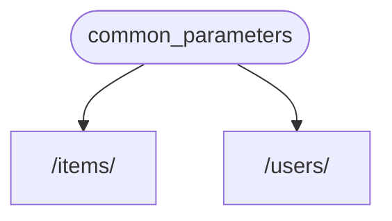

# Judge calibration: labelling sheet

For each item, read the question, the sources the model was given and its
answer, then write one label per item in `labels.csv` (same folder):

- `supported`: every factual claim in the answer (what FastAPI does, how an
  API or parameter behaves, code presented as working) is stated in the
  sources or follows directly from them. Rewording, summarising and generic
  connecting text are fine. Saying the sources do not cover the question is
  supported when they indeed do not.
- `unsupported`: at least one claim is not in the sources or contradicts them,
  including code or parameter names the sources do not show, and claiming the
  sources lack something they contain.
- `unsure`: you cannot decide; these items are left out of the agreement.

Judge support only, not whether the answer is helpful or complete. Use what is
in the sources, not what you know about FastAPI. `note` is optional. The
judge's verdicts are not in this folder; do not look at judge runs before
finishing.


## j-41: How to go through all Pydantic validators even if one fails, and then raise multiple ValueErrors in a FastAPI response?

Question: [so_71905671](https://stackoverflow.com/questions/71905671/how-to-go-through-all-pydantic-validators-even-if-one-fails-and-then-raise-mult) (CC BY-SA 4.0)

<details>
<summary>Source 1: tutorial/response-model.md (Response Model - Return Type { #response-model-return-type } > `response_model` Parameter { #response-model-parameter })</summary>

There are some cases where you need or want to return some data that is not exactly what the type declares.

For example, you could want to **return a dictionary** or a database object, but **declare it as a Pydantic model**. This way the Pydantic model would do all the data documentation, validation, etc. for the object that you returned (e.g. a dictionary or database object).

If you added the return type annotation, tools and editors would complain with a (correct) error telling you that your function is returning a type (e.g. a dict) that is different from what you declared (e.g. a Pydantic model).

In those cases, you can use the *path operation decorator* parameter `response_model` instead of the return type.

You can use the `response_model` parameter in any of the *path operations*:

`@app.get()`

`@app.post()`

`@app.put()`

`@app.delete()`

etc.

{* ../../docs_src/response_model/tutorial001_py310.py hl[17,22,24:27] *}

/// note

Notice that `response_model` is a parameter of the "decorator" method (`get`, `post`, etc). Not of your *path operation function*, like all the parameters and body.

///

`response_model` receives the same type you would declare for a Pydantic model field, so, it can be a Pydantic model, but it can also be, e.g. a `list` of Pydantic models, like `List[Item]`.

FastAPI will use this `response_model` to do all the data documentation, validation, etc. and also to **convert and filter the output data** to its type declaration.

/// tip

If you have strict type checks in your editor, mypy, etc, you can declare the function return type as `Any`.

That way you tell the editor that you are intentionally returning anything. But FastAPI will still do the data documentation, validation, filtering, etc. with the `response_model`.

///

If you declare both a return type and a `response_model`, the `response_model` will take priority and be used by FastAPI.

This way you can add correct type annotations to your functions even when you are returning a type different than the response model, to be used by the editor and tools like mypy. And still you can have FastAPI do the data validation, documentation, etc. using the `response_model`.

You can also use `response_model=None` to disable creating a response model for that *path operation*, you might need to do it if you are adding type annotations for things that are not valid Pydantic fields, you will see an example of that in one of the sections below.

</details>

<details>
<summary>Source 2: tutorial/response-model.md (Response Model - Return Type { #response-model-return-type } > Other Return Type Annotations { #other-return-type-annotations })</summary>

There might be cases where you return something that is not a valid Pydantic field and you annotate it in the function, only to get the support provided by tooling (the editor, mypy, etc).

The most common case would be [returning a Response directly as explained later in the advanced docs](../advanced/response-directly.md).

{* ../../docs_src/response_model/tutorial003_02_py310.py hl[8,10:11] *}

This simple case is handled automatically by FastAPI because the return type annotation is the class (or a subclass of) `Response`.

And tools will also be happy because both `RedirectResponse` and `JSONResponse` are subclasses of `Response`, so the type annotation is correct.

You can also use a subclass of `Response` in the type annotation:

{* ../../docs_src/response_model/tutorial003_03_py310.py hl[8:9] *}

This will also work because `RedirectResponse` is a subclass of `Response`, and FastAPI will automatically handle this simple case.

But when you return some other arbitrary object that is not a valid Pydantic type (e.g. a database object) and you annotate it like that in the function, FastAPI will try to create a Pydantic response model from that type annotation, and will fail.

The same would happen if you had something like a <dfn title='A union between multiple types means "any of these types".'>union</dfn> between different types where one or more of them are not valid Pydantic types, for example this would fail 💥:

{* ../../docs_src/response_model/tutorial003_04_py310.py hl[8] *}

...this fails because the type annotation is not a Pydantic type and is not just a single `Response` class or subclass, it's a union (any of the two) between a `Response` and a `dict`.

Continuing from the example above, you might not want to have the default data validation, documentation, filtering, etc. that is performed by FastAPI.

But you might want to still keep the return type annotation in the function to get the support from tools like editors and type checkers (e.g. mypy).

In this case, you can disable the response model generation by setting `response_model=None`:

{* ../../docs_src/response_model/tutorial003_05_py310.py hl[7] *}

This will make FastAPI skip the response model generation and that way you can have any return type annotations you need without it affecting your FastAPI application. 🤓

</details>

<details>
<summary>Source 3: tutorial/query-param-models.md (Query Parameter Models { #query-parameter-models })</summary>

If you have a group of **query parameters** that are related, you can create a **Pydantic model** to declare them.

This would allow you to **re-use the model** in **multiple places** and also to declare validations and metadata for all the parameters at once. 😎

/// note

This is supported since FastAPI version `0.115.0`. 🤓

///

</details>

<details>
<summary>Source 4: advanced/additional-responses.md (Additional Responses in OpenAPI { #additional-responses-in-openapi } > Combining information { #combining-information })</summary>

You can also combine response information from multiple places, including the `response_model`, `status_code`, and `responses` parameters.

You can declare a `response_model`, using the default status code `200` (or a custom one if you need), and then declare additional information for that same response in `responses`, directly in the OpenAPI schema.

**FastAPI** will keep the additional information from `responses`, and combine it with the JSON Schema from your model.

For example, you can declare a response with a status code `404` that uses a Pydantic model and has a custom `description`.

And a response with a status code `200` that uses your `response_model`, but includes a custom `example`:

{* ../../docs_src/additional_responses/tutorial003_py310.py hl[20:31] *}

It will all be combined and included in your OpenAPI, and shown in the API docs:


</details>

<details>
<summary>Source 5: tutorial/header-param-models.md (Header Parameter Models { #header-parameter-models })</summary>

If you have a group of related **header parameters**, you can create a **Pydantic model** to declare them.

This would allow you to **re-use the model** in **multiple places** and also to declare validations and metadata for all the parameters at once. 😎

/// note

This is supported since FastAPI version `0.115.0`. 🤓

///

</details>

**Answer:**

The provided context doesn't offer a solution for handling multiple Pydantic validator failures and raising multiple `ValueError`s in a FastAPI response. It primarily focuses on using the `response_model` decorator to handle situations where the return type doesn't match the declared Pydantic model. 

Here's a breakdown of what the context does and doesn't cover:

*   **`response_model`**: This parameter is used to specify the expected response type when the return type annotation doesn't align with the declared Pydantic model. It handles data documentation, validation, and filtering.
*   **`response_model=None`**:  This disables response model generation, allowing you to use any return type annotation without affecting FastAPI's validation and documentation features.
*   **Union Types**:  The context discusses handling union types (multiple possible return types) and how FastAPI handles them when returning a `Response` object.
*   **Query and Header Parameter Models**: It mentions creating Pydantic models for related query and header parameters for reuse and validation.
*   **Combining Response Information**:  It explains how to combine response information (status code, `response_model`, and `responses`) in the OpenAPI schema.

**However, it does not address the specific requirement of handling multiple Pydantic validator failures and raising multiple `ValueError`s.**  The context primarily deals with type mismatches and response modeling, not validation error handling.

To achieve the desired outcome of handling multiple validator failures and raising multiple `ValueError`s, you would need to implement a custom validation logic within your FastAPI endpoint, potentially using Pydantic's `ValidationError` to collect and process multiple errors.

---

## j-42: What are the best practices for structuring a FastAPI project?

Question: [so_64943693](https://stackoverflow.com/questions/64943693/what-are-the-best-practices-for-structuring-a-fastapi-project) (CC BY-SA 4.0)

<details>
<summary>Source 1: history-design-future.md (History, Design and Future { #history-design-and-future } > Investigation { #investigation })</summary>

By using all the previous alternatives I had the chance to learn from all of them, take ideas, and combine them in the best way I could find for myself and the teams of developers I have worked with.

For example, it was clear that ideally it should be based on standard Python type hints.

Also, the best approach was to use already existing standards.

So, before even starting to code **FastAPI**, I spent several months studying the specs for OpenAPI, JSON Schema, OAuth2, etc. Understanding their relationship, overlap, and differences.

</details>

<details>
<summary>Source 2: alternatives.md (Alternatives, Inspiration and Comparisons { #alternatives-inspiration-and-comparisons } > Intro { #intro })</summary>

**FastAPI** wouldn't exist if not for the previous work of others.

There have been many tools created before that have helped inspire its creation.

I have been avoiding the creation of a new framework for several years. First I tried to solve all the features covered by **FastAPI** using many different frameworks, plug-ins, and tools.

But at some point, there was no other option than creating something that provided all these features, taking the best ideas from previous tools, and combining them in the best way possible, using language features that weren't even available before (Python 3.6+ type hints).

</details>

<details>
<summary>Source 3: help-fastapi.md (Help FastAPI - Get Help { #help-fastapi-get-help } > Help Maintain FastAPI { #help-maintain-fastapi })</summary>

Help me maintain **FastAPI**! 🤓

There's a lot of work to do, and for most of it, **YOU** can do it.

The main tasks that you can do right now are:

[Help others with questions in GitHub](#help-others-with-questions-in-github) (see the section above).

[Review Pull Requests](#review-pull-requests) (see the section above).

Those two tasks are what **consume time the most**. That's the main work of maintaining FastAPI.

If you can help me with that, **you are helping me maintain FastAPI** and making sure it keeps **advancing faster and better**. 🚀

</details>

<details>
<summary>Source 4: management.md (Repository Management)</summary>

Here's a short description of how the FastAPI repository is managed and maintained.

</details>

<details>
<summary>Source 5: advanced/vibe.md (Vibe Coding { #vibe-coding })</summary>

Are you tired of all that **data validation**, **documentation**, **serialization**, and all that **boring** stuff?

Do you just want to **vibe**? 🎶

**FastAPI** now supports a new `@app.vibe()` decorator that embraces **modern AI coding best practices**. 🤖

</details>

**Answer:**

Based on the provided context, here’s what we can glean about the best practices for structuring a FastAPI project:

*   **Leverage Existing Standards:** The best approach is to use already existing standards.
*   **Python Type Hints:** Ideally, FastAPI should be based on standard Python type hints (Python 3.6+).
*   **Understand Related Specs:** Before starting to code, it's beneficial to understand the specifications of OpenAPI, JSON Schema, and OAuth2.

The context emphasizes maintaining FastAPI through contributions like answering questions on GitHub and reviewing pull requests.  It also suggests embracing modern AI coding best practices through features like the `@app.vibe()` decorator.

However, the context doesn't provide a detailed project structure. It focuses more on the overall approach and philosophy behind FastAPI's development and maintenance.

---

## j-43: how do you properly reuse an httpx.AsyncClient within a FastAPI application?

Question: [so_71031816](https://stackoverflow.com/questions/71031816/how-do-you-properly-reuse-an-httpx-asyncclient-within-a-fastapi-application) (CC BY-SA 4.0)

<details>
<summary>Source 1: advanced/async-tests.md (Async Tests { #async-tests } > HTTPX { #httpx })</summary>

Even if your **FastAPI** application uses normal `def` functions instead of `async def`, it is still an `async` application underneath.

The `TestClient` does some magic inside to call the asynchronous FastAPI application in your normal `def` test functions, using standard pytest. But that magic doesn't work anymore when we're using it inside asynchronous functions. By running our tests asynchronously, we can no longer use the `TestClient` inside our test functions.

The `TestClient` is based on [HTTPX](https://www.python-httpx.org), and luckily, we can use it directly to test the API.

</details>

<details>
<summary>Source 2: advanced/middleware.md (Advanced Middleware { #advanced-middleware } > Adding ASGI middlewares { #adding-asgi-middlewares })</summary>

As **FastAPI** is based on Starlette and implements the <abbr title="Asynchronous Server Gateway Interface">ASGI</abbr> specification, you can use any ASGI middleware.

A middleware doesn't have to be made for FastAPI or Starlette to work, as long as it follows the ASGI spec.

In general, ASGI middlewares are classes that expect to receive an ASGI app as the first argument.

So, in the documentation for third-party ASGI middlewares they will probably tell you to do something like:


```Python
from unicorn import UnicornMiddleware

app = SomeASGIApp()

new_app = UnicornMiddleware(app, some_config="rainbow")
```
But FastAPI (actually Starlette) provides a simpler way to do it that makes sure that the internal middlewares handle server errors and custom exception handlers work properly.

For that, you use `app.add_middleware()` (as in the example for CORS).


```Python
from fastapi import FastAPI
from unicorn import UnicornMiddleware

app = FastAPI()

app.add_middleware(UnicornMiddleware, some_config="rainbow")
```
`app.add_middleware()` receives a middleware class as the first argument and any additional arguments to be passed to the middleware.

</details>

<details>
<summary>Source 3: fastapi-cli.md (FastAPI CLI { #fastapi-cli } > `fastapi run` { #fastapi-run })</summary>

Executing `fastapi run` starts FastAPI in production mode.

By default, **auto-reload** is disabled. It also listens on the IP address `0.0.0.0`, which means all the available IP addresses, this way it will be publicly accessible to anyone that can communicate with the machine. This is how you would normally run it in production, for example, in a container.

In most cases you would (and should) have a "termination proxy" handling HTTPS for you on top, this will depend on how you deploy your application, your provider might do this for you, or you might need to set it up yourself.

/// tip

You can learn more about it in the [deployment documentation](deployment/index.md).

///

</details>

<details>
<summary>Source 4: tutorial/testing.md (Testing { #testing })</summary>

Thanks to [Starlette](https://www.starlette.dev/testclient/), testing **FastAPI** applications is easy and enjoyable.

It is based on [HTTPX](https://www.python-httpx.org), which in turn is designed based on Requests, so it's very familiar and intuitive.

With it, you can use [pytest](https://docs.pytest.org/) directly with **FastAPI**.

</details>

<details>
<summary>Source 5: release-notes.md (Release Notes > 0.87.0 (2022-11-13))</summary>

Highlights of this release:

[Upgraded Starlette](https://github.com/encode/starlette/releases/tag/0.21.0)

Now the `TestClient` is based on HTTPX instead of Requests. 🚀

There are some possible **breaking changes** in the `TestClient` usage, but [@Kludex](https://github.com/Kludex) built [bump-testclient](https://github.com/Kludex/bump-testclient) to help you automatize migrating your tests. Make sure you are using Git and that you can undo any unnecessary changes (false positive changes, etc) before using `bump-testclient`.

New [WebSocketException (and docs)](https://fastapi.tiangolo.com/advanced/websockets/#using-depends-and-others), re-exported from Starlette.

Upgraded and relaxed dependencies for package extras `all` (including new Uvicorn version), when you install `"fastapi[all]"`.

New docs about how to [**Help Maintain FastAPI**](https://fastapi.tiangolo.com/help-fastapi/#help-maintain-fastapi).

⬆️ Upgrade and relax dependencies for extras "all". PR [#5634](https://github.com/tiangolo/fastapi/pull/5634) by [@tiangolo](https://github.com/tiangolo).

✨ Re-export Starlette's `WebSocketException` and add it to docs. PR [#5629](https://github.com/tiangolo/fastapi/pull/5629) by [@tiangolo](https://github.com/tiangolo).

📝 Update references to Requests for tests to HTTPX, and add HTTPX to extras. PR [#5628](https://github.com/tiangolo/fastapi/pull/5628) by [@tiangolo](https://github.com/tiangolo).

⬆ Upgrade Starlette to `0.21.0`, including the new [`TestClient` based on HTTPX](https://github.com/encode/starlette/releases/tag/0.21.0). PR [#5471](https://github.com/tiangolo/fastapi/pull/5471) by [@pawelrubin](https://github.com/pawelrubin).

✏️ Tweak Help FastAPI from PR review after merging. PR [#5633](https://github.com/tiangolo/fastapi/pull/5633) by [@tiangolo](https://github.com/tiangolo).

✏️  Clarify docs on CORS. PR [#5627](https://github.com/tiangolo/fastapi/pull/5627) by [@paxcodes](https://github.com/paxcodes).

📝 Update Help FastAPI: Help Maintain FastAPI. PR [#5632](https://github.com/tiangolo/fastapi/pull/5632) by [@tiangolo](https://github.com/tiangolo).

🌐 Fix highlight lines for Japanese translation for `docs/tutorial/query-params.md`. PR [#2969](https://github.com/tiangolo/fastapi/pull/2969) by [@ftnext](https://github.com/ftnext).

🌐 Add French translation for `docs/fr/docs/advanced/additional-status-code.md`. PR [#5477](https://github.com/tiangolo/fastapi/pull/5477) by [@axel584](https://github.com/axel584).

🌐 Add Portuguese translation for `docs/pt/docs/tutorial/request-forms-and-files.md`. PR [#5579](https://github.com/tiangolo/fastapi/pull/5579) by [@batlopes](https://github.com/batlopes).

🌐 Add Japanese translation for `docs/ja/docs/advanced/websockets.md`. PR [#4983](https://github.com/tiangolo/fastapi/pull/4983) by [@xryuseix](https://github.com/xryuseix).

✨ Use Ruff for linting. PR [#5630](https://github.com/tiangolo/fastapi/pull/5630) by [@tiangolo](https://github.com/tiangolo).

🛠 Add Arabic issue number to Notify Translations GitHub Action. PR [#5610](https://github.com/tiangolo/fastapi/pull/5610) by [@tiangolo](https://github.com/tiangolo).

⬆ Bump dawidd6/action-download-artifact from 2.24.1 to 2.24.2. PR [#5609](https://github.com/tiangolo/fastapi/pull/5609) by [@dependabot[bot]](https://github.com/apps/dependabot).

⬆ Bump dawidd6/action-download-artifact from 2.24.0 to 2.24.1. PR [#5603](https://github.com/tiangolo/fastapi/pull/5603) by [@dependabot[bot]](https://github.com/apps/dependabot).

📝 Update coverage badge to use Samuel Colvin's Smokeshow. PR [#5585](https://github.com/tiangolo/fastapi/pull/5585) by [@tiangolo](https://github.com/tiangolo).

</details>

**Answer:**

The context indicates that the `TestClient` is based on HTTPX. However, it doesn't directly explain how to reuse an `httpx.AsyncClient` within a FastAPI application. It primarily focuses on testing with the `TestClient` and using ASGI middleware. 

The documentation suggests using `app.add_middleware()` to add middleware, and the `TestClient` is based on HTTPX. However, it doesn't provide guidance on reusing a general `httpx.AsyncClient` within the application itself. 

To answer this question, you would need to consult the HTTPX documentation directly for details on creating and managing asynchronous clients, and how they integrate with FastAPI.

---

## j-44: return pydantic model with field names instead of alias as fastapi response

Question: [so_69673518](https://stackoverflow.com/questions/69673518/return-pydantic-model-with-field-names-instead-of-alias-as-fastapi-response) (CC BY-SA 4.0)

<details>
<summary>Source 1: tutorial/request-form-models.md (Form Models { #form-models } > Pydantic Models for Forms { #pydantic-models-for-forms })</summary>

You just need to declare a **Pydantic model** with the fields you want to receive as **form fields**, and then declare the parameter as `Form`:

{* ../../docs_src/request_form_models/tutorial001_an_py310.py hl[9:11,15] *}

**FastAPI** will **extract** the data for **each field** from the **form data** in the request and give you the Pydantic model you defined.

</details>

<details>
<summary>Source 2: tutorial/query-param-models.md (Query Parameter Models { #query-parameter-models } > Query Parameters with a Pydantic Model { #query-parameters-with-a-pydantic-model })</summary>

Declare the **query parameters** that you need in a **Pydantic model**, and then declare the parameter as `Query`:

{* ../../docs_src/query_param_models/tutorial001_an_py310.py hl[9:13,17] *}

**FastAPI** will **extract** the data for **each field** from the **query parameters** in the request and give you the Pydantic model you defined.

</details>

<details>
<summary>Source 3: tutorial/response-model.md (Response Model - Return Type { #response-model-return-type } > Other Return Type Annotations { #other-return-type-annotations })</summary>

There might be cases where you return something that is not a valid Pydantic field and you annotate it in the function, only to get the support provided by tooling (the editor, mypy, etc).

The most common case would be [returning a Response directly as explained later in the advanced docs](../advanced/response-directly.md).

{* ../../docs_src/response_model/tutorial003_02_py310.py hl[8,10:11] *}

This simple case is handled automatically by FastAPI because the return type annotation is the class (or a subclass of) `Response`.

And tools will also be happy because both `RedirectResponse` and `JSONResponse` are subclasses of `Response`, so the type annotation is correct.

You can also use a subclass of `Response` in the type annotation:

{* ../../docs_src/response_model/tutorial003_03_py310.py hl[8:9] *}

This will also work because `RedirectResponse` is a subclass of `Response`, and FastAPI will automatically handle this simple case.

But when you return some other arbitrary object that is not a valid Pydantic type (e.g. a database object) and you annotate it like that in the function, FastAPI will try to create a Pydantic response model from that type annotation, and will fail.

The same would happen if you had something like a <dfn title='A union between multiple types means "any of these types".'>union</dfn> between different types where one or more of them are not valid Pydantic types, for example this would fail 💥:

{* ../../docs_src/response_model/tutorial003_04_py310.py hl[8] *}

...this fails because the type annotation is not a Pydantic type and is not just a single `Response` class or subclass, it's a union (any of the two) between a `Response` and a `dict`.

Continuing from the example above, you might not want to have the default data validation, documentation, filtering, etc. that is performed by FastAPI.

But you might want to still keep the return type annotation in the function to get the support from tools like editors and type checkers (e.g. mypy).

In this case, you can disable the response model generation by setting `response_model=None`:

{* ../../docs_src/response_model/tutorial003_05_py310.py hl[7] *}

This will make FastAPI skip the response model generation and that way you can have any return type annotations you need without it affecting your FastAPI application. 🤓

</details>

<details>
<summary>Source 4: advanced/response-directly.md (Return a Response Directly { #return-a-response-directly } > How a Response Model Works { #how-a-response-model-works })</summary>

When you declare a [Response Model - Return Type](../tutorial/response-model.md) in a path operation, **FastAPI** will use it to serialize the data to JSON, using Pydantic.

{* ../../docs_src/response_model/tutorial001_01_py310.py hl[16,21] *}

As that will happen on the Rust side, the performance will be much better than if it was done with regular Python and the `JSONResponse` class.

When using a `response_model` or return type, FastAPI won't use the `jsonable_encoder` to convert the data (which would be slower) nor the `JSONResponse` class.

Instead it takes the JSON bytes generated with Pydantic using the response model (or return type) and returns a `Response` with the right media type for JSON directly (`application/json`).

</details>

<details>
<summary>Source 5: advanced/response-directly.md (Return a Response Directly { #return-a-response-directly })</summary>

When you create a **FastAPI** *path operation* you can normally return any data from it: a `dict`, a `list`, a Pydantic model, a database model, etc.

If you declare a [Response Model](../tutorial/response-model.md) FastAPI will use it to serialize the data to JSON, using Pydantic.

If you don't declare a response model, FastAPI will use the `jsonable_encoder` explained in [JSON Compatible Encoder](../tutorial/encoder.md) and put it in a `JSONResponse`.

You could also create a `JSONResponse` directly and return it.

/// tip

You will normally have much better performance using a [Response Model](../tutorial/response-model.md) than returning a `JSONResponse` directly, as that way it serializes the data using Pydantic, in Rust.

///

</details>

**Answer:**

Based on the provided context, FastAPI extracts data from form fields and query parameters using Pydantic models you define.

Here's how you would declare these models:

*   **Form Fields:** You just need to declare a Pydantic model with the fields you want to receive as form fields, and then declare the parameter as `Form`.
*   **Query Parameters:** Declare the query parameters that you need in a Pydantic model, and then declare the parameter as `Query`.

The context also mentions that when you return data directly as a response model, FastAPI uses it to serialize the data to JSON using Pydantic. This is more performant than using `JSONResponse` directly. 

However, it doesn't provide instructions on returning a Pydantic model with field names instead of aliases as a FastAPI response.

---

## j-45: How to allow any arbitrary query parameters using FastAPI and Swagger?

Question: [so_68821077](https://stackoverflow.com/questions/68821077/how-to-allow-any-arbitrary-query-parameters-using-fastapi-and-swagger) (CC BY-SA 4.0)

<details>
<summary>Source 1: tutorial/query-params.md (Query Parameters { #query-parameters } > Multiple path and query parameters { #multiple-path-and-query-parameters })</summary>

You can declare multiple path parameters and query parameters at the same time, **FastAPI** knows which is which.

And you don't have to declare them in any specific order.

They will be detected by name:

{* ../../docs_src/query_params/tutorial004_py310.py hl[6,8] *}

</details>

<details>
<summary>Source 2: tutorial/query-params-str-validations.md (Query Parameters and String Validations { #query-parameters-and-string-validations })</summary>

**FastAPI** allows you to declare additional information and validation for your parameters.

Let's take this application as example:

{* ../../docs_src/query_params_str_validations/tutorial001_py310.py hl[7] *}

The query parameter `q` is of type `str | None`, that means that it's of type `str` but could also be `None`, and indeed, the default value is `None`, so FastAPI will know it's not required.

/// note

FastAPI will know that the value of `q` is not required because of the default value `= None`.

Having `str | None` will allow your editor to give you better support and detect errors.

///

</details>

<details>
<summary>Source 3: tutorial/query-param-models.md (Query Parameter Models { #query-parameter-models })</summary>

If you have a group of **query parameters** that are related, you can create a **Pydantic model** to declare them.

This would allow you to **re-use the model** in **multiple places** and also to declare validations and metadata for all the parameters at once. 😎

/// note

This is supported since FastAPI version `0.115.0`. 🤓

///

</details>

<details>
<summary>Source 4: how-to/configure-swagger-ui.md (Configure Swagger UI { #configure-swagger-ui })</summary>

You can configure some extra [Swagger UI parameters](https://swagger.io/docs/open-source-tools/swagger-ui/usage/configuration/).

To configure them, pass the `swagger_ui_parameters` argument when creating the `FastAPI()` app object or to the `get_swagger_ui_html()` function.

`swagger_ui_parameters` receives a dictionary with the configurations passed to Swagger UI directly.

FastAPI converts the configurations to **JSON** to make them compatible with JavaScript, as that's what Swagger UI needs.

</details>

<details>
<summary>Source 5: index.md (FastAPI { #fastapi } > Example upgrade { #example-upgrade })</summary>

Now modify the file `main.py` to receive a body from a `PUT` request.

Declare the body using standard Python types, thanks to Pydantic.


```Python hl_lines="2  7-10 23-25"
from fastapi import FastAPI
from pydantic import BaseModel

app = FastAPI()


class Item(BaseModel):
    name: str
    price: float
    is_offer: bool | None = None


@app.get("/")
def read_root():
    return {"Hello": "World"}


@app.get("/items/{item_id}")
def read_item(item_id: int, q: str | None = None):
    return {"item_id": item_id, "q": q}


@app.put("/items/{item_id}")
def update_item(item_id: int, item: Item):
    return {"item_name": item.name, "item_id": item_id}
```
The `fastapi dev` server should reload automatically.

Now go to [http://127.0.0.1:8000/docs](http://127.0.0.1:8000/docs).

The interactive API documentation will be automatically updated, including the new body:


Click on the button "Try it out", it allows you to fill the parameters and directly interact with the API:


Then click on the "Execute" button, the user interface will communicate with your API, send the parameters, get the results and show them on the screen:


And now, go to [http://127.0.0.1:8000/redoc](http://127.0.0.1:8000/redoc).

The alternative documentation will also reflect the new query parameter and body:


In summary, you declare **once** the types of parameters, body, etc. as function parameters.

You do that with standard modern Python types.

You don't have to learn a new syntax, the methods or classes of a specific library, etc.

Just standard **Python**.

For example, for an `int`:


```Python
item_id: int
```
or for a more complex `Item` model:


```Python
item: Item
```
...and with that single declaration you get:

Editor support, including:

Completion.

Type checks.

Validation of data:

Automatic and clear errors when the data is invalid.

Validation even for deeply nested JSON objects.

<dfn title="also known as: serialization, parsing, marshalling">Conversion</dfn> of input data: coming from the network to Python data and types. Reading from:

JSON.

Path parameters.

Query parameters.

Cookies.

Headers.

Forms.

Files.

<dfn title="also known as: serialization, parsing, marshalling">Conversion</dfn> of output data: converting from Python data and types to network data (as JSON):

Convert Python types (`str`, `int`, `float`, `bool`, `list`, etc).

`datetime` objects.

`UUID` objects.

Database models.

...and many more.

Automatic interactive API documentation, including 2 alternative user interfaces:

Swagger UI.

ReDoc.

Coming back to the previous code example, **FastAPI** will:

Validate that there is an `item_id` in the path for `GET` and `PUT` requests.

Validate that the `item_id` is of type `int` for `GET` and `PUT` requests.

If it is not, the client will see a useful, clear error.

Check if there is an optional query parameter named `q` (as in `http://127.0.0.1:8000/items/foo?q=somequery`) for `GET` requests.

As the `q` parameter is declared with `= None`, it is optional.

Without the `None` it would be required (as is the body in the case with `PUT`).

For `PUT` requests to `/items/{item_id}`, read the body as JSON:

Check that it has a required attribute `name` that should be a `str`.

Check that it has a required attribute `price` that has to be a `float`.

Check that it has an optional attribute `is_offer`, that should be a `bool`, if present.

All this would also work for deeply nested JSON objects.

Convert from and to JSON automatically.

Document everything with OpenAPI, that can be used by:

Interactive documentation systems.

Automatic client code generation systems, for many languages.

Provide 2 interactive documentation web interfaces directly.

We just scratched the surface, but you already get the idea of how it all works.

Try changing the line with:


```Python
    return {"item_name": item.name, "item_id": item_id}
```
...from:


```Python
        ... "item_name": item.name ...
```
...to:


```Python
        ... "item_price": item.price ...
```
...and see how your editor will auto-complete the attributes and know their types:


For a more complete example including more features, see the <a href="https://fastapi.tiangolo.com/tutorial/">Tutorial - User Guide</a>.

**Spoiler alert**: the tutorial - user guide includes:

Declaration of **parameters** from other different places as: **headers**, **cookies**, **form fields** and **files**.

How to set **validation constraints** as `maximum_length` or `regex`.

A very powerful and easy to use **<dfn title="also known as components, resources, providers, services, injectables">Dependency Injection</dfn>** system.

Security and authentication, including support for **OAuth2** with **JWT tokens** and **HTTP Basic** auth.

More advanced (but equally easy) techniques for declaring **deeply nested JSON models** (thanks to Pydantic).

**GraphQL** integration with [Strawberry](https://strawberry.rocks) and other libraries.

Many extra features (thanks to Starlette) as:

**WebSockets**

extremely easy tests based on HTTPX and `pytest`

**CORS**

**Cookie Sessions**

...and more.

You can optionally deploy your FastAPI app to [FastAPI Cloud](https://fastapicloud.com), go and join the waiting list if you haven't. 🚀

If you already have a **FastAPI Cloud** account (we invited you from the waiting list 😉), you can deploy your application with one command.

<div class="termy">

```console
$ fastapi deploy

Deploying to FastAPI Cloud...

✅ Deployment successful!

🐔 Ready the chicken! Your app is ready at https://myapp.fastapicloud.dev
```
</div>
That's it! Now you can access your app at that URL. ✨

**[FastAPI Cloud](https://fastapicloud.com)** is built by the same author and team behind **FastAPI**.

It streamlines the process of **building**, **deploying**, and **accessing** an API with minimal effort.

It brings the same **developer experience** of building apps with FastAPI to **deploying** them to the cloud. 🎉

FastAPI Cloud is the primary sponsor and funding provider for the *FastAPI and friends* open source projects. ✨

FastAPI is open source and based on standards. You can deploy FastAPI apps to any cloud provider you choose.

Follow your cloud provider's guides to deploy FastAPI apps with them. 🤓

</details>

**Answer:**

FastAPI allows you to declare additional information and validation for your parameters. You can use a Pydantic model to declare them, which would allow you to reuse the model in multiple places and declare validations and metadata for all the parameters at once.

Specifically, when you have a group of query parameters that are related, you can create a Pydantic model to declare them. This allows you to reuse the model in multiple places and also to declare validations and metadata for all the parameters at once.

Additionally, FastAPI will know that the value of `q` is not required because of the default value `= None`. Having `str | None` will allow your editor to give you better support and detect errors.

FastAPI automatically handles the conversion of input data from JSON, path parameters, query parameters, cookies, headers, forms, and files. It also converts output data from Python data types to JSON automatically. It will validate that there is an `item_id` in the path for `GET` and `PUT` requests and validate that the `item_id` is of type `int`. It also checks if there is an optional query parameter named `q` (as in `http://127.0.0.1:8000/items/foo?q=somequery`) for `GET` requests.

---

## j-46: FastAPI - Swagger UI docs not rendering list array as query parameter

Question: [so_77830587](https://stackoverflow.com/questions/77830587/fastapi-swagger-ui-docs-not-rendering-list-array-as-query-parameter) (CC BY-SA 4.0)

<details>
<summary>Source 1: how-to/configure-swagger-ui.md (Configure Swagger UI { #configure-swagger-ui })</summary>

You can configure some extra [Swagger UI parameters](https://swagger.io/docs/open-source-tools/swagger-ui/usage/configuration/).

To configure them, pass the `swagger_ui_parameters` argument when creating the `FastAPI()` app object or to the `get_swagger_ui_html()` function.

`swagger_ui_parameters` receives a dictionary with the configurations passed to Swagger UI directly.

FastAPI converts the configurations to **JSON** to make them compatible with JavaScript, as that's what Swagger UI needs.

</details>

<details>
<summary>Source 2: index.md (FastAPI { #fastapi } > Example upgrade { #example-upgrade })</summary>

Now modify the file `main.py` to receive a body from a `PUT` request.

Declare the body using standard Python types, thanks to Pydantic.


```Python hl_lines="2  7-10 23-25"
from fastapi import FastAPI
from pydantic import BaseModel

app = FastAPI()


class Item(BaseModel):
    name: str
    price: float
    is_offer: bool | None = None


@app.get("/")
def read_root():
    return {"Hello": "World"}


@app.get("/items/{item_id}")
def read_item(item_id: int, q: str | None = None):
    return {"item_id": item_id, "q": q}


@app.put("/items/{item_id}")
def update_item(item_id: int, item: Item):
    return {"item_name": item.name, "item_id": item_id}
```
The `fastapi dev` server should reload automatically.

Now go to [http://127.0.0.1:8000/docs](http://127.0.0.1:8000/docs).

The interactive API documentation will be automatically updated, including the new body:


Click on the button "Try it out", it allows you to fill the parameters and directly interact with the API:


Then click on the "Execute" button, the user interface will communicate with your API, send the parameters, get the results and show them on the screen:


And now, go to [http://127.0.0.1:8000/redoc](http://127.0.0.1:8000/redoc).

The alternative documentation will also reflect the new query parameter and body:


In summary, you declare **once** the types of parameters, body, etc. as function parameters.

You do that with standard modern Python types.

You don't have to learn a new syntax, the methods or classes of a specific library, etc.

Just standard **Python**.

For example, for an `int`:


```Python
item_id: int
```
or for a more complex `Item` model:


```Python
item: Item
```
...and with that single declaration you get:

Editor support, including:

Completion.

Type checks.

Validation of data:

Automatic and clear errors when the data is invalid.

Validation even for deeply nested JSON objects.

<dfn title="also known as: serialization, parsing, marshalling">Conversion</dfn> of input data: coming from the network to Python data and types. Reading from:

JSON.

Path parameters.

Query parameters.

Cookies.

Headers.

Forms.

Files.

<dfn title="also known as: serialization, parsing, marshalling">Conversion</dfn> of output data: converting from Python data and types to network data (as JSON):

Convert Python types (`str`, `int`, `float`, `bool`, `list`, etc).

`datetime` objects.

`UUID` objects.

Database models.

...and many more.

Automatic interactive API documentation, including 2 alternative user interfaces:

Swagger UI.

ReDoc.

Coming back to the previous code example, **FastAPI** will:

Validate that there is an `item_id` in the path for `GET` and `PUT` requests.

Validate that the `item_id` is of type `int` for `GET` and `PUT` requests.

If it is not, the client will see a useful, clear error.

Check if there is an optional query parameter named `q` (as in `http://127.0.0.1:8000/items/foo?q=somequery`) for `GET` requests.

As the `q` parameter is declared with `= None`, it is optional.

Without the `None` it would be required (as is the body in the case with `PUT`).

For `PUT` requests to `/items/{item_id}`, read the body as JSON:

Check that it has a required attribute `name` that should be a `str`.

Check that it has a required attribute `price` that has to be a `float`.

Check that it has an optional attribute `is_offer`, that should be a `bool`, if present.

All this would also work for deeply nested JSON objects.

Convert from and to JSON automatically.

Document everything with OpenAPI, that can be used by:

Interactive documentation systems.

Automatic client code generation systems, for many languages.

Provide 2 interactive documentation web interfaces directly.

We just scratched the surface, but you already get the idea of how it all works.

Try changing the line with:


```Python
    return {"item_name": item.name, "item_id": item_id}
```
...from:


```Python
        ... "item_name": item.name ...
```
...to:


```Python
        ... "item_price": item.price ...
```
...and see how your editor will auto-complete the attributes and know their types:


For a more complete example including more features, see the <a href="https://fastapi.tiangolo.com/tutorial/">Tutorial - User Guide</a>.

**Spoiler alert**: the tutorial - user guide includes:

Declaration of **parameters** from other different places as: **headers**, **cookies**, **form fields** and **files**.

How to set **validation constraints** as `maximum_length` or `regex`.

A very powerful and easy to use **<dfn title="also known as components, resources, providers, services, injectables">Dependency Injection</dfn>** system.

Security and authentication, including support for **OAuth2** with **JWT tokens** and **HTTP Basic** auth.

More advanced (but equally easy) techniques for declaring **deeply nested JSON models** (thanks to Pydantic).

**GraphQL** integration with [Strawberry](https://strawberry.rocks) and other libraries.

Many extra features (thanks to Starlette) as:

**WebSockets**

extremely easy tests based on HTTPX and `pytest`

**CORS**

**Cookie Sessions**

...and more.

You can optionally deploy your FastAPI app to [FastAPI Cloud](https://fastapicloud.com), go and join the waiting list if you haven't. 🚀

If you already have a **FastAPI Cloud** account (we invited you from the waiting list 😉), you can deploy your application with one command.

<div class="termy">

```console
$ fastapi deploy

Deploying to FastAPI Cloud...

✅ Deployment successful!

🐔 Ready the chicken! Your app is ready at https://myapp.fastapicloud.dev
```
</div>
That's it! Now you can access your app at that URL. ✨

**[FastAPI Cloud](https://fastapicloud.com)** is built by the same author and team behind **FastAPI**.

It streamlines the process of **building**, **deploying**, and **accessing** an API with minimal effort.

It brings the same **developer experience** of building apps with FastAPI to **deploying** them to the cloud. 🎉

FastAPI Cloud is the primary sponsor and funding provider for the *FastAPI and friends* open source projects. ✨

FastAPI is open source and based on standards. You can deploy FastAPI apps to any cloud provider you choose.

Follow your cloud provider's guides to deploy FastAPI apps with them. 🤓

</details>

<details>
<summary>Source 3: release-notes.md (Release Notes > 0.32.0 (2019-07-12))</summary>

Fix typo in docs for features. PR [#380](https://github.com/tiangolo/fastapi/pull/380) by [@MartinoMensio](https://github.com/MartinoMensio).

Fix source code `limit` for example in [Query Parameters](https://fastapi.tiangolo.com/tutorial/query-params/). PR [#366](https://github.com/tiangolo/fastapi/pull/366) by [@Smashman](https://github.com/Smashman).

Update wording in docs about [OAuth2 scopes](https://fastapi.tiangolo.com/advanced/security/oauth2-scopes/). PR [#371](https://github.com/tiangolo/fastapi/pull/371) by [@cjw296](https://github.com/cjw296).

Update docs for `Enum`s to inherit from `str` and improve Swagger UI rendering. PR [#351](https://github.com/tiangolo/fastapi/pull/351).

Fix regression, add Swagger UI deep linking again. PR [#350](https://github.com/tiangolo/fastapi/pull/350).

Add test for having path templates in `prefix` of `.include_router`. PR [#349](https://github.com/tiangolo/fastapi/pull/349).

Add note to docs: [Include the same router multiple times with different `prefix`](https://fastapi.tiangolo.com/tutorial/bigger-applications/#include-the-same-router-multiple-times-with-different-prefix). PR [#348](https://github.com/tiangolo/fastapi/pull/348).

Fix OpenAPI/JSON Schema generation for two functions with the same name (in different modules) with the same composite bodies.

Composite bodies' IDs are now based on path, not only on route name, as the auto-generated name uses the function names, that can be duplicated in different modules.

The same new ID generation applies to response models.

This also changes the generated title for those models.

Only composite bodies and response models are affected because those are generated dynamically, they don't have a module (a Python file).

This also adds the possibility of using `.include_router()` with the same `APIRouter` *multiple*  times, with different prefixes, e.g. `/api/v2` and `/api/latest`, and it will now work correctly.

PR [#347](https://github.com/tiangolo/fastapi/pull/347).

</details>

<details>
<summary>Source 4: release-notes.md (Release Notes > 0.27.2 (2019-06-03))</summary>

Fix path and query parameters receiving `dict` as a valid type. It should be mapped to a body payload. PR [#287](https://github.com/tiangolo/fastapi/pull/287). Updated docs at: [Query parameter list / multiple values with defaults: Using `list`](https://fastapi.tiangolo.com/tutorial/query-params-str-validations/#using-list).

</details>

<details>
<summary>Source 5: features.md (Features { #features } > FastAPI features { #fastapi-features } > Automatic docs { #automatic-docs })</summary>

Interactive API documentation and exploration web user interfaces. As the framework is based on OpenAPI, there are multiple options, 2 included by default.

[**Swagger UI**](https://github.com/swagger-api/swagger-ui), with interactive exploration, call and test your API directly from the browser.


Alternative API documentation with [**ReDoc**](https://github.com/Rebilly/ReDoc).


</details>

**Answer:**

Okay, let's break down how FastAPI and Swagger UI handle query parameters, especially when dealing with lists. The key is understanding how FastAPI converts data types and how Swagger UI interprets them.

**1. FastAPI's Type Conversion:**

*   **Standard Python Types:** FastAPI leverages Pydantic models to define the structure of your API. When you declare a query parameter (e.g., `q: str | None = None`), FastAPI expects a standard Python type.
*   **Lists:**  When you want to allow multiple values in a query parameter (like `q`), you need to represent that as a *list* in your Pydantic model.  Here's the crucial part:

    ```python
    from fastapi import FastAPI, Query
    from pydantic import BaseModel

    app = FastAPI()

    class Item(BaseModel):
        name: str
        price: float
        tags: list[str] | None = None #List of strings

    @app.get("/")
    def read_root(q: list[str] | None = None): #q is a list of strings
        return {"Hello": "World", "q": q}
    ```

    In this example, `tags: list[str] | None = None` declares that the `tags` parameter should be a list of strings, and it's optional (due to the `| None`).

**2. How Swagger UI Handles Lists:**

*   **Swagger UI's Default Behavior:** Swagger UI (by default) doesn't always intelligently render lists as editable fields in the "Try it out" interface.  It often treats them as single strings or expects you to enter each element of the list manually.
*   **`[]` notation (Important):** The `list[str]` notation in your Pydantic model is telling FastAPI how to handle the data *for validation and conversion*.  Swagger UI needs to be configured to understand this list type.

**3. Configuring Swagger UI for List Parameters (Swagger UI parameters)**

To make Swagger UI correctly render and handle list parameters, you need to pass the `swagger_ui_parameters` argument when creating the `FastAPI()` app object or to the `get_swagger_ui_html()` function.

Here's how you would do it:

```python
from fastapi import FastAPI

app = FastAPI(
    swagger_ui_parameters={"default_size": "full"} #Important parameters
)
```

**4.  Testing and Troubleshooting**

*   **Verify the Parameter Definition:** Double-check your Pydantic model to ensure you've correctly defined the list type (e.g., `list[str]`).
*   **Inspect the Request:** Use your browser's developer tools (Network tab) to examine the actual request being sent to your API.  Ensure that the list parameter is being sent correctly as a JSON array (e.g., `["tag1", "tag2"]`).
*   **Update Swagger UI:**  Make sure you've refreshed your Swagger UI page.  Sometimes it takes a moment for the UI to recognize the new parameter type.

**In Summary:**

1.  Define your query parameters as lists within your Pydantic models.
2.  Use the `list[str]` type notation correctly.
3.  Configure `swagger_ui_parameters`.

By following these steps, you'll enable FastAPI and Swagger UI to work together seamlessly with list query parameters.

**Additional Resources:**

*   [Swagger UI configuration](https://swagger.io/docs/open-source-tools/swagger-ui/usage/configuration/)
*   [FastAPI Tutorial on Query Parameters](https://fastapi.tiangolo.com/tutorial/query-params/)

---

## j-47: How to return a numpy array as an image using FastAPI?

Question: [so_65903231](https://stackoverflow.com/questions/65903231/how-to-return-a-numpy-array-as-an-image-using-fastapi) (CC BY-SA 4.0)

<details>
<summary>Source 1: deployment/docker.md (FastAPI in Containers - Docker { #fastapi-in-containers-docker } > Build a Docker Image for FastAPI { #build-a-docker-image-for-fastapi })</summary>

Okay, let's build something now! 🚀

I'll show you how to build a **Docker image** for FastAPI **from scratch**, based on the **official Python** image.

This is what you would want to do in **most cases**, for example:

Using **Kubernetes** or similar tools

When running on a **Raspberry Pi**

Using a cloud service that would run a container image for you, etc.

You would normally have the **package requirements** for your application in some file.

It would depend mainly on the tool you use to **install** those requirements.

The most common way to do it is to have a file `requirements.txt` with the package names and their versions, one per line.

You would of course use the same ideas you read in [About FastAPI versions](versions.md) to set the ranges of versions.

For example, your `requirements.txt` could look like:


```
fastapi[standard]>=0.113.0,<0.114.0
pydantic>=2.7.0,<3.0.0
```
And you would normally install those package dependencies with `pip`, for example:

<div class="termy">

```console
$ pip install -r requirements.txt
---> 100%
Successfully installed fastapi pydantic
```
</div>
/// info

There are other formats and tools to define and install package dependencies.

///

Create an `app` directory and enter it.

Create an empty file `__init__.py`.

Create a `main.py` file with:


```Python
from fastapi import FastAPI

app = FastAPI()


@app.get("/")
def read_root():
    return {"Hello": "World"}


@app.get("/items/{item_id}")
def read_item(item_id: int, q: str | None = None):
    return {"item_id": item_id, "q": q}
```

Now in the same project directory create a file `Dockerfile` with:


```{ .dockerfile .annotate }
# (1)!
FROM python:3.14

# (2)!
WORKDIR /code

# (3)!
COPY ./requirements.txt /code/requirements.txt

# (4)!
RUN pip install --no-cache-dir --upgrade -r /code/requirements.txt

# (5)!
COPY ./app /code/app

# (6)!
CMD ["fastapi", "run", "app/main.py", "--port", "80"]
```
Start from the official Python base image.

Set the current working directory to `/code`.

This is where we'll put the `requirements.txt` file and the `app` directory.

Copy the file with the requirements to the `/code` directory.

Copy **only** the file with the requirements first, not the rest of the code.

As this file **doesn't change often**, Docker will detect it and use the **cache** for this step, enabling the cache for the next step too.

Install the package dependencies in the requirements file.

The `--no-cache-dir` option tells `pip` to not save the downloaded packages locally, as that is only if `pip` was going to be run again to install the same packages, but that's not the case when working with containers.

/// note

The `--no-cache-dir` is only related to `pip`, it has nothing to do with Docker or containers.

///

The `--upgrade` option tells `pip` to upgrade the packages if they are already installed.

Because the previous step copying the file could be detected by the **Docker cache**, this step will also **use the Docker cache** when available.

Using the cache in this step will **save** you a lot of **time** when building the image again and again during development, instead of **downloading and installing** all the dependencies **every time**.

Copy the `./app` directory inside the `/code` directory.

As this has all the code which is what **changes most frequently** the Docker **cache** won't be used for this or any **following steps** easily.

So, it's important to put this **near the end** of the `Dockerfile`, to optimize the container image build times.

Set the **command** to use `fastapi run`, which uses Uvicorn underneath.

`CMD` takes a list of strings, each of these strings is what you would type in the command line separated by spaces.

This command will be run from the **current working directory**, the same `/code` directory you set above with `WORKDIR /code`.

/// tip

Review what each line does by clicking each number bubble in the code. 👆

///

/// warning

Make sure to **always** use the **exec form** of the `CMD` instruction, as explained below.

///

The [`CMD`](https://docs.docker.com/reference/dockerfile/#cmd) Docker instruction can be written using two forms:

✅ **Exec** form:


```Dockerfile
# ✅ Do this
CMD ["fastapi", "run", "app/main.py", "--port", "80"]
```
⛔️ **Shell** form:


```Dockerfile
# ⛔️ Don't do this
CMD fastapi run app/main.py --port 80
```
Make sure to always use the **exec** form to ensure that FastAPI can shutdown gracefully and [lifespan events](../advanced/events.md) are triggered.

You can read more about it in the [Docker docs for shell and exec form](https://docs.docker.com/reference/dockerfile/#shell-and-exec-form).

This can be quite noticeable when using `docker compose`. See this Docker Compose FAQ section for more technical details: [Why do my services take 10 seconds to recreate or stop?](https://docs.docker.com/compose/faq/#why-do-my-services-take-10-seconds-to-recreate-or-stop).

You should now have a directory structure like:


```
.
├── app
│   ├── __init__.py
│   └── main.py
├── Dockerfile
└── requirements.txt
```

If you are running your container behind a TLS Termination Proxy (load balancer) like Nginx or Traefik, add the option `--proxy-headers`, this will tell Uvicorn (through the FastAPI CLI) to trust the headers sent by that proxy telling it that the application is running behind HTTPS, etc.


```Dockerfile
CMD ["fastapi", "run", "app/main.py", "--proxy-headers", "--port", "80"]
```

There's an important trick in this `Dockerfile`, we first copy the **file with the dependencies alone**, not the rest of the code. Let me tell you why is that.


```Dockerfile
COPY ./requirements.txt /code/requirements.txt
```
Docker and other tools **build** these container images **incrementally**, adding **one layer on top of the other**, starting from the top of the `Dockerfile` and adding any files created by each of the instructions of the `Dockerfile`.

Docker and similar tools also use an **internal cache** when building the image, if a file hasn't changed since the last time building the container image, then it will **reuse the same layer** created the last time, instead of copying the file again and creating a new layer from scratch.

Just avoiding the copy of files doesn't necessarily improve things too much, but because it used the cache for that step, it can **use the cache for the next step**. For example, it could use the cache for the instruction that installs dependencies with:


```Dockerfile
RUN pip install --no-cache-dir --upgrade -r /code/requirements.txt
```
The file with the package requirements **won't change frequently**. So, by copying only that file, Docker will be able to **use the cache** for that step.

And then, Docker will be able to **use the cache for the next step** that downloads and install those dependencies. And here's where we **save a lot of time**. ✨ ...and avoid boredom waiting. 😪😆

Downloading and installing the package dependencies **could take minutes**, but using the **cache** would **take seconds** at most.

And as you would be building the container image again and again during development to check that your code changes are working, there's a lot of accumulated time this would save.

Then, near the end of the `Dockerfile`, we copy all the code. As this is what **changes most frequently**, we put it near the end, because almost always, anything after this step will not be able to use the cache.


```Dockerfile
COPY ./app /code/app
```

Now that all the files are in place, let's build the container image.

Go to the project directory (in where your `Dockerfile` is, containing your `app` directory).

Build your FastAPI image:

<div class="termy">

```console
$ docker build -t myimage .

---> 100%
```
</div>
/// tip

Notice the `.` at the end, it's equivalent to `./`, it tells Docker the directory to use to build the container image.

In this case, it's the same current directory (`.`).

///

Run a container based on your image:

<div class="termy">

```console
$ docker run -d --name mycontainer -p 80:80 myimage
```
</div>

</details>

<details>
<summary>Source 2: deployment/docker.md (FastAPI in Containers - Docker { #fastapi-in-containers-docker })</summary>

When deploying FastAPI applications a common approach is to build a **Linux container image**. It's normally done using [**Docker**](https://www.docker.com/). You can then deploy that container image in one of a few possible ways.

Using Linux containers has several advantages including **security**, **replicability**, **simplicity**, and others.

/// tip

In a hurry and already know this stuff? Jump to the [`Dockerfile` below 👇](#build-a-docker-image-for-fastapi).

///

<details>
<summary>Dockerfile Preview 👀</summary>

```Dockerfile
FROM python:3.14

WORKDIR /code

COPY ./requirements.txt /code/requirements.txt

RUN pip install --no-cache-dir --upgrade -r /code/requirements.txt

COPY ./app /code/app

CMD ["fastapi", "run", "app/main.py", "--port", "80"]

# If running behind a proxy like Nginx or Traefik add --proxy-headers
# CMD ["fastapi", "run", "app/main.py", "--port", "80", "--proxy-headers"]
```
</details>

</details>

<details>
<summary>Source 3: features.md (Features { #features } > FastAPI features { #fastapi-features })</summary>

**FastAPI** gives you the following:

</details>

<details>
<summary>Source 4: advanced/additional-responses.md (Additional Responses in OpenAPI { #additional-responses-in-openapi } > Additional media types for the main response { #additional-media-types-for-the-main-response })</summary>

You can use this same `responses` parameter to add different media types for the same main response.

For example, you can add an additional media type of `image/png`, declaring that your *path operation* can return a JSON object (with media type `application/json`) or a PNG image:

{* ../../docs_src/additional_responses/tutorial002_py310.py hl[17:22,26] *}

/// note

Notice that you have to return the image using a `FileResponse` directly.

///

/// info

Unless you specify a different media type explicitly in your `responses` parameter, FastAPI will assume the response has the same media type as the main response class (default `application/json`).

But if you have specified a custom response class with `None` as its media type, FastAPI will use `application/json` for any additional response that has an associated model.

///

</details>

<details>
<summary>Source 5: tutorial/index.md (Tutorial - User Guide { #tutorial-user-guide })</summary>

This tutorial shows you how to use **FastAPI** with most of its features, step by step.

Each section gradually builds on the previous ones, but it's structured to separate topics, so that you can go directly to any specific one to solve your specific API needs.

It is also built to work as a future reference so you can come back and see exactly what you need.

</details>

**Answer:**

Okay, let's break down how to return a NumPy array as an image using FastAPI, combining the information from the provided context.

**1. Understanding the Core Concepts**

*   **Docker Images:**  The context emphasizes building a Docker image for FastAPI from scratch. This is a best practice for deployment, ensuring consistency and reproducibility.  The Dockerfile will handle the dependencies (like `fastapi` and `pydantic`) and the application code.
*   **`requirements.txt`:** This file lists your project's dependencies, allowing `pip` to install them correctly.  The example shows how to format this file, including version ranges.
*   **`Dockerfile` Structure:** The Dockerfile demonstrates a common structure:
    *   Start from a Python base image (`FROM python:3.14`).
    *   Set the working directory (`WORKDIR /code`).
    *   Copy the `requirements.txt` file.
    *   Install dependencies using `pip`.
    *   Copy the application code.
    *   Define the command to run the FastAPI application.
*   **`CMD` Instruction:** The `CMD` instruction specifies the command that runs when the container starts. In this case, it runs the `fastapi` command to start the application. Using the exec form is recommended.

**2. Returning a NumPy Array as an Image - The Key Step**

The crucial part is converting the NumPy array into an image format (like PNG or JPEG) and then returning it as a `FileResponse`. Here's how you would typically do it in your `main.py` file (which is copied into the `/code/app` directory):

```python
from fastapi import FastAPI, File, UploadFile
from fastapi.responses import JSONResponse, FileResponse
import numpy as np
import io  # Import the io module

app = FastAPI()

@app.get("/")
def read_root():
    return {"Hello": "World"}


@app.get("/items/{item_id}")
def read_item(item_id: int, q: str | None = None):
    return {"item_id": item_id, "q": q}

@app.get("/generate_image/")
def generate_image():
    # Example: Create a dummy NumPy array (replace with your actual array)
    data = np.random.rand(100, 100)  # Example: 100x100 image

    # Convert the NumPy array to an image (e.g., PNG)
    img_buf = io.BytesIO()
    from PIL import Image
    img = Image.fromarray(data)
    img.save(img_buf, format="PNG")  # Or "JPEG", etc.
    img_buf.seek(0)  # Reset the buffer position to the beginning

    # Return the image as a FileResponse
    return FileResponse(img_buf, media_type="image/png")  # Or "image/jpeg"
```

**Explanation:**

1.  **`io.BytesIO()`:** This creates an in-memory byte stream.  We'll write the image data to this stream.
2.  **`from PIL import Image`:** Imports the Pillow library (PIL) for image manipulation.  You'll need to install it: `pip install Pillow`.
3.  **`Image.fromarray(data)`:** Converts the NumPy array `data` into a PIL Image object.
4.  **`img.save(img_buf, format="PNG")`:** Saves the PIL Image object to the `img_buf` byte stream in PNG format.  Change "PNG" to "JPEG" or other supported formats if needed.
5.  **`img_buf.seek(0)`:**  Resets the cursor of the byte stream to the beginning so we can read the image data.
6.  **`FileResponse(img_buf, media_type="image/png")`:** This creates a `FileResponse` object, which is how FastAPI knows to send the image data back to the client as a file.  `media_type` specifies the MIME type of the image (e.g., "image/png").

**3. Integrating with the Dockerfile**

The Dockerfile provides the environment for your application. Make sure your `requirements.txt` contains `Pillow`. Also, remember to copy your `app` directory (`COPY ./app /code/app`) before the `CMD` instruction.

**4. Building and Running**

1.  Build the Docker image: `docker build -t myimage .`
2.  Run the container: `docker run -d --name mycontainer -p 80:80 myimage`
3.  Access the endpoint in your browser: `http://localhost/generate_image/`

**Important Considerations and Additional Information (From the Provided Context):**

*   **Cache:** The Dockerfile uses the cache to speed up the build process.  Copying `requirements.txt` first is important because it's usually the least-changing file.
*   **`--proxy-headers`:**  If you're deploying behind a reverse proxy (like Nginx or Traefik), use the `--proxy-headers` flag in the `CMD` instruction to ensure that the proxy correctly forwards the necessary headers.

To summarize, the key is to use `io.BytesIO` to create an in-memory image buffer, convert your NumPy array to an image format using Pillow, and then return the image buffer as a `FileResponse` with the correct `media_type`. This approach ensures that the FastAPI application can handle the NumPy array and return it as a standard image file.

---

## j-48: What are the advantages of using Depends in FastAPI over just calling a dependent function/class?

Question: [so_61871147](https://stackoverflow.com/questions/61871147/what-are-the-advantages-of-using-depends-in-fastapi-over-just-calling-a-dependen) (CC BY-SA 4.0)

<details>
<summary>Source 1: tutorial/dependencies/index.md (Dependencies { #dependencies } > First Steps { #first-steps })</summary>

Let's see a very simple example. It will be so simple that it is not very useful, for now.

But this way we can focus on how the **Dependency Injection** system works.

Let's first focus on the dependency.

It is just a function that can take all the same parameters that a *path operation function* can take:

{* ../../docs_src/dependencies/tutorial001_an_py310.py hl[8:9] *}

That's it.

**2 lines**.

And it has the same shape and structure that all your *path operation functions* have.

You can think of it as a *path operation function* without the "decorator" (without the `@app.get("/some-path")`).

And it can return anything you want.

In this case, this dependency expects:

An optional query parameter `q` that is a `str`.

An optional query parameter `skip` that is an `int`, and by default is `0`.

An optional query parameter `limit` that is an `int`, and by default is `100`.

And then it just returns a `dict` containing those values.

/// info

FastAPI added support for `Annotated` (and started recommending it) in version 0.95.0.

If you have an older version, you would get errors when trying to use `Annotated`.

Make sure you [Upgrade the FastAPI version](../../deployment/versions.md#upgrading-the-fastapi-versions) to at least 0.95.1 before using `Annotated`.

///

{* ../../docs_src/dependencies/tutorial001_an_py310.py hl[3] *}

The same way you use `Body`, `Query`, etc. with your *path operation function* parameters, use `Depends` with a new parameter:

{* ../../docs_src/dependencies/tutorial001_an_py310.py hl[13,18] *}

Although you use `Depends` in the parameters of your function the same way you use `Body`, `Query`, etc, `Depends` works a bit differently.

You only give `Depends` a single parameter.

This parameter must be something like a function.

You **don't call it** directly (don't add the parenthesis at the end), you just pass it as a parameter to `Depends()`.

And that function takes parameters in the same way that *path operation functions* do.

/// tip

You'll see what other "things", apart from functions, can be used as dependencies in the next chapter.

///

Whenever a new request arrives, **FastAPI** will take care of:

Calling your dependency ("dependable") function with the correct parameters.

Get the result from your function.

Assign that result to the parameter in your *path operation function*.



This way you write shared code once and **FastAPI** takes care of calling it for your *path operations*.

/// check

Notice that you don't have to create a special class and pass it somewhere to **FastAPI** to "register" it or anything similar.

You just pass it to `Depends` and **FastAPI** knows how to do the rest.

///

</details>

<details>
<summary>Source 2: tutorial/dependencies/classes-as-dependencies.md (Classes as Dependencies { #classes-as-dependencies } > Classes as dependencies { #classes-as-dependencies_1 })</summary>

You might notice that to create an instance of a Python class, you use that same syntax.

For example:


```Python
class Cat:
    def __init__(self, name: str):
        self.name = name


fluffy = Cat(name="Mr Fluffy")
```
In this case, `fluffy` is an instance of the class `Cat`.

And to create `fluffy`, you are "calling" `Cat`.

So, a Python class is also a **callable**.

Then, in **FastAPI**, you could use a Python class as a dependency.

What FastAPI actually checks is that it is a "callable" (function, class or anything else) and the parameters defined.

If you pass a "callable" as a dependency in **FastAPI**, it will analyze the parameters for that "callable", and process them in the same way as the parameters for a *path operation function*. Including sub-dependencies.

That also applies to callables with no parameters at all. The same as it would be for *path operation functions* with no parameters.

Then, we can change the dependency "dependable" `common_parameters` from above to the class `CommonQueryParams`:

{* ../../docs_src/dependencies/tutorial002_an_py310.py hl[11:15] *}

Pay attention to the `__init__` method used to create the instance of the class:

{* ../../docs_src/dependencies/tutorial002_an_py310.py hl[12] *}

...it has the same parameters as our previous `common_parameters`:

{* ../../docs_src/dependencies/tutorial001_an_py310.py hl[8] *}

Those parameters are what **FastAPI** will use to "solve" the dependency.

In both cases, it will have:

An optional `q` query parameter that is a `str`.

A `skip` query parameter that is an `int`, with a default of `0`.

A `limit` query parameter that is an `int`, with a default of `100`.

In both cases the data will be converted, validated, documented on the OpenAPI schema, etc.

</details>

<details>
<summary>Source 3: tutorial/dependencies/index.md (Dependencies { #dependencies } > Simple usage { #simple-usage })</summary>

If you look at it, *path operation functions* are declared to be used whenever a *path* and *operation* matches, and then **FastAPI** takes care of calling the function with the correct parameters, extracting the data from the request.

Actually, all (or most) of the web frameworks work in this same way.

You never call those functions directly. They are called by your framework (in this case, **FastAPI**).

With the Dependency Injection system, you can also tell **FastAPI** that your *path operation function* also "depends" on something else that should be executed before your *path operation function*, and **FastAPI** will take care of executing it and "injecting" the results.

Other common terms for this same idea of "dependency injection" are:

resources

providers

services

injectables

components

</details>

<details>
<summary>Source 4: advanced/advanced-dependencies.md (Advanced Dependencies { #advanced-dependencies } > Dependencies with `yield`, `HTTPException`, `except` and Background Tasks { #dependencies-with-yield-httpexception-except-and-background-tasks })</summary>

/// warning

You most probably don't need these technical details.

These details are useful mainly if you had a FastAPI application older than 0.121.0 and you are facing issues with dependencies with `yield`.

///

Dependencies with `yield` have evolved over time to account for the different use cases and to fix some issues, here's a summary of what has changed.

In version 0.121.0, FastAPI added support for `Depends(scope="function")` for dependencies with `yield`.

Using `Depends(scope="function")`, the exit code after `yield` is executed right after the *path operation function* is finished, before the response is sent back to the client.

And when using `Depends(scope="request")` (the default), the exit code after `yield` is executed after the response is sent.

You can read more about it in the docs for [Dependencies with `yield` - Early exit and `scope`](../tutorial/dependencies/dependencies-with-yield.md#early-exit-and-scope).

Before FastAPI 0.118.0, if you used a dependency with `yield`, it would run the exit code after the *path operation function* returned but right before sending the response.

The intention was to avoid holding resources for longer than necessary, waiting for the response to travel through the network.

This change also meant that if you returned a `StreamingResponse`, the exit code of the dependency with `yield` would have been already run.

For example, if you had a database session in a dependency with `yield`, the `StreamingResponse` would not be able to use that session while streaming data because the session would have already been closed in the exit code after `yield`.

This behavior was reverted in 0.118.0, to make the exit code after `yield` be executed after the response is sent.

/// info

As you will see below, this is very similar to the behavior before version 0.106.0, but with several improvements and bug fixes for corner cases.

///

There are some use cases with specific conditions that could benefit from the old behavior of running the exit code of dependencies with `yield` before sending the response.

For example, imagine you have code that uses a database session in a dependency with `yield` only to verify a user, but the database session is never used again in the *path operation function*, only in the dependency, **and** the response takes a long time to be sent, like a `StreamingResponse` that sends data slowly, but for some reason doesn't use the database.

In this case, the database session would be held until the response is finished being sent, but if you don't use it, then it wouldn't be necessary to hold it.

Here's how it could look like:

{* ../../docs_src/dependencies/tutorial013_an_py310.py *}

The exit code, the automatic closing of the `Session` in:

{* ../../docs_src/dependencies/tutorial013_an_py310.py ln[19:21] *}

...would be run after the response finishes sending the slow data:

{* ../../docs_src/dependencies/tutorial013_an_py310.py ln[30:38] hl[31:33] *}

But as `generate_stream()` doesn't use the database session, it is not really necessary to keep the session open while sending the response.

If you have this specific use case using SQLModel (or SQLAlchemy), you could explicitly close the session after you don't need it anymore:

{* ../../docs_src/dependencies/tutorial014_an_py310.py ln[24:28] hl[28] *}

That way the session would release the database connection, so other requests could use it.

If you have a different use case that needs to exit early from a dependency with `yield`, please create a [GitHub Discussion Question](https://github.com/fastapi/fastapi/discussions/new?category=questions) with your specific use case and why you would benefit from having early closing for dependencies with `yield`.

If there are compelling use cases for early closing in dependencies with `yield`, I would consider adding a new way to opt in to early closing.

Before FastAPI 0.110.0, if you used a dependency with `yield`, and then you captured an exception with `except` in that dependency, and you didn't raise the exception again, the exception would be automatically raised/forwarded to any exception handlers or the internal server error handler.

This was changed in version 0.110.0 to fix unhandled memory consumption from forwarded exceptions without a handler (internal server errors), and to make it consistent with the behavior of regular Python code.

Before FastAPI 0.106.0, raising exceptions after `yield` was not possible, the exit code in dependencies with `yield` was executed *after* the response was sent, so [Exception Handlers](../tutorial/handling-errors.md#install-custom-exception-handlers) would have already run.

This was designed this way mainly to allow using the same objects "yielded" by dependencies inside of background tasks, because the exit code would be executed after the background tasks were finished.

This was changed in FastAPI 0.106.0 with the intention to not hold resources while waiting for the response to travel through the network.

/// tip

Additionally, a background task is normally an independent set of logic that should be handled separately, with its own resources (e.g. its own database connection).

So, this way you will probably have cleaner code.

///

If you used to rely on this behavior, now you should create the resources for background tasks inside the background task itself, and use internally only data that doesn't depend on the resources of dependencies with `yield`.

For example, instead of using the same database session, you would create a new database session inside of the background task, and you would obtain the objects from the database using this new session. And then instead of passing the object from the database as a parameter to the background task function, you would pass the ID of that object and then obtain the object again inside the background task function.

</details>

<details>
<summary>Source 5: reference/dependencies.md (Dependencies - `Depends()` and `Security()` > `Depends()`)</summary>

Dependencies are handled mainly with the special function `Depends()` that takes a callable.

Here is the reference for it and its parameters.

You can import it directly from `fastapi`:


```python
from fastapi import Depends
```
::: fastapi.Depends

</details>

**Answer:**

Based on the provided context, here's a breakdown of the advantages of using `Depends` in FastAPI compared to directly calling a dependent function or class:

*   **Automatic Parameter Injection:** `Depends` handles the injection of parameters into the path operation function. It takes care of providing the necessary data from the dependent function or class, eliminating the need for manual parameter passing.

*   **Simplified Usage:** `Depends` simplifies the process of using dependencies. You simply pass the `Depends` function as a parameter to the path operation function, and FastAPI handles the execution and parameter passing internally.  You don't need to explicitly call the dependent function or create an instance of the dependent class.

*   **Centralized Management:** `Depends` centralizes the management of dependencies. FastAPI automatically manages the execution order and parameter passing between dependencies and path operation functions.

*   **No Special Class Creation or Registration:** You don't need to create a special class and register it with FastAPI. `Depends` handles the integration seamlessly.

*   **Handles Callable Objects:** `Depends` works with any "callable" object (function, class or anything else) which means you can pass a class as a dependency and FastAPI checks if it's callable.

In essence, `Depends` simplifies the dependency injection process and streamlines the integration of dependent functions or classes into path operation functions. It abstracts away the complexities of manual parameter passing and execution management.

---

## j-49: FastAPI is very slow in returning a large amount of JSON data

Question: [so_73564771](https://stackoverflow.com/questions/73564771/fastapi-is-very-slow-in-returning-a-large-amount-of-json-data) (CC BY-SA 4.0)

<details>
<summary>Source 1: advanced/response-directly.md (Return a Response Directly { #return-a-response-directly })</summary>

When you create a **FastAPI** *path operation* you can normally return any data from it: a `dict`, a `list`, a Pydantic model, a database model, etc.

If you declare a [Response Model](../tutorial/response-model.md) FastAPI will use it to serialize the data to JSON, using Pydantic.

If you don't declare a response model, FastAPI will use the `jsonable_encoder` explained in [JSON Compatible Encoder](../tutorial/encoder.md) and put it in a `JSONResponse`.

You could also create a `JSONResponse` directly and return it.

/// tip

You will normally have much better performance using a [Response Model](../tutorial/response-model.md) than returning a `JSONResponse` directly, as that way it serializes the data using Pydantic, in Rust.

///

</details>

<details>
<summary>Source 2: advanced/custom-response.md (Custom Response - HTML, Stream, File, others { #custom-response-html-stream-file-others } > JSON Responses { #json-responses })</summary>

By default FastAPI returns JSON responses.

If you declare a [Response Model](../tutorial/response-model.md) FastAPI will use it to serialize the data to JSON, using Pydantic.

If you don't declare a response model, FastAPI will use the `jsonable_encoder` explained in [JSON Compatible Encoder](../tutorial/encoder.md) and put it in a `JSONResponse`.

If you declare a `response_class` with a JSON media type (`application/json`), like is the case with the `JSONResponse`, the data you return will be automatically converted (and filtered) with any Pydantic `response_model` that you declared in the *path operation decorator*. But the data won't be serialized to JSON bytes with Pydantic, instead it will be converted with the `jsonable_encoder` and then passed to the `JSONResponse` class, which will serialize it to bytes using the standard JSON library in Python.

In short, if you want the maximum performance, use a [Response Model](../tutorial/response-model.md) and don't declare a `response_class` in the *path operation decorator*.

{* ../../docs_src/response_model/tutorial001_01_py310.py ln[15:17] hl[16] *}

</details>

<details>
<summary>Source 3: advanced/dataclasses.md (Using Dataclasses { #using-dataclasses } > Dataclasses in Nested Data Structures { #dataclasses-in-nested-data-structures })</summary>

You can also combine `dataclasses` with other type annotations to make nested data structures.

In some cases, you might still have to use Pydantic's version of `dataclasses`. For example, if you have errors with the automatically generated API documentation.

In that case, you can simply swap the standard `dataclasses` with `pydantic.dataclasses`, which is a drop-in replacement:

{* ../../docs_src/dataclasses_/tutorial003_py310.py hl[1,4,7:10,13:16,22:24,27] *}

We still import `field` from standard `dataclasses`.

`pydantic.dataclasses` is a drop-in replacement for `dataclasses`.

The `Author` dataclass includes a list of `Item` dataclasses.

The `Author` dataclass is used as the `response_model` parameter.

You can use other standard type annotations with dataclasses as the request body.

In this case, it's a list of `Item` dataclasses.

Here we are returning a dictionary that contains `items` which is a list of dataclasses.

FastAPI is still capable of <dfn title="converting the data to a format that can be transmitted">serializing</dfn> the data to JSON.

Here the `response_model` is using a type annotation of a list of `Author` dataclasses.

Again, you can combine `dataclasses` with standard type annotations.

Notice that this *path operation function* uses regular `def` instead of `async def`.

As always, in FastAPI you can combine `def` and `async def` as needed.

If you need a refresher about when to use which, check out the section _"In a hurry?"_ in the docs about [`async` and `await`](../async.md#in-a-hurry).

This *path operation function* is not returning dataclasses (although it could), but a list of dictionaries with internal data.

FastAPI will use the `response_model` parameter (that includes dataclasses) to convert the response.

You can combine `dataclasses` with other type annotations in many different combinations to form complex data structures.

Check the in-code annotation tips above to see more specific details.

</details>

<details>
<summary>Source 4: advanced/custom-response.md (Custom Response - HTML, Stream, File, others { #custom-response-html-stream-file-others })</summary>

By default, **FastAPI** will return JSON responses.

You can override it by returning a `Response` directly as seen in [Return a Response directly](response-directly.md).

But if you return a `Response` directly (or any subclass, like `JSONResponse`), the data won't be automatically converted (even if you declare a `response_model`), and the documentation won't be automatically generated (for example, including the specific "media type", in the HTTP header `Content-Type` as part of the generated OpenAPI).

But you can also declare the `Response` that you want to be used (e.g. any `Response` subclass), in the *path operation decorator* using the `response_class` parameter.

The contents that you return from your *path operation function* will be put inside of that `Response`.

/// note

If you use a response class with no media type, FastAPI will expect your response to have no content, so it will not document the response format in its generated OpenAPI docs.

///

</details>

<details>
<summary>Source 5: tutorial/handling-errors.md (Handling Errors { #handling-errors } > Override the default exception handlers { #override-the-default-exception-handlers })</summary>

**FastAPI** has some default exception handlers.

These handlers are in charge of returning the default JSON responses when you `raise` an `HTTPException` and when the request has invalid data.

You can override these exception handlers with your own.

When a request contains invalid data, **FastAPI** internally raises a `RequestValidationError`.

And it also includes a default exception handler for it.

To override it, import the `RequestValidationError` and use it with `@app.exception_handler(RequestValidationError)` to decorate the exception handler.

The exception handler will receive a `Request` and the exception.

{* ../../docs_src/handling_errors/tutorial004_py310.py hl[2,14:19] *}

Now, if you go to `/items/foo`, instead of getting the default JSON error with:


```JSON
{
    "detail": [
        {
            "loc": [
                "path",
                "item_id"
            ],
            "msg": "value is not a valid integer",
            "type": "type_error.integer"
        }
    ]
}
```
you will get a text version, with:


```
Validation errors:
Field: ('path', 'item_id'), Error: Input should be a valid integer, unable to parse string as an integer
```

The same way, you can override the `HTTPException` handler.

For example, you could want to return a plain text response instead of JSON for these errors:

{* ../../docs_src/handling_errors/tutorial004_py310.py hl[3:4,9:11,25] *}

/// note | Technical Details

You could also use `from starlette.responses import PlainTextResponse`.

**FastAPI** provides the same `starlette.responses` as `fastapi.responses` just as a convenience for you, the developer. But most of the available responses come directly from Starlette.

///

/// warning

Have in mind that the `RequestValidationError` contains the information of the file name and line where the validation error happens so that you can show it in your logs with the relevant information if you want to.

But that means that if you just convert it to a string and return that information directly, you could be leaking a bit of information about your system, that's why here the code extracts and shows each error independently.

///

The `RequestValidationError` contains the `body` it received with invalid data.

You could use it while developing your app to log the body and debug it, return it to the user, etc.

{* ../../docs_src/handling_errors/tutorial005_py310.py hl[14] *}

Now try sending an invalid item like:


```JSON
{
  "title": "towel",
  "size": "XL"
}
```
You will receive a response telling you that the data is invalid containing the received body:


```JSON hl_lines="12-15"
{
  "detail": [
    {
      "loc": [
        "body",
        "size"
      ],
      "msg": "value is not a valid integer",
      "type": "type_error.integer"
    }
  ],
  "body": {
    "title": "towel",
    "size": "XL"
  }
}
```

**FastAPI** has its own `HTTPException`.

And **FastAPI**'s `HTTPException` error class inherits from Starlette's `HTTPException` error class.

The only difference is that **FastAPI**'s `HTTPException` accepts any JSON-able data for the `detail` field, while Starlette's `HTTPException` only accepts strings for it.

So, you can keep raising **FastAPI**'s `HTTPException` as normally in your code.

But when you register an exception handler, you should register it for Starlette's `HTTPException`.

This way, if any part of Starlette's internal code, or a Starlette extension or plug-in, raises a Starlette `HTTPException`, your handler will be able to catch and handle it.

In this example, to be able to have both `HTTPException`s in the same code, Starlette's exceptions is renamed to `StarletteHTTPException`:


```Python
from starlette.exceptions import HTTPException as StarletteHTTPException
```

If you want to use the exception along with the same default exception handlers from  **FastAPI**, you can import and reuse the default exception handlers from `fastapi.exception_handlers`:

{* ../../docs_src/handling_errors/tutorial006_py310.py hl[2:5,15,21] *}

In this example you are just printing the error with a very expressive message, but you get the idea. You can use the exception and then just reuse the default exception handlers.

</details>

**Answer:**

Based on the provided documentation, here's how FastAPI handles returning large amounts of JSON data and why it might be slow:

**1. Response Models for Performance:**

*   The documentation strongly recommends using **Response Models** (from `tutorial/response_model.md`) over directly using `JSONResponse`.  When you define a Response Model, FastAPI serializes the data using Pydantic, which is implemented in Rust. This is significantly faster than relying on Python's `jsonable_encoder` and the standard JSON library.

**2. `JSONResponse` Directly (and why it's slower):**

*   If you don't use a Response Model, FastAPI uses `jsonable_encoder` to convert the data to a JSON-compatible format and puts it in a `JSONResponse`. This approach is slower because it relies on Python's JSON encoding, which isn't as optimized as Pydantic's.

**3. Combining Dataclasses:**

*   FastAPI can handle nested data structures built with `dataclasses` (from `tutorial003_py310.py`). These are used as response models, and FastAPI still serializes them to JSON.

**4. Exception Handling and Validation Errors:**

*   When there are validation errors (like `RequestValidationError`), FastAPI returns a JSON response with detailed information about the error.  This can also contribute to the overall response time if the error messages are complex. The documentation highlights the default error handler and how to override it.

**5.  `Response` Class Directly (and its drawbacks):**

*   If you return a `Response` directly, FastAPI won’t automatically serialize the data to JSON, and it won't automatically generate OpenAPI documentation.  This can lead to slower performance if you're manually handling the JSON conversion and documentation.

**In summary, to avoid slow JSON responses when dealing with large amounts of data, always define a Response Model that leverages Pydantic for serialization.**

Do you want me to elaborate on a specific aspect of this, such as:

*   How to create a Response Model?
*   How to handle validation errors efficiently?
*   How to optimize the serialization process further?

---

## j-50: FastAPI docs not working with nginx Ingress controller

Question: [so_60397218](https://stackoverflow.com/questions/60397218/fastapi-docs-not-working-with-nginx-ingress-controller) (CC BY-SA 4.0)

<details>
<summary>Source 1: advanced/behind-a-proxy.md (Behind a Proxy { #behind-a-proxy })</summary>

In many situations, you would use a **proxy** like Traefik or Nginx in front of your FastAPI app.

These proxies could handle HTTPS certificates and other things.

</details>

<details>
<summary>Source 2: features.md (Features { #features } > FastAPI features { #fastapi-features })</summary>

**FastAPI** gives you the following:

</details>

<details>
<summary>Source 3: deployment/concepts.md (Deployments Concepts { #deployments-concepts } > Security - HTTPS { #security-https })</summary>

In the [previous chapter about HTTPS](https.md) we learned about how HTTPS provides encryption for your API.

We also saw that HTTPS is normally provided by a component **external** to your application server, a **TLS Termination Proxy**.

And there has to be something in charge of **renewing the HTTPS certificates**, it could be the same component or it could be something different.

Some of the tools you could use as a TLS Termination Proxy are:

Traefik

Automatically handles certificates renewals ✨

Caddy

Automatically handles certificates renewals ✨

Nginx

With an external component like Certbot for certificate renewals

HAProxy

With an external component like Certbot for certificate renewals

Kubernetes with an Ingress Controller like Nginx

With an external component like cert-manager for certificate renewals

Handled internally by a cloud provider as part of their services (read below 👇)

Another option is that you could use a **cloud service** that does more of the work including setting up HTTPS. It could have some restrictions or charge you more, etc. But in that case, you wouldn't have to set up a TLS Termination Proxy yourself.

I'll show you some concrete examples in the next chapters.

Then the next concepts to consider are all about the program running your actual API (e.g. Uvicorn).

</details>

<details>
<summary>Source 4: reference/security/index.md (Security Tools > OpenID Connect)</summary>

::: fastapi.security.OpenIdConnect

</details>

<details>
<summary>Source 5: deployment/manually.md (Run a Server Manually { #run-a-server-manually } > ASGI Servers { #asgi-servers })</summary>

Let's go a little deeper into the details.

FastAPI uses a standard for building Python web frameworks and servers called <abbr title="Asynchronous Server Gateway Interface">ASGI</abbr>. FastAPI is an ASGI web framework.

The main thing you need to run a **FastAPI** application (or any other ASGI application) in a remote server machine is an ASGI server program like **Uvicorn**, this is the one that comes by default in the `fastapi` command.

There are several alternatives, including:

[Uvicorn](https://www.uvicorn.dev/): a high performance ASGI server.

[Hypercorn](https://hypercorn.readthedocs.io/): an ASGI server compatible with HTTP/2 and Trio among other features.

[Daphne](https://github.com/django/daphne): the ASGI server built for Django Channels.

[Granian](https://github.com/emmett-framework/granian): A Rust HTTP server for Python applications.

[NGINX Unit](https://unit.nginx.org/howto/fastapi/): NGINX Unit is a lightweight and versatile web application runtime.

</details>

**Answer:**

The provided context discusses the use of proxies like Nginx in front of your FastAPI app to handle HTTPS certificates and renewals. It mentions that Nginx can be used with an external component like Certbot for certificate renewals. However, it doesn't provide information about how FastAPI itself interacts with Nginx Ingress Controller or why it might not be working correctly. 

It does state that Uvicorn is the default ASGI server to run a FastAPI application on a remote server.

---
