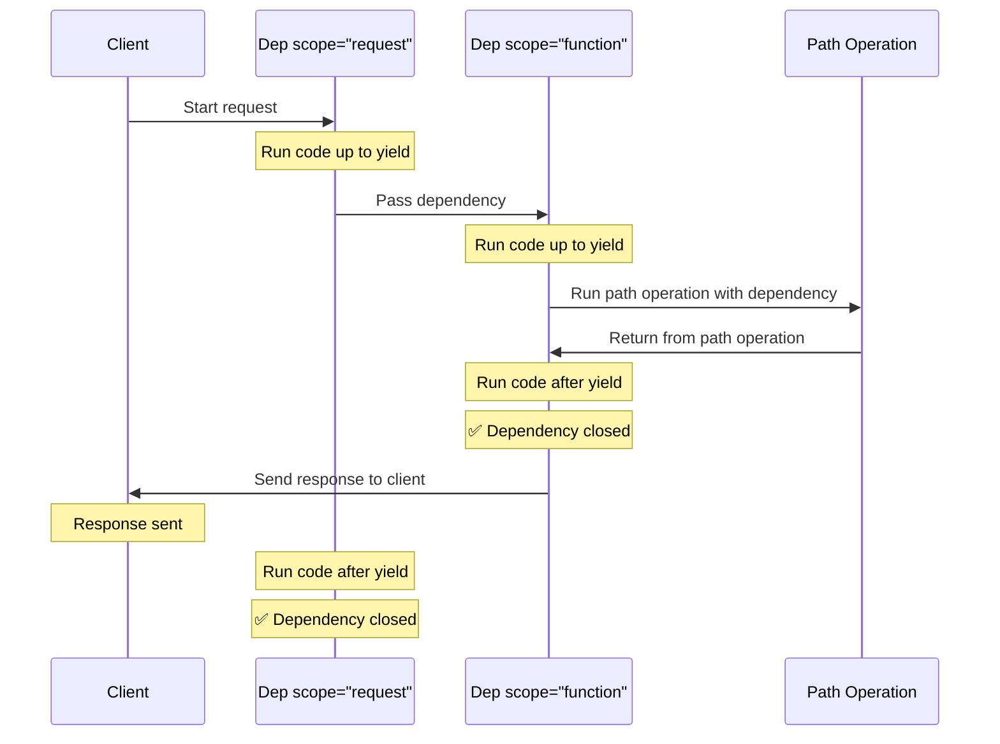

# Judge calibration: labelling sheet

For each item, read the question, the sources the model was given and its
answer, then write one label per item in `labels.csv` (same folder):

- `supported`: every factual claim in the answer (what FastAPI does, how an
  API or parameter behaves, code presented as working) is stated in the
  sources or follows directly from them. Rewording, summarising and generic
  connecting text are fine. Saying the sources do not cover the question is
  supported when they indeed do not.
- `unsupported`: at least one claim is not in the sources or contradicts them,
  including code or parameter names the sources do not show, and claiming the
  sources lack something they contain.
- `unsure`: you cannot decide; these items are left out of the agreement.

Judge support only, not whether the answer is helpful or complete. Use what is
in the sources, not what you know about FastAPI. `note` is optional. The
judge's verdicts are not in this folder; do not look at judge runs before
finishing.


## j-01: How to delete the file after a `return FileResponse(file_path)`

Question: [so_64716495](https://stackoverflow.com/questions/64716495/how-to-delete-the-file-after-a-return-fileresponsefile-path) (CC BY-SA 4.0)

<details>
<summary>Source 1: release-notes.md (Release Notes > 0.66.0 (2021-07-04))</summary>

✨ Allow setting the `response_class` to `RedirectResponse` or `FileResponse` and returning the URL from the function. New and updated docs are in the tutorial section **Custom Response - HTML, Stream, File, others**, in [RedirectResponse](https://fastapi.tiangolo.com/advanced/custom-response/#redirectresponse) and in [FileResponse](https://fastapi.tiangolo.com/advanced/custom-response/#fileresponse). PR [#3457](https://github.com/tiangolo/fastapi/pull/3457) by [@tiangolo](https://github.com/tiangolo).

🐛 Fix include/exclude for dicts in `jsonable_encoder`. PR [#2016](https://github.com/tiangolo/fastapi/pull/2016) by [@Rubikoid](https://github.com/Rubikoid).

🐛 Support custom OpenAPI / JSON Schema fields in the generated output OpenAPI. PR [#1429](https://github.com/tiangolo/fastapi/pull/1429) by [@jmagnusson](https://github.com/jmagnusson).

🌐 Add Spanish translation for `tutorial/query-params.md`. PR [#2243](https://github.com/tiangolo/fastapi/pull/2243) by [@mariacamilagl](https://github.com/mariacamilagl).

🌐 Add Spanish translation for `advanced/response-directly.md`. PR [#1253](https://github.com/tiangolo/fastapi/pull/1253) by [@jfunez](https://github.com/jfunez).

🌐 Add Spanish translation for `advanced/additional-status-codes.md`. PR [#1252](https://github.com/tiangolo/fastapi/pull/1252) by [@jfunez](https://github.com/jfunez).

🌐 Add Spanish translation for `advanced/path-operation-advanced-configuration.md`. PR [#1251](https://github.com/tiangolo/fastapi/pull/1251) by [@jfunez](https://github.com/jfunez).

</details>

<details>
<summary>Source 2: reference/responses.md (Custom Response Classes - File, HTML, Redirect, Streaming, etc.)</summary>

There are several custom response classes you can use to create an instance and return them directly from your *path operations*.

Read more about it in the [FastAPI docs for Custom Response - HTML, Stream, File, others](https://fastapi.tiangolo.com/advanced/custom-response/).

You can import them directly from `fastapi.responses`:


```python
from fastapi.responses import (
    FileResponse,
    HTMLResponse,
    JSONResponse,
    ORJSONResponse,
    PlainTextResponse,
    RedirectResponse,
    Response,
    StreamingResponse,
    UJSONResponse,
)
```

</details>

<details>
<summary>Source 3: tutorial/background-tasks.md (Background Tasks { #background-tasks })</summary>

You can define background tasks to be run *after* returning a response.

This is useful for operations that need to happen after a request, but that the client doesn't really have to be waiting for the operation to complete before receiving the response.

This includes, for example:

Email notifications sent after performing an action:

As connecting to an email server and sending an email tends to be "slow" (several seconds), you can return the response right away and send the email notification in the background.

Processing data:

For example, let's say you receive a file that must go through a slow process, you can return a response of "Accepted" (HTTP 202) and process the file in the background.

</details>

<details>
<summary>Source 4: advanced/additional-responses.md (Additional Responses in OpenAPI { #additional-responses-in-openapi } > Additional media types for the main response { #additional-media-types-for-the-main-response })</summary>

You can use this same `responses` parameter to add different media types for the same main response.

For example, you can add an additional media type of `image/png`, declaring that your *path operation* can return a JSON object (with media type `application/json`) or a PNG image:

{* ../../docs_src/additional_responses/tutorial002_py310.py hl[17:22,26] *}

/// note

Notice that you have to return the image using a `FileResponse` directly.

///

/// info

Unless you specify a different media type explicitly in your `responses` parameter, FastAPI will assume the response has the same media type as the main response class (default `application/json`).

But if you have specified a custom response class with `None` as its media type, FastAPI will use `application/json` for any additional response that has an associated model.

///

</details>

<details>
<summary>Source 5: tutorial/dependencies/dependencies-with-yield.md (Dependencies with yield { #dependencies-with-yield } > Early exit and `scope` { #early-exit-and-scope })</summary>

Normally the exit code of dependencies with `yield` is executed **after the response** is sent to the client.

But if you know that you won't need to use the dependency after returning from the *path operation function*, you can use `Depends(scope="function")` to tell FastAPI that it should close the dependency after the *path operation function* returns, but **before** the **response is sent**.

{* ../../docs_src/dependencies/tutorial008e_an_py310.py hl[12,16] *}

`Depends()` receives a `scope` parameter that can be:

`"function"`: start the dependency before the *path operation function* that handles the request, end the dependency after the *path operation function* ends, but **before** the response is sent back to the client. So, the dependency function will be executed **around** the *path operation **function***.

`"request"`: start the dependency before the *path operation function* that handles the request (similar to when using `"function"`), but end **after** the response is sent back to the client. So, the dependency function will be executed **around** the **request** and response cycle.

If not specified and the dependency has `yield`, it will have a `scope` of `"request"` by default.

When you declare a dependency with a `scope="request"` (the default), any sub-dependency needs to also have a `scope` of `"request"`.

But a dependency with `scope` of `"function"` can have dependencies with `scope` of `"function"` and `scope` of `"request"`.

This is because any dependency needs to be able to run its exit code before the sub-dependencies, as it might need to still use them during its exit code.




</details>

**Answer:**

Based on the provided context, here’s how you can delete a file after returning a `FileResponse` in FastAPI:

1.  **Use a Background Task:** The most efficient way to handle this is to use a background task. As described in Source 3, this is useful for operations that need to happen after a request but don't require the client to wait.  You could send an email notification after performing an action, or process data.

2.  **`Depends(scope="function")`:** As explained in Source 5, you can use `Depends(scope="function")` to ensure the dependency is executed after the *path operation function* returns, but **before** the **response is sent**.  Inside this dependency, you would then delete the file.

3.  **`FileResponse` and Media Types:**  As detailed in Source 4, you must return the image using a `FileResponse` directly.  Also, FastAPI will assume the response has the same media type as the main response class (default `application/json`) unless you specify a different media type explicitly in your `responses` parameter.

Here’s a conceptual example illustrating this approach:

```python
from fastapi import FastAPI, Depends, Response
from fastapi.responses import FileResponse
import os

app = FastAPI()

@app.get("/download/")
async def download_file(file_path: str):
    try:
        # Delete the file after serving it
        os.remove(file_path)
        return FileResponse(file_path, media_type="image/png") # or whatever media type your file has
    except FileNotFoundError:
        return "File not found"
    except Exception as e:
        return f"An error occurred: {e}"
```

**Important Note:** The `Depends(scope="function")` approach ensures the file deletion happens *after* the `FileResponse` is sent, as indicated in Source 5.  Without this, the response might be sent before the file is deleted, leading to potential issues.

---

## j-02: how to send information(data) from a FastAPI server(client) to another FastAPI(model)

Question: [so_71966420](https://stackoverflow.com/questions/71966420/how-to-send-informationdata-from-a-fastapi-serverclient-to-another-fastapim) (CC BY-SA 4.0)

<details>
<summary>Source 1: advanced/response-directly.md (Return a Response Directly { #return-a-response-directly })</summary>

When you create a **FastAPI** *path operation* you can normally return any data from it: a `dict`, a `list`, a Pydantic model, a database model, etc.

If you declare a [Response Model](../tutorial/response-model.md) FastAPI will use it to serialize the data to JSON, using Pydantic.

If you don't declare a response model, FastAPI will use the `jsonable_encoder` explained in [JSON Compatible Encoder](../tutorial/encoder.md) and put it in a `JSONResponse`.

You could also create a `JSONResponse` directly and return it.

/// tip

You will normally have much better performance using a [Response Model](../tutorial/response-model.md) than returning a `JSONResponse` directly, as that way it serializes the data using Pydantic, in Rust.

///

</details>

<details>
<summary>Source 2: tutorial/stream-json-lines.md (Stream JSON Lines { #stream-json-lines } > Server-Sent Events (SSE) { #server-sent-events-sse })</summary>

FastAPI also has first-class support for Server-Sent Events (SSE), which are quite similar but with a couple of extra details. You can learn about them in the next chapter: [Server-Sent Events (SSE)](server-sent-events.md). 🤓

</details>

<details>
<summary>Source 3: reference/websockets.md (WebSockets)</summary>

When defining WebSockets, you normally declare a parameter of type `WebSocket` and with it you can read data from the client and send data to it.

Read more about it in the [FastAPI docs for WebSockets](https://fastapi.tiangolo.com/advanced/websockets/)

It is provided directly by Starlette, but you can import it from `fastapi`:


```python
from fastapi import WebSocket
```
/// tip

When you want to define dependencies that should be compatible with both HTTP and WebSockets, you can define a parameter that takes an `HTTPConnection` instead of a `Request` or a `WebSocket`.

///

::: fastapi.WebSocket
    options:
        members:
            - scope
            - app
            - url
            - base_url
            - headers
            - query_params
            - path_params
            - cookies
            - client
            - state
            - url_for
            - client_state
            - application_state
            - receive
            - send
            - accept
            - receive_text
            - receive_bytes
            - receive_json
            - iter_text
            - iter_bytes
            - iter_json
            - send_text
            - send_bytes
            - send_json
            - close

</details>

<details>
<summary>Source 4: reference/security/index.md (Security Tools > OpenID Connect)</summary>

::: fastapi.security.OpenIdConnect

</details>

<details>
<summary>Source 5: tutorial/body.md (Request Body { #request-body })</summary>

When you need to send data from a client (let's say, a browser) to your API, you send it as a **request body**.

A **request** body is data sent by the client to your API. A **response** body is the data your API sends to the client.

Your API almost always has to send a **response** body. But clients don't necessarily need to send **request bodies** all the time, sometimes they only request a path, maybe with some query parameters, but don't send a body.

To declare a **request** body, you use [Pydantic](https://docs.pydantic.dev/) models with all their power and benefits.

/// info

To send data, you should use one of: `POST` (the more common), `PUT`, `DELETE` or `PATCH`.

Sending a body with a `GET` request has an undefined behavior in the specifications, nevertheless, it is supported by FastAPI, only for very complex/extreme use cases.

As it is discouraged, the interactive docs with Swagger UI won't show the documentation for the body when using `GET`, and proxies in the middle might not support it.

///

</details>

**Answer:**

To send information from a FastAPI server to another FastAPI model, you should use a request body.

You can use HTTP methods like `POST`, `PUT`, `DELETE` or `PATCH` to send data.  You would declare a Pydantic model to define the structure of the data you're sending.  

For example:

```python
from fastapi import FastAPI, Request, Response
from pydantic import BaseModel

app = FastAPI()

class Item(BaseModel):
    name: str
    description: str | None = None
    price: float
    tax: float | None = None

@app.post("/items/")
async def create_item(request: Request):
    # Access the request body as a dictionary
    data = await request.json()
    # Create an Item object from the data
    item = Item(**data)
    # Return the item as a JSON response
    return Response(content=item.json(), media_type="application/json")
```

In this example, the `create_item` function receives a POST request with a JSON body.  The `request.json()` method parses the JSON data into a Python dictionary, which is then used to create an `Item` object (defined using Pydantic). Finally, the `Item` object is serialized to JSON and returned as a response.

---

## j-03: Why FastAPI isn't validating POST body?

Question: [so_78574363](https://stackoverflow.com/questions/78574363/why-fastapi-isnt-validating-post-body) (CC BY-SA 4.0)

<details>
<summary>Source 1: tutorial/first-steps.md (First Steps { #first-steps } > Recap, step by step { #recap-step-by-step } > Step 3: create a *path operation* { #step-3-create-a-path-operation })</summary>

"Path" here refers to the last part of the URL starting from the first `/`.

So, in a URL like:


```
https://example.com/items/foo
```
...the path would be:


```
/items/foo
```
/// info

A "path" is also commonly called an "endpoint" or a "route".

///

While building an API, the "path" is the main way to separate "concerns" and "resources".

"Operation" here refers to one of the HTTP "methods".

One of:

`POST`

`GET`

`PUT`

`DELETE`

...and the more exotic ones:

`OPTIONS`

`HEAD`

`PATCH`

`TRACE`

In the HTTP protocol, you can communicate to each path using one (or more) of these "methods".

When building APIs, you normally use these specific HTTP methods to perform a specific action.

Normally you use:

`POST`: to create data.

`GET`: to read data.

`PUT`: to update data.

`DELETE`: to delete data.

So, in OpenAPI, each of the HTTP methods is called an "operation".

We are going to call them "**operations**" too.

{* ../../docs_src/first_steps/tutorial001_py310.py hl[6] *}

The `@app.get("/")` tells **FastAPI** that the function right below is in charge of handling requests that go to:

the path `/`

using a <dfn title="an HTTP GET method"><code>get</code> operation</dfn>

/// info | `@decorator` Info

That `@something` syntax in Python is called a "decorator".

You put it on top of a function. Like a pretty decorative hat (I guess that's where the term came from).

A "decorator" takes the function below and does something with it.

In our case, this decorator tells **FastAPI** that the function below corresponds to the **path** `/` with an **operation** `get`.

It is the "**path operation decorator**".

///

You can also use the other operations:

`@app.post()`

`@app.put()`

`@app.delete()`

And the more exotic ones:

`@app.options()`

`@app.head()`

`@app.patch()`

`@app.trace()`

/// tip

You are free to use each operation (HTTP method) as you wish.

**FastAPI** doesn't enforce any specific meaning.

The information here is presented as a guideline, not a requirement.

For example, when using GraphQL you normally perform all the actions using only `POST` operations.

///

</details>

<details>
<summary>Source 2: release-notes.md (Release Notes > 0.112.4 (2024-09-05))</summary>

This release is mainly a big internal refactor to enable adding support for Pydantic models for `Form` fields, but that feature comes in the next release.

This release shouldn't affect apps using FastAPI in any way. You don't even have to upgrade to this version yet. It's just a checkpoint. 🤓

♻️ Refactor deciding if `embed` body fields, do not overwrite fields, compute once per router, refactor internals in preparation for Pydantic models in `Form`, `Query` and others. PR [#12117](https://github.com/fastapi/fastapi/pull/12117) by [@tiangolo](https://github.com/tiangolo).

⏪️ Temporarily revert "✨ Add support for Pydantic models in `Form` parameters" to make a checkpoint release. PR [#12128](https://github.com/fastapi/fastapi/pull/12128) by [@tiangolo](https://github.com/tiangolo). Restored by PR [#12129](https://github.com/fastapi/fastapi/pull/12129).

✨ Add support for Pydantic models in `Form` parameters. PR [#12127](https://github.com/fastapi/fastapi/pull/12127) by [@tiangolo](https://github.com/tiangolo). Reverted by PR [#12128](https://github.com/fastapi/fastapi/pull/12128) to make a checkpoint release with only refactors. Restored by PR [#12129](https://github.com/fastapi/fastapi/pull/12129).

</details>

<details>
<summary>Source 3: features.md (Features { #features } > FastAPI features { #fastapi-features })</summary>

**FastAPI** gives you the following:

</details>

<details>
<summary>Source 4: tutorial/request-files.md (Request Files { #request-files } > What is "Form Data" { #what-is-form-data })</summary>

The way HTML forms (`<form></form>`) sends the data to the server normally uses a "special" encoding for that data, it's different from JSON.

**FastAPI** will make sure to read that data from the right place instead of JSON.

/// note | Technical Details

Data from forms is normally encoded using the "media type" `application/x-www-form-urlencoded` when it doesn't include files.

But when the form includes files, it is encoded as `multipart/form-data`. If you use `File`, **FastAPI** will know it has to get the files from the correct part of the body.

If you want to read more about these encodings and form fields, head to the [<abbr title="Mozilla Developer Network">MDN</abbr> web docs for `POST`](https://developer.mozilla.org/en-US/docs/Web/HTTP/Methods/POST).

///

/// warning

You can declare multiple `File` and `Form` parameters in a *path operation*, but you can't also declare `Body` fields that you expect to receive as JSON, as the request will have the body encoded using `multipart/form-data` instead of `application/json`.

This is not a limitation of **FastAPI**, it's part of the HTTP protocol.

///

</details>

<details>
<summary>Source 5: advanced/using-request-directly.md (Using the Request Directly { #using-the-request-directly } > Details about the `Request` object { #details-about-the-request-object })</summary>

As **FastAPI** is actually **Starlette** underneath, with a layer of several tools on top, you can use Starlette's [`Request`](https://www.starlette.dev/requests/) object directly when you need to.

It would also mean that if you get data from the `Request` object directly (for example, read the body) it won't be validated, converted or documented (with OpenAPI, for the automatic API user interface) by FastAPI.

Although any other parameter declared normally (for example, the body with a Pydantic model) would still be validated, converted, annotated, etc.

But there are specific cases where it's useful to get the `Request` object.

</details>

**Answer:**

According to the provided context, FastAPI isn't validating the POST body because if you get data from the `Request` object directly (for example, read the body) it won't be validated, converted or documented (with OpenAPI, for the automatic API user interface) by FastAPI. 

However, any other parameter declared normally (for example, the body with a Pydantic model) would still be validated, converted, and annotated. This behavior is due to the nature of using Starlette's `Request` object directly, which bypasses FastAPI's built-in validation and documentation features.

---

## j-04: Question about FastAPI's dependency injection and its reusability

Question: [so_76446783](https://stackoverflow.com/questions/76446783/question-about-fastapis-dependency-injection-and-its-reusability) (CC BY-SA 4.0)

<details>
<summary>Source 1: tutorial/dependencies/index.md (Dependencies { #dependencies } > **FastAPI** compatibility { #fastapi-compatibility })</summary>

The simplicity of the dependency injection system makes **FastAPI** compatible with:

all the relational databases

NoSQL databases

external packages

external APIs

authentication and authorization systems

API usage monitoring systems

response data injection systems

etc.

</details>

<details>
<summary>Source 2: tutorial/dependencies/index.md (Dependencies { #dependencies })</summary>

**FastAPI** has a very powerful but intuitive **<dfn title="also known as components, resources, providers, services, injectables">Dependency Injection</dfn>** system.

It is designed to be very simple to use, and to make it very easy for any developer to integrate other components with **FastAPI**.

</details>

<details>
<summary>Source 3: tutorial/dependencies/index.md (Dependencies { #dependencies } > Simple usage { #simple-usage })</summary>

If you look at it, *path operation functions* are declared to be used whenever a *path* and *operation* matches, and then **FastAPI** takes care of calling the function with the correct parameters, extracting the data from the request.

Actually, all (or most) of the web frameworks work in this same way.

You never call those functions directly. They are called by your framework (in this case, **FastAPI**).

With the Dependency Injection system, you can also tell **FastAPI** that your *path operation function* also "depends" on something else that should be executed before your *path operation function*, and **FastAPI** will take care of executing it and "injecting" the results.

Other common terms for this same idea of "dependency injection" are:

resources

providers

services

injectables

components

</details>

<details>
<summary>Source 4: tutorial/dependencies/index.md (Dependencies { #dependencies } > What is "Dependency Injection" { #what-is-dependency-injection })</summary>

**"Dependency Injection"** means, in programming, that there is a way for your code (in this case, your *path operation functions*) to declare things that it requires to work and use: "dependencies".

And then, that system (in this case **FastAPI**) will take care of doing whatever is needed to provide your code with those needed dependencies ("inject" the dependencies).

This is very useful when you need to:

Have shared logic (the same code logic again and again).

Share database connections.

Enforce security, authentication, role requirements, etc.

And many other things...

All these, while minimizing code repetition.

</details>

<details>
<summary>Source 5: features.md (Features { #features } > FastAPI features { #fastapi-features } > Dependency Injection { #dependency-injection })</summary>

FastAPI includes an extremely easy to use, but extremely powerful <dfn title='also known as "components", "resources", "services", "providers"'><strong>Dependency Injection</strong></dfn> system.

Even dependencies can have dependencies, creating a hierarchy or **"graph" of dependencies**.

All **automatically handled** by the framework.

All the dependencies can require data from requests and **augment the path operation** constraints and automatic documentation.

**Automatic validation** even for *path operation* parameters defined in dependencies.

Support for complex user authentication systems, **database connections**, etc.

**No compromise** with databases, frontends, etc. But easy integration with all of them.

</details>

**Answer:**

FastAPI’s dependency injection system is designed to be simple and powerful, allowing you to integrate other components easily. It works by letting your path operation functions declare what dependencies they need. FastAPI then takes care of providing those dependencies, which is extremely useful for things like sharing logic, managing database connections, and enforcing security. 

Specifically, the system allows you to create a hierarchy of dependencies – a “graph” – and FastAPI automatically handles it. You can also use it to automatically validate parameters defined in dependencies and augment path operation constraints.  Essentially, it’s about minimizing code repetition and managing complex integrations like database connections and authentication systems.

---

## j-05: FastAPI difference between `json.dumps()` and `JSONResponse()`

Question: [so_76070545](https://stackoverflow.com/questions/76070545/fastapi-difference-between-json-dumps-and-jsonresponse) (CC BY-SA 4.0)

<details>
<summary>Source 1: advanced/custom-response.md (Custom Response - HTML, Stream, File, others { #custom-response-html-stream-file-others } > JSON Responses { #json-responses })</summary>

By default FastAPI returns JSON responses.

If you declare a [Response Model](../tutorial/response-model.md) FastAPI will use it to serialize the data to JSON, using Pydantic.

If you don't declare a response model, FastAPI will use the `jsonable_encoder` explained in [JSON Compatible Encoder](../tutorial/encoder.md) and put it in a `JSONResponse`.

If you declare a `response_class` with a JSON media type (`application/json`), like is the case with the `JSONResponse`, the data you return will be automatically converted (and filtered) with any Pydantic `response_model` that you declared in the *path operation decorator*. But the data won't be serialized to JSON bytes with Pydantic, instead it will be converted with the `jsonable_encoder` and then passed to the `JSONResponse` class, which will serialize it to bytes using the standard JSON library in Python.

In short, if you want the maximum performance, use a [Response Model](../tutorial/response-model.md) and don't declare a `response_class` in the *path operation decorator*.

{* ../../docs_src/response_model/tutorial001_01_py310.py ln[15:17] hl[16] *}

</details>

<details>
<summary>Source 2: advanced/response-directly.md (Return a Response Directly { #return-a-response-directly })</summary>

When you create a **FastAPI** *path operation* you can normally return any data from it: a `dict`, a `list`, a Pydantic model, a database model, etc.

If you declare a [Response Model](../tutorial/response-model.md) FastAPI will use it to serialize the data to JSON, using Pydantic.

If you don't declare a response model, FastAPI will use the `jsonable_encoder` explained in [JSON Compatible Encoder](../tutorial/encoder.md) and put it in a `JSONResponse`.

You could also create a `JSONResponse` directly and return it.

/// tip

You will normally have much better performance using a [Response Model](../tutorial/response-model.md) than returning a `JSONResponse` directly, as that way it serializes the data using Pydantic, in Rust.

///

</details>

<details>
<summary>Source 3: advanced/response-directly.md (Return a Response Directly { #return-a-response-directly } > How a Response Model Works { #how-a-response-model-works })</summary>

When you declare a [Response Model - Return Type](../tutorial/response-model.md) in a path operation, **FastAPI** will use it to serialize the data to JSON, using Pydantic.

{* ../../docs_src/response_model/tutorial001_01_py310.py hl[16,21] *}

As that will happen on the Rust side, the performance will be much better than if it was done with regular Python and the `JSONResponse` class.

When using a `response_model` or return type, FastAPI won't use the `jsonable_encoder` to convert the data (which would be slower) nor the `JSONResponse` class.

Instead it takes the JSON bytes generated with Pydantic using the response model (or return type) and returns a `Response` with the right media type for JSON directly (`application/json`).

</details>

<details>
<summary>Source 4: advanced/response-directly.md (Return a Response Directly { #return-a-response-directly } > Using the `jsonable_encoder` in a `Response` { #using-the-jsonable-encoder-in-a-response })</summary>

Because **FastAPI** doesn't make any changes to a `Response` you return, you have to make sure its contents are ready for it.

For example, you cannot put a Pydantic model in a `JSONResponse` without first converting it to a `dict` with all the data types (like `datetime`, `UUID`, etc) converted to JSON-compatible types.

For those cases, you can use the `jsonable_encoder` to convert your data before passing it to a response:

{* ../../docs_src/response_directly/tutorial001_py310.py hl[5:6,20:21] *}

/// note | Technical Details

You could also use `from starlette.responses import JSONResponse`.

**FastAPI** provides the same `starlette.responses` as `fastapi.responses` just as a convenience for you, the developer. But most of the available responses come directly from Starlette.

///

</details>

<details>
<summary>Source 5: advanced/additional-status-codes.md (Additional Status Codes { #additional-status-codes })</summary>

By default, **FastAPI** will return the responses using a `JSONResponse`, putting the content you return from your *path operation* inside of that `JSONResponse`.

It will use the default status code or the one you set in your *path operation*.

</details>

**Answer:**

Based on the provided context, here’s a breakdown of the differences between `json.dumps()` and `JSONResponse()` in FastAPI:

*   **`JSONResponse()`:** FastAPI primarily uses `JSONResponse()` for returning JSON data. When you don't define a response model, FastAPI utilizes the `jsonable_encoder` to convert data into a JSON-compatible format. This data is then serialized to bytes using the standard Python JSON library. Using a response model provides better performance as it leverages Pydantic for serialization.

*   **`json.dumps()`:** The context doesn't directly mention `json.dumps()`. However, it implies that `JSONResponse()` is the preferred method. Using Pydantic response models avoids the need for manual serialization with `json.dumps()`.

In short, FastAPI's `JSONResponse()` is designed to efficiently handle JSON serialization, especially when utilizing Pydantic models, while `json.dumps()` is a standard Python function for converting Python objects to JSON strings, which would not be the optimal approach within FastAPI's architecture.

---

## j-06: override default encoders for jsonable_encoder in FastAPI

Question: [so_62311401](https://stackoverflow.com/questions/62311401/override-default-encoders-for-jsonable-encoder-in-fastapi) (CC BY-SA 4.0)

<details>
<summary>Source 1: reference/encoders.md (Encoders - `jsonable_encoder`)</summary>

::: fastapi.encoders.jsonable_encoder

</details>

<details>
<summary>Source 2: tutorial/encoder.md (JSON Compatible Encoder { #json-compatible-encoder })</summary>

There are some cases where you might need to convert a data type (like a Pydantic model) to something compatible with JSON (like a `dict`, `list`, etc).

For example, if you need to store it in a database.

For that, **FastAPI** provides a `jsonable_encoder()` function.

</details>

<details>
<summary>Source 3: advanced/custom-response.md (Custom Response - HTML, Stream, File, others { #custom-response-html-stream-file-others } > JSON Responses { #json-responses })</summary>

By default FastAPI returns JSON responses.

If you declare a [Response Model](../tutorial/response-model.md) FastAPI will use it to serialize the data to JSON, using Pydantic.

If you don't declare a response model, FastAPI will use the `jsonable_encoder` explained in [JSON Compatible Encoder](../tutorial/encoder.md) and put it in a `JSONResponse`.

If you declare a `response_class` with a JSON media type (`application/json`), like is the case with the `JSONResponse`, the data you return will be automatically converted (and filtered) with any Pydantic `response_model` that you declared in the *path operation decorator*. But the data won't be serialized to JSON bytes with Pydantic, instead it will be converted with the `jsonable_encoder` and then passed to the `JSONResponse` class, which will serialize it to bytes using the standard JSON library in Python.

In short, if you want the maximum performance, use a [Response Model](../tutorial/response-model.md) and don't declare a `response_class` in the *path operation decorator*.

{* ../../docs_src/response_model/tutorial001_01_py310.py ln[15:17] hl[16] *}

</details>

<details>
<summary>Source 4: advanced/custom-response.md (Custom Response - HTML, Stream, File, others { #custom-response-html-stream-file-others } > Default response class { #default-response-class })</summary>

When creating a **FastAPI** class instance or an `APIRouter` you can specify which response class to use by default.

The parameter that defines this is `default_response_class`.

In the example below, **FastAPI** will use `HTMLResponse` by default, in all *path operations*, instead of JSON.

{* ../../docs_src/custom_response/tutorial010_py310.py hl[2,4] *}

/// tip

You can still override `response_class` in *path operations* as before.

///

</details>

<details>
<summary>Source 5: release-notes.md (Release Notes > 0.2.1 (2019-02-12))</summary>

Fix `jsonable_encoder` for Pydantic models with `Config` but without `json_encoders`: [#29](https://github.com/tiangolo/fastapi/pull/29).

</details>

**Answer:**

Yes, you can override the default encoders for `jsonable_encoder` in FastAPI. You can do this by specifying a `default_response_class` when creating a FastAPI class instance or an `APIRouter`. This will use the specified response class by default in all *path operations*. You can still override the `response_class` in *path operations* as before.

---

## j-07: Python read/write vs shutil copy

Question: [so_67732361](https://stackoverflow.com/questions/67732361/python-read-write-vs-shutil-copy) (CC BY-SA 4.0)

<details>
<summary>Source 1: tutorial/request-files.md (Request Files { #request-files } > File Parameters with `UploadFile` { #file-parameters-with-uploadfile })</summary>

Define a file parameter with a type of `UploadFile`:

{* ../../docs_src/request_files/tutorial001_an_py310.py hl[14] *}

Using `UploadFile` has several advantages over `bytes`:

You don't have to use `File()` in the default value of the parameter.

It uses a "spooled" file:

A file stored in memory up to a maximum size limit, and after passing this limit it will be stored in disk.

This means that it will work well for large files like images, videos, large binaries, etc. without consuming all the memory.

You can get metadata from the uploaded file.

It has a [file-like](https://docs.python.org/3/glossary.html#term-file-like-object) `async` interface.

It exposes an actual Python [`SpooledTemporaryFile`](https://docs.python.org/3/library/tempfile.html#tempfile.SpooledTemporaryFile) object that you can pass directly to other libraries that expect a file-like object.

`UploadFile` has the following attributes:

`filename`: A `str` with the original file name that was uploaded (e.g. `myimage.jpg`).

`content_type`: A `str` with the content type (MIME type / media type) (e.g. `image/jpeg`).

`file`: A [`SpooledTemporaryFile`](https://docs.python.org/3/library/tempfile.html#tempfile.SpooledTemporaryFile) (a [file-like](https://docs.python.org/3/glossary.html#term-file-like-object) object). This is the actual Python file object that you can pass directly to other functions or libraries that expect a "file-like" object.

`UploadFile` has the following `async` methods. They all call the corresponding file methods underneath (using the internal `SpooledTemporaryFile`).

`write(data)`: Writes `data` (`str` or `bytes`) to the file.

`read(size)`: Reads `size` (`int`) bytes/characters of the file.

`seek(offset)`: Goes to the byte position `offset` (`int`) in the file.

E.g., `await myfile.seek(0)` would go to the start of the file.

This is especially useful if you run `await myfile.read()` once and then need to read the contents again.

`close()`: Closes the file.

As all these methods are `async` methods, you need to "await" them.

For example, inside of an `async` *path operation function* you can get the contents with:


```Python
contents = await myfile.read()
```
If you are inside of a normal `def` *path operation function*, you can access the `UploadFile.file` directly, for example:


```Python
contents = myfile.file.read()
```
/// note | `async` Technical Details

When you use the `async` methods, **FastAPI** runs the file methods in a threadpool and awaits for them.

///

/// note | Starlette Technical Details

**FastAPI**'s `UploadFile` inherits directly from **Starlette**'s `UploadFile`, but adds some necessary parts to make it compatible with **Pydantic** and the other parts of FastAPI.

///

</details>

<details>
<summary>Source 2: tutorial/security/first-steps.md (Security - First Steps { #security-first-steps } > Create `main.py` { #create-main-py })</summary>

Copy the example in a file `main.py`:

{* ../../docs_src/security/tutorial001_an_py310.py *}

</details>

<details>
<summary>Source 3: reference/uploadfile.md (`UploadFile` class)</summary>

You can define *path operation function* parameters to be of the type `UploadFile` to receive files from the request.

You can import it directly from `fastapi`:


```python
from fastapi import UploadFile
```
::: fastapi.UploadFile
    options:
        members:
            - file
            - filename
            - size
            - headers
            - content_type
            - read
            - write
            - seek
            - close

</details>

<details>
<summary>Source 4: deployment/docker.md (FastAPI in Containers - Docker { #fastapi-in-containers-docker } > Build a Docker Image for FastAPI { #build-a-docker-image-for-fastapi })</summary>

Okay, let's build something now! 🚀

I'll show you how to build a **Docker image** for FastAPI **from scratch**, based on the **official Python** image.

This is what you would want to do in **most cases**, for example:

Using **Kubernetes** or similar tools

When running on a **Raspberry Pi**

Using a cloud service that would run a container image for you, etc.

You would normally have the **package requirements** for your application in some file.

It would depend mainly on the tool you use to **install** those requirements.

The most common way to do it is to have a file `requirements.txt` with the package names and their versions, one per line.

You would of course use the same ideas you read in [About FastAPI versions](versions.md) to set the ranges of versions.

For example, your `requirements.txt` could look like:


```
fastapi[standard]>=0.113.0,<0.114.0
pydantic>=2.7.0,<3.0.0
```
And you would normally install those package dependencies with `pip`, for example:

<div class="termy">

```console
$ pip install -r requirements.txt
---> 100%
Successfully installed fastapi pydantic
```
</div>
/// info

There are other formats and tools to define and install package dependencies.

///

Create an `app` directory and enter it.

Create an empty file `__init__.py`.

Create a `main.py` file with:


```Python
from fastapi import FastAPI

app = FastAPI()


@app.get("/")
def read_root():
    return {"Hello": "World"}


@app.get("/items/{item_id}")
def read_item(item_id: int, q: str | None = None):
    return {"item_id": item_id, "q": q}
```

Now in the same project directory create a file `Dockerfile` with:


```{ .dockerfile .annotate }
# (1)!
FROM python:3.14

# (2)!
WORKDIR /code

# (3)!
COPY ./requirements.txt /code/requirements.txt

# (4)!
RUN pip install --no-cache-dir --upgrade -r /code/requirements.txt

# (5)!
COPY ./app /code/app

# (6)!
CMD ["fastapi", "run", "app/main.py", "--port", "80"]
```
Start from the official Python base image.

Set the current working directory to `/code`.

This is where we'll put the `requirements.txt` file and the `app` directory.

Copy the file with the requirements to the `/code` directory.

Copy **only** the file with the requirements first, not the rest of the code.

As this file **doesn't change often**, Docker will detect it and use the **cache** for this step, enabling the cache for the next step too.

Install the package dependencies in the requirements file.

The `--no-cache-dir` option tells `pip` to not save the downloaded packages locally, as that is only if `pip` was going to be run again to install the same packages, but that's not the case when working with containers.

/// note

The `--no-cache-dir` is only related to `pip`, it has nothing to do with Docker or containers.

///

The `--upgrade` option tells `pip` to upgrade the packages if they are already installed.

Because the previous step copying the file could be detected by the **Docker cache**, this step will also **use the Docker cache** when available.

Using the cache in this step will **save** you a lot of **time** when building the image again and again during development, instead of **downloading and installing** all the dependencies **every time**.

Copy the `./app` directory inside the `/code` directory.

As this has all the code which is what **changes most frequently** the Docker **cache** won't be used for this or any **following steps** easily.

So, it's important to put this **near the end** of the `Dockerfile`, to optimize the container image build times.

Set the **command** to use `fastapi run`, which uses Uvicorn underneath.

`CMD` takes a list of strings, each of these strings is what you would type in the command line separated by spaces.

This command will be run from the **current working directory**, the same `/code` directory you set above with `WORKDIR /code`.

/// tip

Review what each line does by clicking each number bubble in the code. 👆

///

/// warning

Make sure to **always** use the **exec form** of the `CMD` instruction, as explained below.

///

The [`CMD`](https://docs.docker.com/reference/dockerfile/#cmd) Docker instruction can be written using two forms:

✅ **Exec** form:


```Dockerfile
# ✅ Do this
CMD ["fastapi", "run", "app/main.py", "--port", "80"]
```
⛔️ **Shell** form:


```Dockerfile
# ⛔️ Don't do this
CMD fastapi run app/main.py --port 80
```
Make sure to always use the **exec** form to ensure that FastAPI can shutdown gracefully and [lifespan events](../advanced/events.md) are triggered.

You can read more about it in the [Docker docs for shell and exec form](https://docs.docker.com/reference/dockerfile/#shell-and-exec-form).

This can be quite noticeable when using `docker compose`. See this Docker Compose FAQ section for more technical details: [Why do my services take 10 seconds to recreate or stop?](https://docs.docker.com/compose/faq/#why-do-my-services-take-10-seconds-to-recreate-or-stop).

You should now have a directory structure like:


```
.
├── app
│   ├── __init__.py
│   └── main.py
├── Dockerfile
└── requirements.txt
```

If you are running your container behind a TLS Termination Proxy (load balancer) like Nginx or Traefik, add the option `--proxy-headers`, this will tell Uvicorn (through the FastAPI CLI) to trust the headers sent by that proxy telling it that the application is running behind HTTPS, etc.


```Dockerfile
CMD ["fastapi", "run", "app/main.py", "--proxy-headers", "--port", "80"]
```

There's an important trick in this `Dockerfile`, we first copy the **file with the dependencies alone**, not the rest of the code. Let me tell you why is that.


```Dockerfile
COPY ./requirements.txt /code/requirements.txt
```
Docker and other tools **build** these container images **incrementally**, adding **one layer on top of the other**, starting from the top of the `Dockerfile` and adding any files created by each of the instructions of the `Dockerfile`.

Docker and similar tools also use an **internal cache** when building the image, if a file hasn't changed since the last time building the container image, then it will **reuse the same layer** created the last time, instead of copying the file again and creating a new layer from scratch.

Just avoiding the copy of files doesn't necessarily improve things too much, but because it used the cache for that step, it can **use the cache for the next step**. For example, it could use the cache for the instruction that installs dependencies with:


```Dockerfile
RUN pip install --no-cache-dir --upgrade -r /code/requirements.txt
```
The file with the package requirements **won't change frequently**. So, by copying only that file, Docker will be able to **use the cache** for that step.

And then, Docker will be able to **use the cache for the next step** that downloads and install those dependencies. And here's where we **save a lot of time**. ✨ ...and avoid boredom waiting. 😪😆

Downloading and installing the package dependencies **could take minutes**, but using the **cache** would **take seconds** at most.

And as you would be building the container image again and again during development to check that your code changes are working, there's a lot of accumulated time this would save.

Then, near the end of the `Dockerfile`, we copy all the code. As this is what **changes most frequently**, we put it near the end, because almost always, anything after this step will not be able to use the cache.


```Dockerfile
COPY ./app /code/app
```

Now that all the files are in place, let's build the container image.

Go to the project directory (in where your `Dockerfile` is, containing your `app` directory).

Build your FastAPI image:

<div class="termy">

```console
$ docker build -t myimage .

---> 100%
```
</div>
/// tip

Notice the `.` at the end, it's equivalent to `./`, it tells Docker the directory to use to build the container image.

In this case, it's the same current directory (`.`).

///

Run a container based on your image:

<div class="termy">

```console
$ docker run -d --name mycontainer -p 80:80 myimage
```
</div>

</details>

<details>
<summary>Source 5: tutorial/request-files.md (Request Files { #request-files } > File Parameters with `UploadFile` { #file-parameters-with-uploadfile })</summary>

Define a file parameter with a type of `UploadFile`:

{* ../../docs_src/request_files/tutorial001_an_py310.py hl[14] *}

Using `UploadFile` has several advantages over `bytes`:

You don't have to use `File()` in the default value of the parameter.

It uses a "spooled" file:

A file stored in memory up to a maximum size limit, and after passing this limit it will be stored in disk.

This means that it will work well for large files like images, videos, large binaries, etc. without consuming all the memory.

You can get metadata from the uploaded file.

It has a [file-like](https://docs.python.org/3/glossary.html#term-file-like-object) `async` interface.

It exposes an actual Python [`SpooledTemporaryFile`](https://docs.python.org/3/library/tempfile.html#tempfile.SpooledTemporaryFile) object that you can pass directly to other libraries that expect a file-like object.

`UploadFile` has the following attributes:

`filename`: A `str` with the original file name that was uploaded (e.g. `myimage.jpg`).

`content_type`: A `str` with the content type (MIME type / media type) (e.g. `image/jpeg`).

`file`: A [`SpooledTemporaryFile`](https://docs.python.org/3/library/tempfile.html#tempfile.SpooledTemporaryFile) (a [file-like](https://docs.python.org/3/glossary.html#term-file-like-object) object). This is the actual Python file object that you can pass directly to other functions or libraries that expect a "file-like" object.

`UploadFile` has the following `async` methods. They all call the corresponding file methods underneath (using the internal `SpooledTemporaryFile`).

`write(data)`: Writes `data` (`str` or `bytes`) to the file.

`read(size)`: Reads `size` (`int`) bytes/characters of the file.

`seek(offset)`: Goes to the byte position `offset` (`int`) in the file.

E.g., `await myfile.seek(0)` would go to the start of the file.

This is especially useful if you run `await myfile.read()` once and then need to read the contents again.

`close()`: Closes the file.

As all these methods are `async` methods, you need to "await" them.

For example, inside of an `async` *path operation function* you can get the contents with:


```Python
contents = await myfile.read()
```
If you are inside of a normal `def` *path operation function*, you can access the `UploadFile.file` directly, for example:


```Python
contents = myfile.file.read()
```
/// note | `async` Technical Details

When you use the `async` methods, **FastAPI** runs the file methods in a threadpool and awaits for them.

///

/// note | Starlette Technical Details

**FastAPI**'s `UploadFile` inherits directly from **Starlette**'s `UploadFile`, but adds some necessary parts to make it compatible with **Pydantic** and the other parts of FastAPI.

///

</details>

**Answer:**

Okay, let's break down the differences between using `UploadFile` and `shutil.copy()` for handling file uploads in FastAPI, based on the provided context.

**`UploadFile` (FastAPI's File Handling)**

*   **Memory Efficiency:** The key advantage of `UploadFile` is its design for large files. It uses a "spooled" file, meaning it stores the file data in memory up to a certain size limit *before* writing it to disk. This prevents your application from running out of memory when handling large images, videos, or other binaries.  It also has an `async` interface and returns a `SpooledTemporaryFile` object.
*   **Metadata:** It provides access to file metadata like `filename`, `content_type`, and a `file` object (a `SpooledTemporaryFile`). You can also read and write to the file using its async methods (`write`, `read`, `seek`, `close`).
*   **Asynchronous Operations:** `UploadFile`'s methods are `async`, allowing you to handle file I/O efficiently in an asynchronous environment (important for performance, especially under load).  The FastAPI framework runs the file methods in a threadpool and awaits for them.
*   **Seamless Integration:** It's designed to work seamlessly within FastAPI's request/response handling, simplifying file

---

## j-08: How to set cookies with FastAPI for cross-origin requests

Question: [so_64139023](https://stackoverflow.com/questions/64139023/how-to-set-cookies-with-fastapi-for-cross-origin-requests) (CC BY-SA 4.0)

<details>
<summary>Source 1: tutorial/cors.md (CORS (Cross-Origin Resource Sharing) { #cors-cross-origin-resource-sharing } > Use `CORSMiddleware` { #use-corsmiddleware })</summary>

You can configure it in your **FastAPI** application using the `CORSMiddleware`.

Import `CORSMiddleware`.

Create a list of allowed origins (as strings).

Add it as a "middleware" to your **FastAPI** application.

You can also specify whether your backend allows:

Credentials (Authorization headers, Cookies, etc).

Specific HTTP methods (`POST`, `PUT`) or all of them with the wildcard `"*"`.

Specific HTTP headers or all of them with the wildcard `"*"`.

{* ../../docs_src/cors/tutorial001_py310.py hl[2,6:11,13:19] *}

The default parameters used by the `CORSMiddleware` implementation are restrictive by default, so you'll need to explicitly enable particular origins, methods, or headers, in order for browsers to be permitted to use them in a Cross-Domain context.

The following arguments are supported:

`allow_origins` - A list of origins that should be permitted to make cross-origin requests. E.g. `['https://example.org', 'https://www.example.org']`. You can use `['*']` to allow any origin.

`allow_origin_regex` - A regex string to match against origins that should be permitted to make cross-origin requests. e.g. `'https://.*\.example\.org'`.

`allow_methods` - A list of HTTP methods that should be allowed for cross-origin requests. Defaults to `['GET']`. You can use `['*']` to allow all standard methods.

`allow_headers` - A list of HTTP request headers that should be supported for cross-origin requests. Defaults to `[]`. You can use `['*']` to allow all headers. The `Accept`, `Accept-Language`, `Content-Language` and `Content-Type` headers are always allowed for [simple CORS requests](https://developer.mozilla.org/en-US/docs/Web/HTTP/CORS#simple_requests).

`allow_credentials` - Indicate that cookies should be supported for cross-origin requests. Defaults to `False`.

None of `allow_origins`, `allow_methods` and `allow_headers` can be set to `['*']` if `allow_credentials` is set to `True`. All of them must be [explicitly specified](https://developer.mozilla.org/en-US/docs/Web/HTTP/CORS#credentialed_requests_and_wildcards).

`expose_headers` - Indicate any response headers that should be made accessible to the browser. Defaults to `[]`.

`max_age` - Sets a maximum time in seconds for browsers to cache CORS responses. Defaults to `600`.

The middleware responds to two particular types of HTTP request...

These are any `OPTIONS` request with `Origin` and `Access-Control-Request-Method` headers.

In this case the middleware will intercept the incoming request and respond with appropriate CORS headers, and either a `200` or `400` response for informational purposes.

Any request with an `Origin` header. In this case the middleware will pass the request through as normal, but will include appropriate CORS headers on the response.

</details>

<details>
<summary>Source 2: tutorial/cors.md (CORS (Cross-Origin Resource Sharing) { #cors-cross-origin-resource-sharing } > Use `CORSMiddleware` { #use-corsmiddleware })</summary>

You can configure it in your **FastAPI** application using the `CORSMiddleware`.

Import `CORSMiddleware`.

Create a list of allowed origins (as strings).

Add it as a "middleware" to your **FastAPI** application.

You can also specify whether your backend allows:

Credentials (Authorization headers, Cookies, etc).

Specific HTTP methods (`POST`, `PUT`) or all of them with the wildcard `"*"`.

Specific HTTP headers or all of them with the wildcard `"*"`.

{* ../../docs_src/cors/tutorial001_py310.py hl[2,6:11,13:19] *}

The default parameters used by the `CORSMiddleware` implementation are restrictive by default, so you'll need to explicitly enable particular origins, methods, or headers, in order for browsers to be permitted to use them in a Cross-Domain context.

The following arguments are supported:

`allow_origins` - A list of origins that should be permitted to make cross-origin requests. E.g. `['https://example.org', 'https://www.example.org']`. You can use `['*']` to allow any origin.

`allow_origin_regex` - A regex string to match against origins that should be permitted to make cross-origin requests. e.g. `'https://.*\.example\.org'`.

`allow_methods` - A list of HTTP methods that should be allowed for cross-origin requests. Defaults to `['GET']`. You can use `['*']` to allow all standard methods.

`allow_headers` - A list of HTTP request headers that should be supported for cross-origin requests. Defaults to `[]`. You can use `['*']` to allow all headers. The `Accept`, `Accept-Language`, `Content-Language` and `Content-Type` headers are always allowed for [simple CORS requests](https://developer.mozilla.org/en-US/docs/Web/HTTP/CORS#simple_requests).

`allow_credentials` - Indicate that cookies should be supported for cross-origin requests. Defaults to `False`.

None of `allow_origins`, `allow_methods` and `allow_headers` can be set to `['*']` if `allow_credentials` is set to `True`. All of them must be [explicitly specified](https://developer.mozilla.org/en-US/docs/Web/HTTP/CORS#credentialed_requests_and_wildcards).

`expose_headers` - Indicate any response headers that should be made accessible to the browser. Defaults to `[]`.

`max_age` - Sets a maximum time in seconds for browsers to cache CORS responses. Defaults to `600`.

The middleware responds to two particular types of HTTP request...

These are any `OPTIONS` request with `Origin` and `Access-Control-Request-Method` headers.

In this case the middleware will intercept the incoming request and respond with appropriate CORS headers, and either a `200` or `400` response for informational purposes.

Any request with an `Origin` header. In this case the middleware will pass the request through as normal, but will include appropriate CORS headers on the response.

</details>

<details>
<summary>Source 3: advanced/response-cookies.md (Response Cookies { #response-cookies } > Return a `Response` directly { #return-a-response-directly })</summary>

You can also create cookies when returning a `Response` directly in your code.

To do that, you can create a response as described in [Return a Response Directly](response-directly.md).

Then set Cookies in it, and then return it:

{* ../../docs_src/response_cookies/tutorial001_py310.py hl[10:12] *}

/// tip

Keep in mind that if you return a response directly instead of using the `Response` parameter, FastAPI will return it directly.

So, you will have to make sure your data is of the correct type. E.g. it is compatible with JSON, if you are returning a `JSONResponse`.

And also that you are not sending any data that should have been filtered by a `response_model`.

///

/// note | Technical Details

You could also use `from starlette.responses import Response` or `from starlette.responses import JSONResponse`.

**FastAPI** provides the same `starlette.responses` as `fastapi.responses` just as a convenience for you, the developer. But most of the available responses come directly from Starlette.

And as the `Response` can be used frequently to set headers and cookies, **FastAPI** also provides it at `fastapi.Response`.

///

To see all the available parameters and options, check the [documentation in Starlette](https://www.starlette.dev/responses/#set-cookie).

</details>

<details>
<summary>Source 4: advanced/response-cookies.md (Response Cookies { #response-cookies } > Use a `Response` parameter { #use-a-response-parameter })</summary>

You can declare a parameter of type `Response` in your *path operation function*.

And then you can set cookies in that *temporal* response object.

{* ../../docs_src/response_cookies/tutorial002_py310.py hl[1, 8:9] *}

And then you can return any object you need, as you normally would (a `dict`, a database model, etc).

And if you declared a `response_model`, it will still be used to filter and convert the object you returned.

**FastAPI** will use that *temporal* response to extract the cookies (also headers and status code), and will put them in the final response that contains the value you returned, filtered by any `response_model`.

You can also declare the `Response` parameter in dependencies, and set cookies (and headers) in them.

</details>

<details>
<summary>Source 5: release-notes.md (Release Notes > 0.65.2 (2021-06-09))</summary>

🔒 Check Content-Type request header before assuming JSON. Initial PR [#2118](https://github.com/tiangolo/fastapi/pull/2118) by [@patrickkwang](https://github.com/patrickkwang).

This change fixes a [CSRF](https://en.wikipedia.org/wiki/Cross-site_request_forgery) security vulnerability when using cookies for authentication in path operations with JSON payloads sent by browsers.

In versions lower than `0.65.2`, FastAPI would try to read the request payload as JSON even if the `content-type` header sent was not set to `application/json` or a compatible JSON media type (e.g. `application/geo+json`).

So, a request with a content type of `text/plain` containing JSON data would be accepted and the JSON data would be extracted.

But requests with content type `text/plain` are exempt from [CORS](https://developer.mozilla.org/en-US/docs/Web/HTTP/CORS) preflights, for being considered [Simple requests](https://developer.mozilla.org/en-US/docs/Web/HTTP/CORS#simple_requests). So, the browser would execute them right away including cookies, and the text content could be a JSON string that would be parsed and accepted by the FastAPI application.

See [CVE-2021-32677](https://github.com/tiangolo/fastapi/security/advisories/GHSA-8h2j-cgx8-6xv7) for more details.

Thanks to [Dima Boger](https://x.com/b0g3r) for the security report! 🙇🔒

🔧 Update sponsors badge, course bundle. PR [#3340](https://github.com/tiangolo/fastapi/pull/3340) by [@tiangolo](https://github.com/tiangolo).

🔧 Add new gold sponsor Jina 🎉. PR [#3291](https://github.com/tiangolo/fastapi/pull/3291) by [@tiangolo](https://github.com/tiangolo).

🔧 Add new banner sponsor badge for FastAPI courses bundle. PR [#3288](https://github.com/tiangolo/fastapi/pull/3288) by [@tiangolo](https://github.com/tiangolo).

👷 Upgrade Issue Manager GitHub Action. PR [#3236](https://github.com/tiangolo/fastapi/pull/3236) by [@tiangolo](https://github.com/tiangolo).

</details>

**Answer:**

Based on the provided context, here's how to set cookies with FastAPI for cross-origin requests:

1.  **Import `CORSMiddleware`:** You need to import the `CORSMiddleware` from FastAPI.

2.  **Create a list of allowed origins:** Create a list of allowed origins (as strings) that you want to permit to make cross-origin requests. You can use `['https://example.org', 'https://www.example.org']` or `['*']` to allow any origin.

3.  **Add it as a middleware:** Add the list to your FastAPI application as a middleware.

4.  **Configure `allow_credentials`:**  To support cookies for cross-origin requests, you need to set the `allow_credentials` parameter to `True`.  However, if you set `allow_origins`, `allow_methods`, and `allow_headers` to `['*']`, you cannot set `allow_credentials` to `True`. All of them must be explicitly specified.

5. **Using a Response object:** You can create a `Response` object and set cookies directly within it.  This is especially useful when working with path operation parameters that return a `Response`. This is particularly important to be aware of when dealing with potential CSRF vulnerabilities (as highlighted in Source 5).

Here's a summary of the key arguments within `CORSMiddleware`:

*   `allow_origins`: A list of origins.
*   `allow_origin_regex`: A regex string to match origins.
*   `allow_methods`: A list of allowed HTTP methods.
*   `allow_headers`: A list of allowed HTTP headers.
*   `allow_credentials`: Whether to allow cookies.

You can also use `starlette.responses` or `fastapi.Response` objects to set headers and cookies.

**Important Note (from Source 5):** Be mindful of potential CSRF vulnerabilities when using cookies for authentication, especially when handling JSON payloads. Ensure the `Content-Type` header is correctly set, and always explicitly specify allowed origins, methods, and headers.

---

## j-09: The --reload flag should not be used in production on Windows. Uvicorn server warning

Question: [so_71369164](https://stackoverflow.com/questions/71369164/the-reload-flag-should-not-be-used-in-production-on-windows-uvicorn-server-wa) (CC BY-SA 4.0)

<details>
<summary>Source 1: deployment/manually.md (Run a Server Manually { #run-a-server-manually } > Run the Server Program { #run-the-server-program })</summary>

If you installed an ASGI server manually, you would normally need to pass an import string in a special format for it to import your FastAPI application:

<div class="termy">

```console
$ uvicorn main:app --host 0.0.0.0 --port 80

<span style="color: green;">INFO</span>:     Uvicorn running on http://0.0.0.0:80 (Press CTRL+C to quit)
```
</div>
/// note

The command `uvicorn main:app` refers to:

`main`: the file `main.py` (the Python "module").

`app`: the object created inside of `main.py` with the line `app = FastAPI()`.

It is equivalent to:


```Python
from main import app
```
///

Each alternative ASGI server program would have a similar command, you can read more in their respective documentation.

/// warning

Uvicorn and other servers support a `--reload` option that is useful during development.

The `--reload` option consumes much more resources, is more unstable, etc.

It helps a lot during **development**, but you **shouldn't** use it in **production**.

///

</details>

<details>
<summary>Source 2: fastapi-cli.md (FastAPI CLI { #fastapi-cli } > `fastapi dev` { #fastapi-dev })</summary>

Running `fastapi dev` initiates development mode.

By default, **auto-reload** is enabled, automatically reloading the server when you make changes to your code. This is resource-intensive and could be less stable than when it's disabled. You should only use it for development. It also listens on the IP address `127.0.0.1`, which is the IP for your machine to communicate with itself alone (`localhost`).

</details>

<details>
<summary>Source 3: fastapi-cli.md (FastAPI CLI { #fastapi-cli } > `fastapi run` { #fastapi-run })</summary>

Executing `fastapi run` starts FastAPI in production mode.

By default, **auto-reload** is disabled. It also listens on the IP address `0.0.0.0`, which means all the available IP addresses, this way it will be publicly accessible to anyone that can communicate with the machine. This is how you would normally run it in production, for example, in a container.

In most cases you would (and should) have a "termination proxy" handling HTTPS for you on top, this will depend on how you deploy your application, your provider might do this for you, or you might need to set it up yourself.

/// tip

You can learn more about it in the [deployment documentation](deployment/index.md).

///

</details>

<details>
<summary>Source 4: deployment/manually.md (Run a Server Manually { #run-a-server-manually } > Install the Server Program { #install-the-server-program })</summary>

When you install FastAPI, it comes with a production server, Uvicorn, and you can start it with the `fastapi run` command.

But you can also install an ASGI server manually.

Make sure you create a [virtual environment](../virtual-environments.md), activate it, and then you can install the server application.

For example, to install Uvicorn:

<div class="termy">

```console
$ pip install "uvicorn[standard]"

---> 100%
```
</div>
A similar process would apply to any other ASGI server program.

/// tip

By adding the `standard`, Uvicorn will install and use some recommended extra dependencies.

That including `uvloop`, the high-performance drop-in replacement for `asyncio`, that provides the big concurrency performance boost.

When you install FastAPI with something like `pip install "fastapi[standard]"` you already get `uvicorn[standard]` as well.

///

</details>

<details>
<summary>Source 5: alternatives.md (Alternatives, Inspiration and Comparisons { #alternatives-inspiration-and-comparisons } > Used by **FastAPI** { #used-by-fastapi })</summary>

Pydantic is a library to define data validation, serialization and documentation (using JSON Schema) based on Python type hints.

That makes it extremely intuitive.

It is comparable to Marshmallow. Although it's faster than Marshmallow in benchmarks. And as it is based on the same Python type hints, the editor support is great.

/// check | **FastAPI** uses it to

Handle all the data validation, data serialization and automatic model documentation (based on JSON Schema).

**FastAPI** then takes that JSON Schema data and puts it in OpenAPI, apart from all the other things it does.

///

Starlette is a lightweight <dfn title="The new standard for building asynchronous Python web applications">ASGI</dfn> framework/toolkit, which is ideal for building high-performance asyncio services.

It is very simple and intuitive. It's designed to be easily extensible, and have modular components.

It has:

Seriously impressive performance.

WebSocket support.

In-process background tasks.

Startup and shutdown events.

Test client built on HTTPX.

CORS, GZip, Static Files, Streaming responses.

Session and Cookie support.

100% test coverage.

100% type annotated codebase.

Few hard dependencies.

Starlette is currently the fastest Python framework tested. Only surpassed by Uvicorn, which is not a framework, but a server.

Starlette provides all the basic web microframework functionality.

But it doesn't provide automatic data validation, serialization or documentation.

That's one of the main things that **FastAPI** adds on top, all based on Python type hints (using Pydantic). That, plus the dependency injection system, security utilities, OpenAPI schema generation, etc.

/// note | Technical Details

ASGI is a new "standard" being developed by Django core team members. It is still not a "Python standard" (a PEP), although they are in the process of doing that.

Nevertheless, it is already being used as a "standard" by several tools. This greatly improves interoperability, as you could switch Uvicorn for any other ASGI server (like Daphne or Hypercorn), or you could add ASGI compatible tools, like `python-socketio`.

///

/// check | **FastAPI** uses it to

Handle all the core web parts. Adding features on top.

The class `FastAPI` itself inherits directly from the class `Starlette`.

So, anything that you can do with Starlette, you can do it directly with **FastAPI**, as it is basically Starlette on steroids.

///

Uvicorn is a lightning-fast ASGI server, built on uvloop and httptools.

It is not a web framework, but a server. For example, it doesn't provide tools for routing by paths. That's something that a framework like Starlette (or **FastAPI**) would provide on top.

It is the recommended server for Starlette and **FastAPI**.

/// check | **FastAPI** recommends it as

The main web server to run **FastAPI** applications.

You can also use the `--workers` command line option to have an asynchronous multi-process server.

Check more details in the [Deployment](deployment/index.md) section.

///

</details>

**Answer:**

Yes, the `--reload` option should not be used in production on Windows. 

Uvicorn provides a warning about this. The `--reload` option consumes much more resources and is less stable, and is intended for development, not production environments. It's recommended to use a production server like Uvicorn with the default settings for production deployments. 

You can use the `fastapi run` command to start FastAPI in production mode, which disables auto-reload by default.

---

## j-10: How to return Pydantic object with a specific http response code in FastAPI?

Question: [so_75867644](https://stackoverflow.com/questions/75867644/how-to-return-pydantic-object-with-a-specific-http-response-code-in-fastapi) (CC BY-SA 4.0)

<details>
<summary>Source 1: tutorial/response-model.md (Response Model - Return Type { #response-model-return-type } > Other Return Type Annotations { #other-return-type-annotations })</summary>

There might be cases where you return something that is not a valid Pydantic field and you annotate it in the function, only to get the support provided by tooling (the editor, mypy, etc).

The most common case would be [returning a Response directly as explained later in the advanced docs](../advanced/response-directly.md).

{* ../../docs_src/response_model/tutorial003_02_py310.py hl[8,10:11] *}

This simple case is handled automatically by FastAPI because the return type annotation is the class (or a subclass of) `Response`.

And tools will also be happy because both `RedirectResponse` and `JSONResponse` are subclasses of `Response`, so the type annotation is correct.

You can also use a subclass of `Response` in the type annotation:

{* ../../docs_src/response_model/tutorial003_03_py310.py hl[8:9] *}

This will also work because `RedirectResponse` is a subclass of `Response`, and FastAPI will automatically handle this simple case.

But when you return some other arbitrary object that is not a valid Pydantic type (e.g. a database object) and you annotate it like that in the function, FastAPI will try to create a Pydantic response model from that type annotation, and will fail.

The same would happen if you had something like a <dfn title='A union between multiple types means "any of these types".'>union</dfn> between different types where one or more of them are not valid Pydantic types, for example this would fail 💥:

{* ../../docs_src/response_model/tutorial003_04_py310.py hl[8] *}

...this fails because the type annotation is not a Pydantic type and is not just a single `Response` class or subclass, it's a union (any of the two) between a `Response` and a `dict`.

Continuing from the example above, you might not want to have the default data validation, documentation, filtering, etc. that is performed by FastAPI.

But you might want to still keep the return type annotation in the function to get the support from tools like editors and type checkers (e.g. mypy).

In this case, you can disable the response model generation by setting `response_model=None`:

{* ../../docs_src/response_model/tutorial003_05_py310.py hl[7] *}

This will make FastAPI skip the response model generation and that way you can have any return type annotations you need without it affecting your FastAPI application. 🤓

</details>

<details>
<summary>Source 2: features.md (Features { #features } > Pydantic features { #pydantic-features })</summary>

**FastAPI** is fully compatible with (and based on) [**Pydantic**](https://docs.pydantic.dev/). So, any additional Pydantic code you have, will also work.

Including external libraries also based on Pydantic, as <abbr title="Object-Relational Mapper">ORM</abbr>s, <abbr title="Object-Document Mapper">ODM</abbr>s for databases.

This also means that in many cases you can pass the same object you get from a request **directly to the database**, as everything is validated automatically.

The same applies the other way around, in many cases you can just pass the object you get from the database **directly to the client**.

With **FastAPI** you get all of **Pydantic**'s features (as FastAPI is based on Pydantic for all the data handling):

**No brainfuck**:

No new schema definition micro-language to learn.

If you know Python types you know how to use Pydantic.

Plays nicely with your **<abbr title="Integrated Development Environment: similar to a code editor">IDE</abbr>/<dfn title="A program that checks for code errors">linter</dfn>/brain**:

Because pydantic data structures are just instances of classes you define; auto-completion, linting, mypy and your intuition should all work properly with your validated data.

Validate **complex structures**:

Use of hierarchical Pydantic models, Python `typing`’s `List` and `Dict`, etc.

And validators allow complex data schemas to be clearly and easily defined, checked and documented as JSON Schema.

You can have deeply **nested JSON** objects and have them all validated and annotated.

**Extensible**:

Pydantic allows custom data types to be defined or you can extend validation with methods on a model decorated with the validator decorator.

100% test coverage.

</details>

<details>
<summary>Source 3: advanced/custom-response.md (Custom Response - HTML, Stream, File, others { #custom-response-html-stream-file-others })</summary>

By default, **FastAPI** will return JSON responses.

You can override it by returning a `Response` directly as seen in [Return a Response directly](response-directly.md).

But if you return a `Response` directly (or any subclass, like `JSONResponse`), the data won't be automatically converted (even if you declare a `response_model`), and the documentation won't be automatically generated (for example, including the specific "media type", in the HTTP header `Content-Type` as part of the generated OpenAPI).

But you can also declare the `Response` that you want to be used (e.g. any `Response` subclass), in the *path operation decorator* using the `response_class` parameter.

The contents that you return from your *path operation function* will be put inside of that `Response`.

/// note

If you use a response class with no media type, FastAPI will expect your response to have no content, so it will not document the response format in its generated OpenAPI docs.

///

</details>

<details>
<summary>Source 4: advanced/response-directly.md (Return a Response Directly { #return-a-response-directly })</summary>

When you create a **FastAPI** *path operation* you can normally return any data from it: a `dict`, a `list`, a Pydantic model, a database model, etc.

If you declare a [Response Model](../tutorial/response-model.md) FastAPI will use it to serialize the data to JSON, using Pydantic.

If you don't declare a response model, FastAPI will use the `jsonable_encoder` explained in [JSON Compatible Encoder](../tutorial/encoder.md) and put it in a `JSONResponse`.

You could also create a `JSONResponse` directly and return it.

/// tip

You will normally have much better performance using a [Response Model](../tutorial/response-model.md) than returning a `JSONResponse` directly, as that way it serializes the data using Pydantic, in Rust.

///

</details>

<details>
<summary>Source 5: advanced/response-directly.md (Return a Response Directly { #return-a-response-directly } > How a Response Model Works { #how-a-response-model-works })</summary>

When you declare a [Response Model - Return Type](../tutorial/response-model.md) in a path operation, **FastAPI** will use it to serialize the data to JSON, using Pydantic.

{* ../../docs_src/response_model/tutorial001_01_py310.py hl[16,21] *}

As that will happen on the Rust side, the performance will be much better than if it was done with regular Python and the `JSONResponse` class.

When using a `response_model` or return type, FastAPI won't use the `jsonable_encoder` to convert the data (which would be slower) nor the `JSONResponse` class.

Instead it takes the JSON bytes generated with Pydantic using the response model (or return type) and returns a `Response` with the right media type for JSON directly (`application/json`).

</details>

**Answer:**

To return a Pydantic object with a specific HTTP response code in FastAPI, you can use the `Response` class directly.

Here's how:

1.  **Return a `Response` directly:**  You can return a `Response` directly from your path operation function.  This allows you to set the status code and other response headers manually.

    ```python
    from fastapi import FastAPI, Response

    app = FastAPI()

    @app.get("/items/{item_id}", response_class=Response)
    async def read_item(item_id: int, response: Response):
        response.status_code = 200
        return response

    # Or, you could return a Response object directly:
    # @app.get("/items/{item_id}", response_class=Response)
    # async def read_item(item_id: int):
    #     return Response(status_code=200)
    ```

2.  **Use the `response_class` parameter:** You can also specify the `response_class` in the path operation decorator to return a `Response` object.  This is equivalent to the first example.

    ```python
    from fastapi import FastAPI, Response

    app = FastAPI()

    @app.get("/items/{item_id}", response_class=Response)
    async def read_item(item_id: int, response: Response):
        response.status_code = 200
        return response
    ```

3.  **Set the Status Code:** Within the `Response` object, you can set the `status_code` attribute to the desired HTTP status code.

The `Response` class provides fine-grained control over the HTTP response, allowing you to customize the status code and other headers.  This is especially useful when you need to return a specific status code based on the outcome of your logic.  Note that if you don't set the `status_code`, it defaults to 200 (OK).  The documentation mentions that if you return a `Response` directly (or any subclass, like `JSONResponse`), the data won't be automatically converted, and the documentation won't be automatically generated.

---
