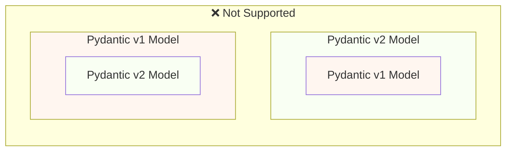
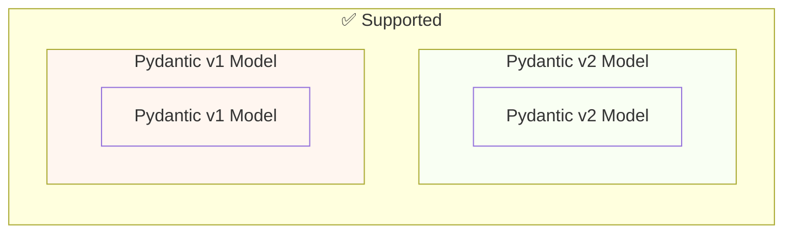
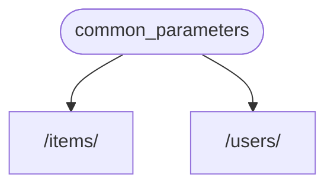
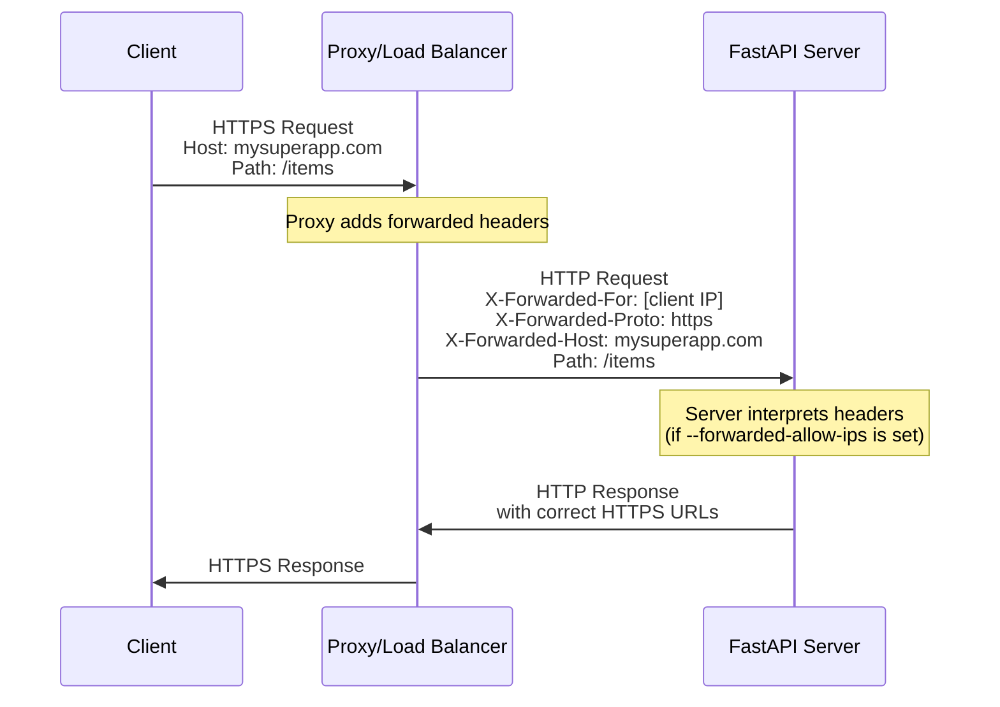

# Judge calibration: labelling sheet

For each item, read the question, the sources the model was given and its
answer, then write one label per item in `labels.csv` (same folder):

- `supported`: every factual claim in the answer (what FastAPI does, how an
  API or parameter behaves, code presented as working) is stated in the
  sources or follows directly from them. Rewording, summarising and generic
  connecting text are fine. Saying the sources do not cover the question is
  supported when they indeed do not.
- `unsupported`: at least one claim is not in the sources or contradicts them,
  including code or parameter names the sources do not show, and claiming the
  sources lack something they contain.
- `unsure`: you cannot decide; these items are left out of the agreement.

Judge support only, not whether the answer is helpful or complete. Use what is
in the sources, not what you know about FastAPI. `note` is optional. The
judge's verdicts are not in this folder; do not look at judge runs before
finishing.


## j-21: How to customize error response in FastAPI?

Question: [so_70952692](https://stackoverflow.com/questions/70952692/how-to-customize-error-response-in-fastapi) (CC BY-SA 4.0)

<details>
<summary>Source 1: reference/response.md (`Response` class)</summary>

You can declare a parameter in a *path operation function* or dependency to be of type `Response` and then you can set data for the response like headers or cookies.

You can also use it directly to create an instance of it and return it from your *path operations*.

Read more about it in the [FastAPI docs about returning a custom Response](https://fastapi.tiangolo.com/advanced/response-directly/#returning-a-custom-response)

You can import it directly from `fastapi`:


```python
from fastapi import Response
```
::: fastapi.Response

</details>

<details>
<summary>Source 2: tutorial/metadata.md (Metadata and Docs URLs { #metadata-and-docs-urls })</summary>

You can customize several metadata configurations in your **FastAPI** application.

</details>

<details>
<summary>Source 3: advanced/response-cookies.md (Response Cookies { #response-cookies } > Return a `Response` directly { #return-a-response-directly })</summary>

You can also create cookies when returning a `Response` directly in your code.

To do that, you can create a response as described in [Return a Response Directly](response-directly.md).

Then set Cookies in it, and then return it:

{* ../../docs_src/response_cookies/tutorial001_py310.py hl[10:12] *}

/// tip

Keep in mind that if you return a response directly instead of using the `Response` parameter, FastAPI will return it directly.

So, you will have to make sure your data is of the correct type. E.g. it is compatible with JSON, if you are returning a `JSONResponse`.

And also that you are not sending any data that should have been filtered by a `response_model`.

///

/// note | Technical Details

You could also use `from starlette.responses import Response` or `from starlette.responses import JSONResponse`.

**FastAPI** provides the same `starlette.responses` as `fastapi.responses` just as a convenience for you, the developer. But most of the available responses come directly from Starlette.

And as the `Response` can be used frequently to set headers and cookies, **FastAPI** also provides it at `fastapi.Response`.

///

To see all the available parameters and options, check the [documentation in Starlette](https://www.starlette.dev/responses/#set-cookie).

</details>

<details>
<summary>Source 4: advanced/additional-status-codes.md (Additional Status Codes { #additional-status-codes })</summary>

By default, **FastAPI** will return the responses using a `JSONResponse`, putting the content you return from your *path operation* inside of that `JSONResponse`.

It will use the default status code or the one you set in your *path operation*.

</details>

<details>
<summary>Source 5: release-notes.md (Release Notes > 0.26.0 (2019-05-29))</summary>

Separate error handling for validation errors.

This will allow developers to customize the exception handlers.

Document better how to handle exceptions and use error handlers.

Include `RequestValidationError` and `WebSocketRequestValidationError` (this last one will be useful once [encode/starlette#527](https://github.com/encode/starlette/pull/527) or equivalent is merged).

New documentation about exceptions handlers:

[Install custom exception handlers](https://fastapi.tiangolo.com/tutorial/handling-errors/#install-custom-exception-handlers).

[Override the default exception handlers](https://fastapi.tiangolo.com/tutorial/handling-errors/#override-the-default-exception-handlers).

[Reuse **FastAPI's** exception handlers](https://fastapi.tiangolo.com/tutorial/handling-errors/#reuse-fastapis-exception-handlers).

PR [#273](https://github.com/tiangolo/fastapi/pull/273).

Fix support for *paths* in *path parameters* without needing explicit `Path(...)`.

PR [#256](https://github.com/tiangolo/fastapi/pull/256).

Documented in PR [#272](https://github.com/tiangolo/fastapi/pull/272) by [@wshayes](https://github.com/wshayes).

New documentation at: [Path Parameters containing paths](https://fastapi.tiangolo.com/tutorial/path-params/#path-parameters-containing-paths).

Update docs for testing FastAPI. Include using `POST`, sending JSON, testing headers, etc. New documentation: [Testing](https://fastapi.tiangolo.com/tutorial/testing/#testing-extended-example). PR [#271](https://github.com/tiangolo/fastapi/pull/271).

Fix type declaration of `response_model` to allow generic Python types as `List[Model]`. Mainly to fix `mypy` for users. PR [#266](https://github.com/tiangolo/fastapi/pull/266).

</details>

**Answer:**

Based on the provided context, here's how you can customize error responses in FastAPI:

1.  **Direct Response Creation:** You can create a `Response` directly and return it from your path operations. This allows you to set headers and cookies within the response.

2.  **Error Handling and Exception Handlers:** FastAPI provides mechanisms for handling exceptions and customizing error responses. You can:
    *   Install custom exception handlers.
    *   Override the default exception handlers.
    *   Reuse FastAPI's exception handlers.

3.  **JSONResponse:** By default, FastAPI uses `JSONResponse` to return responses. You can ensure that your data is compatible with JSON.

4.  **Cookies:** You can create cookies when returning a `Response` directly.

The documentation for returning a custom `Response` can be found here: [https://fastapi.tiangolo.com/advanced/response-directly/](https://fastapi.tiangolo.com/advanced/response-directly/)

To see all the available parameters and options, check the [documentation in Starlette](https://www.starlette.dev/responses/#set-cookie).

---

## j-22: How to send JSON data from Nuxt Axios to a FastAPI backend through a POST request?

Question: [so_73062925](https://stackoverflow.com/questions/73062925/how-to-send-json-data-from-nuxt-axios-to-a-fastapi-backend-through-a-post-reques) (CC BY-SA 4.0)

<details>
<summary>Source 1: tutorial/stream-json-lines.md (Stream JSON Lines { #stream-json-lines })</summary>

You could have a sequence of data that you would like to send in a "**stream**", you could do it with **JSON Lines**.

/// info

Added in FastAPI 0.134.0.

///

</details>

<details>
<summary>Source 2: tutorial/body.md (Request Body { #request-body })</summary>

When you need to send data from a client (let's say, a browser) to your API, you send it as a **request body**.

A **request** body is data sent by the client to your API. A **response** body is the data your API sends to the client.

Your API almost always has to send a **response** body. But clients don't necessarily need to send **request bodies** all the time, sometimes they only request a path, maybe with some query parameters, but don't send a body.

To declare a **request** body, you use [Pydantic](https://docs.pydantic.dev/) models with all their power and benefits.

/// info

To send data, you should use one of: `POST` (the more common), `PUT`, `DELETE` or `PATCH`.

Sending a body with a `GET` request has an undefined behavior in the specifications, nevertheless, it is supported by FastAPI, only for very complex/extreme use cases.

As it is discouraged, the interactive docs with Swagger UI won't show the documentation for the body when using `GET`, and proxies in the middle might not support it.

///

</details>

<details>
<summary>Source 3: advanced/openapi-webhooks.md (OpenAPI Webhooks { #openapi-webhooks } > Documenting webhooks with **FastAPI** and OpenAPI { #documenting-webhooks-with-fastapi-and-openapi })</summary>

With **FastAPI**, using OpenAPI, you can define the names of these webhooks, the types of HTTP operations that your app can send (e.g. `POST`, `PUT`, etc.) and the request **bodies** that your app would send.

This can make it a lot easier for your users to **implement their APIs** to receive your **webhook** requests, they might even be able to autogenerate some of their own API code.

/// info

Webhooks are available in OpenAPI 3.1.0 and above, supported by FastAPI `0.99.0` and above.

///

</details>

<details>
<summary>Source 4: tutorial/request-files.md (Request Files { #request-files } > What is "Form Data" { #what-is-form-data })</summary>

The way HTML forms (`<form></form>`) sends the data to the server normally uses a "special" encoding for that data, it's different from JSON.

**FastAPI** will make sure to read that data from the right place instead of JSON.

/// note | Technical Details

Data from forms is normally encoded using the "media type" `application/x-www-form-urlencoded` when it doesn't include files.

But when the form includes files, it is encoded as `multipart/form-data`. If you use `File`, **FastAPI** will know it has to get the files from the correct part of the body.

If you want to read more about these encodings and form fields, head to the [<abbr title="Mozilla Developer Network">MDN</abbr> web docs for `POST`](https://developer.mozilla.org/en-US/docs/Web/HTTP/Methods/POST).

///

/// warning

You can declare multiple `File` and `Form` parameters in a *path operation*, but you can't also declare `Body` fields that you expect to receive as JSON, as the request will have the body encoded using `multipart/form-data` instead of `application/json`.

This is not a limitation of **FastAPI**, it's part of the HTTP protocol.

///

</details>

<details>
<summary>Source 5: advanced/path-operation-advanced-configuration.md (Path Operation Advanced Configuration { #path-operation-advanced-configuration } > OpenAPI Extra { #openapi-extra })</summary>

When you declare a *path operation* in your application, **FastAPI** automatically generates the relevant metadata about that *path operation* to be included in the OpenAPI schema.

/// note | Technical details

In the OpenAPI specification it is called the [Operation Object](https://github.com/OAI/OpenAPI-Specification/blob/main/versions/3.0.3.md#operation-object).

///

It has all the information about the *path operation* and is used to generate the automatic documentation.

It includes the `tags`, `parameters`, `requestBody`, `responses`, etc.

This *path operation*-specific OpenAPI schema is normally generated automatically by **FastAPI**, but you can also extend it.

/// tip

This is a low level extension point.

If you only need to declare additional responses, a more convenient way to do it is with [Additional Responses in OpenAPI](additional-responses.md).

///

You can extend the OpenAPI schema for a *path operation* using the parameter `openapi_extra`.

This `openapi_extra` can be helpful, for example, to declare [OpenAPI Extensions](https://github.com/OAI/OpenAPI-Specification/blob/main/versions/3.0.3.md#specificationExtensions):

{* ../../docs_src/path_operation_advanced_configuration/tutorial005_py310.py hl[6] *}

If you open the automatic API docs, your extension will show up at the bottom of the specific *path operation*.


And if you see the resulting OpenAPI (at `/openapi.json` in your API), you will see your extension as part of the specific *path operation* too:


```JSON hl_lines="22"
{
    "openapi": "3.1.0",
    "info": {
        "title": "FastAPI",
        "version": "0.1.0"
    },
    "paths": {
        "/items/": {
            "get": {
                "summary": "Read Items",
                "operationId": "read_items_items__get",
                "responses": {
                    "200": {
                        "description": "Successful Response",
                        "content": {
                            "application/json": {
                                "schema": {}
                            }
                        }
                    }
                },
                "x-aperture-labs-portal": "blue"
            }
        }
    }
}
```

The dictionary in `openapi_extra` will be deeply merged with the automatically generated OpenAPI schema for the *path operation*.

So, you could add additional data to the automatically generated schema.

For example, you could decide to read and validate the request with your own code, without using the automatic features of FastAPI with Pydantic, but you could still want to define the request in the OpenAPI schema.

You could do that with `openapi_extra`:

{* ../../docs_src/path_operation_advanced_configuration/tutorial006_py310.py hl[19:36, 39:40] *}

In this example, we didn't declare any Pydantic model. In fact, the request body is not even <dfn title="converted from some plain format, like bytes, into Python objects">parsed</dfn> as JSON, it is read directly as `bytes`, and the function `magic_data_reader()` would be in charge of parsing it in some way.

Nevertheless, we can declare the expected schema for the request body.

Using this same trick, you could use a Pydantic model to define the JSON Schema that is then included in the custom OpenAPI schema section for the *path operation*.

And you could do this even if the data type in the request is not JSON.

For example, in this application we don't use FastAPI's integrated functionality to extract the JSON Schema from Pydantic models nor the automatic validation for JSON. In fact, we are declaring the request content type as YAML, not JSON:

{* ../../docs_src/path_operation_advanced_configuration/tutorial007_py310.py hl[15:20, 22] *}

Nevertheless, although we are not using the default integrated functionality, we are still using a Pydantic model to manually generate the JSON Schema for the data that we want to receive in YAML.

Then we use the request directly, and extract the body as `bytes`. This means that FastAPI won't even try to parse the request payload as JSON.

And then in our code, we parse that YAML content directly, and then we are again using the same Pydantic model to validate the YAML content:

{* ../../docs_src/path_operation_advanced_configuration/tutorial007_py310.py hl[24:31] *}

/// tip

Here we reuse the same Pydantic model.

But the same way, we could have validated it in some other way.

///

</details>

**Answer:**

Based on the provided context, here’s how you would send JSON data from Nuxt Axios to a FastAPI backend via a POST request:

1.  **Request Body:** Axios sends data as a request body. The context specifies that you should use `POST`, `PUT`, `DELETE` or `PATCH` for sending a body.

2.  **Pydantic Models:** To declare a request body, you should use Pydantic models.  FastAPI will automatically generate the metadata for the operation to be included in the OpenAPI schema.

3.  **OpenAPI Schema Extension:**  You can extend the OpenAPI schema for a *path operation* using the parameter `openapi_extra`. This allows you to define the request body schema even if it's not JSON.  You can define the request content type as YAML, not JSON. 

4. **Data Encoding**: Data from forms is normally encoded using the "media type" `application/x-www-form-urlencoded` when it doesn't include files. But when the form includes files, it is encoded as `multipart/form-data`.

To summarize, when using Axios to send JSON data, you would configure the request to send the JSON as a request body. You would then use a Pydantic model to define the schema of the JSON data, and you can extend the OpenAPI schema using `openapi_extra` to define the request body schema even if it's not JSON.

---

## j-23: FastAPI error when handling file together with form-data defined in a Pydantic model

Question: [so_79020006](https://stackoverflow.com/questions/79020006/fastapi-error-when-handling-file-together-with-form-data-defined-in-a-pydantic-m) (CC BY-SA 4.0)

<details>
<summary>Source 1: tutorial/request-form-models.md (Form Models { #form-models } > Pydantic Models for Forms { #pydantic-models-for-forms })</summary>

You just need to declare a **Pydantic model** with the fields you want to receive as **form fields**, and then declare the parameter as `Form`:

{* ../../docs_src/request_form_models/tutorial001_an_py310.py hl[9:11,15] *}

**FastAPI** will **extract** the data for **each field** from the **form data** in the request and give you the Pydantic model you defined.

</details>

<details>
<summary>Source 2: release-notes.md (Release Notes > 0.113.0 (2024-09-05))</summary>

Now you can declare form fields with Pydantic models:


```python
from typing import Annotated

from fastapi import FastAPI, Form
from pydantic import BaseModel

app = FastAPI()


class FormData(BaseModel):
    username: str
    password: str


@app.post("/login/")
async def login(data: Annotated[FormData, Form()]):
    return data
```
Read the new docs: [Form Models](https://fastapi.tiangolo.com/tutorial/request-form-models/).

✨ Add support for Pydantic models in `Form` parameters. PR [#12129](https://github.com/fastapi/fastapi/pull/12129) by [@tiangolo](https://github.com/tiangolo).

🔧 Update sponsors: Coherence link. PR [#12130](https://github.com/fastapi/fastapi/pull/12130) by [@tiangolo](https://github.com/tiangolo).

</details>

<details>
<summary>Source 3: how-to/migrate-from-pydantic-v1-to-pydantic-v2.md (Migrate from Pydantic v1 to Pydantic v2 { #migrate-from-pydantic-v1-to-pydantic-v2 } > Pydantic v1 in v2 { #pydantic-v1-in-v2 })</summary>

Pydantic v2 includes everything from Pydantic v1 as a submodule `pydantic.v1`. But this is no longer supported in versions above Python 3.13.

This means that you can install the latest version of Pydantic v2 and import and use the old Pydantic v1 components from this submodule, as if you had the old Pydantic v1 installed.

{* ../../docs_src/pydantic_v1_in_v2/tutorial001_an_py310.py hl[1,4] *}

Since FastAPI 0.119.0, there's also partial support for Pydantic v1 from inside of Pydantic v2, to facilitate the migration to v2.

So, you could upgrade Pydantic to the latest version 2, and change the imports to use the `pydantic.v1` submodule, and in many cases it would just work.

{* ../../docs_src/pydantic_v1_in_v2/tutorial002_an_py310.py hl[2,5,15] *}

/// warning

Have in mind that as the Pydantic team no longer supports Pydantic v1 in recent versions of Python, starting from Python 3.14, using `pydantic.v1` is also not supported in Python 3.14 and above.

///

It's **not supported** by Pydantic to have a model of Pydantic v2 with its own fields defined as Pydantic v1 models or vice versa.



...but, you can have separated models using Pydantic v1 and v2 in the same app.



In some cases, it's even possible to have both Pydantic v1 and v2 models in the same **path operation** in your FastAPI app:

{* ../../docs_src/pydantic_v1_in_v2/tutorial003_an_py310.py hl[2:3,6,12,21:22] *}

In this example above, the input model is a Pydantic v1 model, and the output model (defined in `response_model=ItemV2`) is a Pydantic v2 model.

If you need to use some of the FastAPI-specific tools for parameters like `Body`, `Query`, `Form`, etc. with Pydantic v1 models, you can import them from `fastapi.temp_pydantic_v1_params` while you finish the migration to Pydantic v2:

{* ../../docs_src/pydantic_v1_in_v2/tutorial004_an_py310.py hl[4,18] *}

/// tip

First try with `bump-pydantic`, if your tests pass and that works, then you're done in one command. ✨

///

If `bump-pydantic` doesn't work for your use case, you can use the support for both Pydantic v1 and v2 models in the same app to do the migration to Pydantic v2 gradually.

You could fist upgrade Pydantic to use the latest version 2, and change the imports to use `pydantic.v1` for all your models.

Then, you can start migrating your models from Pydantic v1 to v2 in groups, in gradual steps. 🚶

</details>

<details>
<summary>Source 4: release-notes.md (Release Notes > 0.114.0 (2024-09-06))</summary>

You can restrict form fields to only include those declared in a Pydantic model and forbid any extra field sent in the request using Pydantic's `model_config = {"extra": "forbid"}`:


```python
from typing import Annotated

from fastapi import FastAPI, Form
from pydantic import BaseModel

app = FastAPI()


class FormData(BaseModel):
    username: str
    password: str
    model_config = {"extra": "forbid"}


@app.post("/login/")
async def login(data: Annotated[FormData, Form()]):
    return data
```
Read the new docs: [Form Models - Forbid Extra Form Fields](https://fastapi.tiangolo.com/tutorial/request-form-models/#forbid-extra-form-fields).

✨ Add support for forbidding extra form fields with Pydantic models. PR [#12134](https://github.com/fastapi/fastapi/pull/12134) by [@tiangolo](https://github.com/tiangolo).

📝 Update docs, Form Models section title, to match config name. PR [#12152](https://github.com/fastapi/fastapi/pull/12152) by [@tiangolo](https://github.com/tiangolo).

✅ Update internal tests for latest Pydantic, including CI tweaks to install the latest Pydantic. PR [#12147](https://github.com/fastapi/fastapi/pull/12147) by [@tiangolo](https://github.com/tiangolo).

</details>

<details>
<summary>Source 5: tutorial/cookie-param-models.md (Cookie Parameter Models { #cookie-parameter-models } > Cookies with a Pydantic Model { #cookies-with-a-pydantic-model })</summary>

Declare the **cookie** parameters that you need in a **Pydantic model**, and then declare the parameter as `Cookie`:

{* ../../docs_src/cookie_param_models/tutorial001_an_py310.py hl[9:12,16] *}

**FastAPI** will **extract** the data for **each field** from the **cookies** received in the request and give you the Pydantic model you defined.

</details>

**Answer:**

Based on the provided context, FastAPI allows you to use Pydantic models for form fields and cookie parameters.

Here's how it works:

1.  **Define a Pydantic Model:** You declare a Pydantic model with the fields you want to receive as form fields or cookie parameters.

2.  **Declare the Parameter as `Form` or `Cookie`:** You then declare the parameter as `Form` if it's a form field or `Cookie` if it's a cookie parameter.

3.  **FastAPI Extracts Data:** FastAPI will extract the data for each field from the form data or cookies and give you the Pydantic model you defined.

Regarding the question about FastAPI errors when handling files together with form data defined in a Pydantic model, the context doesn't provide a direct solution or explanation. However, it does suggest using Pydantic models for both form fields and cookie parameters. The documentation on "Form Models - Forbid Extra Form Fields" ([https://fastapi.tiangolo.com/tutorial/request-form-models/#forbid-extra-form-fields](https://fastapi.tiangolo.com/tutorial/request-form-models/#forbid-extra-form-fields)) demonstrates how to restrict form fields using `model_config = {"extra": "forbid"}`.

To address the error, you may need to carefully define your Pydantic model to include the expected form fields and cookie parameters and ensure that you are handling the file upload separately.  Consider checking the FastAPI documentation for handling file uploads alongside form data for more specific guidance.

---

## j-24: How to return separate JSON responses using FastAPI?

Question: [so_76122326](https://stackoverflow.com/questions/76122326/how-to-return-separate-json-responses-using-fastapi) (CC BY-SA 4.0)

<details>
<summary>Source 1: advanced/response-cookies.md (Response Cookies { #response-cookies } > Return a `Response` directly { #return-a-response-directly })</summary>

You can also create cookies when returning a `Response` directly in your code.

To do that, you can create a response as described in [Return a Response Directly](response-directly.md).

Then set Cookies in it, and then return it:

{* ../../docs_src/response_cookies/tutorial001_py310.py hl[10:12] *}

/// tip

Keep in mind that if you return a response directly instead of using the `Response` parameter, FastAPI will return it directly.

So, you will have to make sure your data is of the correct type. E.g. it is compatible with JSON, if you are returning a `JSONResponse`.

And also that you are not sending any data that should have been filtered by a `response_model`.

///

/// note | Technical Details

You could also use `from starlette.responses import Response` or `from starlette.responses import JSONResponse`.

**FastAPI** provides the same `starlette.responses` as `fastapi.responses` just as a convenience for you, the developer. But most of the available responses come directly from Starlette.

And as the `Response` can be used frequently to set headers and cookies, **FastAPI** also provides it at `fastapi.Response`.

///

To see all the available parameters and options, check the [documentation in Starlette](https://www.starlette.dev/responses/#set-cookie).

</details>

<details>
<summary>Source 2: advanced/response-directly.md (Return a Response Directly { #return-a-response-directly } > Using the `jsonable_encoder` in a `Response` { #using-the-jsonable-encoder-in-a-response })</summary>

Because **FastAPI** doesn't make any changes to a `Response` you return, you have to make sure its contents are ready for it.

For example, you cannot put a Pydantic model in a `JSONResponse` without first converting it to a `dict` with all the data types (like `datetime`, `UUID`, etc) converted to JSON-compatible types.

For those cases, you can use the `jsonable_encoder` to convert your data before passing it to a response:

{* ../../docs_src/response_directly/tutorial001_py310.py hl[5:6,20:21] *}

/// note | Technical Details

You could also use `from starlette.responses import JSONResponse`.

**FastAPI** provides the same `starlette.responses` as `fastapi.responses` just as a convenience for you, the developer. But most of the available responses come directly from Starlette.

///

</details>

<details>
<summary>Source 3: advanced/custom-response.md (Custom Response - HTML, Stream, File, others { #custom-response-html-stream-file-others } > JSON Responses { #json-responses })</summary>

By default FastAPI returns JSON responses.

If you declare a [Response Model](../tutorial/response-model.md) FastAPI will use it to serialize the data to JSON, using Pydantic.

If you don't declare a response model, FastAPI will use the `jsonable_encoder` explained in [JSON Compatible Encoder](../tutorial/encoder.md) and put it in a `JSONResponse`.

If you declare a `response_class` with a JSON media type (`application/json`), like is the case with the `JSONResponse`, the data you return will be automatically converted (and filtered) with any Pydantic `response_model` that you declared in the *path operation decorator*. But the data won't be serialized to JSON bytes with Pydantic, instead it will be converted with the `jsonable_encoder` and then passed to the `JSONResponse` class, which will serialize it to bytes using the standard JSON library in Python.

In short, if you want the maximum performance, use a [Response Model](../tutorial/response-model.md) and don't declare a `response_class` in the *path operation decorator*.

{* ../../docs_src/response_model/tutorial001_01_py310.py ln[15:17] hl[16] *}

</details>

<details>
<summary>Source 4: reference/responses.md (Custom Response Classes - File, HTML, Redirect, Streaming, etc. > FastAPI Responses)</summary>

There were a couple of custom FastAPI response classes that were intended to optimize JSON performance.

However, they are now deprecated as you will now get better performance by using a [Response Model - Return Type](https://fastapi.tiangolo.com/tutorial/response-model/).

That way, Pydantic will serialize the data into JSON bytes on the Rust side, which will achieve better performance than these custom JSON responses.

Read more about it in [Custom Response - HTML, Stream, File, others - `orjson` or Response Model](https://fastapi.tiangolo.com/advanced/custom-response/#orjson-or-response-model).

::: fastapi.responses.UJSONResponse
    options:
        members:
            - charset
            - status_code
            - media_type
            - body
            - background
            - raw_headers
            - render
            - init_headers
            - headers
            - set_cookie
            - delete_cookie

::: fastapi.responses.ORJSONResponse
    options:
        members:
            - charset
            - status_code
            - media_type
            - body
            - background
            - raw_headers
            - render
            - init_headers
            - headers
            - set_cookie
            - delete_cookie

</details>

<details>
<summary>Source 5: advanced/custom-response.md (Custom Response - HTML, Stream, File, others { #custom-response-html-stream-file-others })</summary>

By default, **FastAPI** will return JSON responses.

You can override it by returning a `Response` directly as seen in [Return a Response directly](response-directly.md).

But if you return a `Response` directly (or any subclass, like `JSONResponse`), the data won't be automatically converted (even if you declare a `response_model`), and the documentation won't be automatically generated (for example, including the specific "media type", in the HTTP header `Content-Type` as part of the generated OpenAPI).

But you can also declare the `Response` that you want to be used (e.g. any `Response` subclass), in the *path operation decorator* using the `response_class` parameter.

The contents that you return from your *path operation function* will be put inside of that `Response`.

/// note

If you use a response class with no media type, FastAPI will expect your response to have no content, so it will not document the response format in its generated OpenAPI docs.

///

</details>

**Answer:**

To return separate JSON responses using FastAPI, you can return a `Response` directly in your code. You can create a response as described in [Return a Response Directly](response-directly.md). Then set Cookies in it, and then return it. 

However, if you return a `Response` directly (or any subclass, like `JSONResponse`), the data won't be automatically converted (even if you declare a `response_model`), and the documentation won't be automatically generated (for example, including the specific "media type", in the HTTP header `Content-Type` as part of the generated OpenAPI).

You can also declare the `Response` that you want to be used (e.g. any `Response` subclass), in the *path operation decorator* using the `response_class` parameter. The contents that you return from your *path operation function* will be put inside of that `Response`. 

If you use a response class with no media type, FastAPI will expect your response to have no content, so it will not document the response format in its generated OpenAPI docs.

To achieve maximum performance, using a [Response Model - Return Type](https://fastapi.tiangolo.com/tutorial/response-model/) is recommended. Pydantic will serialize the data into JSON bytes on the Rust side.

---

## j-25: How do I return an image in FastAPI?

Question: [so_55873174](https://stackoverflow.com/questions/55873174/how-do-i-return-an-image-in-fastapi) (CC BY-SA 4.0)

<details>
<summary>Source 1: advanced/additional-responses.md (Additional Responses in OpenAPI { #additional-responses-in-openapi } > Additional media types for the main response { #additional-media-types-for-the-main-response })</summary>

You can use this same `responses` parameter to add different media types for the same main response.

For example, you can add an additional media type of `image/png`, declaring that your *path operation* can return a JSON object (with media type `application/json`) or a PNG image:

{* ../../docs_src/additional_responses/tutorial002_py310.py hl[17:22,26] *}

/// note

Notice that you have to return the image using a `FileResponse` directly.

///

/// info

Unless you specify a different media type explicitly in your `responses` parameter, FastAPI will assume the response has the same media type as the main response class (default `application/json`).

But if you have specified a custom response class with `None` as its media type, FastAPI will use `application/json` for any additional response that has an associated model.

///

</details>

<details>
<summary>Source 2: deployment/docker.md (FastAPI in Containers - Docker { #fastapi-in-containers-docker })</summary>

When deploying FastAPI applications a common approach is to build a **Linux container image**. It's normally done using [**Docker**](https://www.docker.com/). You can then deploy that container image in one of a few possible ways.

Using Linux containers has several advantages including **security**, **replicability**, **simplicity**, and others.

/// tip

In a hurry and already know this stuff? Jump to the [`Dockerfile` below 👇](#build-a-docker-image-for-fastapi).

///

<details>
<summary>Dockerfile Preview 👀</summary>

```Dockerfile
FROM python:3.14

WORKDIR /code

COPY ./requirements.txt /code/requirements.txt

RUN pip install --no-cache-dir --upgrade -r /code/requirements.txt

COPY ./app /code/app

CMD ["fastapi", "run", "app/main.py", "--port", "80"]

# If running behind a proxy like Nginx or Traefik add --proxy-headers
# CMD ["fastapi", "run", "app/main.py", "--port", "80", "--proxy-headers"]
```
</details>

</details>

<details>
<summary>Source 3: features.md (Features { #features } > FastAPI features { #fastapi-features })</summary>

**FastAPI** gives you the following:

</details>

<details>
<summary>Source 4: deployment/server-workers.md (Server Workers - Uvicorn with Workers { #server-workers-uvicorn-with-workers } > Containers and Docker { #containers-and-docker })</summary>

In the next chapter about [FastAPI in Containers - Docker](docker.md) I'll explain some strategies you could use to handle the other **deployment concepts**.

I'll show you how to **build your own image from scratch** to run a single Uvicorn process. It is a simple process and is probably what you would want to do when using a distributed container management system like **Kubernetes**.

</details>

<details>
<summary>Source 5: advanced/additional-status-codes.md (Additional Status Codes { #additional-status-codes })</summary>

By default, **FastAPI** will return the responses using a `JSONResponse`, putting the content you return from your *path operation* inside of that `JSONResponse`.

It will use the default status code or the one you set in your *path operation*.

</details>

**Answer:**

According to the provided context, you can return an image in FastAPI by adding an additional media type like `image/png` to your `responses` parameter. However, you must return the image using a `FileResponse` directly. 

Here's a breakdown of how to do it, based on Source 1:

1.  **Specify the media type:** Add an additional media type to the `responses` parameter of your path operation.
2.  **Use `FileResponse`:**  Return the image using the `FileResponse` class.

Example (as shown in Source 1):

```python
from fastapi import FastAPI, File, Response
from fastapi.responses import JSONResponse

app = FastAPI()

@app.get("/image")
async def get_image():
    return Response(
        content=open("my_image.png", "rb").read(),
        media_type="image/png",
    )
```

---

## j-26: Is having a concurrent.futures.ThreadPoolExecutor call dangerous in a FastAPI endpoint?

Question: [so_74184899](https://stackoverflow.com/questions/74184899/is-having-a-concurrent-futures-threadpoolexecutor-call-dangerous-in-a-fastapi-en) (CC BY-SA 4.0)

<details>
<summary>Source 1: async.md (Concurrency and async / await { #concurrency-and-async-await } > Very Technical Details { #very-technical-details })</summary>

/// warning

You can probably skip this.

These are very technical details of how **FastAPI** works underneath.

If you have quite some technical knowledge (coroutines, threads, blocking, etc.) and are curious about how FastAPI handles `async def` vs normal `def`, go ahead.

///

When you declare a *path operation function* with normal `def` instead of `async def`, it is run in an external threadpool that is then awaited, instead of being called directly (as it would block the server).

If you are coming from another async framework that does not work in the way described above and you are used to defining trivial compute-only *path operation functions* with plain `def` for a tiny performance gain (about 100 nanoseconds), please note that in **FastAPI** the effect would be quite opposite. In these cases, it's better to use `async def` unless your *path operation functions* use code that performs blocking <abbr title="Input/Output: disk reading or writing, network communications.">I/O</abbr>.

Still, in both situations, chances are that **FastAPI** will [still be faster](index.md#performance) than (or at least comparable to) your previous framework.

The same applies for [dependencies](tutorial/dependencies/index.md). If a dependency is a standard `def` function instead of `async def`, it is run in the external threadpool.

You can have multiple dependencies and [sub-dependencies](tutorial/dependencies/sub-dependencies.md) requiring each other (as parameters of the function definitions), some of them might be created with `async def` and some with normal `def`. It would still work, and the ones created with normal `def` would be called on an external thread (from the threadpool) instead of being "awaited".

Any other utility function that you call directly can be created with normal `def` or `async def` and FastAPI won't affect the way you call it.

This is in contrast to the functions that FastAPI calls for you: *path operation functions* and dependencies.

If your utility function is a normal function with `def`, it will be called directly (as you write it in your code), not in a threadpool, if the function is created with `async def` then you should `await` for that function when you call it in your code.

Again, these are very technical details that would probably be useful if you came searching for them.

Otherwise, you should be good with the guidelines from the section above: <a href="#in-a-hurry">In a hurry?</a>.

</details>

<details>
<summary>Source 2: advanced/async-tests.md (Async Tests { #async-tests } > Other Asynchronous Function Calls { #other-asynchronous-function-calls })</summary>

As the testing function is now asynchronous, you can now also call (and `await`) other `async` functions apart from sending requests to your FastAPI application in your tests, exactly as you would call them anywhere else in your code.

/// tip

If you encounter a `RuntimeError: Task attached to a different loop` when integrating asynchronous function calls in your tests (e.g. when using [MongoDB's MotorClient](https://stackoverflow.com/questions/41584243/runtimeerror-task-attached-to-a-different-loop)), remember to instantiate objects that need an event loop only within async functions, e.g. an `@app.on_event("startup")` callback.

///

</details>

<details>
<summary>Source 3: async.md (Concurrency and async / await { #concurrency-and-async-await } > Asynchronous Code { #asynchronous-code })</summary>

Asynchronous code just means that the language 💬 has a way to tell the computer / program 🤖 that at some point in the code, it 🤖 will have to wait for *something else* to finish somewhere else. Let's say that *something else* is called "slow-file" 📝.

So, during that time, the computer can go and do some other work, while "slow-file" 📝 finishes.

Then the computer / program 🤖 will come back every time it has a chance because it's waiting again, or whenever it 🤖 finished all the work it had at that point. And it 🤖 will see if any of the tasks it was waiting for have already finished, doing whatever it had to do.

Next, it 🤖 takes the first task to finish (let's say, our "slow-file" 📝) and continues whatever it had to do with it.

That "wait for something else" normally refers to <abbr title="Input and Output">I/O</abbr> operations that are relatively "slow" (compared to the speed of the processor and the RAM memory), like waiting for:

the data from the client to be sent through the network

the data sent by your program to be received by the client through the network

the contents of a file in the disk to be read by the system and given to your program

the contents your program gave to the system to be written to disk

a remote API operation

a database operation to finish

a database query to return the results

etc.

As the execution time is consumed mostly by waiting for <abbr title="Input and Output">I/O</abbr> operations, they call them "I/O bound" operations.

It's called "asynchronous" because the computer / program doesn't have to be "synchronized" with the slow task, waiting for the exact moment that the task finishes, while doing nothing, to be able to take the task result and continue the work.

Instead of that, by being an "asynchronous" system, once finished, the task can wait in line a little bit (some microseconds) for the computer / program to finish whatever it went to do, and then come back to take the results and continue working with them.

For "synchronous" (contrary to "asynchronous") they commonly also use the term "sequential", because the computer / program follows all the steps in sequence before switching to a different task, even if those steps involve waiting.

This idea of **asynchronous** code described above is also sometimes called **"concurrency"**. It is different from **"parallelism"**.

**Concurrency** and **parallelism** both relate to "different things happening more or less at the same time".

But the details between *concurrency* and *parallelism* are quite different.

To see the difference, imagine the following story about burgers:

You go with your crush to get fast food, you stand in line while the cashier takes the orders from the people in front of you. 😍


Then it's your turn, you place your order of 2 very fancy burgers for your crush and you. 🍔🍔


The cashier says something to the cook in the kitchen so they know they have to prepare your burgers (even though they are currently preparing the ones for the previous clients).


You pay. 💸

The cashier gives you the number of your turn.


While you are waiting, you go with your crush and pick a table, you sit and talk with your crush for a long time (as your burgers are very fancy and take some time to prepare).

As you are sitting at the table with your crush, while you wait for the burgers, you can spend that time admiring how awesome, cute and smart your crush is ✨😍✨.


While waiting and talking to your crush, from time to time, you check the number displayed on the counter to see if it's your turn already.

Then at some point, it finally is your turn. You go to the counter, get your burgers and come back to the table.


You and your crush eat the burgers and have a nice time. ✨


/// info

Beautiful illustrations by [Ketrina Thompson](https://www.instagram.com/ketrinadrawsalot). 🎨

///

Imagine you are the computer / program 🤖 in that story.

While you are at the line, you are just idle 😴, waiting for your turn, not doing anything very "productive". But the line is fast because the cashier is only taking the orders (not preparing them), so that's fine.

Then, when it's your turn, you do actual "productive" work, you process the menu, decide what you want, get your crush's choice, pay, check that you give the correct bill or card, check that you are charged correctly, check that the order has the correct items, etc.

But then, even though you still don't have your burgers, your work with the cashier is "on pause" ⏸, because you have to wait 🕙 for your burgers to be ready.

But as you go away from the counter and sit at the table with a number for your turn, you can switch 🔀 your attention to your crush, and "work" ⏯ 🤓 on that. Then you are again doing something very "productive" as is flirting with your crush 😍.

Then the cashier 💁 says "I'm finished with doing the burgers" by putting your number on the counter's display, but you don't jump like crazy immediately when the displayed number changes to your turn number. You know no one will steal your burgers because you have the number of your turn, and they have theirs.

So you wait for your crush to finish the story (finish the current work ⏯ / task being processed 🤓), smile gently and say that you are going for the burgers ⏸.

Then you go to the counter 🔀, to the initial task that is now finished ⏯, pick the burgers, say thanks and take them to the table. That finishes that step / task of interaction with the counter ⏹. That in turn, creates a new task, of "eating burgers" 🔀 ⏯, but the previous one of "getting burgers" is finished ⏹.

Now let's imagine these aren't "Concurrent Burgers", but "Parallel Burgers".

You go with your crush to get parallel fast food.

You stand in line while several (let's say 8) cashiers that at the same time are cooks take the orders from the people in front of you.

Everyone before you is waiting for their burgers to be ready before leaving the counter because each of the 8 cashiers goes and prepares the burger right away before getting the next order.


Then it's finally your turn, you place your order of 2 very fancy burgers for your crush and you.

You pay 💸.


The cashier goes to the kitchen.

You wait, standing in front of the counter 🕙, so that no one else takes your burgers before you do, as there are no numbers for turns.


As you and your crush are busy not letting anyone get in front of you and take your burgers whenever they arrive, you cannot pay attention to your crush. 😞

This is "synchronous" work, you are "synchronized" with the cashier/cook 👨‍🍳. You have to wait 🕙 and be there at the exact moment that the cashier/cook 👨‍🍳 finishes the burgers and gives them to you, or otherwise, someone else might take them.


Then your cashier/cook 👨‍🍳 finally comes back with your burgers, after a long time waiting 🕙 there in front of the counter.


You take your burgers and go to the table with your crush.

You just eat them, and you are done. ⏹


There was not much talk or flirting as most of the time was spent waiting 🕙 in front of the counter. 😞

/// info

Beautiful illustrations by [Ketrina Thompson](https://www.instagram.com/ketrinadrawsalot). 🎨

///

In this scenario of the parallel burgers, you are a computer / program 🤖 with two processors (you and your crush), both waiting 🕙 and dedicating their attention ⏯ to be "waiting on the counter" 🕙 for a long time.

The fast food store has 8 processors (cashiers/cooks). While the concurrent burgers store might have had only 2 (one cashier and one cook).

But still, the final experience is not the best. 😞

This would be the parallel equivalent story for burgers. 🍔

For a more "real life" example of this, imagine a bank.

Up to recently, most of the banks had multiple cashiers 👨‍💼👨‍💼👨‍💼👨‍💼 and a big line 🕙🕙🕙🕙🕙🕙🕙🕙.

All of the cashiers doing all the work with one client after the other 👨‍💼⏯.

And you have to wait 🕙 in the line for a long time or you lose your turn.

You probably wouldn't want to take your crush 😍 with you to run errands at the bank 🏦.

In this scenario of "fast food burgers with your crush", as there is a lot of waiting 🕙, it makes a lot more sense to have a concurrent system ⏸🔀⏯.

This is the case for most of the web applications.

Many, many users, but your server is waiting 🕙 for their not-so-good connection to send their requests.

And then waiting 🕙 again for the responses to come back.

This "waiting" 🕙 is measured in microseconds, but still, summing it all, it's a lot of waiting in the end.

That's why it makes a lot of sense to use asynchronous ⏸🔀⏯ code for web APIs.

This kind of asynchronicity is what made NodeJS popular (even though NodeJS is not parallel) and that's the strength of Go as a programming language.

And that's the same level of performance you get with **FastAPI**.

And as you can have parallelism and asynchronicity at the same time, you get higher performance than most of the tested NodeJS frameworks and on par with Go, which is a compiled language closer to C [(all thanks to Starlette)](https://www.techempower.com/benchmarks/#section=data-r17&hw=ph&test=query&l=zijmkf-1).

Nope! That's not the moral of the story.

Concurrency is different than parallelism. And it is better on **specific** scenarios that involve a lot of waiting. Because of that, it generally is a lot better than parallelism for web application development. But not for everything.

So, to balance that out, imagine the following short story:

You have to clean a big, dirty house.

*Yep, that's the whole story*.

There's no waiting 🕙 anywhere, just a lot of work to be done, on multiple places of the house.

You could have turns as in the burgers example, first the living room, then the kitchen, but as you are not waiting 🕙 for anything, just cleaning and cleaning, the turns wouldn't affect anything.

It would take the same amount of time to finish with or without turns (concurrency) and you would have done the same amount of work.

But in this case, if you could bring the 8 ex-cashier/cooks/now-cleaners, and each one of them (plus you) could take a zone of the house to clean it, you could do all the work in **parallel**, with the extra help, and finish much sooner.

In this scenario, each one of the cleaners (including you) would be a processor, doing their part of the job.

And as most of the execution time is taken by actual work (instead of waiting), and the work in a computer is done by a <abbr title="Central Processing Unit">CPU</abbr>, they call these problems "CPU bound".

Common examples of CPU bound operations are things that require complex math processing.

For example:

**Audio** or **image processing**.

**Computer vision**: an image is composed of millions of pixels, each pixel has 3 values / colors, processing that normally requires computing something on those pixels, all at the same time.

**Machine Learning**: it normally requires lots of "matrix" and "vector" multiplications. Think of a huge spreadsheet with numbers and multiplying all of them together at the same time.

**Deep Learning**: this is a sub-field of Machine Learning, so, the same applies. It's just that there is not a single spreadsheet of numbers to multiply, but a huge set of them, and in many cases, you use a special processor to build and / or use those models.

With **FastAPI** you can take advantage of concurrency that is very common for web development (the same main attraction of NodeJS).

But you can also exploit the benefits of parallelism and multiprocessing (having multiple processes running in parallel) for **CPU bound** workloads like those in Machine Learning systems.

That, plus the simple fact that Python is the main language for **Data Science**, Machine Learning and especially Deep Learning, make FastAPI a very good match for Data Science / Machine Learning web APIs and applications (among many others).

To see how to achieve this parallelism in production see the section about [Deployment](deployment/index.md).

</details>

<details>
<summary>Source 4: reference/security/index.md (Security Tools > OAuth2 Authentication)</summary>

::: fastapi.security.OAuth2

::: fastapi.security.OAuth2AuthorizationCodeBearer

::: fastapi.security.OAuth2PasswordBearer

</details>

<details>
<summary>Source 5: async.md (Concurrency and async / await { #concurrency-and-async-await } > Asynchronous Code { #asynchronous-code })</summary>

Asynchronous code just means that the language 💬 has a way to tell the computer / program 🤖 that at some point in the code, it 🤖 will have to wait for *something else* to finish somewhere else. Let's say that *something else* is called "slow-file" 📝.

So, during that time, the computer can go and do some other work, while "slow-file" 📝 finishes.

Then the computer / program 🤖 will come back every time it has a chance because it's waiting again, or whenever it 🤖 finished all the work it had at that point. And it 🤖 will see if any of the tasks it was waiting for have already finished, doing whatever it had to do.

Next, it 🤖 takes the first task to finish (let's say, our "slow-file" 📝) and continues whatever it had to do with it.

That "wait for something else" normally refers to <abbr title="Input and Output">I/O</abbr> operations that are relatively "slow" (compared to the speed of the processor and the RAM memory), like waiting for:

the data from the client to be sent through the network

the data sent by your program to be received by the client through the network

the contents of a file in the disk to be read by the system and given to your program

the contents your program gave to the system to be written to disk

a remote API operation

a database operation to finish

a database query to return the results

etc.

As the execution time is consumed mostly by waiting for <abbr title="Input and Output">I/O</abbr> operations, they call them "I/O bound" operations.

It's called "asynchronous" because the computer / program doesn't have to be "synchronized" with the slow task, waiting for the exact moment that the task finishes, while doing nothing, to be able to take the task result and continue the work.

Instead of that, by being an "asynchronous" system, once finished, the task can wait in line a little bit (some microseconds) for the computer / program to finish whatever it went to do, and then come back to take the results and continue working with them.

For "synchronous" (contrary to "asynchronous") they commonly also use the term "sequential", because the computer / program follows all the steps in sequence before switching to a different task, even if those steps involve waiting.

This idea of **asynchronous** code described above is also sometimes called **"concurrency"**. It is different from **"parallelism"**.

**Concurrency** and **parallelism** both relate to "different things happening more or less at the same time".

But the details between *concurrency* and *parallelism* are quite different.

To see the difference, imagine the following story about burgers:

You go with your crush to get fast food, you stand in line while the cashier takes the orders from the people in front of you. 😍


Then it's your turn, you place your order of 2 very fancy burgers for your crush and you. 🍔🍔


The cashier says something to the cook in the kitchen so they know they have to prepare your burgers (even though they are currently preparing the ones for the previous clients).


You pay. 💸

The cashier gives you the number of your turn.


While you are waiting, you go with your crush and pick a table, you sit and talk with your crush for a long time (as your burgers are very fancy and take some time to prepare).

As you are sitting at the table with your crush, while you wait for the burgers, you can spend that time admiring how awesome, cute and smart your crush is ✨😍✨.


While waiting and talking to your crush, from time to time, you check the number displayed on the counter to see if it's your turn already.

Then at some point, it finally is your turn. You go to the counter, get your burgers and come back to the table.


You and your crush eat the burgers and have a nice time. ✨


/// info

Beautiful illustrations by [Ketrina Thompson](https://www.instagram.com/ketrinadrawsalot). 🎨

///

Imagine you are the computer / program 🤖 in that story.

While you are at the line, you are just idle 😴, waiting for your turn, not doing anything very "productive". But the line is fast because the cashier is only taking the orders (not preparing them), so that's fine.

Then, when it's your turn, you do actual "productive" work, you process the menu, decide what you want, get your crush's choice, pay, check that you give the correct bill or card, check that you are charged correctly, check that the order has the correct items, etc.

But then, even though you still don't have your burgers, your work with the cashier is "on pause" ⏸, because you have to wait 🕙 for your burgers to be ready.

But as you go away from the counter and sit at the table with a number for your turn, you can switch 🔀 your attention to your crush, and "work" ⏯ 🤓 on that. Then you are again doing something very "productive" as is flirting with your crush 😍.

Then the cashier 💁 says "I'm finished with doing the burgers" by putting your number on the counter's display, but you don't jump like crazy immediately when the displayed number changes to your turn number. You know no one will steal your burgers because you have the number of your turn, and they have theirs.

So you wait for your crush to finish the story (finish the current work ⏯ / task being processed 🤓), smile gently and say that you are going for the burgers ⏸.

Then you go to the counter 🔀, to the initial task that is now finished ⏯, pick the burgers, say thanks and take them to the table. That finishes that step / task of interaction with the counter ⏹. That in turn, creates a new task, of "eating burgers" 🔀 ⏯, but the previous one of "getting burgers" is finished ⏹.

Now let's imagine these aren't "Concurrent Burgers", but "Parallel Burgers".

You go with your crush to get parallel fast food.

You stand in line while several (let's say 8) cashiers that at the same time are cooks take the orders from the people in front of you.

Everyone before you is waiting for their burgers to be ready before leaving the counter because each of the 8 cashiers goes and prepares the burger right away before getting the next order.


Then it's finally your turn, you place your order of 2 very fancy burgers for your crush and you.

You pay 💸.


The cashier goes to the kitchen.

You wait, standing in front of the counter 🕙, so that no one else takes your burgers before you do, as there are no numbers for turns.


As you and your crush are busy not letting anyone get in front of you and take your burgers whenever they arrive, you cannot pay attention to your crush. 😞

This is "synchronous" work, you are "synchronized" with the cashier/cook 👨‍🍳. You have to wait 🕙 and be there at the exact moment that the cashier/cook 👨‍🍳 finishes the burgers and gives them to you, or otherwise, someone else might take them.


Then your cashier/cook 👨‍🍳 finally comes back with your burgers, after a long time waiting 🕙 there in front of the counter.


You take your burgers and go to the table with your crush.

You just eat them, and you are done. ⏹


There was not much talk or flirting as most of the time was spent waiting 🕙 in front of the counter. 😞

/// info

Beautiful illustrations by [Ketrina Thompson](https://www.instagram.com/ketrinadrawsalot). 🎨

///

In this scenario of the parallel burgers, you are a computer / program 🤖 with two processors (you and your crush), both waiting 🕙 and dedicating their attention ⏯ to be "waiting on the counter" 🕙 for a long time.

The fast food store has 8 processors (cashiers/cooks). While the concurrent burgers store might have had only 2 (one cashier and one cook).

But still, the final experience is not the best. 😞

This would be the parallel equivalent story for burgers. 🍔

For a more "real life" example of this, imagine a bank.

Up to recently, most of the banks had multiple cashiers 👨‍💼👨‍💼👨‍💼👨‍💼 and a big line 🕙🕙🕙🕙🕙🕙🕙🕙.

All of the cashiers doing all the work with one client after the other 👨‍💼⏯.

And you have to wait 🕙 in the line for a long time or you lose your turn.

You probably wouldn't want to take your crush 😍 with you to run errands at the bank 🏦.

In this scenario of "fast food burgers with your crush", as there is a lot of waiting 🕙, it makes a lot more sense to have a concurrent system ⏸🔀⏯.

This is the case for most of the web applications.

Many, many users, but your server is waiting 🕙 for their not-so-good connection to send their requests.

And then waiting 🕙 again for the responses to come back.

This "waiting" 🕙 is measured in microseconds, but still, summing it all, it's a lot of waiting in the end.

That's why it makes a lot of sense to use asynchronous ⏸🔀⏯ code for web APIs.

This kind of asynchronicity is what made NodeJS popular (even though NodeJS is not parallel) and that's the strength of Go as a programming language.

And that's the same level of performance you get with **FastAPI**.

And as you can have parallelism and asynchronicity at the same time, you get higher performance than most of the tested NodeJS frameworks and on par with Go, which is a compiled language closer to C [(all thanks to Starlette)](https://www.techempower.com/benchmarks/#section=data-r17&hw=ph&test=query&l=zijmkf-1).

Nope! That's not the moral of the story.

Concurrency is different than parallelism. And it is better on **specific** scenarios that involve a lot of waiting. Because of that, it generally is a lot better than parallelism for web application development. But not for everything.

So, to balance that out, imagine the following short story:

You have to clean a big, dirty house.

*Yep, that's the whole story*.

There's no waiting 🕙 anywhere, just a lot of work to be done, on multiple places of the house.

You could have turns as in the burgers example, first the living room, then the kitchen, but as you are not waiting 🕙 for anything, just cleaning and cleaning, the turns wouldn't affect anything.

It would take the same amount of time to finish with or without turns (concurrency) and you would have done the same amount of work.

But in this case, if you could bring the 8 ex-cashier/cooks/now-cleaners, and each one of them (plus you) could take a zone of the house to clean it, you could do all the work in **parallel**, with the extra help, and finish much sooner.

In this scenario, each one of the cleaners (including you) would be a processor, doing their part of the job.

And as most of the execution time is taken by actual work (instead of waiting), and the work in a computer is done by a <abbr title="Central Processing Unit">CPU</abbr>, they call these problems "CPU bound".

Common examples of CPU bound operations are things that require complex math processing.

For example:

**Audio** or **image processing**.

**Computer vision**: an image is composed of millions of pixels, each pixel has 3 values / colors, processing that normally requires computing something on those pixels, all at the same time.

**Machine Learning**: it normally requires lots of "matrix" and "vector" multiplications. Think of a huge spreadsheet with numbers and multiplying all of them together at the same time.

**Deep Learning**: this is a sub-field of Machine Learning, so, the same applies. It's just that there is not a single spreadsheet of numbers to multiply, but a huge set of them, and in many cases, you use a special processor to build and / or use those models.

With **FastAPI** you can take advantage of concurrency that is very common for web development (the same main attraction of NodeJS).

But you can also exploit the benefits of parallelism and multiprocessing (having multiple processes running in parallel) for **CPU bound** workloads like those in Machine Learning systems.

That, plus the simple fact that Python is the main language for **Data Science**, Machine Learning and especially Deep Learning, make FastAPI a very good match for Data Science / Machine Learning web APIs and applications (among many others).

To see how to achieve this parallelism in production see the section about [Deployment](deployment/index.md).

</details>

**Answer:**

Okay, let's break down the question about `concurrent.futures.ThreadPoolExecutor` in a FastAPI endpoint and why it's a nuanced topic.

**The Short Answer: Yes, it *can* be dangerous, but it’s also a powerful tool if used correctly.**

**The Longer Explanation:**

The core issue is the interaction between FastAPI's request handling mechanism (which is designed for asynchronous operation) and the blocking nature of a `ThreadPoolExecutor`. Let's unpack this:

1. **FastAPI's Asynchronous Design:** FastAPI is built around `async` and `await`. This means that when a request comes in, FastAPI can start processing it *without* blocking the entire event loop. It can initiate tasks (like making network requests or performing calculations) and then "wait" for those tasks to complete *without* preventing other requests from being handled.  This is the foundation of FastAPI's performance.

2. **`ThreadPoolExecutor`’s Blocking Nature:**  A `ThreadPoolExecutor` creates a pool of worker threads. When you submit a task to the executor, that thread *blocks* – it waits for the task to finish before moving on to the next task. This is fundamentally different from `async/await`, which allows the event loop to continue processing other requests while a task is waiting.

3. **The Conflict:** If you use a `ThreadPoolExecutor` *within* a FastAPI endpoint that's designed to be asynchronous, you're introducing a blocking operation into a system that’s optimized for non-blocking operations.  Here’s what can happen:

   * **Event Loop Blockage:** The thread from the `ThreadPoolExecutor` will block the FastAPI event loop, preventing it from handling other incoming requests. This leads to increased latency and a degraded user experience.
   * **Deadlocks:**  In more complex scenarios, improper use of the executor could create a deadlock situation where tasks are waiting on each other, essentially freezing the entire application.

**When it's (Potentially) OK:**

Despite the risks, there are situations where using `ThreadPoolExecutor` within a FastAPI endpoint *might* be acceptable, but requires careful consideration:

*   **CPU-Bound Tasks Only:** If the task submitted to the `ThreadPoolExecutor` is purely CPU-bound (e.g., a complex numerical calculation that doesn’t involve waiting for external resources), it’s less likely to block the event loop. The event loop can continue handling other requests while the thread does its calculations.
*   **Small, Lightweight Tasks:** Short, quick tasks are less likely to cause issues.
*   **Careful Design:** You *must* ensure that the task submitted to the executor is completely independent and doesn't create any dependencies that would block the event loop.  Avoid using `ThreadPoolExecutor` for tasks that involve I/O operations or waiting for external services.

**Better Alternatives:**

*   **`asyncio.create_task()`:**  This is the preferred approach for running asynchronous tasks within a FastAPI endpoint. It allows you to create new coroutines and schedule them to run concurrently without blocking the event loop.
*   **Celery (with Redis/RabbitMQ):**  If you need to offload long-running tasks to a separate worker process, Celery is a popular choice.  It uses message queues (like Redis or RabbitMQ) to communicate between the main FastAPI process and the worker processes, ensuring that the main process doesn’t block while the task is being processed. Celery is specifically designed for asynchronous task execution.
*   **FastAPI's Background Tasks:** FastAPI has its own built-in mechanism for handling background tasks using the `@fastapi.background()` decorator. This is a cleaner and more integrated way to execute tasks without blocking the main request handler.

**In summary:**  Using `ThreadPoolExecutor` within a FastAPI endpoint is generally discouraged due to the potential for blocking the event loop.  Favor `asyncio.create_task()` or Celery/FastAPI's background tasks for handling asynchronous operations.

Do you want me to elaborate on any of these points (e.g., provide a code example demonstrating the problems or alternatives)?

---

## j-27: ERROR: Error loading ASGI app. Import string "main" must be in format "<module>:<attribute>"

Question: [so_71036753](https://stackoverflow.com/questions/71036753/error-error-loading-asgi-app-import-string-main-must-be-in-format-module) (CC BY-SA 4.0)

<details>
<summary>Source 1: deployment/manually.md (Run a Server Manually { #run-a-server-manually } > Run the Server Program { #run-the-server-program })</summary>

If you installed an ASGI server manually, you would normally need to pass an import string in a special format for it to import your FastAPI application:

<div class="termy">

```console
$ uvicorn main:app --host 0.0.0.0 --port 80

<span style="color: green;">INFO</span>:     Uvicorn running on http://0.0.0.0:80 (Press CTRL+C to quit)
```
</div>
/// note

The command `uvicorn main:app` refers to:

`main`: the file `main.py` (the Python "module").

`app`: the object created inside of `main.py` with the line `app = FastAPI()`.

It is equivalent to:


```Python
from main import app
```
///

Each alternative ASGI server program would have a similar command, you can read more in their respective documentation.

/// warning

Uvicorn and other servers support a `--reload` option that is useful during development.

The `--reload` option consumes much more resources, is more unstable, etc.

It helps a lot during **development**, but you **shouldn't** use it in **production**.

///

</details>

<details>
<summary>Source 2: advanced/middleware.md (Advanced Middleware { #advanced-middleware } > Adding ASGI middlewares { #adding-asgi-middlewares })</summary>

As **FastAPI** is based on Starlette and implements the <abbr title="Asynchronous Server Gateway Interface">ASGI</abbr> specification, you can use any ASGI middleware.

A middleware doesn't have to be made for FastAPI or Starlette to work, as long as it follows the ASGI spec.

In general, ASGI middlewares are classes that expect to receive an ASGI app as the first argument.

So, in the documentation for third-party ASGI middlewares they will probably tell you to do something like:


```Python
from unicorn import UnicornMiddleware

app = SomeASGIApp()

new_app = UnicornMiddleware(app, some_config="rainbow")
```
But FastAPI (actually Starlette) provides a simpler way to do it that makes sure that the internal middlewares handle server errors and custom exception handlers work properly.

For that, you use `app.add_middleware()` (as in the example for CORS).


```Python
from fastapi import FastAPI
from unicorn import UnicornMiddleware

app = FastAPI()

app.add_middleware(UnicornMiddleware, some_config="rainbow")
```
`app.add_middleware()` receives a middleware class as the first argument and any additional arguments to be passed to the middleware.

</details>

<details>
<summary>Source 3: tutorial/bigger-applications.md (Bigger Applications - Multiple Files { #bigger-applications-multiple-files } > Another module with `APIRouter` { #another-module-with-apirouter })</summary>

Let's say you also have the endpoints dedicated to handling "items" from your application in the module at `app/routers/items.py`.

You have *path operations* for:

`/items/`

`/items/{item_id}`

It's all the same structure as with `app/routers/users.py`.

But we want to be smarter and simplify the code a bit.

We know all the *path operations* in this module have the same:

Path `prefix`: `/items`.

`tags`: (just one tag: `items`).

Extra `responses`.

`dependencies`: they all need that `X-Token` dependency we created.

So, instead of adding all that to each *path operation*, we can add it to the `APIRouter`.

{* ../../docs_src/bigger_applications/app_an_py310/routers/items.py hl[5:10,16,21] title["app/routers/items.py"] *}

As the path of each *path operation* has to start with `/`, like in:


```Python hl_lines="1"
@router.get("/{item_id}")
async def read_item(item_id: str):
    ...
```
...the prefix must not include a final `/`.

So, the prefix in this case is `/items`.

We can also add a list of `tags` and extra `responses` that will be applied to all the *path operations* included in this router.

And we can add a list of `dependencies` that will be added to all the *path operations* in the router and will be executed/solved for each request made to them.

/// tip

Note that, much like [dependencies in *path operation decorators*](dependencies/dependencies-in-path-operation-decorators.md), no value will be passed to your *path operation function*.

///

The end result is that the item paths are now:

`/items/`

`/items/{item_id}`

...as we intended.

They will be marked with a list of tags that contain a single string `"items"`.

These "tags" are especially useful for the automatic interactive documentation systems (using OpenAPI).

All of them will include the predefined `responses`.

All these *path operations* will have the list of `dependencies` evaluated/executed before them.

If you also declare dependencies in a specific *path operation*, **they will be executed too**.

The router dependencies are executed first, then the [`dependencies` in the decorator](dependencies/dependencies-in-path-operation-decorators.md), and then the normal parameter dependencies.

You can also add [`Security` dependencies with `scopes`](../advanced/security/oauth2-scopes.md).

/// tip

Having `dependencies` in the `APIRouter` can be used, for example, to require authentication for a whole group of *path operations*. Even if the dependencies are not added individually to each one of them.

///

/// check

The `prefix`, `tags`, `responses`, and `dependencies` parameters are (as in many other cases) just a feature from **FastAPI** to help you avoid code duplication.

///

This code lives in the module `app.routers.items`, the file `app/routers/items.py`.

And we need to get the dependency function from the module `app.dependencies`, the file `app/dependencies.py`.

So we use a relative import with `..` for the dependencies:

{* ../../docs_src/bigger_applications/app_an_py310/routers/items.py hl[3] title["app/routers/items.py"] *}

/// tip

If you know perfectly how imports work, continue to the next section below.

///

A single dot `.`, like in:


```Python
from .dependencies import get_token_header
```
would mean:

Starting in the same package that this module (the file `app/routers/items.py`) lives in (the directory `app/routers/`)...

find the module `dependencies` (an imaginary file at `app/routers/dependencies.py`)...

and from it, import the function `get_token_header`.

But that file doesn't exist, our dependencies are in a file at `app/dependencies.py`.

Remember how our app/file structure looks like:


The two dots `..`, like in:


```Python
from ..dependencies import get_token_header
```
mean:

Starting in the same package that this module (the file `app/routers/items.py`) lives in (the directory `app/routers/`)...

go to the parent package (the directory `app/`)...

and in there, find the module `dependencies` (the file at `app/dependencies.py`)...

and from it, import the function `get_token_header`.

That works correctly! 🎉

The same way, if we had used three dots `...`, like in:


```Python
from ...dependencies import get_token_header
```
that would mean:

Starting in the same package that this module (the file `app/routers/items.py`) lives in (the directory `app/routers/`)...

go to the parent package (the directory `app/`)...

then go to the parent of that package (there's no parent package, `app` is the top level 😱)...

and in there, find the module `dependencies` (the file at `app/dependencies.py`)...

and from it, import the function `get_token_header`.

That would refer to some package above `app/`, with its own file `__init__.py`, etc. But we don't have that. So, that would throw an error in our example. 🚨

But now you know how it works, so you can use relative imports in your own apps no matter how complex they are. 🤓

We are not adding the prefix `/items` nor the `tags=["items"]` to each *path operation* because we added them to the `APIRouter`.

But we can still add _more_ `tags` that will be applied to a specific *path operation*, and also some extra `responses` specific to that *path operation*:

{* ../../docs_src/bigger_applications/app_an_py310/routers/items.py hl[30:31] title["app/routers/items.py"] *}

/// tip

This last path operation will have the combination of tags: `["items", "custom"]`.

And it will also have both responses in the documentation, one for `404` and one for `403`.

///

</details>

<details>
<summary>Source 4: tutorial/bigger-applications.md (Bigger Applications - Multiple Files { #bigger-applications-multiple-files } > The main `FastAPI` { #the-main-fastapi })</summary>

Now, let's see the module at `app/main.py`.

Here's where you import and use the class `FastAPI`.

This will be the main file in your application that ties everything together.

And as most of your logic will now live in its own specific module, the main file will be quite simple.

You import and create a `FastAPI` class as normally.

And we can even declare [global dependencies](dependencies/global-dependencies.md) that will be combined with the dependencies for each `APIRouter`:

{* ../../docs_src/bigger_applications/app_an_py310/main.py hl[1,3,7] title["app/main.py"] *}

Now we import the other submodules that have `APIRouter`s:

{* ../../docs_src/bigger_applications/app_an_py310/main.py hl[4:5] title["app/main.py"] *}

As the files `app/routers/users.py` and `app/routers/items.py` are submodules that are part of the same Python package `app`, we can use a single dot `.` to import them using "relative imports".

The section:


```Python
from .routers import items, users
```
means:

Starting in the same package that this module (the file `app/main.py`) lives in (the directory `app/`)...

look for the subpackage `routers` (the directory at `app/routers/`)...

and from it, import the submodule `items` (the file at `app/routers/items.py`) and `users` (the file at `app/routers/users.py`)...

The module `items` will have a variable `router` (`items.router`). This is the same one we created in the file `app/routers/items.py`, it's an `APIRouter` object.

And then we do the same for the module `users`.

We could also import them like:


```Python
from app.routers import items, users
```
/// info

The first version is a "relative import":


```Python
from .routers import items, users
```
The second version is an "absolute import":


```Python
from app.routers import items, users
```
To learn more about Python Packages and Modules, read [the official Python documentation about Modules](https://docs.python.org/3/tutorial/modules.html).

///

We are importing the submodule `items` directly, instead of importing just its variable `router`.

This is because we also have another variable named `router` in the submodule `users`.

If we had imported one after the other, like:


```Python
from .routers.items import router
from .routers.users import router
```
the `router` from `users` would overwrite the one from `items` and we wouldn't be able to use them at the same time.

So, to be able to use both of them in the same file, we import the submodules directly:

{* ../../docs_src/bigger_applications/app_an_py310/main.py hl[5] title["app/main.py"] *}

Now, let's include the `router`s from the submodules `users` and `items`:

{* ../../docs_src/bigger_applications/app_an_py310/main.py hl[10:11] title["app/main.py"] *}

/// info

`users.router` contains the `APIRouter` inside of the file `app/routers/users.py`.

And `items.router` contains the `APIRouter` inside of the file `app/routers/items.py`.

///

With `app.include_router()` we can add each `APIRouter` to the main `FastAPI` application.

It will include all the routes from that router as part of it.

/// note | Technical Details

It will actually internally create a *path operation* for each *path operation* that was declared in the `APIRouter`.

So, behind the scenes, it will actually work as if everything was the same single app.

///

/// check

You don't have to worry about performance when including routers.

This will take microseconds and will only happen at startup.

So it won't affect performance. ⚡

///

Now, let's imagine your organization gave you the `app/internal/admin.py` file.

It contains an `APIRouter` with some admin *path operations* that your organization shares between several projects.

For this example it will be super simple. But let's say that because it is shared with other projects in the organization, we cannot modify it and add a `prefix`, `dependencies`, `tags`, etc. directly to the `APIRouter`:

{* ../../docs_src/bigger_applications/app_an_py310/internal/admin.py hl[3] title["app/internal/admin.py"] *}

But we still want to set a custom `prefix` when including the `APIRouter` so that all its *path operations* start with `/admin`, we want to secure it with the `dependencies` we already have for this project, and we want to include `tags` and `responses`.

We can declare all that without having to modify the original `APIRouter` by passing those parameters to `app.include_router()`:

{* ../../docs_src/bigger_applications/app_an_py310/main.py hl[14:17] title["app/main.py"] *}

That way, the original `APIRouter` will stay unmodified, so we can still share that same `app/internal/admin.py` file with other projects in the organization.

The result is that in our app, each of the *path operations* from the `admin` module will have:

The prefix `/admin`.

The tag `admin`.

The dependency `get_token_header`.

The response `418`. 🍵

But that will only affect that `APIRouter` in our app, not in any other code that uses it.

So, for example, other projects could use the same `APIRouter` with a different authentication method.

We can also add *path operations* directly to the `FastAPI` app.

Here we do it... just to show that we can 🤷:

{* ../../docs_src/bigger_applications/app_an_py310/main.py hl[21:23] title["app/main.py"] *}

and it will work correctly, together with all the other *path operations* added with `app.include_router()`.

/// info | Very Technical Details

**Note**: this is a very technical detail that you probably can **just skip**.

The `APIRouter`s are not "mounted", they are not isolated from the rest of the application.

This is because we want to include their *path operations* in the OpenAPI schema and the user interfaces.

As we cannot just isolate them and "mount" them independently of the rest, the *path operations* are "cloned" (re-created), not included directly.

///

</details>

<details>
<summary>Source 5: tutorial/bigger-applications.md (Bigger Applications - Multiple Files { #bigger-applications-multiple-files } > Another module with `APIRouter` { #another-module-with-apirouter })</summary>

Let's say you also have the endpoints dedicated to handling "items" from your application in the module at `app/routers/items.py`.

You have *path operations* for:

`/items/`

`/items/{item_id}`

It's all the same structure as with `app/routers/users.py`.

But we want to be smarter and simplify the code a bit.

We know all the *path operations* in this module have the same:

Path `prefix`: `/items`.

`tags`: (just one tag: `items`).

Extra `responses`.

`dependencies`: they all need that `X-Token` dependency we created.

So, instead of adding all that to each *path operation*, we can add it to the `APIRouter`.

{* ../../docs_src/bigger_applications/app_an_py310/routers/items.py hl[5:10,16,21] title["app/routers/items.py"] *}

As the path of each *path operation* has to start with `/`, like in:


```Python hl_lines="1"
@router.get("/{item_id}")
async def read_item(item_id: str):
    ...
```
...the prefix must not include a final `/`.

So, the prefix in this case is `/items`.

We can also add a list of `tags` and extra `responses` that will be applied to all the *path operations* included in this router.

And we can add a list of `dependencies` that will be added to all the *path operations* in the router and will be executed/solved for each request made to them.

/// tip

Note that, much like [dependencies in *path operation decorators*](dependencies/dependencies-in-path-operation-decorators.md), no value will be passed to your *path operation function*.

///

The end result is that the item paths are now:

`/items/`

`/items/{item_id}`

...as we intended.

They will be marked with a list of tags that contain a single string `"items"`.

These "tags" are especially useful for the automatic interactive documentation systems (using OpenAPI).

All of them will include the predefined `responses`.

All these *path operations* will have the list of `dependencies` evaluated/executed before them.

If you also declare dependencies in a specific *path operation*, **they will be executed too**.

The router dependencies are executed first, then the [`dependencies` in the decorator](dependencies/dependencies-in-path-operation-decorators.md), and then the normal parameter dependencies.

You can also add [`Security` dependencies with `scopes`](../advanced/security/oauth2-scopes.md).

/// tip

Having `dependencies` in the `APIRouter` can be used, for example, to require authentication for a whole group of *path operations*. Even if the dependencies are not added individually to each one of them.

///

/// check

The `prefix`, `tags`, `responses`, and `dependencies` parameters are (as in many other cases) just a feature from **FastAPI** to help you avoid code duplication.

///

This code lives in the module `app.routers.items`, the file `app/routers/items.py`.

And we need to get the dependency function from the module `app.dependencies`, the file `app/dependencies.py`.

So we use a relative import with `..` for the dependencies:

{* ../../docs_src/bigger_applications/app_an_py310/routers/items.py hl[3] title["app/routers/items.py"] *}

/// tip

If you know perfectly how imports work, continue to the next section below.

///

A single dot `.`, like in:


```Python
from .dependencies import get_token_header
```
would mean:

Starting in the same package that this module (the file `app/routers/items.py`) lives in (the directory `app/routers/`)...

find the module `dependencies` (an imaginary file at `app/routers/dependencies.py`)...

and from it, import the function `get_token_header`.

But that file doesn't exist, our dependencies are in a file at `app/dependencies.py`.

Remember how our app/file structure looks like:


The two dots `..`, like in:


```Python
from ..dependencies import get_token_header
```
mean:

Starting in the same package that this module (the file `app/routers/items.py`) lives in (the directory `app/routers/`)...

go to the parent package (the directory `app/`)...

and in there, find the module `dependencies` (the file at `app/dependencies.py`)...

and from it, import the function `get_token_header`.

That works correctly! 🎉

The same way, if we had used three dots `...`, like in:


```Python
from ...dependencies import get_token_header
```
that would mean:

Starting in the same package that this module (the file `app/routers/items.py`) lives in (the directory `app/routers/`)...

go to the parent package (the directory `app/`)...

then go to the parent of that package (there's no parent package, `app` is the top level 😱)...

and in there, find the module `dependencies` (the file at `app/dependencies.py`)...

and from it, import the function `get_token_header`.

That would refer to some package above `app/`, with its own file `__init__.py`, etc. But we don't have that. So, that would throw an error in our example. 🚨

But now you know how it works, so you can use relative imports in your own apps no matter how complex they are. 🤓

We are not adding the prefix `/items` nor the `tags=["items"]` to each *path operation* because we added them to the `APIRouter`.

But we can still add _more_ `tags` that will be applied to a specific *path operation*, and also some extra `responses` specific to that *path operation*:

{* ../../docs_src/bigger_applications/app_an_py310/routers/items.py hl[30:31] title["app/routers/items.py"] *}

/// tip

This last path operation will have the combination of tags: `["items", "custom"]`.

And it will also have both responses in the documentation, one for `404` and one for `403`.

///

</details>

**Answer:**

Okay, let's break down this code snippet and the surrounding explanations. This is a highly technical detail about how FastAPI handles routers and path operations, and it's crucial for understanding how to structure your API efficiently.

**Core Concepts**

1. **`APIRouter` Cloning:** FastAPI's `APIRouter` doesn't "mount" routes directly. Instead, it "clones" or re-creates the path operations when they are included in the main app. This cloning is necessary to allow the router to be part of the OpenAPI schema and user interfaces.

2. **Parameter Passing to `app.include_router()`:** The key to avoiding code duplication is to pass parameters (prefix, tags, dependencies, responses) to `app.include_router()`. This allows you to define the common configuration for a router once and apply it to multiple paths.

3. **Relative Imports:** The code demonstrates how to use relative imports (`..` and `...`) to access dependencies defined in separate modules.  Understanding relative imports is critical for organizing larger FastAPI projects.

**Detailed Breakdown of the Code Snippets**

* **`app/internal/admin.py`:** This file defines an `APIRouter` that's used to create an admin API. It's configured with a prefix (`/admin`), tags, dependencies (`get_token_header`), and a specific response (`418`).

* **`app/main.py`:** This file uses `app.include_router()` to include the `admin` router. The parameters passed to `include_router()` are what ensure the `admin` API has the correct prefix, tags, and dependencies.

* **`app/routers/items.py`:** This file defines another `APIRouter` for handling item-related operations. It demonstrates how to apply common configurations (prefix, tags, dependencies, responses) to multiple paths using the router's parameters. The prefix is `/items`, and the tag is `items`.

**Key Takeaways**

* **Don't Modify the Router:**  The code emphasizes that you should *not* modify the original `APIRouter`.  This is to facilitate code reuse across projects.

* **Configuration is Key:** The power of this approach lies in configuring the `APIRouter` once and then applying that configuration to multiple path operations.

* **OpenAPI Integration:**  The tagging functionality is specifically important for OpenAPI documentation, as it allows you to group related paths together.

* **Dependency Management:** Carefully consider where you define your dependencies (e.g., `get_token_header`). Using a central dependency module can improve maintainability.

* **Relative Imports:** Mastering relative imports is essential for navigating the module structure of a FastAPI project and accessing shared code.


**Regarding the "ERROR: Error loading ASGI app. Import string "main" must be in format "<module>:<attribute>""**

This error likely means that the way you're importing the `main` application is incorrect. FastAPI expects you to import the main application like this:

```python
from main import FastAPIApp  # Assuming your main app class is named FastAPIApp
```

Instead of just `from main` which won't work correctly.
If your main application is a regular `app` variable, you'll need to import like this:

```python
from app import app
```

I hope this detailed explanation clarifies the nuances of this code snippet. Let me know if you have any more questions.

---

## j-28: FastAPI: where to set exclude_unset=True?

Question: [so_68236612](https://stackoverflow.com/questions/68236612/fastapi-where-to-set-exclude-unset-true) (CC BY-SA 4.0)

<details>
<summary>Source 1: release-notes.md (Release Notes > 0.61.0 (2020-08-09))</summary>

Add support for injecting `HTTPConnection` (as `Request` and `WebSocket`). Useful for sharing app state in dependencies. PR [#1827](https://github.com/tiangolo/fastapi/pull/1827) by [@nsidnev](https://github.com/nsidnev).

Export `WebSocketDisconnect` and add example handling WebSocket disconnections to docs. PR [#1822](https://github.com/tiangolo/fastapi/pull/1822) by [@rkbeatss](https://github.com/rkbeatss).

Require Pydantic > `1.0.0`.

Remove support for deprecated Pydantic `0.32.2`. This improves maintainability and allows new features.

In `FastAPI` and `APIRouter`:

Remove *path operation decorators* related/deprecated parameter `response_model_skip_defaults` (use `response_model_exclude_unset` instead).

Change *path operation decorators* parameter default for `response_model_exclude` from `set()` to `None` (as is in Pydantic).

In `encoders.jsonable_encoder`:

Remove deprecated `skip_defaults`, use instead `exclude_unset`.

Set default of `exclude` from `set()` to `None` (as is in Pydantic).

PR [#1862](https://github.com/tiangolo/fastapi/pull/1862).

In `encoders.jsonable_encoder` remove parameter `sqlalchemy_safe`.

It was an early hack to allow returning SQLAlchemy models, but it was never documented, and the recommended way is using Pydantic's `orm_mode` as described in the tutorial: [SQL (Relational) Databases](https://fastapi.tiangolo.com/tutorial/sql-databases/).

PR [#1864](https://github.com/tiangolo/fastapi/pull/1864).

Add link to the course by TestDriven.io: [Test-Driven Development with FastAPI and Docker](https://testdriven.io/courses/tdd-fastapi/). PR [#1860](https://github.com/tiangolo/fastapi/pull/1860).

Fix empty log message in docs example about handling errors. PR [#1815](https://github.com/tiangolo/fastapi/pull/1815) by [@manlix](https://github.com/manlix).

Reword text to reduce ambiguity while not being gender-specific. PR [#1824](https://github.com/tiangolo/fastapi/pull/1824) by [@Mause](https://github.com/Mause).

Add Flake8 linting. Original PR [#1774](https://github.com/tiangolo/fastapi/pull/1774) by [@MashhadiNima](https://github.com/MashhadiNima).

Disable Gitter bot, as it's currently broken, and Gitter's response doesn't show the problem. PR [#1853](https://github.com/tiangolo/fastapi/pull/1853).

</details>

<details>
<summary>Source 2: release-notes.md (Release Notes > 0.53.0 (2020-03-27))</summary>

Update test coverage badge. PR [#1175](https://github.com/tiangolo/fastapi/pull/1175).

Add `orjson` to `pip install fastapi[all]`. PR [#1161](https://github.com/tiangolo/fastapi/pull/1161) by [@michael0liver](https://github.com/michael0liver).

Fix included example for `GZipMiddleware`. PR [#1138](https://github.com/tiangolo/fastapi/pull/1138) by [@arimbr](https://github.com/arimbr).

Fix class name in docstring for `OAuth2PasswordRequestFormStrict`. PR [#1126](https://github.com/tiangolo/fastapi/pull/1126) by [@adg-mh](https://github.com/adg-mh).

Clarify function name in example in docs. PR [#1121](https://github.com/tiangolo/fastapi/pull/1121) by [@tmsick](https://github.com/tmsick).

Add external link [Apache Kafka producer and consumer with FastAPI and aiokafka](https://iwpnd.pw/articles/2020-03/apache-kafka-fastapi-geostream) to docs. PR [#1112](https://github.com/tiangolo/fastapi/pull/1112) by [@iwpnd](https://github.com/iwpnd).

Fix serialization when using `by_alias` or `exclude_unset` and returning data with Pydantic models. PR [#1074](https://github.com/tiangolo/fastapi/pull/1074) by [@juhovh-aiven](https://github.com/juhovh-aiven).

Add Gitter chat to docs. PR [#1061](https://github.com/tiangolo/fastapi/pull/1061) by [@aakashnand](https://github.com/aakashnand).

Update and simplify translations docs. PR [#1171](https://github.com/tiangolo/fastapi/pull/1171).

Update development of FastAPI docs, set address to `127.0.0.1` to improve Windows support. PR [#1169](https://github.com/tiangolo/fastapi/pull/1169) by [@mariacamilagl](https://github.com/mariacamilagl).

Add support for docs translations. New docs: [Development - Contributing: Docs: Translations](https://fastapi.tiangolo.com/contributing/#translations). PR [#1168](https://github.com/tiangolo/fastapi/pull/1168).

Update terminal styles in docs and add note about [**Typer**, the FastAPI of CLIs](https://typer.tiangolo.com/). PR [#1139](https://github.com/tiangolo/fastapi/pull/1139).

</details>

<details>
<summary>Source 3: tutorial/body-updates.md (Body - Updates { #body-updates } > Partial updates with `PATCH` { #partial-updates-with-patch })</summary>

You can also use the [HTTP `PATCH`](https://developer.mozilla.org/en-US/docs/Web/HTTP/Methods/PATCH) operation to *partially* update data.

This means that you can send only the data that you want to update, leaving the rest intact.

/// note

`PATCH` is less commonly used and known than `PUT`.

And many teams use only `PUT`, even for partial updates.

You are **free** to use them however you want, **FastAPI** doesn't impose any restrictions.

But this guide shows you, more or less, how they are intended to be used.

///

If you want to receive partial updates, it's very useful to use the parameter `exclude_unset` in Pydantic's model's `.model_dump()`.

Like `item.model_dump(exclude_unset=True)`.

That would generate a `dict` with only the data that was set when creating the `item` model, excluding default values.

Then you can use this to generate a `dict` with only the data that was set (sent in the request), omitting default values:

{* ../../docs_src/body_updates/tutorial002_py310.py hl[32] *}

Now, you can create a copy of the existing model using `.model_copy()`, and pass the `update` parameter with a `dict` containing the data to update.

Like `stored_item_model.model_copy(update=update_data)`:

{* ../../docs_src/body_updates/tutorial002_py310.py hl[33] *}

In summary, to apply partial updates you would:

(Optionally) use `PATCH` instead of `PUT`.

Retrieve the stored data.

Put that data in a Pydantic model.

Generate a `dict` without default values from the input model (using `exclude_unset`).

This way you can update only the values actually set by the user, instead of overriding values already stored with default values in your model.

Create a copy of the stored model, updating its attributes with the received partial updates (using the `update` parameter).

Convert the copied model to something that can be stored in your DB (for example, using the `jsonable_encoder`).

This is comparable to using the model's `.model_dump()` method again, but it makes sure (and converts) the values to data types that can be converted to JSON, for example, `datetime` to `str`.

Save the data to your DB.

Return the updated model.

{* ../../docs_src/body_updates/tutorial002_py310.py hl[28:35] *}

/// tip

You can actually use this same technique with an HTTP `PUT` operation.

But the example here uses `PATCH` because it was created for these use cases.

///

/// note

Notice that the input model is still validated.

So, if you want to receive partial updates that can omit all the attributes, you need to have a model with all the attributes marked as optional (with default values or `None`).

To distinguish from the models with all optional values for **updates** and models with required values for **creation**, you can use the ideas described in [Extra Models](extra-models.md).

///

</details>

<details>
<summary>Source 4: features.md (Features { #features } > FastAPI features { #fastapi-features })</summary>

**FastAPI** gives you the following:

</details>

<details>
<summary>Source 5: release-notes.md (Release Notes > 0.61.0 (2020-08-09))</summary>

Add support for injecting `HTTPConnection` (as `Request` and `WebSocket`). Useful for sharing app state in dependencies. PR [#1827](https://github.com/tiangolo/fastapi/pull/1827) by [@nsidnev](https://github.com/nsidnev).

Export `WebSocketDisconnect` and add example handling WebSocket disconnections to docs. PR [#1822](https://github.com/tiangolo/fastapi/pull/1822) by [@rkbeatss](https://github.com/rkbeatss).

Require Pydantic > `1.0.0`.

Remove support for deprecated Pydantic `0.32.2`. This improves maintainability and allows new features.

In `FastAPI` and `APIRouter`:

Remove *path operation decorators* related/deprecated parameter `response_model_skip_defaults` (use `response_model_exclude_unset` instead).

Change *path operation decorators* parameter default for `response_model_exclude` from `set()` to `None` (as is in Pydantic).

In `encoders.jsonable_encoder`:

Remove deprecated `skip_defaults`, use instead `exclude_unset`.

Set default of `exclude` from `set()` to `None` (as is in Pydantic).

PR [#1862](https://github.com/tiangolo/fastapi/pull/1862).

In `encoders.jsonable_encoder` remove parameter `sqlalchemy_safe`.

It was an early hack to allow returning SQLAlchemy models, but it was never documented, and the recommended way is using Pydantic's `orm_mode` as described in the tutorial: [SQL (Relational) Databases](https://fastapi.tiangolo.com/tutorial/sql-databases/).

PR [#1864](https://github.com/tiangolo/fastapi/pull/1864).

Add link to the course by TestDriven.io: [Test-Driven Development with FastAPI and Docker](https://testdriven.io/courses/tdd-fastapi/). PR [#1860](https://github.com/tiangolo/fastapi/pull/1860).

Fix empty log message in docs example about handling errors. PR [#1815](https://github.com/tiangolo/fastapi/pull/1815) by [@manlix](https://github.com/manlix).

Reword text to reduce ambiguity while not being gender-specific. PR [#1824](https://github.com/tiangolo/fastapi/pull/1824) by [@Mause](https://github.com/Mause).

Add Flake8 linting. Original PR [#1774](https://github.com/tiangolo/fastapi/pull/1774) by [@MashhadiNima](https://github.com/MashhadiNima).

Disable Gitter bot, as it's currently broken, and Gitter's response doesn't show the problem. PR [#1853](https://github.com/tiangolo/fastapi/pull/1853).

</details>

**Answer:**

Based on the provided context, you can use `exclude_unset` in Pydantic's model’s `.model_dump()` to generate a dictionary with only the data that was set when creating the `item` model, excluding default values.

Specifically, the documentation describes this technique for applying partial updates, especially when using `PATCH` operations. The example shows:

`item.model_dump(exclude_unset=True)`

This generates a `dict` with only the data that was set, omitting default values. This data can then be used to construct a request body for a `PATCH` or `PUT` operation.

---

## j-29: How should I organize my path operations in FastAPI?

Question: [so_74936196](https://stackoverflow.com/questions/74936196/how-should-i-organize-my-path-operations-in-fastapi) (CC BY-SA 4.0)

<details>
<summary>Source 1: advanced/generate-clients.md (Generating SDKs { #generating-sdks } > FastAPI App with Tags { #fastapi-app-with-tags })</summary>

In many cases, your FastAPI app will be bigger, and you will probably use tags to separate different groups of *path operations*.

For example, you could have a section for **items** and another section for **users**, and they could be separated by tags:

{* ../../docs_src/generate_clients/tutorial002_py310.py hl[21,26,34] *}

If you generate a client for a FastAPI app using tags, it will normally also separate the client code based on the tags.

This way, you will be able to have things ordered and grouped correctly for the client code:


In this case, you have:

`ItemsService`

`UsersService`

Right now, the generated method names like `createItemItemsPost` don't look very clean:


```TypeScript
ItemsService.createItemItemsPost({name: "Plumbus", price: 5})
```
...that's because the client generator uses the OpenAPI internal **operation ID** for each *path operation*.

OpenAPI requires that each operation ID is unique across all the *path operations*, so FastAPI uses the **function name**, the **path**, and the **HTTP method/operation** to generate that operation ID, because that way it can make sure that the operation IDs are unique.

But I'll show you how to improve that next. 🤓

</details>

<details>
<summary>Source 2: tutorial/dependencies/global-dependencies.md (Global Dependencies { #global-dependencies })</summary>

For some types of applications you might want to add dependencies to the whole application.

Similar to the way you can [add `dependencies` to the *path operation decorators*](dependencies-in-path-operation-decorators.md), you can add them to the `FastAPI` application.

In that case, they will be applied to all the *path operations* in the application:

{* ../../docs_src/dependencies/tutorial012_an_py310.py hl[17] *}

And all the ideas in the section about [adding `dependencies` to the *path operation decorators*](dependencies-in-path-operation-decorators.md) still apply, but in this case, to all of the *path operations* in the app.

</details>

<details>
<summary>Source 3: advanced/sub-applications.md (Sub Applications - Mounts { #sub-applications-mounts } > Mounting a **FastAPI** application { #mounting-a-fastapi-application })</summary>

"Mounting" means adding a completely "independent" application in a specific path, that then takes care of handling everything under that path, with the _path operations_ declared in that sub-application.

First, create the main, top-level, **FastAPI** application, and its *path operations*:

{* ../../docs_src/sub_applications/tutorial001_py310.py hl[3, 6:8] *}

Then, create your sub-application, and its *path operations*.

This sub-application is just another standard FastAPI application, but this is the one that will be "mounted":

{* ../../docs_src/sub_applications/tutorial001_py310.py hl[11, 14:16] *}

In your top-level application, `app`, mount the sub-application, `subapi`.

In this case, it will be mounted at the path `/subapi`:

{* ../../docs_src/sub_applications/tutorial001_py310.py hl[11, 19] *}

Now, run the `fastapi` command:

<div class="termy">

```console
$ fastapi dev

<span style="color: green;">INFO</span>:     Uvicorn running on http://127.0.0.1:8000 (Press CTRL+C to quit)
```
</div>
And open the docs at [http://127.0.0.1:8000/docs](http://127.0.0.1:8000/docs).

You will see the automatic API docs for the main app, including only its own _path operations_:


And then, open the docs for the sub-application, at [http://127.0.0.1:8000/subapi/docs](http://127.0.0.1:8000/subapi/docs).

You will see the automatic API docs for the sub-application, including only its own _path operations_, all under the correct sub-path prefix `/subapi`:


If you try interacting with any of the two user interfaces, they will work correctly, because the browser will be able to talk to each specific app or sub-app.

When you mount a sub-application as described above, FastAPI will take care of communicating the mount path for the sub-application using a mechanism from the ASGI specification called a `root_path`.

That way, the sub-application will know to use that path prefix for the docs UI.

And the sub-application could also have its own mounted sub-applications and everything would work correctly, because FastAPI handles all these `root_path`s automatically.

You will learn more about the `root_path` and how to use it explicitly in the section about [Behind a Proxy](behind-a-proxy.md).

</details>

<details>
<summary>Source 4: tutorial/dependencies/index.md (Dependencies { #dependencies } > First Steps { #first-steps })</summary>

Let's see a very simple example. It will be so simple that it is not very useful, for now.

But this way we can focus on how the **Dependency Injection** system works.

Let's first focus on the dependency.

It is just a function that can take all the same parameters that a *path operation function* can take:

{* ../../docs_src/dependencies/tutorial001_an_py310.py hl[8:9] *}

That's it.

**2 lines**.

And it has the same shape and structure that all your *path operation functions* have.

You can think of it as a *path operation function* without the "decorator" (without the `@app.get("/some-path")`).

And it can return anything you want.

In this case, this dependency expects:

An optional query parameter `q` that is a `str`.

An optional query parameter `skip` that is an `int`, and by default is `0`.

An optional query parameter `limit` that is an `int`, and by default is `100`.

And then it just returns a `dict` containing those values.

/// info

FastAPI added support for `Annotated` (and started recommending it) in version 0.95.0.

If you have an older version, you would get errors when trying to use `Annotated`.

Make sure you [Upgrade the FastAPI version](../../deployment/versions.md#upgrading-the-fastapi-versions) to at least 0.95.1 before using `Annotated`.

///

{* ../../docs_src/dependencies/tutorial001_an_py310.py hl[3] *}

The same way you use `Body`, `Query`, etc. with your *path operation function* parameters, use `Depends` with a new parameter:

{* ../../docs_src/dependencies/tutorial001_an_py310.py hl[13,18] *}

Although you use `Depends` in the parameters of your function the same way you use `Body`, `Query`, etc, `Depends` works a bit differently.

You only give `Depends` a single parameter.

This parameter must be something like a function.

You **don't call it** directly (don't add the parenthesis at the end), you just pass it as a parameter to `Depends()`.

And that function takes parameters in the same way that *path operation functions* do.

/// tip

You'll see what other "things", apart from functions, can be used as dependencies in the next chapter.

///

Whenever a new request arrives, **FastAPI** will take care of:

Calling your dependency ("dependable") function with the correct parameters.

Get the result from your function.

Assign that result to the parameter in your *path operation function*.



This way you write shared code once and **FastAPI** takes care of calling it for your *path operations*.

/// check

Notice that you don't have to create a special class and pass it somewhere to **FastAPI** to "register" it or anything similar.

You just pass it to `Depends` and **FastAPI** knows how to do the rest.

///

</details>

<details>
<summary>Source 5: tutorial/dependencies/dependencies-in-path-operation-decorators.md (Dependencies in path operation decorators { #dependencies-in-path-operation-decorators } > Global Dependencies { #global-dependencies })</summary>

Next we will see how to add dependencies to the whole `FastAPI` application, so that they apply to each *path operation*.

</details>

**Answer:**

Based on the provided context, here's how you should organize your path operations in FastAPI:

1.  **Use Tags:** Organize your *path operations* into logical groups using tags. This helps with grouping and separating different sections of your application, such as "items" and "users" as shown in Source 1.
2.  **Dependencies:** You can add dependencies to the whole application, applying them to all *path operations* (Source 2). This allows you to inject dependencies like query parameters or other functions into every endpoint.
3.  **Sub-Applications:** You can create sub-applications with their own *path operations* (Source 3). These sub-applications can be "mounted" within your main application, creating a hierarchical structure. FastAPI handles the communication between them using `root_path`s.
4.  **Dependency Injection with `Depends`:** Use the `Depends` mechanism to inject dependencies into your *path operation functions* (Source 4).  This allows you to centralize dependency logic and reuse it across multiple endpoints.

In essence, organize your application by grouping related *path operations* using tags, and use dependencies to manage and inject values into your functions.

---

## j-30: FastAPI how to allow endpoint access for specific IP only?

Question: [so_66867814](https://stackoverflow.com/questions/66867814/fastapi-how-to-allow-endpoint-access-for-specific-ip-only) (CC BY-SA 4.0)

<details>
<summary>Source 1: advanced/behind-a-proxy.md (Behind a Proxy { #behind-a-proxy } > Proxy Forwarded Headers { #proxy-forwarded-headers })</summary>

A **proxy** in front of your application would normally set some headers on the fly before sending the requests to your **server** to let the server know that the request was **forwarded** by the proxy, letting it know the original (public) URL, including the domain, that it is using HTTPS, etc.

The **server** program (for example **Uvicorn** via **FastAPI CLI**) is capable of interpreting these headers, and then passing that information to your application.

But for security, as the server doesn't know it is behind a trusted proxy, it won't interpret those headers.

/// note | Technical Details

The proxy headers are:

[X-Forwarded-For](https://developer.mozilla.org/en-US/docs/Web/HTTP/Reference/Headers/X-Forwarded-For)

[X-Forwarded-Proto](https://developer.mozilla.org/en-US/docs/Web/HTTP/Reference/Headers/X-Forwarded-Proto)

[X-Forwarded-Host](https://developer.mozilla.org/en-US/docs/Web/HTTP/Reference/Headers/X-Forwarded-Host)

///

You can start FastAPI CLI with the *CLI Option* `--forwarded-allow-ips` and pass the IP addresses that should be trusted to read those forwarded headers.

If you set it to `--forwarded-allow-ips="*"` it would trust all the incoming IPs.

If your **server** is behind a trusted **proxy** and only the proxy talks to it, this would make it accept whatever is the IP of that **proxy**.

<div class="termy">

```console
$ fastapi run --forwarded-allow-ips="*"

<span style="color: green;">INFO</span>:     Uvicorn running on http://127.0.0.1:8000 (Press CTRL+C to quit)
```
</div>

For example, let's say you define a *path operation* `/items/`:

{* ../../docs_src/behind_a_proxy/tutorial001_01_py310.py hl[6] *}

If the client tries to go to `/items`, by default, it would be redirected to `/items/`.

But before setting the *CLI Option* `--forwarded-allow-ips` it could redirect to `http://localhost:8000/items/`.

But maybe your application is hosted at `https://mysuperapp.com`, and the redirection should be to `https://mysuperapp.com/items/`.

By setting `--proxy-headers` now FastAPI would be able to redirect to the right location. 😎


```
https://mysuperapp.com/items/
```
/// tip

If you want to learn more about HTTPS, check the guide [About HTTPS](../deployment/https.md).

///

Here's a visual representation of how the **proxy** adds forwarded headers between the client and the **application server**:



The **proxy** intercepts the original client request and adds the special *forwarded* headers (`X-Forwarded-*`) before passing the request to the **application server**.

These headers preserve information about the original request that would otherwise be lost:

**X-Forwarded-For**: The original client's IP address

**X-Forwarded-Proto**: The original protocol (`https`)

**X-Forwarded-Host**: The original host (`mysuperapp.com`)

When **FastAPI CLI** is configured with `--forwarded-allow-ips`, it trusts these headers and uses them, for example to generate the correct URLs in redirects.

</details>

<details>
<summary>Source 2: fastapi-cli.md (FastAPI CLI { #fastapi-cli } > `fastapi run` { #fastapi-run })</summary>

Executing `fastapi run` starts FastAPI in production mode.

By default, **auto-reload** is disabled. It also listens on the IP address `0.0.0.0`, which means all the available IP addresses, this way it will be publicly accessible to anyone that can communicate with the machine. This is how you would normally run it in production, for example, in a container.

In most cases you would (and should) have a "termination proxy" handling HTTPS for you on top, this will depend on how you deploy your application, your provider might do this for you, or you might need to set it up yourself.

/// tip

You can learn more about it in the [deployment documentation](deployment/index.md).

///

</details>

<details>
<summary>Source 3: advanced/behind-a-proxy.md (Behind a Proxy { #behind-a-proxy } > Proxy Forwarded Headers { #proxy-forwarded-headers })</summary>

A **proxy** in front of your application would normally set some headers on the fly before sending the requests to your **server** to let the server know that the request was **forwarded** by the proxy, letting it know the original (public) URL, including the domain, that it is using HTTPS, etc.

The **server** program (for example **Uvicorn** via **FastAPI CLI**) is capable of interpreting these headers, and then passing that information to your application.

But for security, as the server doesn't know it is behind a trusted proxy, it won't interpret those headers.

/// note | Technical Details

The proxy headers are:

[X-Forwarded-For](https://developer.mozilla.org/en-US/docs/Web/HTTP/Reference/Headers/X-Forwarded-For)

[X-Forwarded-Proto](https://developer.mozilla.org/en-US/docs/Web/HTTP/Reference/Headers/X-Forwarded-Proto)

[X-Forwarded-Host](https://developer.mozilla.org/en-US/docs/Web/HTTP/Reference/Headers/X-Forwarded-Host)

///

You can start FastAPI CLI with the *CLI Option* `--forwarded-allow-ips` and pass the IP addresses that should be trusted to read those forwarded headers.

If you set it to `--forwarded-allow-ips="*"` it would trust all the incoming IPs.

If your **server** is behind a trusted **proxy** and only the proxy talks to it, this would make it accept whatever is the IP of that **proxy**.

<div class="termy">

```console
$ fastapi run --forwarded-allow-ips="*"

<span style="color: green;">INFO</span>:     Uvicorn running on http://127.0.0.1:8000 (Press CTRL+C to quit)
```
</div>

For example, let's say you define a *path operation* `/items/`:

{* ../../docs_src/behind_a_proxy/tutorial001_01_py310.py hl[6] *}

If the client tries to go to `/items`, by default, it would be redirected to `/items/`.

But before setting the *CLI Option* `--forwarded-allow-ips` it could redirect to `http://localhost:8000/items/`.

But maybe your application is hosted at `https://mysuperapp.com`, and the redirection should be to `https://mysuperapp.com/items/`.

By setting `--proxy-headers` now FastAPI would be able to redirect to the right location. 😎


```
https://mysuperapp.com/items/
```
/// tip

If you want to learn more about HTTPS, check the guide [About HTTPS](../deployment/https.md).

///

Here's a visual representation of how the **proxy** adds forwarded headers between the client and the **application server**:


The **proxy** intercepts the original client request and adds the special *forwarded* headers (`X-Forwarded-*`) before passing the request to the **application server**.

These headers preserve information about the original request that would otherwise be lost:

**X-Forwarded-For**: The original client's IP address

**X-Forwarded-Proto**: The original protocol (`https`)

**X-Forwarded-Host**: The original host (`mysuperapp.com`)

When **FastAPI CLI** is configured with `--forwarded-allow-ips`, it trusts these headers and uses them, for example to generate the correct URLs in redirects.

</details>

<details>
<summary>Source 4: advanced/behind-a-proxy.md (Behind a Proxy { #behind-a-proxy } > Proxy Forwarded Headers { #proxy-forwarded-headers })</summary>

A **proxy** in front of your application would normally set some headers on the fly before sending the requests to your **server** to let the server know that the request was **forwarded** by the proxy, letting it know the original (public) URL, including the domain, that it is using HTTPS, etc.

The **server** program (for example **Uvicorn** via **FastAPI CLI**) is capable of interpreting these headers, and then passing that information to your application.

But for security, as the server doesn't know it is behind a trusted proxy, it won't interpret those headers.

/// note | Technical Details

The proxy headers are:

[X-Forwarded-For](https://developer.mozilla.org/en-US/docs/Web/HTTP/Reference/Headers/X-Forwarded-For)

[X-Forwarded-Proto](https://developer.mozilla.org/en-US/docs/Web/HTTP/Reference/Headers/X-Forwarded-Proto)

[X-Forwarded-Host](https://developer.mozilla.org/en-US/docs/Web/HTTP/Reference/Headers/X-Forwarded-Host)

///

You can start FastAPI CLI with the *CLI Option* `--forwarded-allow-ips` and pass the IP addresses that should be trusted to read those forwarded headers.

If you set it to `--forwarded-allow-ips="*"` it would trust all the incoming IPs.

If your **server** is behind a trusted **proxy** and only the proxy talks to it, this would make it accept whatever is the IP of that **proxy**.

<div class="termy">

```console
$ fastapi run --forwarded-allow-ips="*"

<span style="color: green;">INFO</span>:     Uvicorn running on http://127.0.0.1:8000 (Press CTRL+C to quit)
```
</div>

For example, let's say you define a *path operation* `/items/`:

{* ../../docs_src/behind_a_proxy/tutorial001_01_py310.py hl[6] *}

If the client tries to go to `/items`, by default, it would be redirected to `/items/`.

But before setting the *CLI Option* `--forwarded-allow-ips` it could redirect to `http://localhost:8000/items/`.

But maybe your application is hosted at `https://mysuperapp.com`, and the redirection should be to `https://mysuperapp.com/items/`.

By setting `--proxy-headers` now FastAPI would be able to redirect to the right location. 😎


```
https://mysuperapp.com/items/
```
/// tip

If you want to learn more about HTTPS, check the guide [About HTTPS](../deployment/https.md).

///

Here's a visual representation of how the **proxy** adds forwarded headers between the client and the **application server**:


The **proxy** intercepts the original client request and adds the special *forwarded* headers (`X-Forwarded-*`) before passing the request to the **application server**.

These headers preserve information about the original request that would otherwise be lost:

**X-Forwarded-For**: The original client's IP address

**X-Forwarded-Proto**: The original protocol (`https`)

**X-Forwarded-Host**: The original host (`mysuperapp.com`)

When **FastAPI CLI** is configured with `--forwarded-allow-ips`, it trusts these headers and uses them, for example to generate the correct URLs in redirects.

</details>

<details>
<summary>Source 5: deployment/https.md (About HTTPS { #about-https } > Proxy Forwarded Headers { #proxy-forwarded-headers })</summary>

When using a proxy to handle HTTPS, your **application server** (for example Uvicorn via FastAPI CLI) doesn't known anything about the HTTPS process, it communicates with plain HTTP with the **TLS Termination Proxy**.

This **proxy** would normally set some HTTP headers on the fly before transmitting the request to the **application server**, to let the application server know that the request is being **forwarded** by the proxy.

/// note | Technical Details

The proxy headers are:

[X-Forwarded-For](https://developer.mozilla.org/en-US/docs/Web/HTTP/Reference/Headers/X-Forwarded-For)

[X-Forwarded-Proto](https://developer.mozilla.org/en-US/docs/Web/HTTP/Reference/Headers/X-Forwarded-Proto)

[X-Forwarded-Host](https://developer.mozilla.org/en-US/docs/Web/HTTP/Reference/Headers/X-Forwarded-Host)

///

Nevertheless, as the **application server** doesn't know it is behind a trusted **proxy**, by default, it wouldn't trust those headers.

But you can configure the **application server** to trust the *forwarded* headers sent by the **proxy**. If you are using FastAPI CLI, you can use the *CLI Option* `--forwarded-allow-ips` to tell it from which IPs it should trust those *forwarded* headers.

For example, if the **application server** is only receiving communication from the trusted **proxy**, you can set it to `--forwarded-allow-ips="*"` to make it trust all incoming IPs, as it will only receive requests from whatever is the IP used by the **proxy**.

This way the application would be able to know what is its own public URL, if it is using HTTPS, the domain, etc.

This would be useful for example to properly handle redirects.

/// tip

You can learn more about this in the documentation for [Behind a Proxy - Enable Proxy Forwarded Headers](../advanced/behind-a-proxy.md#enable-proxy-forwarded-headers)

///

</details>

**Answer:**

To allow endpoint access for specific IP addresses, you can use the `--forwarded-allow-ips` CLI option with FastAPI CLI. This option allows you to specify a list of IP addresses that the server should trust to read the forwarded headers.

For example, to allow access from IP address `192.168.1.100`, you would use the following command:

```bash
fastapi run --forwarded-allow-ips="192.168.1.100"
```

To allow access from a range of IP addresses, you can specify them separated by commas:

```bash
fastapi run --forwarded-allow-ips="192.168.1.100,192.168.1.101"
```

To trust all incoming IPs, you can use the wildcard character:

```bash
fastapi run --forwarded-allow-ips="*"
```

However, using the wildcard is generally not recommended for security reasons, as it allows access from any IP address.  It's best to explicitly list the IP addresses that you trust.

---
