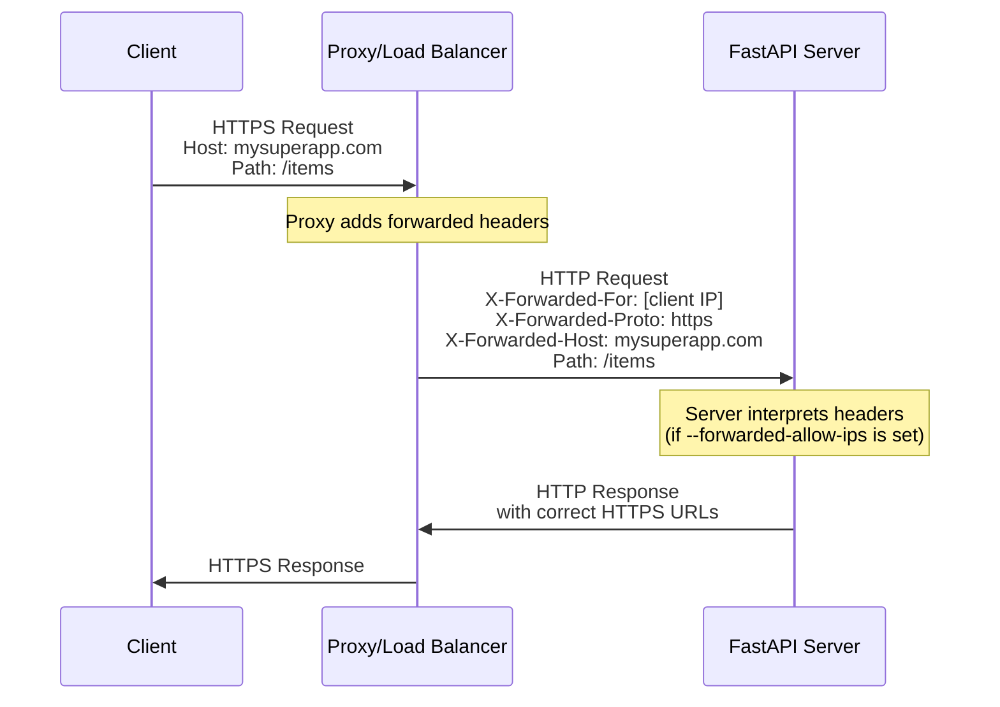
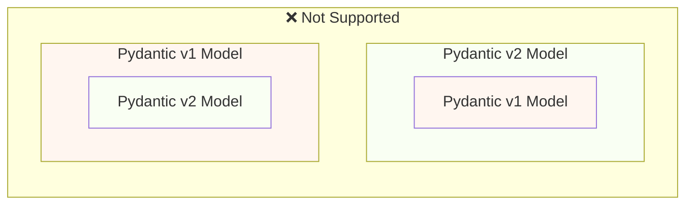
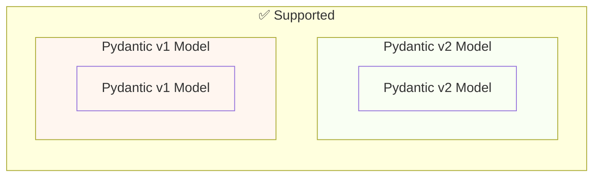

# Judge calibration: labelling sheet

For each item, read the question, the sources the model was given and its
answer, then write one label per item in `labels.csv` (same folder):

- `supported`: every factual claim in the answer (what FastAPI does, how an
  API or parameter behaves, code presented as working) is stated in the
  sources or follows directly from them. Rewording, summarising and generic
  connecting text are fine. Saying the sources do not cover the question is
  supported when they indeed do not.
- `unsupported`: at least one claim is not in the sources or contradicts them,
  including code or parameter names the sources do not show, and claiming the
  sources lack something they contain.
- `unsure`: you cannot decide; these items are left out of the agreement.

Judge support only, not whether the answer is helpful or complete. Use what is
in the sources, not what you know about FastAPI. `note` is optional. The
judge's verdicts are not in this folder; do not look at judge runs before
finishing.


## j-31: How do I integrate custom exception handling with the FastAPI exception handling?

Question: [so_72831952](https://stackoverflow.com/questions/72831952/how-do-i-integrate-custom-exception-handling-with-the-fastapi-exception-handling) (CC BY-SA 4.0)

<details>
<summary>Source 1: release-notes.md (Release Notes > 0.26.0 (2019-05-29))</summary>

Separate error handling for validation errors.

This will allow developers to customize the exception handlers.

Document better how to handle exceptions and use error handlers.

Include `RequestValidationError` and `WebSocketRequestValidationError` (this last one will be useful once [encode/starlette#527](https://github.com/encode/starlette/pull/527) or equivalent is merged).

New documentation about exceptions handlers:

[Install custom exception handlers](https://fastapi.tiangolo.com/tutorial/handling-errors/#install-custom-exception-handlers).

[Override the default exception handlers](https://fastapi.tiangolo.com/tutorial/handling-errors/#override-the-default-exception-handlers).

[Reuse **FastAPI's** exception handlers](https://fastapi.tiangolo.com/tutorial/handling-errors/#reuse-fastapis-exception-handlers).

PR [#273](https://github.com/tiangolo/fastapi/pull/273).

Fix support for *paths* in *path parameters* without needing explicit `Path(...)`.

PR [#256](https://github.com/tiangolo/fastapi/pull/256).

Documented in PR [#272](https://github.com/tiangolo/fastapi/pull/272) by [@wshayes](https://github.com/wshayes).

New documentation at: [Path Parameters containing paths](https://fastapi.tiangolo.com/tutorial/path-params/#path-parameters-containing-paths).

Update docs for testing FastAPI. Include using `POST`, sending JSON, testing headers, etc. New documentation: [Testing](https://fastapi.tiangolo.com/tutorial/testing/#testing-extended-example). PR [#271](https://github.com/tiangolo/fastapi/pull/271).

Fix type declaration of `response_model` to allow generic Python types as `List[Model]`. Mainly to fix `mypy` for users. PR [#266](https://github.com/tiangolo/fastapi/pull/266).

</details>

<details>
<summary>Source 2: tutorial/handling-errors.md (Handling Errors { #handling-errors } > Install custom exception handlers { #install-custom-exception-handlers })</summary>

You can add custom exception handlers with [the same exception utilities from Starlette](https://www.starlette.dev/exceptions/).

Let's say you have a custom exception `UnicornException` that you (or a library you use) might `raise`.

And you want to handle this exception globally with FastAPI.

You could add a custom exception handler with `@app.exception_handler()`:

{* ../../docs_src/handling_errors/tutorial003_py310.py hl[5:7,13:18,24] *}

Here, if you request `/unicorns/yolo`, the *path operation* will `raise` a `UnicornException`.

But it will be handled by the `unicorn_exception_handler`.

So, you will receive a clean error, with an HTTP status code of `418` and a JSON content of:


```JSON
{"message": "Oops! yolo did something. There goes a rainbow..."}
```
/// note | Technical Details

You could also use `from starlette.requests import Request` and `from starlette.responses import JSONResponse`.

**FastAPI** provides the same `starlette.responses` as `fastapi.responses` just as a convenience for you, the developer. But most of the available responses come directly from Starlette. The same with `Request`.

///

</details>

<details>
<summary>Source 3: tutorial/handling-errors.md (Handling Errors { #handling-errors } > Override the default exception handlers { #override-the-default-exception-handlers })</summary>

**FastAPI** has some default exception handlers.

These handlers are in charge of returning the default JSON responses when you `raise` an `HTTPException` and when the request has invalid data.

You can override these exception handlers with your own.

When a request contains invalid data, **FastAPI** internally raises a `RequestValidationError`.

And it also includes a default exception handler for it.

To override it, import the `RequestValidationError` and use it with `@app.exception_handler(RequestValidationError)` to decorate the exception handler.

The exception handler will receive a `Request` and the exception.

{* ../../docs_src/handling_errors/tutorial004_py310.py hl[2,14:19] *}

Now, if you go to `/items/foo`, instead of getting the default JSON error with:


```JSON
{
    "detail": [
        {
            "loc": [
                "path",
                "item_id"
            ],
            "msg": "value is not a valid integer",
            "type": "type_error.integer"
        }
    ]
}
```
you will get a text version, with:


```
Validation errors:
Field: ('path', 'item_id'), Error: Input should be a valid integer, unable to parse string as an integer
```

The same way, you can override the `HTTPException` handler.

For example, you could want to return a plain text response instead of JSON for these errors:

{* ../../docs_src/handling_errors/tutorial004_py310.py hl[3:4,9:11,25] *}

/// note | Technical Details

You could also use `from starlette.responses import PlainTextResponse`.

**FastAPI** provides the same `starlette.responses` as `fastapi.responses` just as a convenience for you, the developer. But most of the available responses come directly from Starlette.

///

/// warning

Have in mind that the `RequestValidationError` contains the information of the file name and line where the validation error happens so that you can show it in your logs with the relevant information if you want to.

But that means that if you just convert it to a string and return that information directly, you could be leaking a bit of information about your system, that's why here the code extracts and shows each error independently.

///

The `RequestValidationError` contains the `body` it received with invalid data.

You could use it while developing your app to log the body and debug it, return it to the user, etc.

{* ../../docs_src/handling_errors/tutorial005_py310.py hl[14] *}

Now try sending an invalid item like:


```JSON
{
  "title": "towel",
  "size": "XL"
}
```
You will receive a response telling you that the data is invalid containing the received body:


```JSON hl_lines="12-15"
{
  "detail": [
    {
      "loc": [
        "body",
        "size"
      ],
      "msg": "value is not a valid integer",
      "type": "type_error.integer"
    }
  ],
  "body": {
    "title": "towel",
    "size": "XL"
  }
}
```

**FastAPI** has its own `HTTPException`.

And **FastAPI**'s `HTTPException` error class inherits from Starlette's `HTTPException` error class.

The only difference is that **FastAPI**'s `HTTPException` accepts any JSON-able data for the `detail` field, while Starlette's `HTTPException` only accepts strings for it.

So, you can keep raising **FastAPI**'s `HTTPException` as normally in your code.

But when you register an exception handler, you should register it for Starlette's `HTTPException`.

This way, if any part of Starlette's internal code, or a Starlette extension or plug-in, raises a Starlette `HTTPException`, your handler will be able to catch and handle it.

In this example, to be able to have both `HTTPException`s in the same code, Starlette's exceptions is renamed to `StarletteHTTPException`:


```Python
from starlette.exceptions import HTTPException as StarletteHTTPException
```

If you want to use the exception along with the same default exception handlers from  **FastAPI**, you can import and reuse the default exception handlers from `fastapi.exception_handlers`:

{* ../../docs_src/handling_errors/tutorial006_py310.py hl[2:5,15,21] *}

In this example you are just printing the error with a very expressive message, but you get the idea. You can use the exception and then just reuse the default exception handlers.

</details>

<details>
<summary>Source 4: advanced/advanced-dependencies.md (Advanced Dependencies { #advanced-dependencies } > Dependencies with `yield`, `HTTPException`, `except` and Background Tasks { #dependencies-with-yield-httpexception-except-and-background-tasks })</summary>

/// warning

You most probably don't need these technical details.

These details are useful mainly if you had a FastAPI application older than 0.121.0 and you are facing issues with dependencies with `yield`.

///

Dependencies with `yield` have evolved over time to account for the different use cases and to fix some issues, here's a summary of what has changed.

In version 0.121.0, FastAPI added support for `Depends(scope="function")` for dependencies with `yield`.

Using `Depends(scope="function")`, the exit code after `yield` is executed right after the *path operation function* is finished, before the response is sent back to the client.

And when using `Depends(scope="request")` (the default), the exit code after `yield` is executed after the response is sent.

You can read more about it in the docs for [Dependencies with `yield` - Early exit and `scope`](../tutorial/dependencies/dependencies-with-yield.md#early-exit-and-scope).

Before FastAPI 0.118.0, if you used a dependency with `yield`, it would run the exit code after the *path operation function* returned but right before sending the response.

The intention was to avoid holding resources for longer than necessary, waiting for the response to travel through the network.

This change also meant that if you returned a `StreamingResponse`, the exit code of the dependency with `yield` would have been already run.

For example, if you had a database session in a dependency with `yield`, the `StreamingResponse` would not be able to use that session while streaming data because the session would have already been closed in the exit code after `yield`.

This behavior was reverted in 0.118.0, to make the exit code after `yield` be executed after the response is sent.

/// info

As you will see below, this is very similar to the behavior before version 0.106.0, but with several improvements and bug fixes for corner cases.

///

There are some use cases with specific conditions that could benefit from the old behavior of running the exit code of dependencies with `yield` before sending the response.

For example, imagine you have code that uses a database session in a dependency with `yield` only to verify a user, but the database session is never used again in the *path operation function*, only in the dependency, **and** the response takes a long time to be sent, like a `StreamingResponse` that sends data slowly, but for some reason doesn't use the database.

In this case, the database session would be held until the response is finished being sent, but if you don't use it, then it wouldn't be necessary to hold it.

Here's how it could look like:

{* ../../docs_src/dependencies/tutorial013_an_py310.py *}

The exit code, the automatic closing of the `Session` in:

{* ../../docs_src/dependencies/tutorial013_an_py310.py ln[19:21] *}

...would be run after the response finishes sending the slow data:

{* ../../docs_src/dependencies/tutorial013_an_py310.py ln[30:38] hl[31:33] *}

But as `generate_stream()` doesn't use the database session, it is not really necessary to keep the session open while sending the response.

If you have this specific use case using SQLModel (or SQLAlchemy), you could explicitly close the session after you don't need it anymore:

{* ../../docs_src/dependencies/tutorial014_an_py310.py ln[24:28] hl[28] *}

That way the session would release the database connection, so other requests could use it.

If you have a different use case that needs to exit early from a dependency with `yield`, please create a [GitHub Discussion Question](https://github.com/fastapi/fastapi/discussions/new?category=questions) with your specific use case and why you would benefit from having early closing for dependencies with `yield`.

If there are compelling use cases for early closing in dependencies with `yield`, I would consider adding a new way to opt in to early closing.

Before FastAPI 0.110.0, if you used a dependency with `yield`, and then you captured an exception with `except` in that dependency, and you didn't raise the exception again, the exception would be automatically raised/forwarded to any exception handlers or the internal server error handler.

This was changed in version 0.110.0 to fix unhandled memory consumption from forwarded exceptions without a handler (internal server errors), and to make it consistent with the behavior of regular Python code.

Before FastAPI 0.106.0, raising exceptions after `yield` was not possible, the exit code in dependencies with `yield` was executed *after* the response was sent, so [Exception Handlers](../tutorial/handling-errors.md#install-custom-exception-handlers) would have already run.

This was designed this way mainly to allow using the same objects "yielded" by dependencies inside of background tasks, because the exit code would be executed after the background tasks were finished.

This was changed in FastAPI 0.106.0 with the intention to not hold resources while waiting for the response to travel through the network.

/// tip

Additionally, a background task is normally an independent set of logic that should be handled separately, with its own resources (e.g. its own database connection).

So, this way you will probably have cleaner code.

///

If you used to rely on this behavior, now you should create the resources for background tasks inside the background task itself, and use internally only data that doesn't depend on the resources of dependencies with `yield`.

For example, instead of using the same database session, you would create a new database session inside of the background task, and you would obtain the objects from the database using this new session. And then instead of passing the object from the database as a parameter to the background task function, you would pass the ID of that object and then obtain the object again inside the background task function.

</details>

<details>
<summary>Source 5: tutorial/handling-errors.md (Handling Errors { #handling-errors } > Override the default exception handlers { #override-the-default-exception-handlers })</summary>

**FastAPI** has some default exception handlers.

These handlers are in charge of returning the default JSON responses when you `raise` an `HTTPException` and when the request has invalid data.

You can override these exception handlers with your own.

When a request contains invalid data, **FastAPI** internally raises a `RequestValidationError`.

And it also includes a default exception handler for it.

To override it, import the `RequestValidationError` and use it with `@app.exception_handler(RequestValidationError)` to decorate the exception handler.

The exception handler will receive a `Request` and the exception.

{* ../../docs_src/handling_errors/tutorial004_py310.py hl[2,14:19] *}

Now, if you go to `/items/foo`, instead of getting the default JSON error with:


```JSON
{
    "detail": [
        {
            "loc": [
                "path",
                "item_id"
            ],
            "msg": "value is not a valid integer",
            "type": "type_error.integer"
        }
    ]
}
```
you will get a text version, with:


```
Validation errors:
Field: ('path', 'item_id'), Error: Input should be a valid integer, unable to parse string as an integer
```

The same way, you can override the `HTTPException` handler.

For example, you could want to return a plain text response instead of JSON for these errors:

{* ../../docs_src/handling_errors/tutorial004_py310.py hl[3:4,9:11,25] *}

/// note | Technical Details

You could also use `from starlette.responses import PlainTextResponse`.

**FastAPI** provides the same `starlette.responses` as `fastapi.responses` just as a convenience for you, the developer. But most of the available responses come directly from Starlette.

///

/// warning

Have in mind that the `RequestValidationError` contains the information of the file name and line where the validation error happens so that you can show it in your logs with the relevant information if you want to.

But that means that if you just convert it to a string and return that information directly, you could be leaking a bit of information about your system, that's why here the code extracts and shows each error independently.

///

The `RequestValidationError` contains the `body` it received with invalid data.

You could use it while developing your app to log the body and debug it, return it to the user, etc.

{* ../../docs_src/handling_errors/tutorial005_py310.py hl[14] *}

Now try sending an invalid item like:


```JSON
{
  "title": "towel",
  "size": "XL"
}
```
You will receive a response telling you that the data is invalid containing the received body:


```JSON hl_lines="12-15"
{
  "detail": [
    {
      "loc": [
        "body",
        "size"
      ],
      "msg": "value is not a valid integer",
      "type": "type_error.integer"
    }
  ],
  "body": {
    "title": "towel",
    "size": "XL"
  }
}
```

**FastAPI** has its own `HTTPException`.

And **FastAPI**'s `HTTPException` error class inherits from Starlette's `HTTPException` error class.

The only difference is that **FastAPI**'s `HTTPException` accepts any JSON-able data for the `detail` field, while Starlette's `HTTPException` only accepts strings for it.

So, you can keep raising **FastAPI**'s `HTTPException` as normally in your code.

But when you register an exception handler, you should register it for Starlette's `HTTPException`.

This way, if any part of Starlette's internal code, or a Starlette extension or plug-in, raises a Starlette `HTTPException`, your handler will be able to catch and handle it.

In this example, to be able to have both `HTTPException`s in the same code, Starlette's exceptions is renamed to `StarletteHTTPException`:


```Python
from starlette.exceptions import HTTPException as StarletteHTTPException
```

If you want to use the exception along with the same default exception handlers from  **FastAPI**, you can import and reuse the default exception handlers from `fastapi.exception_handlers`:

{* ../../docs_src/handling_errors/tutorial006_py310.py hl[2:5,15,21] *}

In this example you are just printing the error with a very expressive message, but you get the idea. You can use the exception and then just reuse the default exception handlers.

</details>

**Answer:**

Okay, let's break down this documentation excerpt and address the key points regarding FastAPI's exception handling and the potential for early closing of dependencies with `yield`.

**1. Early Closing of Dependencies with `yield` - The Core Concept**

The central idea presented here is that under specific circumstances, you *might* want to have FastAPI gracefully exit a dependency that uses `yield` (e.g., a database session) *before* the response is fully sent. This is particularly relevant when:

*   The dependency only uses the session for a short, specific task (like a verification).
*   The response generation is slow (e.g., StreamingResponse).

The documentation suggests this might be achieved through careful resource management (closing the session) and potentially by structuring background tasks differently.

**2.  Shift Responsibility to Background Tasks**

This is a crucial point. Instead of relying on the dependency with `yield` to handle all resources, you should create those resources *within* the background task itself.  This isolates the task, making it less dependent on the dependency's resources. This helps prevent unnecessary holding of resources while waiting for the slow response to complete.

*   **New Session:** Create a new database session inside the background task.
*   **Independent Data:** Obtain objects from the database using the new session and pass only the necessary IDs to the background task.  The task then fetches the full objects itself.

**3. Changes in FastAPI (Prior to 0.110.0)**

*   **Exception Forwarding:**  Before 0.110.0, if a dependency with `yield` raised an exception that wasn't handled, the exception would automatically be propagated to any global exception handlers or the server error handler.
*   **Post-Response Exit Code:**  The exit code for dependencies with `yield` was executed *after* the response was sent.
*   **Now Changed:** This has been changed to prevent memory consumption when exceptions are not handled.

**4. Exception Handlers and RequestValidationError**

*   **`RequestValidationError`:** FastAPI internally raises a `RequestValidationError` if the request data is invalid.
*   **Custom Handlers:** You can override the default `RequestValidationError` handler by decorating it with `@app.exception_handler(RequestValidationError)`.  This allows you to customize the error response format.
*   **Plain Text Responses:** You can return plain text responses instead of JSON for these errors.

**5. Starlette HTTP Exceptions**

*   **Inheritance:** FastAPI's `HTTPException` inherits from Starlette's `HTTPException`.
*   **JSON vs. String:** FastAPI's `HTTPException` can handle JSON-able data in the `detail` field, while Starlette's only accepts strings.
*   **Registering Handlers:**  To handle Starlette's `HTTPException`s, you must register your handler for `StarletteHTTPException`.

**6.  Reusing Default Exception Handlers**

You can reuse FastAPI's default exception handlers with your custom exception handlers.

**Key Takeaways & Implications**

*   **Resource Management:** Carefully manage resources (like database sessions) within your dependencies. Don't hold them unnecessarily.
*   **Isolation:**  Isolate background tasks to prevent dependency leaks.
*   **Exception Handling:** Use FastAPI's built-in exception handlers and customize them as needed.
*   **Code Evolution:** Be aware that FastAPI's behavior around dependencies with `yield` and exception handling has evolved over time (0.106.0 to 0.110.0), and the current behavior is designed to optimize performance.

**Regarding your question about the GitHub Discussion Question:**

You're right to raise this. If you have a specific use case where early closing of dependencies with `yield` offers a clear benefit, creating a discussion on the FastAPI GitHub repository is an excellent way to advocate for potential future changes. Provide a detailed explanation of your use case, including the reasons why early closing would be advantageous.

Do you have a specific use case in mind that you'd like to discuss further, or would like to refine your approach to using background tasks and resource management?

---

## j-32: Video Streaming App using FastAPI and OpenCV

Question: [so_63667466](https://stackoverflow.com/questions/63667466/video-streaming-app-using-fastapi-and-opencv) (CC BY-SA 4.0)

<details>
<summary>Source 1: editor-support.md (Editor Support { #editor-support })</summary>

The official [FastAPI Extension](https://marketplace.visualstudio.com/items?itemName=FastAPILabs.fastapi-vscode) enhances your FastAPI development workflow with *path operation* discovery, navigation, as well as FastAPI Cloud deployment, and live log streaming.

For more details about the extension, refer to the README on the [GitHub repository](https://github.com/fastapi/fastapi-vscode).

</details>

<details>
<summary>Source 2: index.md (FastAPI { #fastapi } > Example upgrade { #example-upgrade })</summary>

Now modify the file `main.py` to receive a body from a `PUT` request.

Declare the body using standard Python types, thanks to Pydantic.


```Python hl_lines="2  7-10 23-25"
from fastapi import FastAPI
from pydantic import BaseModel

app = FastAPI()


class Item(BaseModel):
    name: str
    price: float
    is_offer: bool | None = None


@app.get("/")
def read_root():
    return {"Hello": "World"}


@app.get("/items/{item_id}")
def read_item(item_id: int, q: str | None = None):
    return {"item_id": item_id, "q": q}


@app.put("/items/{item_id}")
def update_item(item_id: int, item: Item):
    return {"item_name": item.name, "item_id": item_id}
```
The `fastapi dev` server should reload automatically.

Now go to [http://127.0.0.1:8000/docs](http://127.0.0.1:8000/docs).

The interactive API documentation will be automatically updated, including the new body:


Click on the button "Try it out", it allows you to fill the parameters and directly interact with the API:


Then click on the "Execute" button, the user interface will communicate with your API, send the parameters, get the results and show them on the screen:


And now, go to [http://127.0.0.1:8000/redoc](http://127.0.0.1:8000/redoc).

The alternative documentation will also reflect the new query parameter and body:


In summary, you declare **once** the types of parameters, body, etc. as function parameters.

You do that with standard modern Python types.

You don't have to learn a new syntax, the methods or classes of a specific library, etc.

Just standard **Python**.

For example, for an `int`:


```Python
item_id: int
```
or for a more complex `Item` model:


```Python
item: Item
```
...and with that single declaration you get:

Editor support, including:

Completion.

Type checks.

Validation of data:

Automatic and clear errors when the data is invalid.

Validation even for deeply nested JSON objects.

<dfn title="also known as: serialization, parsing, marshalling">Conversion</dfn> of input data: coming from the network to Python data and types. Reading from:

JSON.

Path parameters.

Query parameters.

Cookies.

Headers.

Forms.

Files.

<dfn title="also known as: serialization, parsing, marshalling">Conversion</dfn> of output data: converting from Python data and types to network data (as JSON):

Convert Python types (`str`, `int`, `float`, `bool`, `list`, etc).

`datetime` objects.

`UUID` objects.

Database models.

...and many more.

Automatic interactive API documentation, including 2 alternative user interfaces:

Swagger UI.

ReDoc.

Coming back to the previous code example, **FastAPI** will:

Validate that there is an `item_id` in the path for `GET` and `PUT` requests.

Validate that the `item_id` is of type `int` for `GET` and `PUT` requests.

If it is not, the client will see a useful, clear error.

Check if there is an optional query parameter named `q` (as in `http://127.0.0.1:8000/items/foo?q=somequery`) for `GET` requests.

As the `q` parameter is declared with `= None`, it is optional.

Without the `None` it would be required (as is the body in the case with `PUT`).

For `PUT` requests to `/items/{item_id}`, read the body as JSON:

Check that it has a required attribute `name` that should be a `str`.

Check that it has a required attribute `price` that has to be a `float`.

Check that it has an optional attribute `is_offer`, that should be a `bool`, if present.

All this would also work for deeply nested JSON objects.

Convert from and to JSON automatically.

Document everything with OpenAPI, that can be used by:

Interactive documentation systems.

Automatic client code generation systems, for many languages.

Provide 2 interactive documentation web interfaces directly.

We just scratched the surface, but you already get the idea of how it all works.

Try changing the line with:


```Python
    return {"item_name": item.name, "item_id": item_id}
```
...from:


```Python
        ... "item_name": item.name ...
```
...to:


```Python
        ... "item_price": item.price ...
```
...and see how your editor will auto-complete the attributes and know their types:


For a more complete example including more features, see the <a href="https://fastapi.tiangolo.com/tutorial/">Tutorial - User Guide</a>.

**Spoiler alert**: the tutorial - user guide includes:

Declaration of **parameters** from other different places as: **headers**, **cookies**, **form fields** and **files**.

How to set **validation constraints** as `maximum_length` or `regex`.

A very powerful and easy to use **<dfn title="also known as components, resources, providers, services, injectables">Dependency Injection</dfn>** system.

Security and authentication, including support for **OAuth2** with **JWT tokens** and **HTTP Basic** auth.

More advanced (but equally easy) techniques for declaring **deeply nested JSON models** (thanks to Pydantic).

**GraphQL** integration with [Strawberry](https://strawberry.rocks) and other libraries.

Many extra features (thanks to Starlette) as:

**WebSockets**

extremely easy tests based on HTTPX and `pytest`

**CORS**

**Cookie Sessions**

...and more.

You can optionally deploy your FastAPI app to [FastAPI Cloud](https://fastapicloud.com), go and join the waiting list if you haven't. 🚀

If you already have a **FastAPI Cloud** account (we invited you from the waiting list 😉), you can deploy your application with one command.

<div class="termy">

```console
$ fastapi deploy

Deploying to FastAPI Cloud...

✅ Deployment successful!

🐔 Ready the chicken! Your app is ready at https://myapp.fastapicloud.dev
```
</div>
That's it! Now you can access your app at that URL. ✨

**[FastAPI Cloud](https://fastapicloud.com)** is built by the same author and team behind **FastAPI**.

It streamlines the process of **building**, **deploying**, and **accessing** an API with minimal effort.

It brings the same **developer experience** of building apps with FastAPI to **deploying** them to the cloud. 🎉

FastAPI Cloud is the primary sponsor and funding provider for the *FastAPI and friends* open source projects. ✨

FastAPI is open source and based on standards. You can deploy FastAPI apps to any cloud provider you choose.

Follow your cloud provider's guides to deploy FastAPI apps with them. 🤓

</details>

<details>
<summary>Source 3: advanced/openapi-webhooks.md (OpenAPI Webhooks { #openapi-webhooks } > Documenting webhooks with **FastAPI** and OpenAPI { #documenting-webhooks-with-fastapi-and-openapi })</summary>

With **FastAPI**, using OpenAPI, you can define the names of these webhooks, the types of HTTP operations that your app can send (e.g. `POST`, `PUT`, etc.) and the request **bodies** that your app would send.

This can make it a lot easier for your users to **implement their APIs** to receive your **webhook** requests, they might even be able to autogenerate some of their own API code.

/// info

Webhooks are available in OpenAPI 3.1.0 and above, supported by FastAPI `0.99.0` and above.

///

</details>

<details>
<summary>Source 4: tutorial/first-steps.md (First Steps { #first-steps } > Recap { #recap })</summary>

Import `FastAPI`.

Create an `app` instance.

Write a **path operation decorator** using decorators like `@app.get("/")`.

Define a **path operation function**; for example, `def root(): ...`.

Run the development server using the command `fastapi dev`.

Optionally deploy your app with `fastapi deploy`.

</details>

<details>
<summary>Source 5: tutorial/first-steps.md (First Steps { #first-steps } > Check it { #check-it } > Deploy your app (optional) { #deploy-your-app-optional })</summary>

You can optionally deploy your FastAPI app to [FastAPI Cloud](https://fastapicloud.com), go and join the waiting list if you haven't. 🚀

If you already have a **FastAPI Cloud** account (we invited you from the waiting list 😉), you can deploy your application with one command.

Before deploying, make sure you are logged in:

<div class="termy">

```console
$ fastapi login

You are logged in to FastAPI Cloud 🚀
```
</div>
Then deploy your app:

<div class="termy">

```console
$ fastapi deploy

Deploying to FastAPI Cloud...

✅ Deployment successful!

🐔 Ready the chicken! Your app is ready at https://myapp.fastapicloud.dev
```
</div>
That's it! Now you can access your app at that URL. ✨

</details>

**Answer:**

Okay, let's break down how you can build a video streaming app using FastAPI and OpenCV, based on the provided documentation. Here's a roadmap and key considerations, incorporating the information from the sources:

**1. Core FastAPI Setup (as demonstrated in Source 2):**

*   **Import Necessary Libraries:** You'll need `FastAPI`, `Pydantic` (for data validation), and `OpenCV` (`cv2`) for video processing.
*   **Create a FastAPI App:**  Initialize your FastAPI application instance.
*   **Define Pydantic Models:** Create Pydantic models (like `Item` in the example) to define the structure of incoming data. This is *crucial* for validation and type safety. You'll need models for:
    *   **Video Stream Parameters:**  This will likely include parameters like the video source, resolution, frame rate, and possibly options for encoding.
    *   **User Preferences:** (If you want to allow users to customize their stream).
*   **Define Path Operations:** Define endpoints (using `@app.get`, `@app.post`, etc.) to handle requests related to:
    *   **Starting the Stream:**  This could be triggered by a `POST` request.
    *   **Stopping the Stream:** A `POST` request to stop.
    *   **Configuring the Stream:** A `POST` request to send parameters to configure the stream.
*   **Example PUT Request Handling (from Source 2):** The example shows a `PUT` request to `/items/{item_id}`. This pattern will be important when setting stream parameters or updating configurations.

**2. OpenCV Integration:**

*   **Capture Video:** Use OpenCV's `VideoCapture` class to capture video from a source (e.g., a webcam, a video file, or a network stream).
*   **Process Video Frames:**  Within your path operation functions, you'll use OpenCV functions to:
    *   **Read Frames:** `cap.read()` to get the next frame.
    *   **Encode Frames:**  Convert the frames to a suitable format for streaming (e.g., JPEG, H.264) using `cv2.imencode()`.
    *   **Send Frames:**  Send the encoded frames to the client (usually over HTTP using FastAPI).

**3. Streaming the Video (Key Considerations):**

*   **Bytes vs. Strings:** You'll need to convert the OpenCV image frames (NumPy arrays) to bytes before sending them over HTTP.  Use `io.BytesIO()` and `cv2.imencode()` to efficiently convert.
*   **HTTP Streaming:** FastAPI supports streaming responses. You can use the `StreamingResponse` class to stream the frames directly.
*   **WebSockets (Advanced):**  For truly real-time, bidirectional streaming (where the client can send control signals), consider using WebSockets. FastAPI has excellent WebSocket support.

**4. Documentation and Testing (Leveraging FastAPI's Features):**

*   **Swagger UI/ReDoc:**  FastAPI automatically generates interactive API documentation using Swagger UI or ReDoc (as shown in Source 1 and 2).  This is invaluable for testing and understanding the API. You’ll need to define the OpenAPI schema to document your endpoints and parameters.
*   **Automatic Validation:**  Pydantic models provide automatic data validation. This is *essential* for handling unexpected input and preventing errors.
*   **Editor Support:** FastAPI provides excellent IDE support through extensions (e.g., the Visual Studio Code extension described in Source 1).
*   **Dependency Injection:** Use FastAPI’s dependency injection system to manage the OpenCV object.

**5. Deployment (Source 5):**

*   **FastAPI Cloud:** The easiest way to deploy is using FastAPI Cloud.  This service handles deployment and scaling automatically. You'll use the `fastapi deploy` command.

**6. API Structure:**

Here's a conceptual API structure:

*   `POST /stream/start`: Starts the video stream with specified parameters.
*   `POST /stream/stop`: Stops the video stream.
*   `POST /stream/config`: Configures the stream with parameters (e.g., resolution, frame rate).

**Example Snippet (Illustrative – Needs Adaptation):**

```python
from fastapi import FastAPI, StreamingResponse, Request
import cv2
import io
# ... other imports ...

app = FastAPI()

@app.post("/stream/start")
async def start_stream(request: Request):
    # Get parameters from the request (e.g., resolution, frame rate)
    # Validate the parameters
    # Initialize OpenCV capture object
    cap = cv2.VideoCapture(0) # 0 for default webcam
    # ...
    return {"message": "Stream started"}

@app.post("/stream/stop")
async def stop_stream():
    # Stop the stream (release the video capture object)
    return {"message": "Stream stopped"}

@app.post("/stream/config")
async def config_stream(request: Request):
    # Get parameters from the request
    # ...
    return {"message": "Stream configuration updated"}

```

**Important Notes:**

*   **Error Handling:** Implement robust error handling to gracefully handle issues like camera access problems, encoding errors, or network problems.
*   **Resource Management:**  Make sure to properly release the OpenCV `VideoCapture` object when the stream is stopped to avoid resource leaks.
*   **Security:**  If your app is exposed to the internet, implement appropriate security measures (e.g., authentication, authorization).

To reiterate the key takeaway:  FastAPI's features like Pydantic models, automatic validation, and Swagger UI/ReDoc will greatly simplify the development and testing of your video streaming application.

---

## j-33: Why do I get an "Unprocessable Entity" error while uploading an image with FastAPI?

Question: [so_69292855](https://stackoverflow.com/questions/69292855/why-do-i-get-an-unprocessable-entity-error-while-uploading-an-image-with-fasta) (CC BY-SA 4.0)

<details>
<summary>Source 1: deployment/docker.md (FastAPI in Containers - Docker { #fastapi-in-containers-docker } > Previous Steps Before Starting and Containers { #previous-steps-before-starting-and-containers })</summary>

If you are using containers (e.g. Docker, Kubernetes), then there are two main approaches you can use.

If you have **multiple containers**, probably each one running a **single process** (for example, in a **Kubernetes** cluster), then you would probably want to have a **separate container** doing the work of the **previous steps** in a single container, running a single process, **before** running the replicated worker containers.

/// info

If you are using Kubernetes, this would probably be an [Init Container](https://kubernetes.io/docs/concepts/workloads/pods/init-containers/).

///

If in your use case there's no problem in running those previous steps **multiple times in parallel** (for example if you are not running database migrations, but just checking if the database is ready yet), then you could also just put them in each container right before starting the main process.

If you have a simple setup, with a **single container** that then starts multiple **worker processes** (or also just one process), then you could run those previous steps in the same container, right before starting the process with the app.

There used to be an official FastAPI Docker image: [tiangolo/uvicorn-gunicorn-fastapi](https://github.com/tiangolo/uvicorn-gunicorn-fastapi-docker). But it is now deprecated. ⛔️

You should probably **not** use this base Docker image (or any other similar one).

If you are using **Kubernetes** (or others) and you are already setting **replication** at the cluster level, with multiple **containers**. In those cases, you are better off **building an image from scratch** as described above: [Build a Docker Image for FastAPI](#build-a-docker-image-for-fastapi).

And if you need to have multiple workers, you can simply use the `--workers` command line option.

/// note | Technical Details

The Docker image was created when Uvicorn didn't support managing and restarting dead workers, so it was needed to use Gunicorn with Uvicorn, which added quite some complexity, just to have Gunicorn manage and restart the Uvicorn worker processes.

But now that Uvicorn (and the `fastapi` command) support using `--workers`, there's no reason to use a base Docker image instead of building your own (it's pretty much the same amount of code 😅).

///

</details>

<details>
<summary>Source 2: advanced/using-request-directly.md (Using the Request Directly { #using-the-request-directly } > Details about the `Request` object { #details-about-the-request-object })</summary>

As **FastAPI** is actually **Starlette** underneath, with a layer of several tools on top, you can use Starlette's [`Request`](https://www.starlette.dev/requests/) object directly when you need to.

It would also mean that if you get data from the `Request` object directly (for example, read the body) it won't be validated, converted or documented (with OpenAPI, for the automatic API user interface) by FastAPI.

Although any other parameter declared normally (for example, the body with a Pydantic model) would still be validated, converted, annotated, etc.

But there are specific cases where it's useful to get the `Request` object.

</details>

<details>
<summary>Source 3: tutorial/handling-errors.md (Handling Errors { #handling-errors } > Override the default exception handlers { #override-the-default-exception-handlers })</summary>

**FastAPI** has some default exception handlers.

These handlers are in charge of returning the default JSON responses when you `raise` an `HTTPException` and when the request has invalid data.

You can override these exception handlers with your own.

When a request contains invalid data, **FastAPI** internally raises a `RequestValidationError`.

And it also includes a default exception handler for it.

To override it, import the `RequestValidationError` and use it with `@app.exception_handler(RequestValidationError)` to decorate the exception handler.

The exception handler will receive a `Request` and the exception.

{* ../../docs_src/handling_errors/tutorial004_py310.py hl[2,14:19] *}

Now, if you go to `/items/foo`, instead of getting the default JSON error with:


```JSON
{
    "detail": [
        {
            "loc": [
                "path",
                "item_id"
            ],
            "msg": "value is not a valid integer",
            "type": "type_error.integer"
        }
    ]
}
```
you will get a text version, with:


```
Validation errors:
Field: ('path', 'item_id'), Error: Input should be a valid integer, unable to parse string as an integer
```

The same way, you can override the `HTTPException` handler.

For example, you could want to return a plain text response instead of JSON for these errors:

{* ../../docs_src/handling_errors/tutorial004_py310.py hl[3:4,9:11,25] *}

/// note | Technical Details

You could also use `from starlette.responses import PlainTextResponse`.

**FastAPI** provides the same `starlette.responses` as `fastapi.responses` just as a convenience for you, the developer. But most of the available responses come directly from Starlette.

///

/// warning

Have in mind that the `RequestValidationError` contains the information of the file name and line where the validation error happens so that you can show it in your logs with the relevant information if you want to.

But that means that if you just convert it to a string and return that information directly, you could be leaking a bit of information about your system, that's why here the code extracts and shows each error independently.

///

The `RequestValidationError` contains the `body` it received with invalid data.

You could use it while developing your app to log the body and debug it, return it to the user, etc.

{* ../../docs_src/handling_errors/tutorial005_py310.py hl[14] *}

Now try sending an invalid item like:


```JSON
{
  "title": "towel",
  "size": "XL"
}
```
You will receive a response telling you that the data is invalid containing the received body:


```JSON hl_lines="12-15"
{
  "detail": [
    {
      "loc": [
        "body",
        "size"
      ],
      "msg": "value is not a valid integer",
      "type": "type_error.integer"
    }
  ],
  "body": {
    "title": "towel",
    "size": "XL"
  }
}
```

**FastAPI** has its own `HTTPException`.

And **FastAPI**'s `HTTPException` error class inherits from Starlette's `HTTPException` error class.

The only difference is that **FastAPI**'s `HTTPException` accepts any JSON-able data for the `detail` field, while Starlette's `HTTPException` only accepts strings for it.

So, you can keep raising **FastAPI**'s `HTTPException` as normally in your code.

But when you register an exception handler, you should register it for Starlette's `HTTPException`.

This way, if any part of Starlette's internal code, or a Starlette extension or plug-in, raises a Starlette `HTTPException`, your handler will be able to catch and handle it.

In this example, to be able to have both `HTTPException`s in the same code, Starlette's exceptions is renamed to `StarletteHTTPException`:


```Python
from starlette.exceptions import HTTPException as StarletteHTTPException
```

If you want to use the exception along with the same default exception handlers from  **FastAPI**, you can import and reuse the default exception handlers from `fastapi.exception_handlers`:

{* ../../docs_src/handling_errors/tutorial006_py310.py hl[2:5,15,21] *}

In this example you are just printing the error with a very expressive message, but you get the idea. You can use the exception and then just reuse the default exception handlers.

</details>

<details>
<summary>Source 4: tutorial/request-files.md (Request Files { #request-files } > Import `File` { #import-file })</summary>

Import `File` and `UploadFile` from `fastapi`:

{* ../../docs_src/request_files/tutorial001_an_py310.py hl[3] *}

</details>

<details>
<summary>Source 5: alternatives.md (Alternatives, Inspiration and Comparisons { #alternatives-inspiration-and-comparisons } > Previous tools { #previous-tools })</summary>

It's the most popular Python framework and is widely trusted. It is used to build systems like Instagram.

It's relatively tightly coupled with relational databases (like MySQL or PostgreSQL), so, having a NoSQL database (like Couchbase, MongoDB, Cassandra, etc) as the main store engine is not very easy.

It was created to generate the HTML in the backend, not to create APIs used by a modern frontend (like React, Vue.js and Angular) or by other systems (like <abbr title="Internet of Things">IoT</abbr> devices) communicating with it.

Django REST framework was created to be a flexible toolkit for building Web APIs using Django underneath, to improve its API capabilities.

It is used by many companies including Mozilla, Red Hat and Eventbrite.

It was one of the first examples of **automatic API documentation**, and this was specifically one of the first ideas that inspired "the search for" **FastAPI**.

/// note

Django REST Framework was created by Tom Christie. The same creator of Starlette and Uvicorn, on which **FastAPI** is based.

///

/// check | Inspired **FastAPI** to

Have an automatic API documentation web user interface.

///

Flask is a "microframework", it doesn't include database integrations nor many of the things that come by default in Django.

This simplicity and flexibility allow doing things like using NoSQL databases as the main data storage system.

As it is very simple, it's relatively intuitive to learn, although the documentation gets somewhat technical at some points.

It is also commonly used for other applications that don't necessarily need a database, user management, or any of the many features that come pre-built in Django. Although many of these features can be added with plug-ins.

This decoupling of parts, and being a "microframework" that could be extended to cover exactly what is needed was a key feature that I wanted to keep.

Given the simplicity of Flask, it seemed like a good match for building APIs. The next thing to find was a "Django REST Framework" for Flask.

/// check | Inspired **FastAPI** to

Be a micro-framework. Making it easy to mix and match the tools and parts needed.

Have a simple and easy to use routing system.

///

**FastAPI** is not actually an alternative to **Requests**. Their scope is very different.

It would actually be common to use Requests *inside* of a FastAPI application.

But still, FastAPI got quite some inspiration from Requests.

**Requests** is a library to *interact* with APIs (as a client), while **FastAPI** is a library to *build* APIs (as a server).

They are, more or less, at opposite ends, complementing each other.

Requests has a very simple and intuitive design, it's very easy to use, with sensible defaults. But at the same time, it's very powerful and customizable.

That's why, as said in the official website:

Requests is one of the most downloaded Python packages of all time

The way you use it is very simple. For example, to do a `GET` request, you would write:


```Python
response = requests.get("http://example.com/some/url")
```
The FastAPI counterpart API *path operation* could look like:


```Python hl_lines="1"
@app.get("/some/url")
def read_url():
    return {"message": "Hello World"}
```
See the similarities in `requests.get(...)` and `@app.get(...)`.

/// check | Inspired **FastAPI** to

Have a simple and intuitive API.

Use HTTP method names (operations) directly, in a straightforward and intuitive way.

Have sensible defaults, but powerful customizations.

///

The main feature I wanted from Django REST Framework was the automatic API documentation.

Then I found that there was a standard to document APIs, using JSON (or YAML, an extension of JSON) called Swagger.

And there was a web user interface for Swagger APIs already created. So, being able to generate Swagger documentation for an API would allow using this web user interface automatically.

At some point, Swagger was given to the Linux Foundation, to be renamed OpenAPI.

That's why when talking about version 2.0 it's common to say "Swagger", and for version 3+ "OpenAPI".

/// check | Inspired **FastAPI** to

Adopt and use an open standard for API specifications, instead of a custom schema.

And integrate standards-based user interface tools:

[Swagger UI](https://github.com/swagger-api/swagger-ui)

[ReDoc](https://github.com/Rebilly/ReDoc)

These two were chosen for being fairly popular and stable, but doing a quick search, you could find dozens of alternative user interfaces for OpenAPI (that you can use with **FastAPI**).

///

There are several Flask REST frameworks, but after investing the time and work into investigating them, I found that many are discontinued or abandoned, with several standing issues that made them unfit.

One of the main features needed by API systems is data "<dfn title="also called marshalling, conversion">serialization</dfn>" which is taking data from the code (Python) and converting it into something that can be sent through the network. For example, converting an object containing data from a database into a JSON object. Converting `datetime` objects into strings, etc.

Another big feature needed by APIs is data validation, making sure that the data is valid, given certain parameters. For example, that some field is an `int`, and not some random string. This is especially useful for incoming data.

Without a data validation system, you would have to do all the checks by hand, in code.

These features are what Marshmallow was built to provide. It is a great library, and I have used it a lot before.

But it was created before there existed Python type hints. So, to define every <dfn title="the definition of how data should be formed">schema</dfn> you need to use specific utils and classes provided by Marshmallow.

/// check | Inspired **FastAPI** to

Use code to define "schemas" that provide data types and validation, automatically.

///

Another big feature required by APIs is <dfn title="reading and converting to Python data">parsing</dfn> data from incoming requests.

Webargs is a tool that was made to provide that on top of several frameworks, including Flask.

It uses Marshmallow underneath to do the data validation. And it was created by the same developers.

It's a great tool and I have used it a lot too, before having **FastAPI**.

/// info

Webargs was created by the same Marshmallow developers.

///

/// check | Inspired **FastAPI** to

Have automatic validation of incoming request data.

///

Marshmallow and Webargs provide validation, parsing and serialization as plug-ins.

But documentation is still missing. Then APISpec was created.

It is a plug-in for many frameworks (and there's a plug-in for Starlette too).

The way it works is that you write the definition of the schema using YAML format inside the docstring of each function handling a route.

And it generates OpenAPI schemas.

That's how it works in Flask, Starlette, Responder, etc.

But then, we have again the problem of having a micro-syntax, inside of a Python string (a big YAML).

The editor can't help much with that. And if we modify parameters or Marshmallow schemas and forget to also modify that YAML docstring, the generated schema would be obsolete.

/// info

APISpec was created by the same Marshmallow developers.

///

/// check | Inspired **FastAPI** to

Support the open standard for APIs, OpenAPI.

///

It's a Flask plug-in, that ties together Webargs, Marshmallow and APISpec.

It uses the information from Webargs and Marshmallow to automatically generate OpenAPI schemas, using APISpec.

It's a great tool, very underrated. It should be way more popular than many Flask plug-ins out there. It might be due to its documentation being too concise and abstract.

This solved having to write YAML (another syntax) inside of Python docstrings.

This combination of Flask, Flask-apispec with Marshmallow and Webargs was my favorite backend stack until building **FastAPI**.

Using it led to the creation of several Flask full-stack generators. These are the main stacks I (and several external teams) have been using up to now:

[https://github.com/tiangolo/full-stack](https://github.com/tiangolo/full-stack)

[https://github.com/tiangolo/full-stack-flask-couchbase](https://github.com/tiangolo/full-stack-flask-couchbase)

[https://github.com/tiangolo/full-stack-flask-couchdb](https://github.com/tiangolo/full-stack-flask-couchdb)

And these same full-stack generators were the base of the [**FastAPI** Project Generators](project-generation.md).

/// info

Flask-apispec was created by the same Marshmallow developers.

///

/// check | Inspired **FastAPI** to

Generate the OpenAPI schema automatically, from the same code that defines serialization and validation.

///

This isn't even Python, NestJS is a JavaScript (TypeScript) NodeJS framework inspired by Angular.

It achieves something somewhat similar to what can be done with Flask-apispec.

It has an integrated dependency injection system, inspired by Angular 2. It requires pre-registering the "injectables" (like all the other dependency injection systems I know), so, it adds to the verbosity and code repetition.

As the parameters are described with TypeScript types (similar to Python type hints), editor support is quite good.

But as TypeScript data is not preserved after compilation to JavaScript, it cannot rely on the types to define validation, serialization and documentation at the same time. Due to this and some design decisions, to get validation, serialization and automatic schema generation, it's needed to add decorators in many places. So, it becomes quite verbose.

It can't handle nested models very well. So, if the JSON body in the request is a JSON object that has inner fields that in turn are nested JSON objects, it cannot be properly documented and validated.

/// check | Inspired **FastAPI** to

Use Python types to have great editor support.

Have a powerful dependency injection system. Find a way to minimize code repetition.

///

It was one of the first extremely fast Python frameworks based on `asyncio`. It was made to be very similar to Flask.

/// note | Technical Details

It used [`uvloop`](https://github.com/MagicStack/uvloop) instead of the default Python `asyncio` loop. That's what made it so fast.

It clearly inspired Uvicorn and Starlette, that are currently faster than Sanic in open benchmarks.

///

/// check | Inspired **FastAPI** to

Find a way to have a crazy performance.

That's why **FastAPI** is based on Starlette, as it is the fastest framework available (tested by third-party benchmarks).

///

Falcon is another high performance Python framework, it is designed to be minimal, and work as the foundation of other frameworks like Hug.

It is designed to have functions that receive two parameters, one "request" and one "response". Then you "read" parts from the request, and "write" parts to the response. Because of this design, it is not possible to declare request parameters and bodies with standard Python type hints as function parameters.

So, data validation, serialization, and documentation, have to be done in code, not automatically. Or they have to be implemented as a framework on top of Falcon, like Hug. This same distinction happens in other frameworks that are inspired by Falcon's design, of having one request object and one response object as parameters.

/// check | Inspired **FastAPI** to

Find ways to get great performance.

Along with Hug (as Hug is based on Falcon) inspired **FastAPI** to declare a `response` parameter in functions.

Although in FastAPI it's optional, and is used mainly to set headers, cookies, and alternative status codes.

///

I discovered Molten in the first stages of building **FastAPI**. And it has quite similar ideas:

Based on Python type hints.

Validation and documentation from these types.

Dependency Injection system.

It doesn't use a data validation, serialization and documentation third-party library like Pydantic, it has its own. So, these data type definitions would not be reusable as easily.

It requires a little bit more verbose configurations. And as it is based on WSGI (instead of ASGI), it is not designed to take advantage of the high performance provided by tools like Uvicorn, Starlette and Sanic.

The dependency injection system requires pre-registration of the dependencies and the dependencies are solved based on the declared types. So, it's not possible to declare more than one "component" that provides a certain type.

Routes are declared in a single place, using functions declared in other places (instead of using decorators that can be placed right on top of the function that handles the endpoint). This is closer to how Django does it than to how Flask (and Starlette) does it. It separates in the code things that are relatively tightly coupled.

/// check | Inspired **FastAPI** to

Define extra validations for data types using the "default" value of model attributes. This improves editor support, and it was not available in Pydantic before.

This actually inspired updating parts of Pydantic, to support the same validation declaration style (all this functionality is now already available in Pydantic).

///

Hug was one of the first frameworks to implement the declaration of API parameter types using Python type hints. This was a great idea that inspired other tools to do the same.

It used custom types in its declarations instead of standard Python types, but it was still a huge step forward.

It also was one of the first frameworks to generate a custom schema declaring the whole API in JSON.

It was not based on a standard like OpenAPI and JSON Schema. So it wouldn't be straightforward to integrate it with other tools, like Swagger UI. But again, it was a very innovative idea.

It has an interesting, uncommon feature: using the same framework, it's possible to create APIs and also CLIs.

As it is based on the previous standard for synchronous Python web frameworks (WSGI), it can't handle Websockets and other things, although it still has high performance too.

/// info

Hug was created by Timothy Crosley, the same creator of [`isort`](https://github.com/timothycrosley/isort), a great tool to automatically sort imports in Python files.

///

/// check | Ideas inspiring **FastAPI**

Hug inspired parts of APIStar, and was one of the tools I found most promising, alongside APIStar.

Hug helped inspiring **FastAPI** to use Python type hints to declare parameters, and to generate a schema defining the API automatically.

Hug inspired **FastAPI** to declare a `response` parameter in functions to set headers and cookies.

///

Right before deciding to build **FastAPI** I found **APIStar** server. It had almost everything I was looking for and had a great design.

It was one of the first implementations of a framework using Python type hints to declare parameters and requests that I ever saw (before NestJS and Molten). I found it more or less at the same time as Hug. But APIStar used the OpenAPI standard.

It had automatic data validation, data serialization and OpenAPI schema generation based on the same type hints in several places.

Body schema definitions didn't use the same Python type hints like Pydantic, it was a bit more similar to Marshmallow, so, editor support wouldn't be as good, but still, APIStar was the best available option.

It had the best performance benchmarks at the time (only surpassed by Starlette).

At first, it didn't have an automatic API documentation web UI, but I knew I could add Swagger UI to it.

It had a dependency injection system. It required pre-registration of components, as other tools discussed above. But still, it was a great feature.

I was never able to use it in a full project, as it didn't have security integration, so, I couldn't replace all the features I was having with the full-stack generators based on Flask-apispec. I had in my backlog of projects to create a pull request adding that functionality.

But then, the project's focus shifted.

It was no longer an API web framework, as the creator needed to focus on Starlette.

Now APIStar is a set of tools to validate OpenAPI specifications, not a web framework.

/// info

APIStar was created by Tom Christie. The same guy that created:

Django REST Framework

Starlette (in which **FastAPI** is based)

Uvicorn (used by Starlette and **FastAPI**)

///

/// check | Inspired **FastAPI** to

Exist.

The idea of declaring multiple things (data validation, serialization and documentation) with the same Python types, that at the same time provided great editor support, was something I considered a brilliant idea.

And after searching for a long time for a similar framework and testing many different alternatives, APIStar was the best option available.

Then APIStar stopped to exist as a server and Starlette was created, and was a new better foundation for such a system. That was the final inspiration to build **FastAPI**.

I consider **FastAPI** a "spiritual successor" to APIStar, while improving and increasing the features, typing system, and other parts, based on the learnings from all these previous tools.

///

</details>

**Answer:**

Okay, let's break down the potential reasons for a "Unprocessable Entity" (HTTP 422) error when uploading an image with FastAPI, drawing on the information provided about the inspirations and development of FastAPI and related tools.

Here’s a breakdown of the likely causes, categorized by the issues discussed above:

**1. Data Validation & Schema Mismatch (Most Likely)**

* **Inconsistent Type Hints:** The most frequent cause, as emphasized repeatedly, is a mismatch between the data you're sending in the request body and the type hints defined in your FastAPI endpoint.  The "Unprocessable Entity" error signals that the data doesn’t conform to the expected structure and types.  This is a direct consequence of the issues with Molten, Pydantic, and the need to explicitly decorate for validation.
* **Missing Required Fields:** Your image data (file, potentially metadata) might be missing required fields as defined in your schema.  FastAPI relies on type hints to ensure fields are present.
* **Incorrect Data Types:** The image data might be the wrong type (e.g., sending a string instead of a file object, or a file object with incorrect encoding).  FastAPI uses type hints to strictly enforce types.
* **Nested Structures (Potentially):**  As mentioned earlier, FastAPI and the tools it's inspired by can struggle with deeply nested JSON structures. If your image upload includes complex nested objects within the image metadata, this could lead to validation problems.

**2. Dependency Injection & Component Problems (Less Likely, but Possible)**

* **Unregistered Dependencies:** If your image upload logic relies on dependencies (e.g., a service to process the image, a storage service), and these dependencies haven’t been properly registered as "injectable" components within your FastAPI application, this could cause issues during validation or serialization. The verbose nature of dependency injection systems, as seen in NestJS and Molten, can lead to configuration errors.
* **Incorrect Dependency Resolution:** There might be an issue with how FastAPI is resolving dependencies for the image upload component.

**3. Framework Specific Quirks & Design Decisions (Possible, but less common now)**

* **Response Parameter Issues:** Though optional, if you *are* using the `response` parameter in your FastAPI function (which you probably aren’t for a simple upload), incorrect use of it can sometimes lead to validation errors.
* **WSGI Limitations:**  The underlying WSGI architecture (even though FastAPI uses ASGI, the design of the framework itself inherits some limitations).

**4.  APIStar Legacy (Very Unlikely, but worth a check)**

* **APIStar schema differences:** Though APIStar is now primarily a tool for validating OpenAPI specs, its original design might have subtle differences in its schema definitions that could cause incompatibility.  This is less likely, as FastAPI is building on Starlette.


**Troubleshooting Steps:**

1. **Inspect the Request Body:** Use a tool like `curl`, Postman, or a debugger to carefully examine the exact JSON payload you're sending in the request body.  Verify that it matches the type hints you’ve defined in your FastAPI endpoint.
2. **Review Your Schema:**  Double-check your Pydantic model definition to ensure the field names, data types, and required fields are correct.
3. **Simplify the Request:**  Start with a minimal, valid request body to isolate the problem. Gradually add complexity to reproduce the error.
4. **Logging:** Add detailed logging to your FastAPI endpoint to capture the incoming request data, validation results, and any error messages.  This will provide valuable clues.
5. **Use a Validator:** Manually validate the JSON body using a tool like JSON Schema Validator to ensure it conforms to your expected structure.

**In the context of your question, the most probable cause is a mismatch between the data you’re sending in the request body and the type hints defined in your FastAPI endpoint.  Focus your troubleshooting efforts on carefully inspecting the request body and ensuring that it conforms precisely to the schema you’ve defined for your image upload endpoint.**

Do you want me to delve deeper into a specific aspect of this, such as how to define the Pydantic model, or how to debug the request body?  Or would you like me to provide an example of a valid JSON request body based on a hypothetical FastAPI endpoint?

---

## j-34: How to initialize a global object or variable and reuse it in every FastAPI endpoint?

Question: [so_76322463](https://stackoverflow.com/questions/76322463/how-to-initialize-a-global-object-or-variable-and-reuse-it-in-every-fastapi-endp) (CC BY-SA 4.0)

<details>
<summary>Source 1: advanced/generate-clients.md (Generating SDKs { #generating-sdks })</summary>

Because **FastAPI** is based on the **OpenAPI** specification, its APIs can be described in a standard format that many tools understand.

This makes it easy to generate up-to-date **documentation**, client libraries (<abbr title="Software Development Kits">**SDKs**</abbr>) in multiple languages, and **testing** or **automation workflows** that stay in sync with your code.

In this guide, you'll learn how to generate a **TypeScript SDK** for your FastAPI backend.

</details>

<details>
<summary>Source 2: tutorial/index.md (Tutorial - User Guide { #tutorial-user-guide })</summary>

This tutorial shows you how to use **FastAPI** with most of its features, step by step.

Each section gradually builds on the previous ones, but it's structured to separate topics, so that you can go directly to any specific one to solve your specific API needs.

It is also built to work as a future reference so you can come back and see exactly what you need.

</details>

<details>
<summary>Source 3: tutorial/first-steps.md (First Steps { #first-steps } > Check it { #check-it } > `fastapi dev` with path { #fastapi-dev-with-path })</summary>

You can also pass the file path to the `fastapi dev` command, and it will guess the FastAPI app object to use:


```console
$ fastapi dev main.py
```
But you would have to remember to pass the correct path every time you call the `fastapi` command.

Additionally, other tools might not be able to find it, for example the [VS Code Extension](../editor-support.md) or [FastAPI Cloud](https://fastapicloud.com), so it is recommended to use the `entrypoint` in `pyproject.toml`.

</details>

<details>
<summary>Source 4: reference/fastapi.md (`FastAPI` class)</summary>

Here's the reference information for the `FastAPI` class, with all its parameters, attributes and methods.

You can import the `FastAPI` class directly from `fastapi`:


```python
from fastapi import FastAPI
```
::: fastapi.FastAPI
    options:
        members:
            - openapi_version
            - webhooks
            - state
            - dependency_overrides
            - openapi
            - websocket
            - include_router
            - get
            - put
            - post
            - delete
            - options
            - head
            - patch
            - trace
            - on_event
            - middleware
            - exception_handler

</details>

<details>
<summary>Source 5: tutorial/background-tasks.md (Background Tasks { #background-tasks } > Dependency Injection { #dependency-injection })</summary>

Using `BackgroundTasks` also works with the dependency injection system, you can declare a parameter of type `BackgroundTasks` at multiple levels: in a *path operation function*, in a dependency (dependable), in a sub-dependency, etc.

**FastAPI** knows what to do in each case and how to reuse the same object, so that all the background tasks are merged together and are run in the background afterwards:

{* ../../docs_src/background_tasks/tutorial002_an_py310.py hl[13,15,22,25] *}

In this example, the messages will be written to the `log.txt` file *after* the response is sent.

If there was a query in the request, it will be written to the log in a background task.

And then another background task generated at the *path operation function* will write a message using the `email` path parameter.

</details>

**Answer:**

Based on the provided context, FastAPI utilizes dependency injection to manage objects and reuse them across different parts of your application, including endpoint functions. 

Specifically, the context mentions using `BackgroundTasks` which allows you to declare a parameter of type `BackgroundTasks` at multiple levels (path operation functions, dependencies, sub-dependencies). FastAPI then manages these tasks and merges them to be executed in the background. This ensures that the same object is used and reused, even across different endpoints.

You can find more details about the `FastAPI` class and its parameters in [Source 4](https://fastapi.tiangolo.com/reference/).

---

## j-35: FastAPI (starlette) get client real IP

Question: [so_60098005](https://stackoverflow.com/questions/60098005/fastapi-starlette-get-client-real-ip) (CC BY-SA 4.0)

<details>
<summary>Source 1: features.md (Features { #features } > Starlette features { #starlette-features })</summary>

**FastAPI** is fully compatible with (and based on) [**Starlette**](https://www.starlette.dev/). So, any additional Starlette code you have, will also work.

`FastAPI` is actually a sub-class of `Starlette`. So, if you already know or use Starlette, most of the functionality will work the same way.

With **FastAPI** you get all of **Starlette**'s features (as FastAPI is just Starlette on steroids):

Seriously impressive performance. It is [one of the fastest Python frameworks available, on par with **NodeJS** and **Go**](https://github.com/encode/starlette#performance).

**WebSocket** support.

In-process background tasks.

Startup and shutdown events.

Test client built on HTTPX.

**CORS**, GZip, Static Files, Streaming responses.

**Session and Cookie** support.

100% test coverage.

100% type annotated codebase.

</details>

<details>
<summary>Source 2: advanced/using-request-directly.md (Using the Request Directly { #using-the-request-directly } > Details about the `Request` object { #details-about-the-request-object })</summary>

As **FastAPI** is actually **Starlette** underneath, with a layer of several tools on top, you can use Starlette's [`Request`](https://www.starlette.dev/requests/) object directly when you need to.

It would also mean that if you get data from the `Request` object directly (for example, read the body) it won't be validated, converted or documented (with OpenAPI, for the automatic API user interface) by FastAPI.

Although any other parameter declared normally (for example, the body with a Pydantic model) would still be validated, converted, annotated, etc.

But there are specific cases where it's useful to get the `Request` object.

</details>

<details>
<summary>Source 3: advanced/behind-a-proxy.md (Behind a Proxy { #behind-a-proxy } > Proxy Forwarded Headers { #proxy-forwarded-headers })</summary>

A **proxy** in front of your application would normally set some headers on the fly before sending the requests to your **server** to let the server know that the request was **forwarded** by the proxy, letting it know the original (public) URL, including the domain, that it is using HTTPS, etc.

The **server** program (for example **Uvicorn** via **FastAPI CLI**) is capable of interpreting these headers, and then passing that information to your application.

But for security, as the server doesn't know it is behind a trusted proxy, it won't interpret those headers.

/// note | Technical Details

The proxy headers are:

[X-Forwarded-For](https://developer.mozilla.org/en-US/docs/Web/HTTP/Reference/Headers/X-Forwarded-For)

[X-Forwarded-Proto](https://developer.mozilla.org/en-US/docs/Web/HTTP/Reference/Headers/X-Forwarded-Proto)

[X-Forwarded-Host](https://developer.mozilla.org/en-US/docs/Web/HTTP/Reference/Headers/X-Forwarded-Host)

///

You can start FastAPI CLI with the *CLI Option* `--forwarded-allow-ips` and pass the IP addresses that should be trusted to read those forwarded headers.

If you set it to `--forwarded-allow-ips="*"` it would trust all the incoming IPs.

If your **server** is behind a trusted **proxy** and only the proxy talks to it, this would make it accept whatever is the IP of that **proxy**.

<div class="termy">

```console
$ fastapi run --forwarded-allow-ips="*"

<span style="color: green;">INFO</span>:     Uvicorn running on http://127.0.0.1:8000 (Press CTRL+C to quit)
```
</div>

For example, let's say you define a *path operation* `/items/`:

{* ../../docs_src/behind_a_proxy/tutorial001_01_py310.py hl[6] *}

If the client tries to go to `/items`, by default, it would be redirected to `/items/`.

But before setting the *CLI Option* `--forwarded-allow-ips` it could redirect to `http://localhost:8000/items/`.

But maybe your application is hosted at `https://mysuperapp.com`, and the redirection should be to `https://mysuperapp.com/items/`.

By setting `--proxy-headers` now FastAPI would be able to redirect to the right location. 😎


```
https://mysuperapp.com/items/
```
/// tip

If you want to learn more about HTTPS, check the guide [About HTTPS](../deployment/https.md).

///

Here's a visual representation of how the **proxy** adds forwarded headers between the client and the **application server**:



The **proxy** intercepts the original client request and adds the special *forwarded* headers (`X-Forwarded-*`) before passing the request to the **application server**.

These headers preserve information about the original request that would otherwise be lost:

**X-Forwarded-For**: The original client's IP address

**X-Forwarded-Proto**: The original protocol (`https`)

**X-Forwarded-Host**: The original host (`mysuperapp.com`)

When **FastAPI CLI** is configured with `--forwarded-allow-ips`, it trusts these headers and uses them, for example to generate the correct URLs in redirects.

</details>

<details>
<summary>Source 4: advanced/behind-a-proxy.md (Behind a Proxy { #behind-a-proxy } > Proxy Forwarded Headers { #proxy-forwarded-headers })</summary>

A **proxy** in front of your application would normally set some headers on the fly before sending the requests to your **server** to let the server know that the request was **forwarded** by the proxy, letting it know the original (public) URL, including the domain, that it is using HTTPS, etc.

The **server** program (for example **Uvicorn** via **FastAPI CLI**) is capable of interpreting these headers, and then passing that information to your application.

But for security, as the server doesn't know it is behind a trusted proxy, it won't interpret those headers.

/// note | Technical Details

The proxy headers are:

[X-Forwarded-For](https://developer.mozilla.org/en-US/docs/Web/HTTP/Reference/Headers/X-Forwarded-For)

[X-Forwarded-Proto](https://developer.mozilla.org/en-US/docs/Web/HTTP/Reference/Headers/X-Forwarded-Proto)

[X-Forwarded-Host](https://developer.mozilla.org/en-US/docs/Web/HTTP/Reference/Headers/X-Forwarded-Host)

///

You can start FastAPI CLI with the *CLI Option* `--forwarded-allow-ips` and pass the IP addresses that should be trusted to read those forwarded headers.

If you set it to `--forwarded-allow-ips="*"` it would trust all the incoming IPs.

If your **server** is behind a trusted **proxy** and only the proxy talks to it, this would make it accept whatever is the IP of that **proxy**.

<div class="termy">

```console
$ fastapi run --forwarded-allow-ips="*"

<span style="color: green;">INFO</span>:     Uvicorn running on http://127.0.0.1:8000 (Press CTRL+C to quit)
```
</div>

For example, let's say you define a *path operation* `/items/`:

{* ../../docs_src/behind_a_proxy/tutorial001_01_py310.py hl[6] *}

If the client tries to go to `/items`, by default, it would be redirected to `/items/`.

But before setting the *CLI Option* `--forwarded-allow-ips` it could redirect to `http://localhost:8000/items/`.

But maybe your application is hosted at `https://mysuperapp.com`, and the redirection should be to `https://mysuperapp.com/items/`.

By setting `--proxy-headers` now FastAPI would be able to redirect to the right location. 😎


```
https://mysuperapp.com/items/
```
/// tip

If you want to learn more about HTTPS, check the guide [About HTTPS](../deployment/https.md).

///

Here's a visual representation of how the **proxy** adds forwarded headers between the client and the **application server**:


The **proxy** intercepts the original client request and adds the special *forwarded* headers (`X-Forwarded-*`) before passing the request to the **application server**.

These headers preserve information about the original request that would otherwise be lost:

**X-Forwarded-For**: The original client's IP address

**X-Forwarded-Proto**: The original protocol (`https`)

**X-Forwarded-Host**: The original host (`mysuperapp.com`)

When **FastAPI CLI** is configured with `--forwarded-allow-ips`, it trusts these headers and uses them, for example to generate the correct URLs in redirects.

</details>

<details>
<summary>Source 5: tutorial/first-steps.md (First Steps { #first-steps } > Recap, step by step { #recap-step-by-step } > Step 1: import `FastAPI` { #step-1-import-fastapi })</summary>

{* ../../docs_src/first_steps/tutorial001_py310.py hl[1] *}

`FastAPI` is a Python class that provides all the functionality for your API.

/// note | Technical Details

`FastAPI` is a class that inherits directly from `Starlette`.

You can use all the [Starlette](https://www.starlette.dev/) functionality with `FastAPI` too.

///

</details>

**Answer:**

Based on the provided context, here's how FastAPI (and Starlette) can get the client's real IP address when behind a proxy:

1.  **Forwarded Headers:** When your FastAPI application is behind a proxy, the proxy adds special HTTP headers to the request before forwarding it to your FastAPI server. These headers contain information about the original client request. The key headers are:
    *   `X-Forwarded-For`:  Contains the original client's IP address.
    *   `X-Forwarded-Proto`: Indicates the protocol used by the client (e.g., `https`).
    *   `X-Forwarded-Host`:  Specifies the original hostname used by the client.

2.  **`--forwarded-allow-ips` CLI Option:**  To ensure that your FastAPI server correctly interprets these headers, you can use the `--forwarded-allow-ips` CLI option when running `fastapi run`. This option allows you to specify a list of IP addresses or use `"*"` to trust all incoming IPs.  If you don't use this, your server will not accept these headers.

3.  **Accessing the Request Object (Carefully):** You *can* access the `Request` object directly from Starlette (as described in Source 2) to read the body of the request, however, this will not automatically validate, convert or document it.  If you do this, you need to be careful, as it bypasses FastAPI's built-in validation and documentation features (OpenAPI).

4.  **Proxy Configuration:** The proxy needs to be configured to add these headers to the forwarded requests (as shown in Source 3 and 4).

**Important Security Note:**  As highlighted in the sources, it's crucial to trust the proxy and only accept the `X-Forwarded-*` headers if you're confident that the proxy is a trusted component in your infrastructure.  Setting `--forwarded-allow-ips="*" ` is convenient but should be done with caution.

In short, FastAPI relies on the proxy to add the necessary headers, and you need to configure the CLI to trust those headers.

---

## j-36: How to use a Pydantic model with Form data in FastAPI?

Question: [so_60127234](https://stackoverflow.com/questions/60127234/how-to-use-a-pydantic-model-with-form-data-in-fastapi) (CC BY-SA 4.0)

<details>
<summary>Source 1: tutorial/request-form-models.md (Form Models { #form-models } > Pydantic Models for Forms { #pydantic-models-for-forms })</summary>

You just need to declare a **Pydantic model** with the fields you want to receive as **form fields**, and then declare the parameter as `Form`:

{* ../../docs_src/request_form_models/tutorial001_an_py310.py hl[9:11,15] *}

**FastAPI** will **extract** the data for **each field** from the **form data** in the request and give you the Pydantic model you defined.

</details>

<details>
<summary>Source 2: tutorial/request-form-models.md (Form Models { #form-models } > Summary { #summary })</summary>

You can use Pydantic models to declare form fields in FastAPI. 😎

</details>

<details>
<summary>Source 3: release-notes.md (Release Notes > 0.114.0 (2024-09-06))</summary>

You can restrict form fields to only include those declared in a Pydantic model and forbid any extra field sent in the request using Pydantic's `model_config = {"extra": "forbid"}`:


```python
from typing import Annotated

from fastapi import FastAPI, Form
from pydantic import BaseModel

app = FastAPI()


class FormData(BaseModel):
    username: str
    password: str
    model_config = {"extra": "forbid"}


@app.post("/login/")
async def login(data: Annotated[FormData, Form()]):
    return data
```
Read the new docs: [Form Models - Forbid Extra Form Fields](https://fastapi.tiangolo.com/tutorial/request-form-models/#forbid-extra-form-fields).

✨ Add support for forbidding extra form fields with Pydantic models. PR [#12134](https://github.com/fastapi/fastapi/pull/12134) by [@tiangolo](https://github.com/tiangolo).

📝 Update docs, Form Models section title, to match config name. PR [#12152](https://github.com/fastapi/fastapi/pull/12152) by [@tiangolo](https://github.com/tiangolo).

✅ Update internal tests for latest Pydantic, including CI tweaks to install the latest Pydantic. PR [#12147](https://github.com/fastapi/fastapi/pull/12147) by [@tiangolo](https://github.com/tiangolo).

</details>

<details>
<summary>Source 4: release-notes.md (Release Notes > 0.113.0 (2024-09-05))</summary>

Now you can declare form fields with Pydantic models:


```python
from typing import Annotated

from fastapi import FastAPI, Form
from pydantic import BaseModel

app = FastAPI()


class FormData(BaseModel):
    username: str
    password: str


@app.post("/login/")
async def login(data: Annotated[FormData, Form()]):
    return data
```
Read the new docs: [Form Models](https://fastapi.tiangolo.com/tutorial/request-form-models/).

✨ Add support for Pydantic models in `Form` parameters. PR [#12129](https://github.com/fastapi/fastapi/pull/12129) by [@tiangolo](https://github.com/tiangolo).

🔧 Update sponsors: Coherence link. PR [#12130](https://github.com/fastapi/fastapi/pull/12130) by [@tiangolo](https://github.com/tiangolo).

</details>

<details>
<summary>Source 5: how-to/migrate-from-pydantic-v1-to-pydantic-v2.md (Migrate from Pydantic v1 to Pydantic v2 { #migrate-from-pydantic-v1-to-pydantic-v2 } > Pydantic v1 in v2 { #pydantic-v1-in-v2 })</summary>

Pydantic v2 includes everything from Pydantic v1 as a submodule `pydantic.v1`. But this is no longer supported in versions above Python 3.13.

This means that you can install the latest version of Pydantic v2 and import and use the old Pydantic v1 components from this submodule, as if you had the old Pydantic v1 installed.

{* ../../docs_src/pydantic_v1_in_v2/tutorial001_an_py310.py hl[1,4] *}

Since FastAPI 0.119.0, there's also partial support for Pydantic v1 from inside of Pydantic v2, to facilitate the migration to v2.

So, you could upgrade Pydantic to the latest version 2, and change the imports to use the `pydantic.v1` submodule, and in many cases it would just work.

{* ../../docs_src/pydantic_v1_in_v2/tutorial002_an_py310.py hl[2,5,15] *}

/// warning

Have in mind that as the Pydantic team no longer supports Pydantic v1 in recent versions of Python, starting from Python 3.14, using `pydantic.v1` is also not supported in Python 3.14 and above.

///

It's **not supported** by Pydantic to have a model of Pydantic v2 with its own fields defined as Pydantic v1 models or vice versa.



...but, you can have separated models using Pydantic v1 and v2 in the same app.



In some cases, it's even possible to have both Pydantic v1 and v2 models in the same **path operation** in your FastAPI app:

{* ../../docs_src/pydantic_v1_in_v2/tutorial003_an_py310.py hl[2:3,6,12,21:22] *}

In this example above, the input model is a Pydantic v1 model, and the output model (defined in `response_model=ItemV2`) is a Pydantic v2 model.

If you need to use some of the FastAPI-specific tools for parameters like `Body`, `Query`, `Form`, etc. with Pydantic v1 models, you can import them from `fastapi.temp_pydantic_v1_params` while you finish the migration to Pydantic v2:

{* ../../docs_src/pydantic_v1_in_v2/tutorial004_an_py310.py hl[4,18] *}

/// tip

First try with `bump-pydantic`, if your tests pass and that works, then you're done in one command. ✨

///

If `bump-pydantic` doesn't work for your use case, you can use the support for both Pydantic v1 and v2 models in the same app to do the migration to Pydantic v2 gradually.

You could fist upgrade Pydantic to use the latest version 2, and change the imports to use `pydantic.v1` for all your models.

Then, you can start migrating your models from Pydantic v1 to v2 in groups, in gradual steps. 🚶

</details>

**Answer:**

To use a Pydantic model with Form data in FastAPI, you need to declare a Pydantic model with the fields you want to receive as form fields, and then declare the parameter as `Form`.

Here’s an example:

```python
from typing import Annotated

from fastapi import FastAPI, Form
from pydantic import BaseModel

app = FastAPI()


class FormData(BaseModel):
    username: str
    password: str


@app.post("/login/")
async def login(data: Annotated[FormData, Form()]):
    return data
```

In this example:

1.  We define a Pydantic model named `FormData` with fields `username` and `password`.
2.  We use `Annotated[FormData, Form()]` to indicate that the `data` parameter should be populated with form data from the request and that the data should be validated against the `FormData` model.

You can also restrict form fields to only include those declared in a Pydantic model and forbid any extra field sent in the request using Pydantic's `model_config = {"extra": "forbid"}`:

```python
from typing import Annotated

from fastapi import FastAPI, Form
from pydantic import BaseModel

app = FastAPI()


class FormData(BaseModel):
    username: str
    password: str
    model_config = {"extra": "forbid"}


@app.post("/login/")
async def login(data: Annotated[FormData, Form()]):
    return data
```

This will ensure that only the `username` and `password` fields are accepted in the form data, and any other fields will be rejected.

---

## j-37: Running Alembic Migrations on FastAPI Startup

Question: [so_77170361](https://stackoverflow.com/questions/77170361/running-alembic-migrations-on-fastapi-startup) (CC BY-SA 4.0)

<details>
<summary>Source 1: release-notes.md (Release Notes > 0.111.0 (2024-05-03))</summary>

✨ Add FastAPI CLI, the new `fastapi` command. PR [#11522](https://github.com/tiangolo/fastapi/pull/11522) by [@tiangolo](https://github.com/tiangolo).

New docs: [FastAPI CLI](https://fastapi.tiangolo.com/fastapi-cli/).

Try it out with:


```console
$ pip install --upgrade fastapi

$ fastapi dev main.py


 ╭────────── FastAPI CLI - Development mode ───────────╮
 │                                                     │
 │  Serving at: http://127.0.0.1:8000                  │
 │                                                     │
 │  API docs: http://127.0.0.1:8000/docs               │
 │                                                     │
 │  Running in development mode, for production use:   │
 │                                                     │
 │  fastapi run                                        │
 │                                                     │
 ╰─────────────────────────────────────────────────────╯

INFO:     Will watch for changes in these directories: ['/home/user/code/awesomeapp']
INFO:     Uvicorn running on http://127.0.0.1:8000 (Press CTRL+C to quit)
INFO:     Started reloader process [2248755] using WatchFiles
INFO:     Started server process [2248757]
INFO:     Waiting for application startup.
INFO:     Application startup complete.
```

🔧 Add configs and setup for `fastapi-slim` including optional extras `fastapi-slim[standard]`, and `fastapi` including by default the same `standard` extras. PR [#11503](https://github.com/tiangolo/fastapi/pull/11503) by [@tiangolo](https://github.com/tiangolo).

</details>

<details>
<summary>Source 2: tutorial/sql-databases.md (SQL (Relational) Databases { #sql-relational-databases } > Create the App with a Single Model { #create-the-app-with-a-single-model } > Create Database Tables on Startup { #create-database-tables-on-startup })</summary>

We will create the database tables when the application starts.

{* ../../docs_src/sql_databases/tutorial001_an_py310.py ln[32:37] hl[35:37] *}

Here we create the tables on an application startup event.

For production you would probably use a migration script that runs before you start your app. 🤓

/// tip

SQLModel will have migration utilities wrapping Alembic, but for now, you can use [Alembic](https://alembic.sqlalchemy.org/en/latest/) directly.

///

</details>

<details>
<summary>Source 3: release-notes.md (Release Notes > 0.111.0 (2024-05-03))</summary>

✨ Add FastAPI CLI, the new `fastapi` command. PR [#11522](https://github.com/tiangolo/fastapi/pull/11522) by [@tiangolo](https://github.com/tiangolo).

New docs: [FastAPI CLI](https://fastapi.tiangolo.com/fastapi-cli/).

Try it out with:


```console
$ pip install --upgrade fastapi

$ fastapi dev main.py


 ╭────────── FastAPI CLI - Development mode ───────────╮
 │                                                     │
 │  Serving at: http://127.0.0.1:8000                  │
 │                                                     │
 │  API docs: http://127.0.0.1:8000/docs               │
 │                                                     │
 │  Running in development mode, for production use:   │
 │                                                     │
 │  fastapi run                                        │
 │                                                     │
 ╰─────────────────────────────────────────────────────╯

INFO:     Will watch for changes in these directories: ['/home/user/code/awesomeapp']
INFO:     Uvicorn running on http://127.0.0.1:8000 (Press CTRL+C to quit)
INFO:     Started reloader process [2248755] using WatchFiles
INFO:     Started server process [2248757]
INFO:     Waiting for application startup.
INFO:     Application startup complete.
```

🔧 Add configs and setup for `fastapi-slim` including optional extras `fastapi-slim[standard]`, and `fastapi` including by default the same `standard` extras. PR [#11503](https://github.com/tiangolo/fastapi/pull/11503) by [@tiangolo](https://github.com/tiangolo).

</details>

<details>
<summary>Source 4: fastapi-cli.md (FastAPI CLI { #fastapi-cli })</summary>

**FastAPI <abbr title="command line interface">CLI</abbr>** is a command line program that you can use to serve your FastAPI app, manage your FastAPI project, and more.

When you install FastAPI (e.g. with `pip install "fastapi[standard]"`), it comes with a command line program you can run in the terminal.

To run your FastAPI app for development, you can use the `fastapi dev` command:

<div class="termy">

```console
$ <font color="#4E9A06">fastapi</font> dev

  <span style="background-color:#009485"><font color="#D3D7CF"> FastAPI </font></span>  Starting development server 🚀

             Searching for package file structure from directories with
             <font color="#3465A4">__init__.py</font> files
             Importing from <font color="#75507B">/home/user/code/</font><font color="#AD7FA8">awesomeapp</font>

   <span style="background-color:#007166"><font color="#D3D7CF"> module </font></span>  🐍 main.py

     <span style="background-color:#007166"><font color="#D3D7CF"> code </font></span>  Importing the FastAPI app object from the module with the
             following code:

             <u style="text-decoration-style:solid">from </u><u style="text-decoration-style:solid"><b>main</b></u><u style="text-decoration-style:solid"> import </u><u style="text-decoration-style:solid"><b>app</b></u>

      <span style="background-color:#007166"><font color="#D3D7CF"> app </font></span>  Using import string: <font color="#3465A4">main:app</font>

   <span style="background-color:#007166"><font color="#D3D7CF"> server </font></span>  Server started at <font color="#729FCF"><u style="text-decoration-style:solid">http://127.0.0.1:8000</u></font>
   <span style="background-color:#007166"><font color="#D3D7CF"> server </font></span>  Documentation at <font color="#729FCF"><u style="text-decoration-style:solid">http://127.0.0.1:8000/docs</u></font>

      <span style="background-color:#007166"><font color="#D3D7CF"> tip </font></span>  Running in development mode, for production use:
             <b>fastapi run</b>

             Logs:

     <span style="background-color:#007166"><font color="#D3D7CF"> INFO </font></span>  Will watch for changes in these directories:
             <b>[</b><font color="#4E9A06">&apos;/home/user/code/awesomeapp&apos;</font><b>]</b>
     <span style="background-color:#007166"><font color="#D3D7CF"> INFO </font></span>  Uvicorn running on <font color="#729FCF"><u style="text-decoration-style:solid">http://127.0.0.1:8000</u></font> <b>(</b>Press CTRL+C to
             quit<b>)</b>
     <span style="background-color:#007166"><font color="#D3D7CF"> INFO </font></span>  Started reloader process <b>[</b><font color="#34E2E2"><b>383138</b></font><b>]</b> using WatchFiles
     <span style="background-color:#007166"><font color="#D3D7CF"> INFO </font></span>  Started server process <b>[</b><font color="#34E2E2"><b>383153</b></font><b>]</b>
     <span style="background-color:#007166"><font color="#D3D7CF"> INFO </font></span>  Waiting for application startup.
     <span style="background-color:#007166"><font color="#D3D7CF"> INFO </font></span>  Application startup complete.
```
</div>
/// tip

For production you would use `fastapi run` instead of `fastapi dev`. 🚀

///

Internally, **FastAPI CLI** uses [Uvicorn](https://www.uvicorn.dev), a high-performance, production-ready, ASGI server. 😎

The `fastapi` CLI will try to detect automatically the FastAPI app to run, assuming it's an object called `app` in a file `main.py` (or a couple other variants).

But you can configure explicitly the app to use.

</details>

<details>
<summary>Source 5: deployment/index.md (Deployment { #deployment })</summary>

Deploying a **FastAPI** application is relatively easy.

</details>

**Answer:**

Based on the provided context, here's a breakdown of how to run FastAPI applications, particularly focusing on the `fastapi dev` command and the CLI:

**1. Running Your FastAPI App with `fastapi dev`:**

*   The `fastapi dev` command is the easiest way to run your FastAPI application during development.
*   It uses Uvicorn as an ASGI server to serve your application.
*   It automatically watches for changes in your source code and automatically reloads the server when changes are detected.
*   It provides API documentation at `http://127.0.0.1:8000/docs`.

**2.  Using the FastAPI CLI:**

*   The FastAPI CLI (introduced in PR [#11522]) provides a command-line interface for managing your FastAPI projects.
*   You can use the `fastapi` command to serve your app in development mode (`fastapi dev`).
*   The CLI also handles tasks like upgrading FastAPI itself (`pip install --upgrade fastapi`).

**3. Running in Production:**

*   For production use, you should use the `fastapi run` command instead of `fastapi dev`.

**4. Database Migrations:**

*   The context suggests using Alembic for database migrations.  For development, tables are created when the application starts. However, for production, you'd typically use migration scripts to manage changes to your database schema.

**5.  `fastapi` command**

*   The `fastapi` command is a command line program you can use to serve your FastAPI app, manage your FastAPI project, and more. It's a part of the installed FastAPI package.

---

## j-38: How to customize error response for a specific route in FastAPI?

Question: [so_71681068](https://stackoverflow.com/questions/71681068/how-to-customize-error-response-for-a-specific-route-in-fastapi) (CC BY-SA 4.0)

<details>
<summary>Source 1: release-notes.md (Release Notes > 0.41.0 (2019-10-07))</summary>

Upgrade required Starlette to `0.12.9`, the new range is `>=0.12.9,<=0.12.9`.

Add `State` to FastAPI apps at `app.state`.

PR [#593](https://github.com/tiangolo/fastapi/pull/593).

Improve handling of custom classes for `Request`s and `APIRoute`s.

This helps to more easily solve use cases like:

Reading a body before and/or after a request (equivalent to a middleware).

Run middleware-like code only for a subset of *path operations*.

Process a request before passing it to a *path operation function*. E.g. decompressing, deserializing, etc.

Processing a response after being generated by *path operation functions* but before returning it. E.g. adding custom headers, logging, adding extra metadata.

New docs section: [Custom Request and APIRoute class](https://fastapi.tiangolo.com/advanced/custom-request-and-route/).

PR [#589](https://github.com/tiangolo/fastapi/pull/589) by [@dmontagu](https://github.com/dmontagu).

Fix preserving custom route class in routers when including other sub-routers. PR [#538](https://github.com/tiangolo/fastapi/pull/538) by [@dmontagu](https://github.com/dmontagu).

</details>

<details>
<summary>Source 2: release-notes.md (Release Notes > 0.62.0 (2020-11-29))</summary>

✨ Add support for shared/top-level parameters (dependencies, tags, etc). PR [#2434](https://github.com/tiangolo/fastapi/pull/2434) by [@tiangolo](https://github.com/tiangolo).

Up to now, for several options, the only way to apply them to a group of *path operations* was in `include_router`. That works well, but the call to `app.include_router()` or `router.include_router()` is normally done in another file.

That means that, for example, to apply authentication to all the *path operations* in a router it would end up being done in a different file, instead of keeping related logic together.

Setting options in `include_router` still makes sense in some cases, for example, to override or increase configurations from a third party router included in an app. But in a router that is part of a bigger application, it would probably make more sense to add those settings when creating the `APIRouter`.

**In `FastAPI`**

This allows setting the (mostly new) parameters (additionally to the already existing parameters):

`default_response_class`: updated to handle defaults in `APIRouter` and `include_router`.

`dependencies`: to include ✨ top-level dependencies ✨ that apply to the whole application. E.g. to add global authentication.

`callbacks`: OpenAPI callbacks that apply to all the *path operations*.

`deprecated`: to mark all the *path operations* as deprecated. 🤷

`include_in_schema`: to allow excluding all the *path operations* from the OpenAPI schema.

`responses`: OpenAPI responses that apply to all the *path operations*.

For example:


```Python
from fastapi import FastAPI, Depends


async def some_dependency():
    return


app = FastAPI(dependencies=[Depends(some_dependency)])
```
**In `APIRouter`**

This allows setting the (mostly new) parameters (additionally to the already existing parameters):

`default_response_class`: updated to handle defaults in `APIRouter` and `include_router`. For example, it's not needed to set it explicitly when [creating callbacks](https://fastapi.tiangolo.com/advanced/openapi-callbacks/).

`dependencies`: to include ✨ router-level dependencies ✨ that apply to all the *path operations* in a router. Up to now, this was only possible with `include_router`.

`callbacks`: OpenAPI callbacks that apply to all the *path operations* in this router.

`deprecated`: to mark all the *path operations* in a router as deprecated.

`include_in_schema`: to allow excluding all the *path operations* in a router from the OpenAPI schema.

`responses`: OpenAPI responses that apply to all the *path operations* in a router.

`prefix`: to set the path prefix for a router. Up to now, this was only possible when calling `include_router`.

`tags`: OpenAPI tags to apply to all the *path operations* in this router.

For example:


```Python
from fastapi import APIRouter, Depends


async def some_dependency():
    return


router = APIRouter(prefix="/users", dependencies=[Depends(some_dependency)])
```
**In `include_router`**

Most of these settings are now supported in `APIRouter`, which normally lives closer to the related code, so it is recommended to use `APIRouter` when possible.

But `include_router` is still useful to, for example, adding options (like `dependencies`, `prefix`, and `tags`) when including a third party router, or a generic router that is shared between several projects.

This PR allows setting the (mostly new) parameters (additionally to the already existing parameters):

`default_response_class`: updated to handle defaults in `APIRouter` and `FastAPI`.

`deprecated`: to mark all the *path operations* in a router as deprecated in OpenAPI.

`include_in_schema`: to allow disabling all the *path operations* from showing in the OpenAPI schema.

`callbacks`: OpenAPI callbacks that apply to all the *path operations* in this router.

Note: all the previous parameters are still there, so it's still possible to declare `dependencies` in `include_router`.

PR [#2434](https://github.com/tiangolo/fastapi/pull/2434) includes several improvements that shouldn't affect normal use cases, but could affect in advanced scenarios:

If you are testing the generated OpenAPI (you shouldn't, FastAPI already tests it extensively for you): the order for `tags` in `include_router` and *path operations* was updated for consistency, but it's a simple order change.

If you have advanced custom logic to access each route's `route.response_class`, or the `router.default_response_class`, or the `app.default_response_class`: the default value for `response_class` in `APIRoute` and for `default_response_class` in `APIRouter` and `FastAPI` is now a `DefaultPlaceholder` used internally to handle and solve default values and overrides. The actual response class inside the `DefaultPlaceholder` is available at `route.response_class.value`.

PR [#2434](https://github.com/tiangolo/fastapi/pull/2434) (above) includes new or updated docs:

[Advanced User Guide - OpenAPI Callbacks](https://fastapi.tiangolo.com/advanced/openapi-callbacks/).

[Tutorial - Bigger Applications](https://fastapi.tiangolo.com/tutorial/bigger-applications/).

[Tutorial - Dependencies - Dependencies in path operation decorators](https://fastapi.tiangolo.com/tutorial/dependencies/dependencies-in-path-operation-decorators/).

[Tutorial - Dependencies - Global Dependencies](https://fastapi.tiangolo.com/tutorial/dependencies/global-dependencies/).

📝 Add FastAPI monitoring blog post to External Links. PR [#2324](https://github.com/tiangolo/fastapi/pull/2324) by [@louisguitton](https://github.com/louisguitton).

✏️ Fix typo in Deta tutorial. PR [#2320](https://github.com/tiangolo/fastapi/pull/2320) by [@tiangolo](https://github.com/tiangolo).

✨ Add Discord chat. PR [#2322](https://github.com/tiangolo/fastapi/pull/2322) by [@tiangolo](https://github.com/tiangolo).

📝 Fix image links for sponsors. PR [#2304](https://github.com/tiangolo/fastapi/pull/2304) by [@tiangolo](https://github.com/tiangolo).

🌐 Add Japanese translation for Advanced - Custom Response. PR [#2193](https://github.com/tiangolo/fastapi/pull/2193) by [@Attsun1031](https://github.com/Attsun1031).

🌐 Add Chinese translation for Benchmarks. PR [#2119](https://github.com/tiangolo/fastapi/pull/2119) by [@spaceack](https://github.com/spaceack).

🌐 Add Chinese translation for Tutorial - Body - Nested Models. PR [#1609](https://github.com/tiangolo/fastapi/pull/1609) by [@waynerv](https://github.com/waynerv).

🌐 Add Chinese translation for Advanced - Custom Response. PR [#1459](https://github.com/tiangolo/fastapi/pull/1459) by [@RunningIkkyu](https://github.com/RunningIkkyu).

🌐 Add Chinese translation for Advanced - Return a Response Directly. PR [#1452](https://github.com/tiangolo/fastapi/pull/1452) by [@RunningIkkyu](https://github.com/RunningIkkyu).

🌐 Add Chinese translation for Advanced - Additional Status Codes. PR [#1451](https://github.com/tiangolo/fastapi/pull/1451) by [@RunningIkkyu](https://github.com/RunningIkkyu).

🌐 Add Chinese translation for Advanced - Path Operation Advanced Configuration. PR [#1447](https://github.com/tiangolo/fastapi/pull/1447) by [@RunningIkkyu](https://github.com/RunningIkkyu).

🌐 Add Chinese translation for Advanced User Guide - Intro. PR [#1445](https://github.com/tiangolo/fastapi/pull/1445) by [@RunningIkkyu](https://github.com/RunningIkkyu).

🔧 Update TestDriven link to course in sponsors section. PR [#2435](https://github.com/tiangolo/fastapi/pull/2435) by [@tiangolo](https://github.com/tiangolo).

🍱 Update sponsor logos. PR [#2418](https://github.com/tiangolo/fastapi/pull/2418) by [@tiangolo](https://github.com/tiangolo).

💚 Fix disabling install of Material for MkDocs Insiders in forks, strike 1 ⚾. PR [#2340](https://github.com/tiangolo/fastapi/pull/2340) by [@tiangolo](https://github.com/tiangolo).

🐛 Fix disabling Material for MkDocs Insiders install in forks. PR [#2339](https://github.com/tiangolo/fastapi/pull/2339) by [@tiangolo](https://github.com/tiangolo).

✨ Add silver sponsor WeTransfer. PR [#2338](https://github.com/tiangolo/fastapi/pull/2338) by [@tiangolo](https://github.com/tiangolo).

✨ Set up and enable Material for MkDocs Insiders for the docs. PR [#2325](https://github.com/tiangolo/fastapi/pull/2325) by [@tiangolo](https://github.com/tiangolo).

</details>

<details>
<summary>Source 3: advanced/custom-response.md (Custom Response - HTML, Stream, File, others { #custom-response-html-stream-file-others })</summary>

By default, **FastAPI** will return JSON responses.

You can override it by returning a `Response` directly as seen in [Return a Response directly](response-directly.md).

But if you return a `Response` directly (or any subclass, like `JSONResponse`), the data won't be automatically converted (even if you declare a `response_model`), and the documentation won't be automatically generated (for example, including the specific "media type", in the HTTP header `Content-Type` as part of the generated OpenAPI).

But you can also declare the `Response` that you want to be used (e.g. any `Response` subclass), in the *path operation decorator* using the `response_class` parameter.

The contents that you return from your *path operation function* will be put inside of that `Response`.

/// note

If you use a response class with no media type, FastAPI will expect your response to have no content, so it will not document the response format in its generated OpenAPI docs.

///

</details>

<details>
<summary>Source 4: reference/response.md (`Response` class)</summary>

You can declare a parameter in a *path operation function* or dependency to be of type `Response` and then you can set data for the response like headers or cookies.

You can also use it directly to create an instance of it and return it from your *path operations*.

Read more about it in the [FastAPI docs about returning a custom Response](https://fastapi.tiangolo.com/advanced/response-directly/#returning-a-custom-response)

You can import it directly from `fastapi`:


```python
from fastapi import Response
```
::: fastapi.Response

</details>

<details>
<summary>Source 5: release-notes.md (Release Notes > 0.26.0 (2019-05-29))</summary>

Separate error handling for validation errors.

This will allow developers to customize the exception handlers.

Document better how to handle exceptions and use error handlers.

Include `RequestValidationError` and `WebSocketRequestValidationError` (this last one will be useful once [encode/starlette#527](https://github.com/encode/starlette/pull/527) or equivalent is merged).

New documentation about exceptions handlers:

[Install custom exception handlers](https://fastapi.tiangolo.com/tutorial/handling-errors/#install-custom-exception-handlers).

[Override the default exception handlers](https://fastapi.tiangolo.com/tutorial/handling-errors/#override-the-default-exception-handlers).

[Reuse **FastAPI's** exception handlers](https://fastapi.tiangolo.com/tutorial/handling-errors/#reuse-fastapis-exception-handlers).

PR [#273](https://github.com/tiangolo/fastapi/pull/273).

Fix support for *paths* in *path parameters* without needing explicit `Path(...)`.

PR [#256](https://github.com/tiangolo/fastapi/pull/256).

Documented in PR [#272](https://github.com/tiangolo/fastapi/pull/272) by [@wshayes](https://github.com/wshayes).

New documentation at: [Path Parameters containing paths](https://fastapi.tiangolo.com/tutorial/path-params/#path-parameters-containing-paths).

Update docs for testing FastAPI. Include using `POST`, sending JSON, testing headers, etc. New documentation: [Testing](https://fastapi.tiangolo.com/tutorial/testing/#testing-extended-example). PR [#271](https://github.com/tiangolo/fastapi/pull/271).

Fix type declaration of `response_model` to allow generic Python types as `List[Model]`. Mainly to fix `mypy` for users. PR [#266](https://github.com/tiangolo/fastapi/pull/266).

</details>

**Answer:**

Based on the provided context, here's how you can customize error responses for a specific route in FastAPI, combining the information from multiple sources:

**1. Using `response_class` in the Path Operation Decorator:**

   - This is the primary way to control the response format and behavior for a route.
   - You can specify a `Response` object directly in the `path_operation` decorator (e.g., within an `@app.get('/users/{user_id}', response_class=MyResponse)`).
   - This allows you to set headers, cookies, and other response metadata.
   - The contents of your path operation function will be put inside this `Response` object.

   ```python
   from fastapi import FastAPI, Depends, Response

   async def some_dependency():
       return

   app = FastAPI(dependencies=[Depends(some_dependency)])

   @app.get("/users/{user_id}", response_class=Response)
   async def get_user(user_id: int, response: Response):
       # Customize the response here
       response.headers["X-Custom-Header"] = "My Value"
       response.status_code = 200
       return Response(content="User data", media_type="text/plain") # Important to return a valid Response
   ```

**2.  Using `APIRouter` and `router.response_class`:**

   - As outlined in Source 2 and 3, you can also set response-related options directly on the `APIRouter` itself.
   - This provides a way to apply these settings to a group of path operations without having to repeat them for each route.
   - Key options include `response_class`, `callbacks`, `deprecated`, `include_in_schema` and `responses`.

   ```python
   from fastapi import APIRouter, Depends

   async def some_dependency():
       return

   router = APIRouter(prefix="/users",
                       dependencies=[Depends(some_dependency)],
                       response_class=Response) # This sets the default response for the router

   @router.get("/users/{user_id}", response_class=Response)
   async def get_user(user_id: int, response: Response):
       # Still customize the response here - but the default response_class is applied
       response.headers["X-Custom-Header"] = "My Value"
       return Response(content="User data", media_type="text/plain")
   ```

**3.  Custom Exception Handlers (for Validation Errors):**

   - While this doesn't directly control the *response format* for all errors, it allows you to handle validation errors (e.g., `RequestValidationError`) specifically, letting FastAPI provide a default JSON

---

## j-39: Uvicorn server shutting down unexpectedly

Question: [so_57036856](https://stackoverflow.com/questions/57036856/uvicorn-server-shutting-down-unexpectedly) (CC BY-SA 4.0)

<details>
<summary>Source 1: deployment/server-workers.md (Server Workers - Uvicorn with Workers { #server-workers-uvicorn-with-workers } > Multiple Workers { #multiple-workers })</summary>

You can start multiple workers with the `--workers` command line option:

//// tab | `fastapi`

If you use the `fastapi` command:

<div class="termy">

```console
$ <font color="#4E9A06">fastapi</font> run --workers 4 <u style="text-decoration-style:solid">main.py</u>

  <span style="background-color:#009485"><font color="#D3D7CF"> FastAPI </font></span>  Starting production server 🚀

             Searching for package file structure from directories with
             <font color="#3465A4">__init__.py</font> files
             Importing from <font color="#75507B">/home/user/code/</font><font color="#AD7FA8">awesomeapp</font>

   <span style="background-color:#007166"><font color="#D3D7CF"> module </font></span>  🐍 main.py

     <span style="background-color:#007166"><font color="#D3D7CF"> code </font></span>  Importing the FastAPI app object from the module with the
             following code:

             <u style="text-decoration-style:solid">from </u><u style="text-decoration-style:solid"><b>main</b></u><u style="text-decoration-style:solid"> import </u><u style="text-decoration-style:solid"><b>app</b></u>

      <span style="background-color:#007166"><font color="#D3D7CF"> app </font></span>  Using import string: <font color="#3465A4">main:app</font>

   <span style="background-color:#007166"><font color="#D3D7CF"> server </font></span>  Server started at <font color="#729FCF"><u style="text-decoration-style:solid">http://0.0.0.0:8000</u></font>
   <span style="background-color:#007166"><font color="#D3D7CF"> server </font></span>  Documentation at <font color="#729FCF"><u style="text-decoration-style:solid">http://0.0.0.0:8000/docs</u></font>

             Logs:

     <span style="background-color:#007166"><font color="#D3D7CF"> INFO </font></span>  Uvicorn running on <font color="#729FCF"><u style="text-decoration-style:solid">http://0.0.0.0:8000</u></font> <b>(</b>Press CTRL+C to
             quit<b>)</b>
     <span style="background-color:#007166"><font color="#D3D7CF"> INFO </font></span>  Started parent process <b>[</b><font color="#34E2E2"><b>27365</b></font><b>]</b>
     <span style="background-color:#007166"><font color="#D3D7CF"> INFO </font></span>  Started server process <b>[</b><font color="#34E2E2"><b>27368</b></font><b>]</b>
     <span style="background-color:#007166"><font color="#D3D7CF"> INFO </font></span>  Started server process <b>[</b><font color="#34E2E2"><b>27369</b></font><b>]</b>
     <span style="background-color:#007166"><font color="#D3D7CF"> INFO </font></span>  Started server process <b>[</b><font color="#34E2E2"><b>27370</b></font><b>]</b>
     <span style="background-color:#007166"><font color="#D3D7CF"> INFO </font></span>  Started server process <b>[</b><font color="#34E2E2"><b>27367</b></font><b>]</b>
     <span style="background-color:#007166"><font color="#D3D7CF"> INFO </font></span>  Waiting for application startup.
     <span style="background-color:#007166"><font color="#D3D7CF"> INFO </font></span>  Waiting for application startup.
     <span style="background-color:#007166"><font color="#D3D7CF"> INFO </font></span>  Waiting for application startup.
     <span style="background-color:#007166"><font color="#D3D7CF"> INFO </font></span>  Waiting for application startup.
     <span style="background-color:#007166"><font color="#D3D7CF"> INFO </font></span>  Application startup complete.
     <span style="background-color:#007166"><font color="#D3D7CF"> INFO </font></span>  Application startup complete.
     <span style="background-color:#007166"><font color="#D3D7CF"> INFO </font></span>  Application startup complete.
     <span style="background-color:#007166"><font color="#D3D7CF"> INFO </font></span>  Application startup complete.
```
</div>
////

//// tab | `uvicorn`

If you prefer to use the `uvicorn` command directly:

<div class="termy">

```console
$ uvicorn main:app --host 0.0.0.0 --port 8080 --workers 4
<font color="#A6E22E">INFO</font>:     Uvicorn running on <b>http://0.0.0.0:8080</b> (Press CTRL+C to quit)
<font color="#A6E22E">INFO</font>:     Started parent process [<font color="#A1EFE4"><b>27365</b></font>]
<font color="#A6E22E">INFO</font>:     Started server process [<font color="#A1EFE4">27368</font>]
<font color="#A6E22E">INFO</font>:     Waiting for application startup.
<font color="#A6E22E">INFO</font>:     Application startup complete.
<font color="#A6E22E">INFO</font>:     Started server process [<font color="#A1EFE4">27369</font>]
<font color="#A6E22E">INFO</font>:     Waiting for application startup.
<font color="#A6E22E">INFO</font>:     Application startup complete.
<font color="#A6E22E">INFO</font>:     Started server process [<font color="#A1EFE4">27370</font>]
<font color="#A6E22E">INFO</font>:     Waiting for application startup.
<font color="#A6E22E">INFO</font>:     Application startup complete.
<font color="#A6E22E">INFO</font>:     Started server process [<font color="#A1EFE4">27367</font>]
<font color="#A6E22E">INFO</font>:     Waiting for application startup.
<font color="#A6E22E">INFO</font>:     Application startup complete.
```
</div>
////

The only new option here is `--workers` telling Uvicorn to start 4 worker processes.

You can also see that it shows the **PID** of each process, `27365` for the parent process (this is the **process manager**) and one for each worker process: `27368`, `27369`, `27370`, and `27367`.

</details>

<details>
<summary>Source 2: deployment/manually.md (Run a Server Manually { #run-a-server-manually } > Install the Server Program { #install-the-server-program })</summary>

When you install FastAPI, it comes with a production server, Uvicorn, and you can start it with the `fastapi run` command.

But you can also install an ASGI server manually.

Make sure you create a [virtual environment](../virtual-environments.md), activate it, and then you can install the server application.

For example, to install Uvicorn:

<div class="termy">

```console
$ pip install "uvicorn[standard]"

---> 100%
```
</div>
A similar process would apply to any other ASGI server program.

/// tip

By adding the `standard`, Uvicorn will install and use some recommended extra dependencies.

That including `uvloop`, the high-performance drop-in replacement for `asyncio`, that provides the big concurrency performance boost.

When you install FastAPI with something like `pip install "fastapi[standard]"` you already get `uvicorn[standard]` as well.

///

</details>

<details>
<summary>Source 3: alternatives.md (Alternatives, Inspiration and Comparisons { #alternatives-inspiration-and-comparisons } > Used by **FastAPI** { #used-by-fastapi })</summary>

Pydantic is a library to define data validation, serialization and documentation (using JSON Schema) based on Python type hints.

That makes it extremely intuitive.

It is comparable to Marshmallow. Although it's faster than Marshmallow in benchmarks. And as it is based on the same Python type hints, the editor support is great.

/// check | **FastAPI** uses it to

Handle all the data validation, data serialization and automatic model documentation (based on JSON Schema).

**FastAPI** then takes that JSON Schema data and puts it in OpenAPI, apart from all the other things it does.

///

Starlette is a lightweight <dfn title="The new standard for building asynchronous Python web applications">ASGI</dfn> framework/toolkit, which is ideal for building high-performance asyncio services.

It is very simple and intuitive. It's designed to be easily extensible, and have modular components.

It has:

Seriously impressive performance.

WebSocket support.

In-process background tasks.

Startup and shutdown events.

Test client built on HTTPX.

CORS, GZip, Static Files, Streaming responses.

Session and Cookie support.

100% test coverage.

100% type annotated codebase.

Few hard dependencies.

Starlette is currently the fastest Python framework tested. Only surpassed by Uvicorn, which is not a framework, but a server.

Starlette provides all the basic web microframework functionality.

But it doesn't provide automatic data validation, serialization or documentation.

That's one of the main things that **FastAPI** adds on top, all based on Python type hints (using Pydantic). That, plus the dependency injection system, security utilities, OpenAPI schema generation, etc.

/// note | Technical Details

ASGI is a new "standard" being developed by Django core team members. It is still not a "Python standard" (a PEP), although they are in the process of doing that.

Nevertheless, it is already being used as a "standard" by several tools. This greatly improves interoperability, as you could switch Uvicorn for any other ASGI server (like Daphne or Hypercorn), or you could add ASGI compatible tools, like `python-socketio`.

///

/// check | **FastAPI** uses it to

Handle all the core web parts. Adding features on top.

The class `FastAPI` itself inherits directly from the class `Starlette`.

So, anything that you can do with Starlette, you can do it directly with **FastAPI**, as it is basically Starlette on steroids.

///

Uvicorn is a lightning-fast ASGI server, built on uvloop and httptools.

It is not a web framework, but a server. For example, it doesn't provide tools for routing by paths. That's something that a framework like Starlette (or **FastAPI**) would provide on top.

It is the recommended server for Starlette and **FastAPI**.

/// check | **FastAPI** recommends it as

The main web server to run **FastAPI** applications.

You can also use the `--workers` command line option to have an asynchronous multi-process server.

Check more details in the [Deployment](deployment/index.md) section.

///

</details>

<details>
<summary>Source 4: tutorial/debugging.md (Debugging { #debugging } > Run your code with your debugger { #run-your-code-with-your-debugger })</summary>

Because you are running the Uvicorn server directly from your code, you can call your Python program (your FastAPI application) directly from the debugger.

For example, in Visual Studio Code, you can:

Go to the "Debug" panel.

"Add configuration...".

Select "Python"

Run the debugger with the option "`Python: Current File (Integrated Terminal)`".

It will then start the server with your **FastAPI** code, stop at your breakpoints, etc.

Here's how it might look:


If you use Pycharm, you can:

Open the "Run" menu.

Select the option "Debug...".

Then a context menu shows up.

Select the file to debug (in this case, `main.py`).

It will then start the server with your **FastAPI** code, stop at your breakpoints, etc.

Here's how it might look:


</details>

<details>
<summary>Source 5: index.md (FastAPI { #fastapi } > Example { #example })</summary>

Create a file `main.py` with:


```Python
from fastapi import FastAPI

app = FastAPI()


@app.get("/")
def read_root():
    return {"Hello": "World"}


@app.get("/items/{item_id}")
def read_item(item_id: int, q: str | None = None):
    return {"item_id": item_id, "q": q}
```
<details markdown="1">
<summary>Or use <code>async def</code>...</summary>
If your code uses `async` / `await`, use `async def`:


```Python hl_lines="7  12"
from fastapi import FastAPI

app = FastAPI()


@app.get("/")
async def read_root():
    return {"Hello": "World"}


@app.get("/items/{item_id}")
async def read_item(item_id: int, q: str | None = None):
    return {"item_id": item_id, "q": q}
```
**Note**:

If you don't know, check the _"In a hurry?"_ section about [`async` and `await` in the docs](https://fastapi.tiangolo.com/async/#in-a-hurry).

</details>

Run the server with:

<div class="termy">

```console
$ fastapi dev

 ╭────────── FastAPI CLI - Development mode ───────────╮
 │                                                     │
 │  Serving at: http://127.0.0.1:8000                  │
 │                                                     │
 │  API docs: http://127.0.0.1:8000/docs               │
 │                                                     │
 │  Running in development mode, for production use:   │
 │                                                     │
 │  fastapi run                                        │
 │                                                     │
 ╰─────────────────────────────────────────────────────╯

INFO:     Will watch for changes in these directories: ['/home/user/code/awesomeapp']
INFO:     Uvicorn running on http://127.0.0.1:8000 (Press CTRL+C to quit)
INFO:     Started reloader process [2248755] using WatchFiles
INFO:     Started server process [2248757]
INFO:     Waiting for application startup.
INFO:     Application startup complete.
```
</div>
<details markdown="1">
<summary>About the command <code>fastapi dev</code>...</summary>
The command `fastapi dev` reads your `main.py` file automatically, detects the **FastAPI** app in it, and starts a server using [Uvicorn](https://www.uvicorn.dev).

By default, `fastapi dev` will start with auto-reload enabled for local development.

You can read more about it in the [FastAPI CLI docs](https://fastapi.tiangolo.com/fastapi-cli/).

</details>

Open your browser at [http://127.0.0.1:8000/items/5?q=somequery](http://127.0.0.1:8000/items/5?q=somequery).

You will see the JSON response as:


```JSON
{"item_id": 5, "q": "somequery"}
```
You already created an API that:

Receives HTTP requests in the _paths_ `/` and `/items/{item_id}`.

Both _paths_ take `GET` <em>operations</em> (also known as HTTP _methods_).

The _path_ `/items/{item_id}` has a _path parameter_ `item_id` that should be an `int`.

The _path_ `/items/{item_id}` has an optional `str` _query parameter_ `q`.

Now go to [http://127.0.0.1:8000/docs](http://127.0.0.1:8000/docs).

You will see the automatic interactive API documentation (provided by [Swagger UI](https://github.com/swagger-api/swagger-ui)):


And now, go to [http://127.0.0.1:8000/redoc](http://127.0.0.1:8000/redoc).

You will see the alternative automatic documentation (provided by [ReDoc](https://github.com/Rebilly/ReDoc)):


</details>

**Answer:**

Okay, let's break down this information and answer the implicit question about Uvicorn shutting down unexpectedly.

**Key Components and Their Roles:**

*   **FastAPI:** A modern, high-performance web framework for building APIs. It's built on Starlette and Pydantic.
*   **Starlette:** A lightweight ASGI framework. It's the core of FastAPI's performance.
*   **ASGI:** An Asynchronous Server Gateway Interface – a standard for web servers and application frameworks to communicate.
*   **Uvicorn:**  A production-ready ASGI server specifically designed to run FastAPI applications quickly. It's the recommended server.
*   **Pydantic:** A library for data validation, serialization, and documentation (using JSON Schema).  It's tightly integrated with FastAPI.
*   **Swagger UI / ReDoc:** Tools for automatically generating interactive API documentation based on your FastAPI code.

**Understanding the Workflow:**

1.  **FastAPI Defines the API:** You write your API endpoints (e.g., `/`, `/items/{item_id}`) and define the data types for each endpoint using Python type hints. Pydantic handles the validation and serialization of this data.
2.  **Starlette Handles Asynchronous Processing:** FastAPI leverages Starlette's ASGI capabilities for efficient handling of concurrent requests.
3.  **Uvicorn Serves the Application:** Uvicorn acts as the server, receiving requests from clients and forwarding them to your FastAPI application. It's optimized for speed.

**Why Uvicorn Might Shut Down Unexpectedly (and how to troubleshoot):**

The provided text doesn't give a *specific* cause for Uvicorn shutting down, but we can infer potential issues and troubleshooting steps. Here are the most common reasons and how to approach them:

1.  **Resource Exhaustion (Most Likely):** Uvicorn, by default, uses processes.  If your application makes a *lot* of requests (especially complex ones involving a lot of data processing or database interactions) or if the server doesn't have enough memory or CPU, it can crash. The `fastapi dev` mode provides a simple way to test your application, but the "development" nature of `fastapi dev` can cause resource issues.

    *   **Solution:**
        *   **Increase Workers:** Use the `--workers` flag with the `fastapi run` command to increase the number of worker processes that Uvicorn uses.  Start with a small number (e.g., 2 or 4) and gradually increase it while monitoring.
        *   **Monitor Resources:** Use system monitoring tools (like `top`, `htop`, or a system monitor) to see if CPU or memory usage is consistently high.
        *   **Optimize Code:**  Review your FastAPI code for inefficiencies.  Slow database queries, excessive data processing, or memory leaks can contribute to resource exhaustion.

2.  **Code Errors:** A bug in your FastAPI code (e.g., an infinite loop, an uncaught exception) can cause Uvicorn to crash.

    *   **Solution:**
        *   **Debugging:**  Use a debugger (as demonstrated in Source 4) to step through your code and identify the source of the error.
        *   **Logging:** Add detailed logging to your FastAPI code to help you track down issues.

3.  **Dependencies Issues:** Sometimes, a problem with a dependency (e.g., a missing library, an incompatible version) can cause Uvicorn to fail.

    *   **Solution:**
        *   **Review Dependencies:** Check the dependencies listed in your `requirements.txt` file. Make sure you have the correct versions installed.
        *   **Virtual Environment:** Use a virtual environment to isolate your project's dependencies.

4. **Configuration Issues:** Issues with the configuration of Uvicorn itself could be the cause.

    *   **Solution:**
        *   **Check Uvicorn Configuration:** Review any command-line arguments you're passing to Uvicorn.  Incorrect settings can lead to crashes.

**In the Context of the Provided Information:**

The provided text doesn't give us enough information to pinpoint the *exact* cause. However, the fact that you're running `fastapi dev` suggests that the issue is likely related to the development environment's resources. The most common fix is to use the `fastapi run` command for production-like settings.

**Regarding your question: "Uvicorn server shutting down unexpectedly"**

The most likely answer is that your application is consuming too many resources, causing Uvicorn to crash. Start by increasing the number of workers and monitoring your system's resources.

To help you further, could you tell me:

*   What's the content of your `main.py` file?
*   What's the error message you're seeing when Uvicorn shuts down? (The full error output is crucial).
*   What operating system are you using?
*   How are you running the server (e.g., `fastapi dev`, `fastapi run`)?

---

## j-40: How to tell FastAPI to get the descriptions from the docstring

Question: [so_76963514](https://stackoverflow.com/questions/76963514/how-to-tell-fastapi-to-get-the-descriptions-from-the-docstring) (CC BY-SA 4.0)

<details>
<summary>Source 1: tutorial/path-operation-configuration.md (Path Operation Configuration { #path-operation-configuration } > Description from docstring { #description-from-docstring })</summary>

As descriptions tend to be long and cover multiple lines, you can declare the *path operation* description in the function <dfn title="a multi-line string as the first expression inside a function (not assigned to any variable) used for documentation">docstring</dfn> and **FastAPI** will read it from there.

You can write [Markdown](https://en.wikipedia.org/wiki/Markdown) in the docstring, it will be interpreted and displayed correctly (taking into account docstring indentation).

{* ../../docs_src/path_operation_configuration/tutorial004_py310.py hl[17:25] *}

It will be used in the interactive docs:


</details>

<details>
<summary>Source 2: advanced/path-operation-advanced-configuration.md (Path Operation Advanced Configuration { #path-operation-advanced-configuration } > Advanced description from docstring { #advanced-description-from-docstring })</summary>

You can limit the lines used from the docstring of a *path operation function* for OpenAPI.

Adding an `\f` (an escaped "form feed" character) causes **FastAPI** to truncate the output used for OpenAPI at this point.

It won't show up in the documentation, but other tools (such as Sphinx) will be able to use the rest.

{* ../../docs_src/path_operation_advanced_configuration/tutorial004_py310.py hl[17:27] *}

</details>

<details>
<summary>Source 3: advanced/using-request-directly.md (Using the Request Directly { #using-the-request-directly })</summary>

Up to now, you have been declaring the parts of the request that you need with their types.

Taking data from:

The path as parameters.

Headers.

Cookies.

etc.

And by doing so, **FastAPI** is validating that data, converting it and generating documentation for your API automatically.

But there are situations where you might need to access the `Request` object directly.

</details>

<details>
<summary>Source 4: deployment/server-workers.md (Server Workers - Uvicorn with Workers { #server-workers-uvicorn-with-workers })</summary>

Let's check back those deployment concepts from before:

Security - HTTPS

Running on startup

Restarts

**Replication (the number of processes running)**

Memory

Previous steps before starting

Up to this point, with all the tutorials in the docs, you have probably been running a **server program**, for example, using the `fastapi` command, that runs Uvicorn, running a **single process**.

When deploying applications you will probably want to have some **replication of processes** to take advantage of **multiple cores** and to be able to handle more requests.

As you saw in the previous chapter about [Deployment Concepts](concepts.md), there are multiple strategies you can use.

Here I'll show you how to use **Uvicorn** with **worker processes** using the `fastapi` command or the `uvicorn` command directly.

/// info

If you are using containers, for example with Docker or Kubernetes, I'll tell you more about that in the next chapter: [FastAPI in Containers - Docker](docker.md).

In particular, when running on **Kubernetes** you will probably **not** want to use workers and instead run **a single Uvicorn process per container**, but I'll tell you about it later in that chapter.

///

</details>

<details>
<summary>Source 5: features.md (Features { #features } > FastAPI features { #fastapi-features })</summary>

**FastAPI** gives you the following:

</details>

**Answer:**

According to Source 1, you can declare the path operation description in the function’s docstring, and FastAPI will read it from there. You can also write Markdown in the docstring, which will be interpreted and displayed correctly. 

Source 2 explains that you can limit the lines used from the docstring for OpenAPI by adding an `\f` (an escaped "form feed" character). This will truncate the output used for OpenAPI, but won't affect documentation displayed in the interactive docs or by tools like Sphinx.

---
