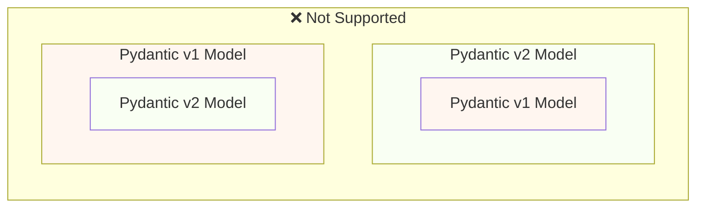
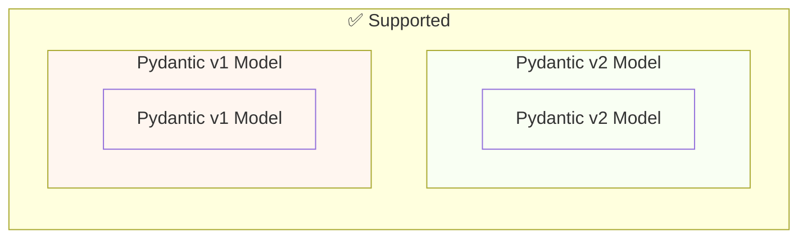

# Judge calibration: labelling sheet

For each item, read the question, the sources the model was given and its
answer, then write one label per item in `labels.csv` (same folder):

- `supported`: every factual claim in the answer (what FastAPI does, how an
  API or parameter behaves, code presented as working) is stated in the
  sources or follows directly from them. Rewording, summarising and generic
  connecting text are fine. Saying the sources do not cover the question is
  supported when they indeed do not.
- `unsupported`: at least one claim is not in the sources or contradicts them,
  including code or parameter names the sources do not show, and claiming the
  sources lack something they contain.
- `unsure`: you cannot decide; these items are left out of the agreement.

Judge support only, not whether the answer is helpful or complete. Use what is
in the sources, not what you know about FastAPI. `note` is optional. The
judge's verdicts are not in this folder; do not look at judge runs before
finishing.


## j-41: Browser Cookie never expires

Question: [so_74041393](https://stackoverflow.com/questions/74041393/browser-cookie-never-expires) (CC BY-SA 4.0)

<details>
<summary>Source 1: tutorial/cookie-param-models.md (Cookie Parameter Models { #cookie-parameter-models } > Forbid Extra Cookies { #forbid-extra-cookies })</summary>

In some special use cases (probably not very common), you might want to **restrict** the cookies that you want to receive.

Your API now has the power to control its own <dfn title="This is a joke, just in case. It has nothing to do with cookie consents, but it's funny that even the API can now reject the poor cookies. Have a cookie. 🍪">cookie consent</dfn>. 🤪🍪

You can use Pydantic's model configuration to `forbid` any `extra` fields:

{* ../../docs_src/cookie_param_models/tutorial002_an_py310.py hl[10] *}

If a client tries to send some **extra cookies**, they will receive an **error** response.

Poor cookie banners with all their effort to get your consent for the <dfn title="This is another joke. Don't pay attention to me. Have some coffee for your cookie. ☕">API to reject it</dfn>. 🍪

For example, if the client tries to send a `santa_tracker` cookie with a value of `good-list-please`, the client will receive an **error** response telling them that the `santa_tracker` <dfn title="Santa disapproves the lack of cookies. 🎅 Okay, no more cookie jokes.">cookie is not allowed</dfn>:


```json
{
    "detail": [
        {
            "type": "extra_forbidden",
            "loc": ["cookie", "santa_tracker"],
            "msg": "Extra inputs are not permitted",
            "input": "good-list-please",
        }
    ]
}
```

</details>

<details>
<summary>Source 2: tutorial/cookie-params.md (Cookie Parameters { #cookie-parameters } > Recap { #recap })</summary>

Declare cookies with `Cookie`, using the same common pattern as `Query` and `Path`.

</details>

<details>
<summary>Source 3: tutorial/cookie-param-models.md (Cookie Parameter Models { #cookie-parameter-models } > Summary { #summary })</summary>

You can use **Pydantic models** to declare <dfn title="Have a last cookie before you go. 🍪">**cookies**</dfn> in **FastAPI**. 😎

</details>

<details>
<summary>Source 4: tutorial/cookie-param-models.md (Cookie Parameter Models { #cookie-parameter-models } > Forbid Extra Cookies { #forbid-extra-cookies })</summary>

In some special use cases (probably not very common), you might want to **restrict** the cookies that you want to receive.

Your API now has the power to control its own <dfn title="This is a joke, just in case. It has nothing to do with cookie consents, but it's funny that even the API can now reject the poor cookies. Have a cookie. 🍪">cookie consent</dfn>. 🤪🍪

You can use Pydantic's model configuration to `forbid` any `extra` fields:

{* ../../docs_src/cookie_param_models/tutorial002_an_py310.py hl[10] *}

If a client tries to send some **extra cookies**, they will receive an **error** response.

Poor cookie banners with all their effort to get your consent for the <dfn title="This is another joke. Don't pay attention to me. Have some coffee for your cookie. ☕">API to reject it</dfn>. 🍪

For example, if the client tries to send a `santa_tracker` cookie with a value of `good-list-please`, the client will receive an **error** response telling them that the `santa_tracker` <dfn title="Santa disapproves the lack of cookies. 🎅 Okay, no more cookie jokes.">cookie is not allowed</dfn>:


```json
{
    "detail": [
        {
            "type": "extra_forbidden",
            "loc": ["cookie", "santa_tracker"],
            "msg": "Extra inputs are not permitted",
            "input": "good-list-please",
        }
    ]
}
```

</details>

<details>
<summary>Source 5: tutorial/cookie-params.md (Cookie Parameters { #cookie-parameters } > Declare `Cookie` parameters { #declare-cookie-parameters })</summary>

Then declare the cookie parameters using the same structure as with `Path` and `Query`.

You can define the default value as well as all the extra validation or annotation parameters:

{* ../../docs_src/cookie_params/tutorial001_an_py310.py hl[9] *}

/// note | Technical Details

`Cookie` is a "sister" class of `Path` and `Query`. It also inherits from the same common `Param` class.

But remember that when you import `Query`, `Path`, `Cookie` and others from `fastapi`, those are actually functions that return special classes.

///

/// info

To declare cookies, you need to use `Cookie`, because otherwise the parameters would be interpreted as query parameters.

///

/// info

Have in mind that, as **browsers handle cookies** in special ways and behind the scenes, they **don't** easily allow **JavaScript** to touch them.

If you go to the **API docs UI** at `/docs` you will be able to see the **documentation** for cookies for your *path operations*.

But even if you **fill the data** and click "Execute", because the docs UI works with **JavaScript**, the cookies won't be sent, and you will see an **error** message as if you didn't write any values.

///

</details>

**Answer:**

The documentation indicates that you can restrict the cookies your API receives using Pydantic models by using the `forbid` configuration. If a client sends extra cookies that are not allowed, the API will return an error response. However, the documentation doesn't provide information about browser cookie expiration. It does mention that browsers handle cookies in special ways and that JavaScript doesn't easily access them, and that the documentation in the UI won't work because it relies on JavaScript.

---

## j-42: How to authenticate static routes in FastAPI

Question: [so_66570680](https://stackoverflow.com/questions/66570680/how-to-authenticate-static-routes-in-fastapi) (CC BY-SA 4.0)

<details>
<summary>Source 1: tutorial/static-files.md (Static Files { #static-files } > Details { #details })</summary>

The first `"/static"` refers to the sub-path this "sub-application" will be "mounted" on. So, any path that starts with `"/static"` will be handled by it.

The `directory="static"` refers to the name of the directory that contains your static files.

The `name="static"` gives it a name that can be used internally by **FastAPI**.

All these parameters can be different than "`static`", adjust them with the needs and specific details of your own application.

</details>

<details>
<summary>Source 2: tutorial/security/first-steps.md (Security - First Steps { #security-first-steps })</summary>

Let's imagine that you have your **backend** API in some domain.

And you have a **frontend** in another domain or in a different path of the same domain (or in a mobile application).

And you want to have a way for the frontend to authenticate with the backend, using a **username** and **password**.

We can use **OAuth2** to build that with **FastAPI**.

But let's save you the time of reading the full long specification just to find those little pieces of information you need.

Let's use the tools provided by **FastAPI** to handle security.

</details>

<details>
<summary>Source 3: tutorial/security/index.md (Security { #security } > **FastAPI** utilities { #fastapi-utilities })</summary>

FastAPI provides several tools for each of these security schemes in the `fastapi.security` module that simplify using these security mechanisms.

In the next chapters you will see how to add security to your API using those tools provided by **FastAPI**.

And you will also see how it gets automatically integrated into the interactive documentation system.

</details>

<details>
<summary>Source 4: reference/security/index.md (Security Tools > OpenID Connect)</summary>

::: fastapi.security.OpenIdConnect

</details>

<details>
<summary>Source 5: release-notes.md (Release Notes > 0.20.0 (2019-04-27))</summary>

Upgrade OAuth2:

Upgrade Password flow using Bearer tokens to use the correct HTTP status code 401 `UNAUTHORIZED`, with `WWW-Authenticate` headers.

Update, simplify, and improve all the [security docs](https://fastapi.tiangolo.com/advanced/security/).

Add new `scope_str` to `SecurityScopes` and update docs: [OAuth2 scopes](https://fastapi.tiangolo.com/advanced/security/oauth2-scopes/).

Update docs, images, tests.

PR [#188](https://github.com/tiangolo/fastapi/pull/188).

Include [Hypercorn](https://gitlab.com/pgjones/hypercorn) as an alternative ASGI server in the docs. PR [#187](https://github.com/tiangolo/fastapi/pull/187).

Add docs for [Static Files](https://fastapi.tiangolo.com/tutorial/static-files/) and [Templates](https://fastapi.tiangolo.com/advanced/templates/). PR [#186](https://github.com/tiangolo/fastapi/pull/186).

Add docs for handling [Response Cookies](https://fastapi.tiangolo.com/advanced/response-cookies/) and [Response Headers](https://fastapi.tiangolo.com/advanced/response-headers/). PR [#185](https://github.com/tiangolo/fastapi/pull/185).

Fix typos in docs. PR [#176](https://github.com/tiangolo/fastapi/pull/176) by [@chdsbd](https://github.com/chdsbd).

</details>

**Answer:**

The provided context doesn't directly explain how to authenticate static routes in FastAPI. However, it mentions "Static Files" documentation ([https://fastapi.tiangolo.com/tutorial/static-files/](https://fastapi.tiangolo.com/tutorial/static-files/)). This documentation covers serving static files through a sub-application mounted on the `/static` path.  

It explains the parameters `directory` and `name` that are used to define this sub-application, and emphasizes that these can be adjusted based on your application's needs.

---

## j-43: FastAPI python: How to run a thread in the background?

Question: [so_70872276](https://stackoverflow.com/questions/70872276/fastapi-python-how-to-run-a-thread-in-the-background) (CC BY-SA 4.0)

<details>
<summary>Source 1: tutorial/background-tasks.md (Background Tasks { #background-tasks } > Dependency Injection { #dependency-injection })</summary>

Using `BackgroundTasks` also works with the dependency injection system, you can declare a parameter of type `BackgroundTasks` at multiple levels: in a *path operation function*, in a dependency (dependable), in a sub-dependency, etc.

**FastAPI** knows what to do in each case and how to reuse the same object, so that all the background tasks are merged together and are run in the background afterwards:

{* ../../docs_src/background_tasks/tutorial002_an_py310.py hl[13,15,22,25] *}

In this example, the messages will be written to the `log.txt` file *after* the response is sent.

If there was a query in the request, it will be written to the log in a background task.

And then another background task generated at the *path operation function* will write a message using the `email` path parameter.

</details>

<details>
<summary>Source 2: tutorial/background-tasks.md (Background Tasks { #background-tasks } > Create a task function { #create-a-task-function })</summary>

Create a function to be run as the background task.

It is just a standard function that can receive parameters.

It can be an `async def` or normal `def` function, **FastAPI** will know how to handle it correctly.

In this case, the task function will write to a file (simulating sending an email).

And as the write operation doesn't use `async` and `await`, we define the function with normal `def`:

{* ../../docs_src/background_tasks/tutorial001_py310.py hl[6:9] *}

</details>

<details>
<summary>Source 3: tutorial/background-tasks.md (Background Tasks { #background-tasks } > Technical Details { #technical-details })</summary>

The class `BackgroundTasks` comes directly from [`starlette.background`](https://www.starlette.dev/background/).

It is imported/included directly into FastAPI so that you can import it from `fastapi` and avoid accidentally importing the alternative `BackgroundTask` (without the `s` at the end) from `starlette.background`.

By only using `BackgroundTasks` (and not `BackgroundTask`), it's then possible to use it as a *path operation function* parameter and have **FastAPI** handle the rest for you, just like when using the `Request` object directly.

It's still possible to use `BackgroundTask` alone in FastAPI, but you have to create the object in your code and return a Starlette `Response` including it.

You can see more details in [Starlette's official docs for Background Tasks](https://www.starlette.dev/background/).

</details>

<details>
<summary>Source 4: reference/background.md (Background Tasks - `BackgroundTasks`)</summary>

You can declare a parameter in a *path operation function* or dependency function with the type `BackgroundTasks`, and then you can use it to schedule the execution of background tasks after the response is sent.

You can import it directly from `fastapi`:


```python
from fastapi import BackgroundTasks
```
::: fastapi.BackgroundTasks

</details>

<details>
<summary>Source 5: advanced/advanced-dependencies.md (Advanced Dependencies { #advanced-dependencies } > Dependencies with `yield`, `HTTPException`, `except` and Background Tasks { #dependencies-with-yield-httpexception-except-and-background-tasks })</summary>

/// warning

You most probably don't need these technical details.

These details are useful mainly if you had a FastAPI application older than 0.121.0 and you are facing issues with dependencies with `yield`.

///

Dependencies with `yield` have evolved over time to account for the different use cases and to fix some issues, here's a summary of what has changed.

In version 0.121.0, FastAPI added support for `Depends(scope="function")` for dependencies with `yield`.

Using `Depends(scope="function")`, the exit code after `yield` is executed right after the *path operation function* is finished, before the response is sent back to the client.

And when using `Depends(scope="request")` (the default), the exit code after `yield` is executed after the response is sent.

You can read more about it in the docs for [Dependencies with `yield` - Early exit and `scope`](../tutorial/dependencies/dependencies-with-yield.md#early-exit-and-scope).

Before FastAPI 0.118.0, if you used a dependency with `yield`, it would run the exit code after the *path operation function* returned but right before sending the response.

The intention was to avoid holding resources for longer than necessary, waiting for the response to travel through the network.

This change also meant that if you returned a `StreamingResponse`, the exit code of the dependency with `yield` would have been already run.

For example, if you had a database session in a dependency with `yield`, the `StreamingResponse` would not be able to use that session while streaming data because the session would have already been closed in the exit code after `yield`.

This behavior was reverted in 0.118.0, to make the exit code after `yield` be executed after the response is sent.

/// info

As you will see below, this is very similar to the behavior before version 0.106.0, but with several improvements and bug fixes for corner cases.

///

There are some use cases with specific conditions that could benefit from the old behavior of running the exit code of dependencies with `yield` before sending the response.

For example, imagine you have code that uses a database session in a dependency with `yield` only to verify a user, but the database session is never used again in the *path operation function*, only in the dependency, **and** the response takes a long time to be sent, like a `StreamingResponse` that sends data slowly, but for some reason doesn't use the database.

In this case, the database session would be held until the response is finished being sent, but if you don't use it, then it wouldn't be necessary to hold it.

Here's how it could look like:

{* ../../docs_src/dependencies/tutorial013_an_py310.py *}

The exit code, the automatic closing of the `Session` in:

{* ../../docs_src/dependencies/tutorial013_an_py310.py ln[19:21] *}

...would be run after the response finishes sending the slow data:

{* ../../docs_src/dependencies/tutorial013_an_py310.py ln[30:38] hl[31:33] *}

But as `generate_stream()` doesn't use the database session, it is not really necessary to keep the session open while sending the response.

If you have this specific use case using SQLModel (or SQLAlchemy), you could explicitly close the session after you don't need it anymore:

{* ../../docs_src/dependencies/tutorial014_an_py310.py ln[24:28] hl[28] *}

That way the session would release the database connection, so other requests could use it.

If you have a different use case that needs to exit early from a dependency with `yield`, please create a [GitHub Discussion Question](https://github.com/fastapi/fastapi/discussions/new?category=questions) with your specific use case and why you would benefit from having early closing for dependencies with `yield`.

If there are compelling use cases for early closing in dependencies with `yield`, I would consider adding a new way to opt in to early closing.

Before FastAPI 0.110.0, if you used a dependency with `yield`, and then you captured an exception with `except` in that dependency, and you didn't raise the exception again, the exception would be automatically raised/forwarded to any exception handlers or the internal server error handler.

This was changed in version 0.110.0 to fix unhandled memory consumption from forwarded exceptions without a handler (internal server errors), and to make it consistent with the behavior of regular Python code.

Before FastAPI 0.106.0, raising exceptions after `yield` was not possible, the exit code in dependencies with `yield` was executed *after* the response was sent, so [Exception Handlers](../tutorial/handling-errors.md#install-custom-exception-handlers) would have already run.

This was designed this way mainly to allow using the same objects "yielded" by dependencies inside of background tasks, because the exit code would be executed after the background tasks were finished.

This was changed in FastAPI 0.106.0 with the intention to not hold resources while waiting for the response to travel through the network.

/// tip

Additionally, a background task is normally an independent set of logic that should be handled separately, with its own resources (e.g. its own database connection).

So, this way you will probably have cleaner code.

///

If you used to rely on this behavior, now you should create the resources for background tasks inside the background task itself, and use internally only data that doesn't depend on the resources of dependencies with `yield`.

For example, instead of using the same database session, you would create a new database session inside of the background task, and you would obtain the objects from the database using this new session. And then instead of passing the object from the database as a parameter to the background task function, you would pass the ID of that object and then obtain the object again inside the background task function.

</details>

**Answer:**

Based on the provided context, you can run a thread in the background using `BackgroundTasks` in FastAPI. Here’s how:

1.  **Import `BackgroundTasks`:**
    ```python
    from fastapi import BackgroundTasks
    ```

2.  **Declare a `BackgroundTasks` parameter:** You can declare a parameter of type `BackgroundTasks` at multiple levels: in a *path operation function*, in a dependency (dependable), or in a sub-dependency.

3.  **Create a function to be run as the background task:**  It’s a standard function (can be `async def` or `def`) that can receive parameters.

4. **Use the `BackgroundTasks` parameter to schedule the execution of the function:** This will execute the function after the response is sent.

**Example (based on Source 4):**

```python
from fastapi import FastAPI, BackgroundTasks

app = FastAPI()

@app.post("/background", async_background=True)
async def background_task(background_tasks: BackgroundTasks, item: str):
    await background_tasks.add_task(my_background_function, item)
    return {"message": f"Task scheduled for background processing with item: {item}"}

import time
def my_background_function(item):
    print(f"Running background task with item: {item}")
    time.sleep(5)  # Simulate a long-running task
```

**Important Considerations (based on Sources 3 & 5):**

*   **Starlette Background Tasks:** `BackgroundTasks` comes from [`starlette.background`](https://www.starlette.dev/background/) and is imported directly from `fastapi` to avoid conflicts.

*   **Dependencies with `yield` (Older versions):**  If you’re using an older version of FastAPI (before 0.121.0) and have dependencies with `yield`, the background tasks will run *after* the response is sent.  This is to avoid holding resources while waiting for the response.  In newer versions, this behavior is more standardized.

*   **Explicit Resource Management:**  When using background tasks, it’s generally best to create resources (like database connections) *within* the background task function itself. This prevents conflicts and ensures cleaner code.  Don't reuse resources from dependencies with `yield`.

The context emphasizes using `BackgroundTasks` for offloading work from the main request handler to improve responsiveness, especially when dealing with potentially long-running operations.

---

## j-44: How to get a session from async_session() generator FastApi Sqlalchemy

Question: [so_75150942](https://stackoverflow.com/questions/75150942/how-to-get-a-session-from-async-session-generator-fastapi-sqlalchemy) (CC BY-SA 4.0)

<details>
<summary>Source 1: tutorial/sql-databases.md (SQL (Relational) Databases { #sql-relational-databases } > Create the App with a Single Model { #create-the-app-with-a-single-model } > Create a Session Dependency { #create-a-session-dependency })</summary>

A **`Session`** is what stores the **objects in memory** and keeps track of any changes needed in the data, then it **uses the `engine`** to communicate with the database.

We will create a FastAPI **dependency** with `yield` that will provide a new `Session` for each request. This is what ensures that we use a single session per request. 🤓

Then we create an `Annotated` dependency `SessionDep` to simplify the rest of the code that will use this dependency.

{* ../../docs_src/sql_databases/tutorial001_an_py310.py ln[25:30]  hl[25:27,30] *}

</details>

<details>
<summary>Source 2: release-notes.md (Release Notes > 0.6.2 (2019-02-23))</summary>

Introduce new project generator based on FastAPI and PostgreSQL: [https://github.com/tiangolo/full-stack-fastapi-postgresql](https://github.com/tiangolo/full-stack-fastapi-postgresql). PR [#52](https://github.com/tiangolo/fastapi/pull/52).

Update [SQL tutorial with SQLAlchemy, using `Depends` to improve editor support and reduce code repetition](https://fastapi.tiangolo.com/tutorial/sql-databases/). PR [#52](https://github.com/tiangolo/fastapi/pull/52).

Improve middleware naming in tutorial for SQL with SQLAlchemy [https://fastapi.tiangolo.com/tutorial/sql-databases/](https://fastapi.tiangolo.com/tutorial/sql-databases/).

</details>

<details>
<summary>Source 3: release-notes.md (Release Notes > 0.3.0 (2019-02-12))</summary>

Fix/add SQLAlchemy support, including ORM, and update [docs for SQLAlchemy](https://fastapi.tiangolo.com/tutorial/sql-databases/): [#30](https://github.com/tiangolo/fastapi/pull/30).

</details>

<details>
<summary>Source 4: tutorial/sql-databases.md (SQL (Relational) Databases { #sql-relational-databases })</summary>

**FastAPI** doesn't require you to use a SQL (relational) database. But you can use **any database** that you want.

Here we'll see an example using [SQLModel](https://sqlmodel.tiangolo.com/).

**SQLModel** is built on top of [SQLAlchemy](https://www.sqlalchemy.org/) and Pydantic. It was made by the same author of **FastAPI** to be the perfect match for FastAPI applications that need to use **SQL databases**.

/// tip

You could use any other SQL or NoSQL database library you want (in some cases called <abbr title="Object Relational Mapper: a fancy term for a library where some classes represent SQL tables and instances represent rows in those tables">"ORMs"</abbr>), FastAPI doesn't force you to use anything. 😎

///

As SQLModel is based on SQLAlchemy, you can easily use **any database supported** by SQLAlchemy (which makes them also supported by SQLModel), like:

PostgreSQL

MySQL

SQLite

Oracle

Microsoft SQL Server, etc.

In this example, we'll use **SQLite**, because it uses a single file and Python has integrated support. So, you can copy this example and run it as is.

Later, for your production application, you might want to use a database server like **PostgreSQL**.

/// tip

There is an official project generator with **FastAPI** and **PostgreSQL** including a frontend and more tools: [https://github.com/fastapi/full-stack-fastapi-template](https://github.com/fastapi/full-stack-fastapi-template)

///

This is a very simple and short tutorial, if you want to learn about databases in general, about SQL, or more advanced features, go to the [SQLModel docs](https://sqlmodel.tiangolo.com/).

</details>

<details>
<summary>Source 5: tutorial/sql-databases.md (SQL (Relational) Databases { #sql-relational-databases } > Create the App with a Single Model { #create-the-app-with-a-single-model } > Create an Engine { #create-an-engine })</summary>

A SQLModel `engine` (underneath it's actually a SQLAlchemy `engine`) is what **holds the connections** to the database.

You would have **one single `engine` object** for all your code to connect to the same database.

{* ../../docs_src/sql_databases/tutorial001_an_py310.py ln[14:18] hl[14:15,17:18] *}

Using `check_same_thread=False` allows FastAPI to use the same SQLite database in different threads. This is necessary as **one single request** could use **more than one thread** (for example in dependencies).

Don't worry, with the way the code is structured, we'll make sure we use **a single SQLModel *session* per request** later, this is actually what the `check_same_thread` is trying to achieve.

</details>

**Answer:**

To get a session from the `async_session()` generator in FastAPI with SQLAlchemy, you will create a FastAPI dependency with `yield` that will provide a new `Session` for each request. This ensures that you use a single session per request. The `async_session()` generator is designed to manage and provide sessions efficiently, particularly when dealing with multiple threads within a request. 

Specifically, you'll create a dependency that uses `yield` to produce a new `Session` object for each incoming request. This is crucial for isolating database interactions and preventing conflicts between concurrent requests.

---

## j-45: Render NumPy array in FastAPI

Question: [so_71595635](https://stackoverflow.com/questions/71595635/render-numpy-array-in-fastapi) (CC BY-SA 4.0)

<details>
<summary>Source 1: features.md (Features { #features } > FastAPI features { #fastapi-features })</summary>

**FastAPI** gives you the following:

</details>

<details>
<summary>Source 2: reference/responses.md (Custom Response Classes - File, HTML, Redirect, Streaming, etc. > Starlette Responses)</summary>

You can read more about all of them in the [FastAPI docs for Custom Response](https://fastapi.tiangolo.com/advanced/custom-response/) and in the [Starlette docs about Responses](https://starlette.dev/responses/).

::: fastapi.responses.FileResponse
    options:
        members:
            - chunk_size
            - charset
            - status_code
            - media_type
            - body
            - background
            - raw_headers
            - render
            - init_headers
            - headers
            - set_cookie
            - delete_cookie

::: fastapi.responses.HTMLResponse
    options:
        members:
            - charset
            - status_code
            - media_type
            - body
            - background
            - raw_headers
            - render
            - init_headers
            - headers
            - set_cookie
            - delete_cookie

::: fastapi.responses.JSONResponse
    options:
        members:
            - charset
            - status_code
            - media_type
            - body
            - background
            - raw_headers
            - render
            - init_headers
            - headers
            - set_cookie
            - delete_cookie

::: fastapi.responses.PlainTextResponse
    options:
        members:
            - charset
            - status_code
            - media_type
            - body
            - background
            - raw_headers
            - render
            - init_headers
            - headers
            - set_cookie
            - delete_cookie

::: fastapi.responses.RedirectResponse
    options:
        members:
            - charset
            - status_code
            - media_type
            - body
            - background
            - raw_headers
            - render
            - init_headers
            - headers
            - set_cookie
            - delete_cookie

::: fastapi.responses.Response
    options:
        members:
            - charset
            - status_code
            - media_type
            - body
            - background
            - raw_headers
            - render
            - init_headers
            - headers
            - set_cookie
            - delete_cookie

::: fastapi.responses.StreamingResponse
    options:
        members:
            - body_iterator
            - charset
            - status_code
            - media_type
            - body
            - background
            - raw_headers
            - render
            - init_headers
            - headers
            - set_cookie
            - delete_cookie

</details>

<details>
<summary>Source 3: tutorial/body-nested-models.md (Body - Nested Models { #body-nested-models })</summary>

With **FastAPI**, you can define, validate, document, and use arbitrarily deeply nested models (thanks to Pydantic).

</details>

<details>
<summary>Source 4: reference/responses.md (Custom Response Classes - File, HTML, Redirect, Streaming, etc. > Starlette Responses)</summary>

You can read more about all of them in the [FastAPI docs for Custom Response](https://fastapi.tiangolo.com/advanced/custom-response/) and in the [Starlette docs about Responses](https://starlette.dev/responses/).

::: fastapi.responses.FileResponse
    options:
        members:
            - chunk_size
            - charset
            - status_code
            - media_type
            - body
            - background
            - raw_headers
            - render
            - init_headers
            - headers
            - set_cookie
            - delete_cookie

::: fastapi.responses.HTMLResponse
    options:
        members:
            - charset
            - status_code
            - media_type
            - body
            - background
            - raw_headers
            - render
            - init_headers
            - headers
            - set_cookie
            - delete_cookie

::: fastapi.responses.JSONResponse
    options:
        members:
            - charset
            - status_code
            - media_type
            - body
            - background
            - raw_headers
            - render
            - init_headers
            - headers
            - set_cookie
            - delete_cookie

::: fastapi.responses.PlainTextResponse
    options:
        members:
            - charset
            - status_code
            - media_type
            - body
            - background
            - raw_headers
            - render
            - init_headers
            - headers
            - set_cookie
            - delete_cookie

::: fastapi.responses.RedirectResponse
    options:
        members:
            - charset
            - status_code
            - media_type
            - body
            - background
            - raw_headers
            - render
            - init_headers
            - headers
            - set_cookie
            - delete_cookie

::: fastapi.responses.Response
    options:
        members:
            - charset
            - status_code
            - media_type
            - body
            - background
            - raw_headers
            - render
            - init_headers
            - headers
            - set_cookie
            - delete_cookie

::: fastapi.responses.StreamingResponse
    options:
        members:
            - body_iterator
            - charset
            - status_code
            - media_type
            - body
            - background
            - raw_headers
            - render
            - init_headers
            - headers
            - set_cookie
            - delete_cookie

</details>

<details>
<summary>Source 5: advanced/dataclasses.md (Using Dataclasses { #using-dataclasses } > Version { #version })</summary>

This is available since FastAPI version `0.67.0`. 🔖

</details>

**Answer:**

The provided context doesn't contain information on how to render a NumPy array in FastAPI. It primarily describes the available response classes and their members. 

To achieve this, you would need to consult the FastAPI docs for Custom Response ([https://fastapi.tiangolo.com/advanced/custom-response/](https://fastapi.tiangolo.com/advanced/custom-response/)) and potentially Starlette docs about Responses ([https://starlette.dev/responses/](https://starlette.dev/responses/)) for more details on how to handle different data types in responses. Also, note that the functionality of rendering NumPy arrays may be available since FastAPI version `0.67.0`.

---

## j-46: How to enable filtering on all fields of a model in FastAPI

Question: [so_66680866](https://stackoverflow.com/questions/66680866/how-to-enable-filtering-on-all-fields-of-a-model-in-fastapi) (CC BY-SA 4.0)

<details>
<summary>Source 1: tutorial/response-model.md (Response Model - Return Type { #response-model-return-type } > Return Type and Data Filtering { #return-type-and-data-filtering })</summary>

Let's continue from the previous example. We wanted to **annotate the function with one type**, but we wanted to be able to return from the function something that actually includes **more data**.

We want FastAPI to keep **filtering** the data using the response model. So that even though the function returns more data, the response will only include the fields declared in the response model.

In the previous example, because the classes were different, we had to use the `response_model` parameter. But that also means that we don't get the support from the editor and tools checking the function return type.

But in most of the cases where we need to do something like this, we want the model just to **filter/remove** some of the data as in this example.

And in those cases, we can use classes and inheritance to take advantage of function **type annotations** to get better support in the editor and tools, and still get the FastAPI **data filtering**.

{* ../../docs_src/response_model/tutorial003_01_py310.py hl[7:10,13:14,18] *}

With this, we get tooling support, from editors and mypy as this code is correct in terms of types, but we also get the data filtering from FastAPI.

How does this work? Let's check that out. 🤓

First let's see how editors, mypy and other tools would see this.

`BaseUser` has the base fields. Then `UserIn` inherits from `BaseUser` and adds the `password` field, so, it will include all the fields from both models.

We annotate the function return type as `BaseUser`, but we are actually returning a `UserIn` instance.

The editor, mypy, and other tools won't complain about this because, in typing terms, `UserIn` is a subclass of `BaseUser`, which means it's a *valid* type when what is expected is anything that is a `BaseUser`.

Now, for FastAPI, it will see the return type and make sure that what you return includes **only** the fields that are declared in the type.

FastAPI does several things internally with Pydantic to make sure that those same rules of class inheritance are not used for the returned data filtering, otherwise you could end up returning much more data than what you expected.

This way, you can get the best of both worlds: type annotations with **tooling support** and **data filtering**.

</details>

<details>
<summary>Source 2: release-notes.md (Release Notes > 0.47.1 (2020-01-18))</summary>

Fix model filtering in `response_model`, cloning sub-models. PR [#889](https://github.com/tiangolo/fastapi/pull/889).

Fix FastAPI serialization of Pydantic models using ORM mode blocking the event loop. PR [#888](https://github.com/tiangolo/fastapi/pull/888).

</details>

<details>
<summary>Source 3: tutorial/request-form-models.md (Form Models { #form-models } > Pydantic Models for Forms { #pydantic-models-for-forms })</summary>

You just need to declare a **Pydantic model** with the fields you want to receive as **form fields**, and then declare the parameter as `Form`:

{* ../../docs_src/request_form_models/tutorial001_an_py310.py hl[9:11,15] *}

**FastAPI** will **extract** the data for **each field** from the **form data** in the request and give you the Pydantic model you defined.

</details>

<details>
<summary>Source 4: release-notes.md (Release Notes > 0.112.4 (2024-09-05))</summary>

This release is mainly a big internal refactor to enable adding support for Pydantic models for `Form` fields, but that feature comes in the next release.

This release shouldn't affect apps using FastAPI in any way. You don't even have to upgrade to this version yet. It's just a checkpoint. 🤓

♻️ Refactor deciding if `embed` body fields, do not overwrite fields, compute once per router, refactor internals in preparation for Pydantic models in `Form`, `Query` and others. PR [#12117](https://github.com/fastapi/fastapi/pull/12117) by [@tiangolo](https://github.com/tiangolo).

⏪️ Temporarily revert "✨ Add support for Pydantic models in `Form` parameters" to make a checkpoint release. PR [#12128](https://github.com/fastapi/fastapi/pull/12128) by [@tiangolo](https://github.com/tiangolo). Restored by PR [#12129](https://github.com/fastapi/fastapi/pull/12129).

✨ Add support for Pydantic models in `Form` parameters. PR [#12127](https://github.com/fastapi/fastapi/pull/12127) by [@tiangolo](https://github.com/tiangolo). Reverted by PR [#12128](https://github.com/fastapi/fastapi/pull/12128) to make a checkpoint release with only refactors. Restored by PR [#12129](https://github.com/fastapi/fastapi/pull/12129).

</details>

<details>
<summary>Source 5: tutorial/response-model.md (Response Model - Return Type { #response-model-return-type } > Return Type and Data Filtering { #return-type-and-data-filtering })</summary>

Let's continue from the previous example. We wanted to **annotate the function with one type**, but we wanted to be able to return from the function something that actually includes **more data**.

We want FastAPI to keep **filtering** the data using the response model. So that even though the function returns more data, the response will only include the fields declared in the response model.

In the previous example, because the classes were different, we had to use the `response_model` parameter. But that also means that we don't get the support from the editor and tools checking the function return type.

But in most of the cases where we need to do something like this, we want the model just to **filter/remove** some of the data as in this example.

And in those cases, we can use classes and inheritance to take advantage of function **type annotations** to get better support in the editor and tools, and still get the FastAPI **data filtering**.

{* ../../docs_src/response_model/tutorial003_01_py310.py hl[7:10,13:14,18] *}

With this, we get tooling support, from editors and mypy as this code is correct in terms of types, but we also get the data filtering from FastAPI.

How does this work? Let's check that out. 🤓

First let's see how editors, mypy and other tools would see this.

`BaseUser` has the base fields. Then `UserIn` inherits from `BaseUser` and adds the `password` field, so, it will include all the fields from both models.

We annotate the function return type as `BaseUser`, but we are actually returning a `UserIn` instance.

The editor, mypy, and other tools won't complain about this because, in typing terms, `UserIn` is a subclass of `BaseUser`, which means it's a *valid* type when what is expected is anything that is a `BaseUser`.

Now, for FastAPI, it will see the return type and make sure that what you return includes **only** the fields that are declared in the type.

FastAPI does several things internally with Pydantic to make sure that those same rules of class inheritance are not used for the returned data filtering, otherwise you could end up returning much more data than what you expected.

This way, you can get the best of both worlds: type annotations with **tooling support** and **data filtering**.

</details>

**Answer:**

According to the provided context, you can achieve data filtering in FastAPI by using classes and inheritance to take advantage of function type annotations. Specifically:

1.  **Base and Subclasses:** Create a `BaseUser` class with the base fields and then define subclasses like `UserIn` that inherit from `BaseUser` and add additional fields (e.g., `password`).
2.  **Type Annotation:** Annotate the function return type as `BaseUser`.
3.  **Return Subclass:** Return an instance of the subclass (e.g., `UserIn`).

This approach allows you to get tooling support from editors and mypy, ensuring that the code is type-correct, while still benefiting from FastAPI's data filtering capabilities. FastAPI will ensure that the returned data includes only the fields defined in the `BaseUser` type.  This avoids the need to use the `response_model` parameter, which would otherwise disable editor and tool support.

---

## j-47: How to post JSON data to FastAPI and retrieve the JSON data inside the endpoint?

Question: [so_70975344](https://stackoverflow.com/questions/70975344/how-to-post-json-data-to-fastapi-and-retrieve-the-json-data-inside-the-endpoint) (CC BY-SA 4.0)

<details>
<summary>Source 1: advanced/custom-response.md (Custom Response - HTML, Stream, File, others { #custom-response-html-stream-file-others } > JSON Responses { #json-responses })</summary>

By default FastAPI returns JSON responses.

If you declare a [Response Model](../tutorial/response-model.md) FastAPI will use it to serialize the data to JSON, using Pydantic.

If you don't declare a response model, FastAPI will use the `jsonable_encoder` explained in [JSON Compatible Encoder](../tutorial/encoder.md) and put it in a `JSONResponse`.

If you declare a `response_class` with a JSON media type (`application/json`), like is the case with the `JSONResponse`, the data you return will be automatically converted (and filtered) with any Pydantic `response_model` that you declared in the *path operation decorator*. But the data won't be serialized to JSON bytes with Pydantic, instead it will be converted with the `jsonable_encoder` and then passed to the `JSONResponse` class, which will serialize it to bytes using the standard JSON library in Python.

In short, if you want the maximum performance, use a [Response Model](../tutorial/response-model.md) and don't declare a `response_class` in the *path operation decorator*.

{* ../../docs_src/response_model/tutorial001_01_py310.py ln[15:17] hl[16] *}

</details>

<details>
<summary>Source 2: advanced/custom-response.md (Custom Response - HTML, Stream, File, others { #custom-response-html-stream-file-others } > Custom response class { #custom-response-class })</summary>

You can create your own custom response class, inheriting from `Response` and using it.

For example, let's say that you want to use [`orjson`](https://github.com/ijl/orjson) with some settings.

Let's say you want it to return indented and formatted JSON, so you want to use the orjson option `orjson.OPT_INDENT_2`.

You could create a `CustomORJSONResponse`. The main thing you have to do is create a `Response.render(content)` method that returns the content as `bytes`:

{* ../../docs_src/custom_response/tutorial009c_py310.py hl[9:14,17] *}

Now instead of returning:


```json
{"message": "Hello World"}
```
...this response will return:


```json
{
  "message": "Hello World"
}
```
Of course, you will probably find much better ways to take advantage of this than formatting JSON. 😉

If what you are looking for is performance, you are probably better off using a [Response Model](../tutorial/response-model.md) than an `orjson` response.

With a response model, FastAPI will use Pydantic to serialize the data to JSON, without using intermediate steps, like converting it with `jsonable_encoder`, which would happen in any other case.

And under the hood, Pydantic uses the same underlying Rust mechanisms as `orjson` to serialize to JSON, so you will already get the best performance with a response model.

</details>

<details>
<summary>Source 3: advanced/response-directly.md (Return a Response Directly { #return-a-response-directly })</summary>

When you create a **FastAPI** *path operation* you can normally return any data from it: a `dict`, a `list`, a Pydantic model, a database model, etc.

If you declare a [Response Model](../tutorial/response-model.md) FastAPI will use it to serialize the data to JSON, using Pydantic.

If you don't declare a response model, FastAPI will use the `jsonable_encoder` explained in [JSON Compatible Encoder](../tutorial/encoder.md) and put it in a `JSONResponse`.

You could also create a `JSONResponse` directly and return it.

/// tip

You will normally have much better performance using a [Response Model](../tutorial/response-model.md) than returning a `JSONResponse` directly, as that way it serializes the data using Pydantic, in Rust.

///

</details>

<details>
<summary>Source 4: tutorial/first-steps.md (First Steps { #first-steps } > Check it { #check-it } > OpenAPI { #openapi })</summary>

**FastAPI** generates a "schema" with all your API using the **OpenAPI** standard for defining APIs.

A "schema" is a definition or description of something. Not the code that implements it, but just an abstract description.

In this case, [OpenAPI](https://github.com/OAI/OpenAPI-Specification) is a specification that dictates how to define a schema of your API.

This schema definition includes your API paths, the possible parameters they take, etc.

The term "schema" might also refer to the shape of some data, like a JSON content.

In that case, it would mean the JSON attributes, and data types they have, etc.

OpenAPI defines an API schema for your API. And that schema includes definitions (or "schemas") of the data sent and received by your API using **JSON Schema**, the standard for JSON data schemas.

If you are curious about how the raw OpenAPI schema looks like, FastAPI automatically generates a JSON (schema) with the descriptions of all your API.

You can see it directly at: [http://127.0.0.1:8000/openapi.json](http://127.0.0.1:8000/openapi.json).

It will show a JSON starting with something like:


```JSON
{
    "openapi": "3.1.0",
    "info": {
        "title": "FastAPI",
        "version": "0.1.0"
    },
    "paths": {
        "/items/": {
            "get": {
                "responses": {
                    "200": {
                        "description": "Successful Response",
                        "content": {
                            "application/json": {


...
```

The OpenAPI schema is what powers the two interactive documentation systems included.

And there are dozens of alternatives, all based on OpenAPI. You could easily add any of those alternatives to your application built with **FastAPI**.

You could also use it to generate code automatically, for clients that communicate with your API. For example, frontend, mobile or IoT applications.

</details>

<details>
<summary>Source 5: tutorial/stream-json-lines.md (Stream JSON Lines { #stream-json-lines } > Stream JSON Lines with FastAPI { #stream-json-lines-with-fastapi })</summary>

To stream JSON Lines with FastAPI you can, instead of using `return` in your *path operation function*, use `yield` to produce each item in turn.

{* ../../docs_src/stream_json_lines/tutorial001_py310.py ln[1:24] hl[24] *}

If each JSON item you want to send back is of type `Item` (a Pydantic model) and it's an async function, you can declare the return type as `AsyncIterable[Item]`:

{* ../../docs_src/stream_json_lines/tutorial001_py310.py ln[1:24] hl[9:11,22] *}

If you declare the return type, FastAPI will use it to **validate** the data, **document** it in OpenAPI, **filter** it, and **serialize** it using Pydantic.

/// tip

As Pydantic will serialize it in the **Rust** side, you will get much higher **performance** than if you don't declare a return type.

///

You can also use regular `def` functions (without `async`), and use `yield` the same way.

FastAPI will make sure it's run correctly so that it doesn't block the event loop.

As in this case the function is not async, the right return type would be `Iterable[Item]`:

{* ../../docs_src/stream_json_lines/tutorial001_py310.py ln[27:30] hl[28] *}

You can also omit the return type. FastAPI will then use the [`jsonable_encoder`](./encoder.md) to convert the data to something that can be serialized to JSON and then send it as JSON Lines.

{* ../../docs_src/stream_json_lines/tutorial001_py310.py ln[33:36] hl[34] *}

</details>

**Answer:**

Here's how you can post JSON data to a FastAPI endpoint and retrieve the JSON data, based on the provided documentation:

**1. Using a Response Model (Recommended for Performance):**

   - **Define a Pydantic Model:**  Create a Pydantic model that defines the structure of the JSON data you expect to receive.
   - **Use the Model in the Path Operation:**  Apply the model as a `response_model` to your endpoint function's path operation decorator. This enables automatic validation, documentation, filtering, and serialization using Pydantic in Rust, which is the most efficient approach.

   ```python
   from fastapi import FastAPI, ResponseModel
   from pydantic import BaseModel

   app = FastAPI()

   class Item(BaseModel):
       name: str
       description: str | None = None
       price: float
       tax: float | None = None

   @app.post("/items/", response_model=Item)
   async def create_item(item: Item):
       # Process the received item data
       return item # FastAPI will automatically serialize to JSON
   ```

**2. Without a Response Model (Fallback):**

   - **Use `jsonable_encoder`:** If you don't define a `response_model`, FastAPI will use the `jsonable_encoder` to convert the data to JSON.
   - **Use `JSONResponse`:**  You can explicitly use the `JSONResponse` class to return the data.

   ```python
   from fastapi import FastAPI, JSONResponse
   from fastapi.encoders import jsonable_encoder

   app = FastAPI()

   @app.post("/items/", response_class=JSONResponse)
   async def create_item(item):
       # Process the received item data
       return JSONResponse(content=jsonable_encoder(item))
   ```

**3. Streaming JSON Lines (for large datasets):**

   - If you are sending a large dataset, consider using streaming JSON Lines.  This is useful when you're not returning a single JSON object but rather a series of smaller JSON objects.  You would use `yield` to produce the items one by one.  FastAPI will validate, document, filter, and serialize the data using Pydantic in Rust when you declare an `AsyncIterable[Item]` return type.

**Key Considerations:**

*   **Validation:**  Using a `response_model` (or `jsonable_encoder`) ensures that the incoming JSON data conforms to the expected schema, preventing errors.
*   **Performance:**  As the documentation highlights, using a `response_model` with Pydantic's Rust-based serialization provides the best performance.

The context emphasizes that defining a `response_model` is generally the preferred approach due to its efficiency and built-in features.  However, the `jsonable_encoder` provides a fallback mechanism if you don't want to define a model.

---

## j-48: How to maintain "pydantic style" errors for validations outside of pydantic?

Question: [so_78084456](https://stackoverflow.com/questions/78084456/how-to-maintain-pydantic-style-errors-for-validations-outside-of-pydantic) (CC BY-SA 4.0)

<details>
<summary>Source 1: how-to/migrate-from-pydantic-v1-to-pydantic-v2.md (Migrate from Pydantic v1 to Pydantic v2 { #migrate-from-pydantic-v1-to-pydantic-v2 } > Pydantic v1 in v2 { #pydantic-v1-in-v2 })</summary>

Pydantic v2 includes everything from Pydantic v1 as a submodule `pydantic.v1`. But this is no longer supported in versions above Python 3.13.

This means that you can install the latest version of Pydantic v2 and import and use the old Pydantic v1 components from this submodule, as if you had the old Pydantic v1 installed.

{* ../../docs_src/pydantic_v1_in_v2/tutorial001_an_py310.py hl[1,4] *}

Since FastAPI 0.119.0, there's also partial support for Pydantic v1 from inside of Pydantic v2, to facilitate the migration to v2.

So, you could upgrade Pydantic to the latest version 2, and change the imports to use the `pydantic.v1` submodule, and in many cases it would just work.

{* ../../docs_src/pydantic_v1_in_v2/tutorial002_an_py310.py hl[2,5,15] *}

/// warning

Have in mind that as the Pydantic team no longer supports Pydantic v1 in recent versions of Python, starting from Python 3.14, using `pydantic.v1` is also not supported in Python 3.14 and above.

///

It's **not supported** by Pydantic to have a model of Pydantic v2 with its own fields defined as Pydantic v1 models or vice versa.



...but, you can have separated models using Pydantic v1 and v2 in the same app.



In some cases, it's even possible to have both Pydantic v1 and v2 models in the same **path operation** in your FastAPI app:

{* ../../docs_src/pydantic_v1_in_v2/tutorial003_an_py310.py hl[2:3,6,12,21:22] *}

In this example above, the input model is a Pydantic v1 model, and the output model (defined in `response_model=ItemV2`) is a Pydantic v2 model.

If you need to use some of the FastAPI-specific tools for parameters like `Body`, `Query`, `Form`, etc. with Pydantic v1 models, you can import them from `fastapi.temp_pydantic_v1_params` while you finish the migration to Pydantic v2:

{* ../../docs_src/pydantic_v1_in_v2/tutorial004_an_py310.py hl[4,18] *}

/// tip

First try with `bump-pydantic`, if your tests pass and that works, then you're done in one command. ✨

///

If `bump-pydantic` doesn't work for your use case, you can use the support for both Pydantic v1 and v2 models in the same app to do the migration to Pydantic v2 gradually.

You could fist upgrade Pydantic to use the latest version 2, and change the imports to use `pydantic.v1` for all your models.

Then, you can start migrating your models from Pydantic v1 to v2 in groups, in gradual steps. 🚶

</details>

<details>
<summary>Source 2: advanced/settings.md (Settings and Environment Variables { #settings-and-environment-variables } > Pydantic `Settings` { #pydantic-settings })</summary>

Fortunately, Pydantic provides a great utility to handle these settings coming from environment variables with [Pydantic: Settings management](https://docs.pydantic.dev/latest/concepts/pydantic_settings/).

First, make sure you create your [virtual environment](../virtual-environments.md), activate it, and then install the `pydantic-settings` package:

<div class="termy">

```console
$ pip install pydantic-settings
---> 100%
```
</div>
It also comes included when you install the `all` extras with:

<div class="termy">

```console
$ pip install "fastapi[all]"
---> 100%
```
</div>

Import `BaseSettings` from Pydantic and create a sub-class, very much like with a Pydantic model.

The same way as with Pydantic models, you declare class attributes with type annotations, and possibly default values.

You can use all the same validation features and tools you use for Pydantic models, like different data types and additional validations with `Field()`.

{* ../../docs_src/settings/tutorial001_py310.py hl[2,5:8,11] *}

/// tip

If you want something quick to copy and paste, don't use this example, use the last one below.

///

Then, when you create an instance of that `Settings` class (in this case, in the `settings` object), Pydantic will read the environment variables in a case-insensitive way, so, an upper-case variable `APP_NAME` will still be read for the attribute `app_name`.

Next it will convert and validate the data. So, when you use that `settings` object, you will have data of the types you declared (e.g. `items_per_user` will be an `int`).

Then you can use the new `settings` object in your application:

{* ../../docs_src/settings/tutorial001_py310.py hl[18:20] *}

Next, you would run the server passing the configurations as environment variables, for example you could set an `ADMIN_EMAIL` and `APP_NAME` with:

<div class="termy">

```console
$ ADMIN_EMAIL="deadpool@example.com" APP_NAME="ChimichangApp" fastapi run main.py

<span style="color: green;">INFO</span>:     Uvicorn running on http://127.0.0.1:8000 (Press CTRL+C to quit)
```
</div>
/// tip

To set multiple env vars for a single command just separate them with a space, and put them all before the command.

///

And then the `admin_email` setting would be set to `"deadpool@example.com"`.

The `app_name` would be `"ChimichangApp"`.

And the `items_per_user` would keep its default value of `50`.

</details>

<details>
<summary>Source 3: features.md (Features { #features } > Pydantic features { #pydantic-features })</summary>

**FastAPI** is fully compatible with (and based on) [**Pydantic**](https://docs.pydantic.dev/). So, any additional Pydantic code you have, will also work.

Including external libraries also based on Pydantic, as <abbr title="Object-Relational Mapper">ORM</abbr>s, <abbr title="Object-Document Mapper">ODM</abbr>s for databases.

This also means that in many cases you can pass the same object you get from a request **directly to the database**, as everything is validated automatically.

The same applies the other way around, in many cases you can just pass the object you get from the database **directly to the client**.

With **FastAPI** you get all of **Pydantic**'s features (as FastAPI is based on Pydantic for all the data handling):

**No brainfuck**:

No new schema definition micro-language to learn.

If you know Python types you know how to use Pydantic.

Plays nicely with your **<abbr title="Integrated Development Environment: similar to a code editor">IDE</abbr>/<dfn title="A program that checks for code errors">linter</dfn>/brain**:

Because pydantic data structures are just instances of classes you define; auto-completion, linting, mypy and your intuition should all work properly with your validated data.

Validate **complex structures**:

Use of hierarchical Pydantic models, Python `typing`’s `List` and `Dict`, etc.

And validators allow complex data schemas to be clearly and easily defined, checked and documented as JSON Schema.

You can have deeply **nested JSON** objects and have them all validated and annotated.

**Extensible**:

Pydantic allows custom data types to be defined or you can extend validation with methods on a model decorated with the validator decorator.

100% test coverage.

</details>

<details>
<summary>Source 4: tutorial/body-fields.md (Body - Fields { #body-fields } > Recap { #recap })</summary>

You can use Pydantic's `Field` to declare extra validations and metadata for model attributes.

You can also use the extra keyword arguments to pass additional JSON Schema metadata.

</details>

<details>
<summary>Source 5: release-notes.md (Release Notes > 0.100.0 (2023-07-07))</summary>

✨ Support for **Pydantic v2** ✨

Pydantic version 2 has the **core** re-written in **Rust** and includes a lot of improvements and features, for example:

Improved **correctness** in corner cases.

**Safer** types.

Better **performance** and **less energy** consumption.

Better **extensibility**.

etc.

...all this while keeping the **same Python API**. In most of the cases, for simple models, you can simply upgrade the Pydantic version and get all the benefits. 🚀

In some cases, for pure data validation and processing, you can get performance improvements of **20x** or more. This means 2,000% or more. 🤯

When you use **FastAPI**, there's a lot more going on, processing the request and response, handling dependencies, executing **your own code**, and particularly, **waiting for the network**. But you will probably still get some nice performance improvements just from the upgrade.

The focus of this release is **compatibility** with Pydantic v1 and v2, to make sure your current apps keep working. Later there will be more focus on refactors, correctness, code improvements, and then **performance** improvements. Some third-party early beta testers that ran benchmarks on the beta releases of FastAPI reported improvements of **2x - 3x**. Which is not bad for just doing `pip install --upgrade fastapi pydantic`. This was not an official benchmark and I didn't check it myself, but it's a good sign.

Check out the [Pydantic migration guide](https://docs.pydantic.dev/2.0/migration/).

For the things that need changes in your Pydantic models, the Pydantic team built [`bump-pydantic`](https://github.com/pydantic/bump-pydantic).

A command line tool that will **process your code** and update most of the things **automatically** for you. Make sure you have your code in git first, and review each of the changes to make sure everything is correct before committing the changes.

**This version of FastAPI still supports Pydantic v1**. And although Pydantic v1 will be deprecated at some point, it will still be supported for a while.

This means that you can install the new Pydantic v2, and if something fails, you can install Pydantic v1 while you fix any problems you might have, but having the latest FastAPI.

There are **tests for both Pydantic v1 and v2**, and test **coverage** is kept at **100%**.

There are **new parameter** fields supported by Pydantic `Field()` for:

`Path()`

`Query()`

`Header()`

`Cookie()`

`Body()`

`Form()`

`File()`

The new parameter fields are:

`default_factory`

`alias_priority`

`validation_alias`

`serialization_alias`

`discriminator`

`strict`

`multiple_of`

`allow_inf_nan`

`max_digits`

`decimal_places`

`json_schema_extra`

...you can read about them in the Pydantic docs.

The parameter `regex` has been deprecated and replaced by `pattern`.

You can read more about it in the docs for [Query Parameters and String Validations: Add regular expressions](https://fastapi.tiangolo.com/tutorial/query-params-str-validations/#add-regular-expressions).

New Pydantic models use an improved and simplified attribute `model_config` that takes a simple dict instead of an internal class `Config` for their configuration.

You can read more about it in the docs for [Declare Request Example Data](https://fastapi.tiangolo.com/tutorial/schema-extra-example/).

The attribute `schema_extra` for the internal class `Config` has been replaced by the key `json_schema_extra` in the new `model_config` dict.

You can read more about it in the docs for [Declare Request Example Data](https://fastapi.tiangolo.com/tutorial/schema-extra-example/).

When you install `"fastapi[all]"` it now also includes:

[`pydantic-settings`](https://docs.pydantic.dev/latest/usage/pydantic_settings/) - for settings management.

[`pydantic-extra-types`](https://docs.pydantic.dev/latest/usage/types/extra_types/extra_types/) - for extra types to be used with Pydantic.

Now Pydantic Settings is an additional optional package (included in `"fastapi[all]"`). To use settings you should now import `from pydantic_settings import BaseSettings` instead of importing from `pydantic` directly.

You can read more about it in the docs for [Settings and Environment Variables](https://fastapi.tiangolo.com/advanced/settings/).

PR [#9816](https://github.com/tiangolo/fastapi/pull/9816) by [@tiangolo](https://github.com/tiangolo), included all the work done (in multiple PRs) on the beta branch (`main-pv2`).

</details>

**Answer:**

Based on the provided context, here’s how you can maintain "Pydantic style" errors for validations outside of Pydantic models, especially when using FastAPI:

**1. Using `bump-pydantic`:**

   - The most streamlined approach is to use `bump-pydantic`. This tool automatically processes your code and updates Pydantic model definitions to use Pydantic v2. It will handle many of the necessary changes to ensure consistent validation error messages. It can be found here: [https://github.com/pydantic/bump-pydantic](https://github.com/pydantic/bump-pydantic)

**2. Gradual Migration with Mixed Models:**

   - You can have separated models using Pydantic v1 and v2 in the same app.  In this scenario, you can use FastAPI-specific tools (like `Body`, `Query`, `Form`, etc.) with Pydantic v1 models.  Import them from `fastapi.temp_pydantic_v1_params`.

**3.  Leveraging Pydantic's `Field` and `json_schema_extra`:**

   - The `Field` utility within Pydantic allows you to define extra validations and metadata for model attributes.
   - Use the `json_schema_extra` parameter within `model_config` to add JSON Schema metadata. This will ensure consistent formatting of errors.

**4.  Consider the `settings` utility:**

    - If you're using Pydantic Settings to manage environment variables, Pydantic's validation capabilities will still apply.  This can help maintain consistent error messages based on the validated settings.

**Important Considerations:**

*   **Pydantic v2's Focus:**  Pydantic v2 is primarily designed for compatibility, making the migration as seamless as possible.
*   **No Model Type Mixing:** It's *not* supported* to have a Pydantic v2 model with fields defined as Pydantic v1 models or vice versa.

**Resources:**

*   [Pydantic migration guide](https://docs.pydantic.dev/2.0/migration/)
*   [Bump-pydantic](https://github.com/pydantic/bump-pydantic)

The context highlights a smooth transition process, emphasizing the `bump-pydantic` tool and a gradual approach to maintain compatibility and consistency in error handling.

---

## j-49: Fast API : How to return a str as JSON

Question: [so_71794990](https://stackoverflow.com/questions/71794990/fast-api-how-to-return-a-str-as-json) (CC BY-SA 4.0)

<details>
<summary>Source 1: tutorial/first-steps.md (First Steps { #first-steps } > Recap, step by step { #recap-step-by-step } > Step 5: return the content { #step-5-return-the-content })</summary>

{* ../../docs_src/first_steps/tutorial001_py310.py hl[8] *}

You can return a `dict`, `list`, singular values as `str`, `int`, etc.

You can also return Pydantic models (you'll see more about that later).

There are many other objects and models that will be automatically converted to JSON (including ORMs, etc). Try using your favorite ones, it's highly probable that they are already supported.

</details>

<details>
<summary>Source 2: how-to/general.md (General - How To - Recipes { #general-how-to-recipes } > Optimize Response Performance - Response Model - Return Type { #optimize-response-performance-response-model-return-type })</summary>

To optimize performance when returning JSON data, use a return type or response model, that way Pydantic will handle the serialization to JSON on the Rust side, without going through Python. Read more in the docs for [Tutorial - Response Model - Return Type](../tutorial/response-model.md).

</details>

<details>
<summary>Source 3: advanced/response-directly.md (Return a Response Directly { #return-a-response-directly } > How a Response Model Works { #how-a-response-model-works })</summary>

When you declare a [Response Model - Return Type](../tutorial/response-model.md) in a path operation, **FastAPI** will use it to serialize the data to JSON, using Pydantic.

{* ../../docs_src/response_model/tutorial001_01_py310.py hl[16,21] *}

As that will happen on the Rust side, the performance will be much better than if it was done with regular Python and the `JSONResponse` class.

When using a `response_model` or return type, FastAPI won't use the `jsonable_encoder` to convert the data (which would be slower) nor the `JSONResponse` class.

Instead it takes the JSON bytes generated with Pydantic using the response model (or return type) and returns a `Response` with the right media type for JSON directly (`application/json`).

</details>

<details>
<summary>Source 4: tutorial/stream-json-lines.md (Stream JSON Lines { #stream-json-lines } > Stream JSON Lines with FastAPI { #stream-json-lines-with-fastapi })</summary>

To stream JSON Lines with FastAPI you can, instead of using `return` in your *path operation function*, use `yield` to produce each item in turn.

{* ../../docs_src/stream_json_lines/tutorial001_py310.py ln[1:24] hl[24] *}

If each JSON item you want to send back is of type `Item` (a Pydantic model) and it's an async function, you can declare the return type as `AsyncIterable[Item]`:

{* ../../docs_src/stream_json_lines/tutorial001_py310.py ln[1:24] hl[9:11,22] *}

If you declare the return type, FastAPI will use it to **validate** the data, **document** it in OpenAPI, **filter** it, and **serialize** it using Pydantic.

/// tip

As Pydantic will serialize it in the **Rust** side, you will get much higher **performance** than if you don't declare a return type.

///

You can also use regular `def` functions (without `async`), and use `yield` the same way.

FastAPI will make sure it's run correctly so that it doesn't block the event loop.

As in this case the function is not async, the right return type would be `Iterable[Item]`:

{* ../../docs_src/stream_json_lines/tutorial001_py310.py ln[27:30] hl[28] *}

You can also omit the return type. FastAPI will then use the [`jsonable_encoder`](./encoder.md) to convert the data to something that can be serialized to JSON and then send it as JSON Lines.

{* ../../docs_src/stream_json_lines/tutorial001_py310.py ln[33:36] hl[34] *}

</details>

<details>
<summary>Source 5: index.md (FastAPI { #fastapi } > Example upgrade { #example-upgrade })</summary>

Now modify the file `main.py` to receive a body from a `PUT` request.

Declare the body using standard Python types, thanks to Pydantic.


```Python hl_lines="2  7-10 23-25"
from fastapi import FastAPI
from pydantic import BaseModel

app = FastAPI()


class Item(BaseModel):
    name: str
    price: float
    is_offer: bool | None = None


@app.get("/")
def read_root():
    return {"Hello": "World"}


@app.get("/items/{item_id}")
def read_item(item_id: int, q: str | None = None):
    return {"item_id": item_id, "q": q}


@app.put("/items/{item_id}")
def update_item(item_id: int, item: Item):
    return {"item_name": item.name, "item_id": item_id}
```
The `fastapi dev` server should reload automatically.

Now go to [http://127.0.0.1:8000/docs](http://127.0.0.1:8000/docs).

The interactive API documentation will be automatically updated, including the new body:


Click on the button "Try it out", it allows you to fill the parameters and directly interact with the API:


Then click on the "Execute" button, the user interface will communicate with your API, send the parameters, get the results and show them on the screen:


And now, go to [http://127.0.0.1:8000/redoc](http://127.0.0.1:8000/redoc).

The alternative documentation will also reflect the new query parameter and body:


In summary, you declare **once** the types of parameters, body, etc. as function parameters.

You do that with standard modern Python types.

You don't have to learn a new syntax, the methods or classes of a specific library, etc.

Just standard **Python**.

For example, for an `int`:


```Python
item_id: int
```
or for a more complex `Item` model:


```Python
item: Item
```
...and with that single declaration you get:

Editor support, including:

Completion.

Type checks.

Validation of data:

Automatic and clear errors when the data is invalid.

Validation even for deeply nested JSON objects.

<dfn title="also known as: serialization, parsing, marshalling">Conversion</dfn> of input data: coming from the network to Python data and types. Reading from:

JSON.

Path parameters.

Query parameters.

Cookies.

Headers.

Forms.

Files.

<dfn title="also known as: serialization, parsing, marshalling">Conversion</dfn> of output data: converting from Python data and types to network data (as JSON):

Convert Python types (`str`, `int`, `float`, `bool`, `list`, etc).

`datetime` objects.

`UUID` objects.

Database models.

...and many more.

Automatic interactive API documentation, including 2 alternative user interfaces:

Swagger UI.

ReDoc.

Coming back to the previous code example, **FastAPI** will:

Validate that there is an `item_id` in the path for `GET` and `PUT` requests.

Validate that the `item_id` is of type `int` for `GET` and `PUT` requests.

If it is not, the client will see a useful, clear error.

Check if there is an optional query parameter named `q` (as in `http://127.0.0.1:8000/items/foo?q=somequery`) for `GET` requests.

As the `q` parameter is declared with `= None`, it is optional.

Without the `None` it would be required (as is the body in the case with `PUT`).

For `PUT` requests to `/items/{item_id}`, read the body as JSON:

Check that it has a required attribute `name` that should be a `str`.

Check that it has a required attribute `price` that has to be a `float`.

Check that it has an optional attribute `is_offer`, that should be a `bool`, if present.

All this would also work for deeply nested JSON objects.

Convert from and to JSON automatically.

Document everything with OpenAPI, that can be used by:

Interactive documentation systems.

Automatic client code generation systems, for many languages.

Provide 2 interactive documentation web interfaces directly.

We just scratched the surface, but you already get the idea of how it all works.

Try changing the line with:


```Python
    return {"item_name": item.name, "item_id": item_id}
```
...from:


```Python
        ... "item_name": item.name ...
```
...to:


```Python
        ... "item_price": item.price ...
```
...and see how your editor will auto-complete the attributes and know their types:


For a more complete example including more features, see the <a href="https://fastapi.tiangolo.com/tutorial/">Tutorial - User Guide</a>.

**Spoiler alert**: the tutorial - user guide includes:

Declaration of **parameters** from other different places as: **headers**, **cookies**, **form fields** and **files**.

How to set **validation constraints** as `maximum_length` or `regex`.

A very powerful and easy to use **<dfn title="also known as components, resources, providers, services, injectables">Dependency Injection</dfn>** system.

Security and authentication, including support for **OAuth2** with **JWT tokens** and **HTTP Basic** auth.

More advanced (but equally easy) techniques for declaring **deeply nested JSON models** (thanks to Pydantic).

**GraphQL** integration with [Strawberry](https://strawberry.rocks) and other libraries.

Many extra features (thanks to Starlette) as:

**WebSockets**

extremely easy tests based on HTTPX and `pytest`

**CORS**

**Cookie Sessions**

...and more.

You can optionally deploy your FastAPI app to [FastAPI Cloud](https://fastapicloud.com), go and join the waiting list if you haven't. 🚀

If you already have a **FastAPI Cloud** account (we invited you from the waiting list 😉), you can deploy your application with one command.

<div class="termy">

```console
$ fastapi deploy

Deploying to FastAPI Cloud...

✅ Deployment successful!

🐔 Ready the chicken! Your app is ready at https://myapp.fastapicloud.dev
```
</div>
That's it! Now you can access your app at that URL. ✨

**[FastAPI Cloud](https://fastapicloud.com)** is built by the same author and team behind **FastAPI**.

It streamlines the process of **building**, **deploying**, and **accessing** an API with minimal effort.

It brings the same **developer experience** of building apps with FastAPI to **deploying** them to the cloud. 🎉

FastAPI Cloud is the primary sponsor and funding provider for the *FastAPI and friends* open source projects. ✨

FastAPI is open source and based on standards. You can deploy FastAPI apps to any cloud provider you choose.

Follow your cloud provider's guides to deploy FastAPI apps with them. 🤓

</details>

**Answer:**

When you declare a `response_model` or return type, FastAPI will use it to serialize the data to JSON, using Pydantic. There are many other objects and models that will be automatically converted to JSON (including ORMs, etc). Try using your favorite ones, it's highly probable that they are already supported.

To optimize performance when returning JSON data, use a return type or response model, that way Pydantic will handle the serialization to JSON on the Rust side, without going through Python.

As in this case the function is not async, the right return type would be `Iterable[Item]`:

If you declare the return type, FastAPI will use it to **validate** the data, **document** it in OpenAPI, **filter** it, and **serialize** it using Pydantic. As Pydantic will serialize it in the **Rust** side, you will get much higher **performance** than if you don't declare a return type.

---

## j-50: FastAPI: Optimal way of sending multiple requests from an API

Question: [so_67138549](https://stackoverflow.com/questions/67138549/fastapi-optimal-way-of-sending-multiple-requests-from-an-api) (CC BY-SA 4.0)

<details>
<summary>Source 1: alternatives.md (Alternatives, Inspiration and Comparisons { #alternatives-inspiration-and-comparisons } > Previous tools { #previous-tools })</summary>

It's the most popular Python framework and is widely trusted. It is used to build systems like Instagram.

It's relatively tightly coupled with relational databases (like MySQL or PostgreSQL), so, having a NoSQL database (like Couchbase, MongoDB, Cassandra, etc) as the main store engine is not very easy.

It was created to generate the HTML in the backend, not to create APIs used by a modern frontend (like React, Vue.js and Angular) or by other systems (like <abbr title="Internet of Things">IoT</abbr> devices) communicating with it.

Django REST framework was created to be a flexible toolkit for building Web APIs using Django underneath, to improve its API capabilities.

It is used by many companies including Mozilla, Red Hat and Eventbrite.

It was one of the first examples of **automatic API documentation**, and this was specifically one of the first ideas that inspired "the search for" **FastAPI**.

/// note

Django REST Framework was created by Tom Christie. The same creator of Starlette and Uvicorn, on which **FastAPI** is based.

///

/// check | Inspired **FastAPI** to

Have an automatic API documentation web user interface.

///

Flask is a "microframework", it doesn't include database integrations nor many of the things that come by default in Django.

This simplicity and flexibility allow doing things like using NoSQL databases as the main data storage system.

As it is very simple, it's relatively intuitive to learn, although the documentation gets somewhat technical at some points.

It is also commonly used for other applications that don't necessarily need a database, user management, or any of the many features that come pre-built in Django. Although many of these features can be added with plug-ins.

This decoupling of parts, and being a "microframework" that could be extended to cover exactly what is needed was a key feature that I wanted to keep.

Given the simplicity of Flask, it seemed like a good match for building APIs. The next thing to find was a "Django REST Framework" for Flask.

/// check | Inspired **FastAPI** to

Be a micro-framework. Making it easy to mix and match the tools and parts needed.

Have a simple and easy to use routing system.

///

**FastAPI** is not actually an alternative to **Requests**. Their scope is very different.

It would actually be common to use Requests *inside* of a FastAPI application.

But still, FastAPI got quite some inspiration from Requests.

**Requests** is a library to *interact* with APIs (as a client), while **FastAPI** is a library to *build* APIs (as a server).

They are, more or less, at opposite ends, complementing each other.

Requests has a very simple and intuitive design, it's very easy to use, with sensible defaults. But at the same time, it's very powerful and customizable.

That's why, as said in the official website:

Requests is one of the most downloaded Python packages of all time

The way you use it is very simple. For example, to do a `GET` request, you would write:


```Python
response = requests.get("http://example.com/some/url")
```
The FastAPI counterpart API *path operation* could look like:


```Python hl_lines="1"
@app.get("/some/url")
def read_url():
    return {"message": "Hello World"}
```
See the similarities in `requests.get(...)` and `@app.get(...)`.

/// check | Inspired **FastAPI** to

Have a simple and intuitive API.

Use HTTP method names (operations) directly, in a straightforward and intuitive way.

Have sensible defaults, but powerful customizations.

///

The main feature I wanted from Django REST Framework was the automatic API documentation.

Then I found that there was a standard to document APIs, using JSON (or YAML, an extension of JSON) called Swagger.

And there was a web user interface for Swagger APIs already created. So, being able to generate Swagger documentation for an API would allow using this web user interface automatically.

At some point, Swagger was given to the Linux Foundation, to be renamed OpenAPI.

That's why when talking about version 2.0 it's common to say "Swagger", and for version 3+ "OpenAPI".

/// check | Inspired **FastAPI** to

Adopt and use an open standard for API specifications, instead of a custom schema.

And integrate standards-based user interface tools:

[Swagger UI](https://github.com/swagger-api/swagger-ui)

[ReDoc](https://github.com/Rebilly/ReDoc)

These two were chosen for being fairly popular and stable, but doing a quick search, you could find dozens of alternative user interfaces for OpenAPI (that you can use with **FastAPI**).

///

There are several Flask REST frameworks, but after investing the time and work into investigating them, I found that many are discontinued or abandoned, with several standing issues that made them unfit.

One of the main features needed by API systems is data "<dfn title="also called marshalling, conversion">serialization</dfn>" which is taking data from the code (Python) and converting it into something that can be sent through the network. For example, converting an object containing data from a database into a JSON object. Converting `datetime` objects into strings, etc.

Another big feature needed by APIs is data validation, making sure that the data is valid, given certain parameters. For example, that some field is an `int`, and not some random string. This is especially useful for incoming data.

Without a data validation system, you would have to do all the checks by hand, in code.

These features are what Marshmallow was built to provide. It is a great library, and I have used it a lot before.

But it was created before there existed Python type hints. So, to define every <dfn title="the definition of how data should be formed">schema</dfn> you need to use specific utils and classes provided by Marshmallow.

/// check | Inspired **FastAPI** to

Use code to define "schemas" that provide data types and validation, automatically.

///

Another big feature required by APIs is <dfn title="reading and converting to Python data">parsing</dfn> data from incoming requests.

Webargs is a tool that was made to provide that on top of several frameworks, including Flask.

It uses Marshmallow underneath to do the data validation. And it was created by the same developers.

It's a great tool and I have used it a lot too, before having **FastAPI**.

/// info

Webargs was created by the same Marshmallow developers.

///

/// check | Inspired **FastAPI** to

Have automatic validation of incoming request data.

///

Marshmallow and Webargs provide validation, parsing and serialization as plug-ins.

But documentation is still missing. Then APISpec was created.

It is a plug-in for many frameworks (and there's a plug-in for Starlette too).

The way it works is that you write the definition of the schema using YAML format inside the docstring of each function handling a route.

And it generates OpenAPI schemas.

That's how it works in Flask, Starlette, Responder, etc.

But then, we have again the problem of having a micro-syntax, inside of a Python string (a big YAML).

The editor can't help much with that. And if we modify parameters or Marshmallow schemas and forget to also modify that YAML docstring, the generated schema would be obsolete.

/// info

APISpec was created by the same Marshmallow developers.

///

/// check | Inspired **FastAPI** to

Support the open standard for APIs, OpenAPI.

///

It's a Flask plug-in, that ties together Webargs, Marshmallow and APISpec.

It uses the information from Webargs and Marshmallow to automatically generate OpenAPI schemas, using APISpec.

It's a great tool, very underrated. It should be way more popular than many Flask plug-ins out there. It might be due to its documentation being too concise and abstract.

This solved having to write YAML (another syntax) inside of Python docstrings.

This combination of Flask, Flask-apispec with Marshmallow and Webargs was my favorite backend stack until building **FastAPI**.

Using it led to the creation of several Flask full-stack generators. These are the main stacks I (and several external teams) have been using up to now:

[https://github.com/tiangolo/full-stack](https://github.com/tiangolo/full-stack)

[https://github.com/tiangolo/full-stack-flask-couchbase](https://github.com/tiangolo/full-stack-flask-couchbase)

[https://github.com/tiangolo/full-stack-flask-couchdb](https://github.com/tiangolo/full-stack-flask-couchdb)

And these same full-stack generators were the base of the [**FastAPI** Project Generators](project-generation.md).

/// info

Flask-apispec was created by the same Marshmallow developers.

///

/// check | Inspired **FastAPI** to

Generate the OpenAPI schema automatically, from the same code that defines serialization and validation.

///

This isn't even Python, NestJS is a JavaScript (TypeScript) NodeJS framework inspired by Angular.

It achieves something somewhat similar to what can be done with Flask-apispec.

It has an integrated dependency injection system, inspired by Angular 2. It requires pre-registering the "injectables" (like all the other dependency injection systems I know), so, it adds to the verbosity and code repetition.

As the parameters are described with TypeScript types (similar to Python type hints), editor support is quite good.

But as TypeScript data is not preserved after compilation to JavaScript, it cannot rely on the types to define validation, serialization and documentation at the same time. Due to this and some design decisions, to get validation, serialization and automatic schema generation, it's needed to add decorators in many places. So, it becomes quite verbose.

It can't handle nested models very well. So, if the JSON body in the request is a JSON object that has inner fields that in turn are nested JSON objects, it cannot be properly documented and validated.

/// check | Inspired **FastAPI** to

Use Python types to have great editor support.

Have a powerful dependency injection system. Find a way to minimize code repetition.

///

It was one of the first extremely fast Python frameworks based on `asyncio`. It was made to be very similar to Flask.

/// note | Technical Details

It used [`uvloop`](https://github.com/MagicStack/uvloop) instead of the default Python `asyncio` loop. That's what made it so fast.

It clearly inspired Uvicorn and Starlette, that are currently faster than Sanic in open benchmarks.

///

/// check | Inspired **FastAPI** to

Find a way to have a crazy performance.

That's why **FastAPI** is based on Starlette, as it is the fastest framework available (tested by third-party benchmarks).

///

Falcon is another high performance Python framework, it is designed to be minimal, and work as the foundation of other frameworks like Hug.

It is designed to have functions that receive two parameters, one "request" and one "response". Then you "read" parts from the request, and "write" parts to the response. Because of this design, it is not possible to declare request parameters and bodies with standard Python type hints as function parameters.

So, data validation, serialization, and documentation, have to be done in code, not automatically. Or they have to be implemented as a framework on top of Falcon, like Hug. This same distinction happens in other frameworks that are inspired by Falcon's design, of having one request object and one response object as parameters.

/// check | Inspired **FastAPI** to

Find ways to get great performance.

Along with Hug (as Hug is based on Falcon) inspired **FastAPI** to declare a `response` parameter in functions.

Although in FastAPI it's optional, and is used mainly to set headers, cookies, and alternative status codes.

///

I discovered Molten in the first stages of building **FastAPI**. And it has quite similar ideas:

Based on Python type hints.

Validation and documentation from these types.

Dependency Injection system.

It doesn't use a data validation, serialization and documentation third-party library like Pydantic, it has its own. So, these data type definitions would not be reusable as easily.

It requires a little bit more verbose configurations. And as it is based on WSGI (instead of ASGI), it is not designed to take advantage of the high performance provided by tools like Uvicorn, Starlette and Sanic.

The dependency injection system requires pre-registration of the dependencies and the dependencies are solved based on the declared types. So, it's not possible to declare more than one "component" that provides a certain type.

Routes are declared in a single place, using functions declared in other places (instead of using decorators that can be placed right on top of the function that handles the endpoint). This is closer to how Django does it than to how Flask (and Starlette) does it. It separates in the code things that are relatively tightly coupled.

/// check | Inspired **FastAPI** to

Define extra validations for data types using the "default" value of model attributes. This improves editor support, and it was not available in Pydantic before.

This actually inspired updating parts of Pydantic, to support the same validation declaration style (all this functionality is now already available in Pydantic).

///

Hug was one of the first frameworks to implement the declaration of API parameter types using Python type hints. This was a great idea that inspired other tools to do the same.

It used custom types in its declarations instead of standard Python types, but it was still a huge step forward.

It also was one of the first frameworks to generate a custom schema declaring the whole API in JSON.

It was not based on a standard like OpenAPI and JSON Schema. So it wouldn't be straightforward to integrate it with other tools, like Swagger UI. But again, it was a very innovative idea.

It has an interesting, uncommon feature: using the same framework, it's possible to create APIs and also CLIs.

As it is based on the previous standard for synchronous Python web frameworks (WSGI), it can't handle Websockets and other things, although it still has high performance too.

/// info

Hug was created by Timothy Crosley, the same creator of [`isort`](https://github.com/timothycrosley/isort), a great tool to automatically sort imports in Python files.

///

/// check | Ideas inspiring **FastAPI**

Hug inspired parts of APIStar, and was one of the tools I found most promising, alongside APIStar.

Hug helped inspiring **FastAPI** to use Python type hints to declare parameters, and to generate a schema defining the API automatically.

Hug inspired **FastAPI** to declare a `response` parameter in functions to set headers and cookies.

///

Right before deciding to build **FastAPI** I found **APIStar** server. It had almost everything I was looking for and had a great design.

It was one of the first implementations of a framework using Python type hints to declare parameters and requests that I ever saw (before NestJS and Molten). I found it more or less at the same time as Hug. But APIStar used the OpenAPI standard.

It had automatic data validation, data serialization and OpenAPI schema generation based on the same type hints in several places.

Body schema definitions didn't use the same Python type hints like Pydantic, it was a bit more similar to Marshmallow, so, editor support wouldn't be as good, but still, APIStar was the best available option.

It had the best performance benchmarks at the time (only surpassed by Starlette).

At first, it didn't have an automatic API documentation web UI, but I knew I could add Swagger UI to it.

It had a dependency injection system. It required pre-registration of components, as other tools discussed above. But still, it was a great feature.

I was never able to use it in a full project, as it didn't have security integration, so, I couldn't replace all the features I was having with the full-stack generators based on Flask-apispec. I had in my backlog of projects to create a pull request adding that functionality.

But then, the project's focus shifted.

It was no longer an API web framework, as the creator needed to focus on Starlette.

Now APIStar is a set of tools to validate OpenAPI specifications, not a web framework.

/// info

APIStar was created by Tom Christie. The same guy that created:

Django REST Framework

Starlette (in which **FastAPI** is based)

Uvicorn (used by Starlette and **FastAPI**)

///

/// check | Inspired **FastAPI** to

Exist.

The idea of declaring multiple things (data validation, serialization and documentation) with the same Python types, that at the same time provided great editor support, was something I considered a brilliant idea.

And after searching for a long time for a similar framework and testing many different alternatives, APIStar was the best option available.

Then APIStar stopped to exist as a server and Starlette was created, and was a new better foundation for such a system. That was the final inspiration to build **FastAPI**.

I consider **FastAPI** a "spiritual successor" to APIStar, while improving and increasing the features, typing system, and other parts, based on the learnings from all these previous tools.

///

</details>

<details>
<summary>Source 2: deployment/concepts.md (Deployments Concepts { #deployments-concepts } > Replication - Processes and Memory { #replication-processes-and-memory })</summary>

With a FastAPI application, using a server program like the `fastapi` command that runs Uvicorn, running it once in **one process** can serve multiple clients concurrently.

But in many cases, you will want to run several worker processes at the same time.

If you have more clients than what a single process can handle (for example if the virtual machine is not too big) and you have **multiple cores** in the server's CPU, then you could have **multiple processes** running with the same application at the same time, and distribute all the requests among them.

When you run **multiple processes** of the same API program, they are commonly called **workers**.

Remember from the docs [About HTTPS](https.md) that only one process can be listening on one combination of port and IP address in a server?

This is still true.

So, to be able to have **multiple processes** at the same time, there has to be a **single process listening on a port** that then transmits the communication to each worker process in some way.

Now, when the program loads things in memory, for example, a machine learning model in a variable, or the contents of a large file in a variable, all that **consumes a bit of the memory (RAM)** of the server.

And multiple processes normally **don't share any memory**. This means that each running process has its own things, variables, and memory. And if you are consuming a large amount of memory in your code, **each process** will consume an equivalent amount of memory.

For example, if your code loads a Machine Learning model with **1 GB in size**, when you run one process with your API, it will consume at least 1 GB of RAM. And if you start **4 processes** (4 workers), each will consume 1 GB of RAM. So in total, your API will consume **4 GB of RAM**.

And if your remote server or virtual machine only has 3 GB of RAM, trying to load more than 4 GB of RAM will cause problems. 🚨

In this example, there's a **Manager Process** that starts and controls two **Worker Processes**.

This Manager Process would probably be the one listening on the **port** in the IP. And it would transmit all the communication to the worker processes.

Those worker processes would be the ones running your application, they would perform the main computations to receive a **request** and return a **response**, and they would load anything you put in variables in RAM.


And of course, the same machine would probably have **other processes** running as well, apart from your application.

An interesting detail is that the percentage of the **CPU used** by each process can **vary** a lot over time, but the **memory (RAM)** normally stays more or less **stable**.

If you have an API that does a comparable amount of computations every time and you have a lot of clients, then the **CPU utilization** will probably *also be stable* (instead of constantly going up and down quickly).

There can be several approaches to achieve this, and I'll tell you more about specific strategies in the next chapters, for example when talking about Docker and containers.

The main constraint to consider is that there has to be a **single** component handling the **port** in the **public IP**. And then it has to have a way to **transmit** the communication to the replicated **processes/workers**.

Here are some possible combinations and strategies:

**Uvicorn** with `--workers`

One Uvicorn **process manager** would listen on the **IP** and **port**, and it would start **multiple Uvicorn worker processes**.

**Kubernetes** and other distributed **container systems**

Something in the **Kubernetes** layer would listen on the **IP** and **port**. The replication would be by having **multiple containers**, each with **one Uvicorn process** running.

**Cloud services** that handle this for you

The cloud service will probably **handle replication for you**. It would possibly let you define **a process to run**, or a **container image** to use, in any case, it would most probably be **a single Uvicorn process**, and the cloud service would be in charge of replicating it.

/// tip

Don't worry if some of these items about **containers**, Docker, or Kubernetes don't make a lot of sense yet.

I'll tell you more about container images, Docker, Kubernetes, etc. in a future chapter: [FastAPI in Containers - Docker](docker.md).

///

</details>

<details>
<summary>Source 3: advanced/openapi-webhooks.md (OpenAPI Webhooks { #openapi-webhooks })</summary>

There are cases where you want to tell your API **users** that your app could call *their* app (sending a request) with some data, normally to **notify** of some type of **event**.

This means that instead of the normal process of your users sending requests to your API, it's **your API** (or your app) that could **send requests to their system** (to their API, their app).

This is normally called a **webhook**.

</details>

<details>
<summary>Source 4: tutorial/index.md (Tutorial - User Guide { #tutorial-user-guide })</summary>

This tutorial shows you how to use **FastAPI** with most of its features, step by step.

Each section gradually builds on the previous ones, but it's structured to separate topics, so that you can go directly to any specific one to solve your specific API needs.

It is also built to work as a future reference so you can come back and see exactly what you need.

</details>

<details>
<summary>Source 5: features.md (Features { #features } > FastAPI features { #fastapi-features })</summary>

**FastAPI** gives you the following:

</details>

**Answer:**

Okay, let's synthesize the information from these sources to understand the development of FastAPI and its key features.

**1. Hug’s Influence & FastAPI’s Origins:**

* **Hug was a pioneering framework:** Created by Timothy Crosley, it was one of the first to use type hints in Python to define APIs and generate schemas automatically. It had an uncommon feature: creating both APIs and CLIs.
* **Inspired FastAPI:**  FastAPI was heavily influenced by Hug’s ideas, particularly the use of type hints for parameter declaration and schema generation. It adopted the concept of a `response` parameter for headers and cookies.
* **APIStar as a Precursor:** APIStar, another framework, was also inspired by Hug and shared similar goals.  It was a strong competitor at the time.

**2. APIStar and its Characteristics:**

* **Early Implementation:** APIStar was one of the first implementations of a Python type hint-based API framework.
* **Automatic Features:**  It offered automatic data validation, serialization, and OpenAPI schema generation, driven by type hints (similar to Pydantic, but with a different approach).
* **Performance:** It was known for its good performance (competitive with Starlette at the time).
* **Missing Features:** Initially lacked automatic API documentation (Swagger UI), but this was planned.
* **Dependency Injection:** It included a dependency injection system.

**3. FastAPI’s Design Philosophy – A “Spiritual Successor”:**

* **Building on Existing Ideas:**  FastAPI was conceived as a “spiritual successor” to APIStar, refining and expanding upon its concepts.
* **Enhanced Typing:** FastAPI’s type hinting system is a core feature and a significant advancement over APIStar’s approach.
* **Focus on Features:** FastAPI incorporated many features from previous frameworks.

**4. Concurrent Processing & Worker Processes (Crucial for Performance):**

* **Multiple Processes for Scalability:** FastAPI, like other modern frameworks, supports running multiple processes (workers) to handle concurrent client requests, especially when using a CPU with multiple cores.
* **RAM Considerations:** Running multiple processes increases memory consumption; each worker has its own isolated memory space.
* **Manager Process:** A key component is the “Manager Process” which listens on the port, manages the worker processes, and handles communication.
* **Strategies for Scaling:** Common approaches include using Uvicorn with `--workers`, Kubernetes, or cloud services to manage worker processes.

**5. Webhooks - Extending API Functionality:**

* **Two-Way Communication:** Webhooks enable FastAPI to *initiate* requests to external systems (rather than just receiving requests). This is useful for event notifications.

**6. FastAPI’s Approach to Tutorials and Learning:**

* **Step-by-Step Tutorials:** FastAPI’s documentation includes practical, step-by-step tutorials to guide users through API development.
* **Modular Structure:** The tutorials are designed to be modular, allowing users to quickly jump to specific topics.
* **Reference Material:** It's structured to serve as a useful reference as users build APIs over time.

**In essence, FastAPI represents a culmination of many innovative ideas from frameworks like Hug and APIStar, combined with modern Python best practices and a focus on developer experience.**  Its strength lies in its type-hinting system, efficient concurrency handling (through worker processes), and ease of use. 

Do you want me to delve deeper into any specific aspect, such as:

*   The concurrency model in more detail?
*   Webhooks and their use cases?
*   Comparing FastAPI to other frameworks?

---
